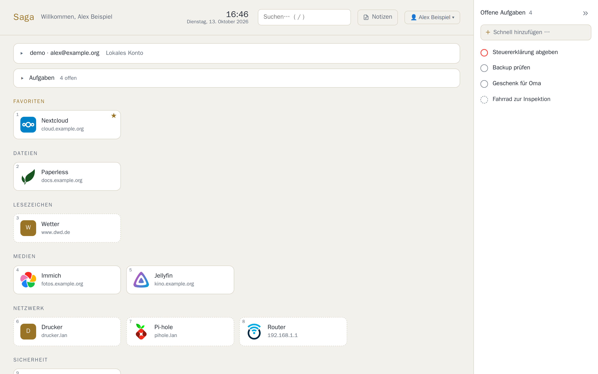

<p align="center">
  
</p>

<h1 align="center">Saga</h1>

<p align="center">
  <b>Dein selbst gehostetes Zuhause für Dienste, Notizen und Aufgaben.</b><br>
  Dashboard · Seiten &amp; Datenbanken im Notion-Stil · Aufgaben · Kalender · Lesezeichen · mehrbenutzerfähig
</p>

<p align="center">
  <a href="README.md">English</a> · <b>Deutsch</b> · <a href="README.es.md">Español</a>
</p>

<p align="center">
  <a href="https://github.com/yggdrasil-sh/saga/releases"></a>
  <a href="LICENSE"></a>
</p>

<p align="center">
  <a href="https://yggdrasil-sh.github.io/saga/">Projektseite</a> ·
  <a href="docs/ANLEITUNG.md">Anleitung</a> ·
  <a href="#schnellstart">Schnellstart</a> ·
  <a href="#funktionen">Funktionen</a> ·
  <a href="#screenshots">Screenshots</a>
</p>


## Funktionen

- **Dashboard** mit Kacheln für alle Dienste, Status-Punkten, Favoriten, Suche (optional Websuche über SearXNG)
  und Tastenkürzeln
- **Dienste per Gruppe:** Wer in der Gruppe `s_nextcloud` ist, sieht die Kachel „Nextcloud“ automatisch –
  egal ob die Gruppe lokal angelegt ist oder aus LDAP/SSO kommt
- **Eigene Lesezeichen** für jeden Benutzer, nur für ihn sichtbar
- **Seiten im Notion-Stil:** Blöcke, Unterseiten, Vorlagen, Versionen, Papierkorb, Export als Markdown
- **Datenbanken** mit Tabelle, Board, Liste, Galerie und Kalender, Filtern, Relationen und Berechnungen
- **Seiten veröffentlichen:** eine Seite (auf Wunsch mit Unterseiten) unter `/@name/seite` teilen – ohne Konto
  lesbar, ohne JavaScript, optional als Startseite für Besucher
- **Aufgaben** mit Fälligkeit, Priorität und Wiederholung
- **Kalender (CalDAV):** Nextcloud, mailcow/SOGo, Radicale, iCloud … anzeigen und bearbeiten
- **Immich:** eigene Fotos als Bilder und Titelbilder einbinden
- **Jeder Benutzer verwaltet seinen Bereich selbst:** Kalender, Immich, Lesezeichen, App-Schlüssel –
  privat, auch Admins sehen keine Inhalte
- **Konten:** lokale Benutzer, Registrierung an/aus, **LDAP/Active Directory** und **SSO/OIDC**
  (Keycloak, Authentik, Authelia, Zitadel, Entra ID …)
- **Admin-Bereich auf eigenem Port** für Benutzer, Gruppen, Dienste und Anmeldung
- **Deutsch, Englisch und Spanisch:** jeder Benutzer kann seine Sprache in den Einstellungen wählen
- **[Apps](https://github.com/yggdrasil-sh/saga-apps/blob/main/README.de.md)** (iOS/iPadOS/macOS, Linux/GTK, Android) über dieselbe
  Schnittstelle, mit dauerhafter Anmeldung und Kopplung per QR-Code

## Schnellstart

Voraussetzung: ein Server mit Docker und Docker Compose.

```sh
git clone https://github.com/yggdrasil-sh/saga.git
cd saga
cp .env.example .env
nano .env        # BASE_URL, SECRET_KEY, POSTGRES_PASSWORD eintragen (siehe Kommentare)
docker compose pull && docker compose up -d
```

**Update:** `git pull && docker compose pull && docker compose up -d` – vor Datenbank-Änderungen legt Saga
automatisch ein Backup an. Was neu ist, steht im **[Changelog](CHANGELOG.md)**. Neugierig auf das Neueste?
`SAGA_VERSION=testing` in der `.env` holt die Testversion aus dem Branch `testing`. Bilder und Dateien der Seiten
stecken nicht im Datenbank-Backup: das Volume `saga-data` sichern oder
`docker compose exec saga python run.py backup --dateien`.

- **Saga:** `http://<server>:8080` – für den Betrieb hinter einen Reverse Proxy mit HTTPS stellen (mit einer
  Grenze für Anfragen von etwa 12 MB, siehe Anleitung)
- **Admin-Bereich:** `http://127.0.0.1:8081` auf dem Server (standardmäßig nur lokal erreichbar, z. B. per
  SSH-Tunnel `ssh -L 8081:127.0.0.1:8081 server`)
- **Erstes Admin-Konto:** `admin` – Passwort aus `ADMIN_PASSWORD`, sonst steht ein erzeugtes in
  `docker compose logs saga`. Vergessen? `docker compose exec saga python run.py admin-passwort`

Alles Weitere – Reverse Proxy, Benutzer, Dienste, LDAP, SSO, Kalender, Sicherung, Updates – steht in der
**[Anleitung](docs/ANLEITUNG.md)**.

## Screenshots

| | |
|---|---|
|  |  |
| **Seiten** mit Blöcken, Checklisten, Tabellen | **Datenbanken** als Tabelle, Board, Kalender … |
|  |  |
| **Admin:** Dienste mit Zugang über Gruppen | **Admin:** SSO/OIDC mit Verbindungstest |
|  |  |
| Helles Design (folgt dem System) | Eigene Einstellungen jedes Benutzers |

## Aufbau

```
Browser / Apps ──► Saga (Python, FastAPI)  :8080  Dashboard, Seiten, API
                   Admin-Bereich           :8081  eigene Anmeldung, nur Admins
                        │
                        ├── PostgreSQL     Konten, Seiten, Aufgaben, Einstellungen
                        ├── /data          Bilder und Dateien der Seiten
                        └── optional: LDAP/AD, OIDC-Anbieter, SearXNG, CalDAV, Immich
```

## Sicherheit in Kürze

- Passwörter mit scrypt, Sperre nach wiederholten Fehlversuchen, CSRF-Schutz, strenge Content-Security-Policy
- Kalender-, Immich-, LDAP- und SSO-Zugangsdaten verschlüsselt in der Datenbank (Schlüssel: `SECRET_KEY`)
- Benutzerdaten strikt getrennt – automatisch getestet (`tests/isolation.py`)
- Interne Adressen (Heimnetz) für Kalender/Immich nur nach Freigabe durch den Admin (Schutz vor SSRF)
- Sperren eines Kontos beendet sofort alle Sitzungen und App-Anmeldungen

Sicherheitslücke gefunden? Bitte nicht als öffentliches Issue, sondern über
[Security Advisories](https://github.com/yggdrasil-sh/saga/security/advisories/new) melden.

## Entwicklung &amp; Tests

Die Tests laufen gegen einen echten Stack mit PostgreSQL, Radicale (CalDAV), einem Test-OpenLDAP und
einem OIDC-Testanbieter:

```sh
SAGA_SSH=root@dockerhost tools/test-stack.sh
```

Screenshots für diese Seite: `SAGA_SSH=… SAGA_SCRIPT=screens-remote.sh tools/test-stack.sh`.

## Lizenz

[GNU AGPL-3.0](LICENSE) – du darfst Saga frei nutzen, verändern und weitergeben; wer eine veränderte
Fassung als Dienst für andere betreibt, muss deren Quelltext ebenfalls offenlegen. Mitgelieferte Editor.js-Bausteine unter ihren eigenen Lizenzen
(`static/vendor/editorjs/licenses`). Dienst-Symbole von [selfh.st/icons](https://selfh.st/icons).
