# Saga – Guía

[English](../en/GUIDE.md) · [Deutsch](../ANLEITUNG.md) · **Español**

Esta guía te acompaña desde la instalación hasta el uso diario: primero para quien administra Saga (admin),
después para todas las personas que lo usan.

**Contenido**

1. [Requisitos](#1-requisitos)
2. [Instalación](#2-instalación)
3. [HTTPS con proxy inverso](#3-https-con-proxy-inverso)
4. [El área de administración](#4-el-área-de-administración)
5. [Usuarios y registro](#5-usuarios-y-registro)
6. [Grupos y servicios](#6-grupos-y-servicios)
7. [LDAP / Active Directory](#7-ldap--active-directory)
8. [SSO con OpenID Connect](#8-sso-con-openid-connect)
9. [Usar Saga](#9-usar-saga)
10. [Búsqueda web (opcional)](#10-búsqueda-web-opcional)
11. [Copias de seguridad, restauración y actualizaciones](#11-copias-de-seguridad-restauración-y-actualizaciones)
12. [Solución de problemas](#12-solución-de-problemas)
13. [Todos los ajustes del .env](#13-todos-los-ajustes-del-env)

---

## 1. Requisitos

- Un servidor Linux (o VM/LXC) con **Docker** y **Docker Compose** (`docker compose version`)
- Unos 512 MB de RAM y algunos GB de espacio (según las imágenes que tengan tus páginas)
- Para acceder desde fuera: un nombre de dominio y un proxy inverso con HTTPS (ver sección 3)

Saga **no** necesita ningún servicio de inicio de sesión externo: las cuentas locales funcionan desde el primer
momento. LDAP y SSO puedes añadirlos más adelante en el área de administración.

## 2. Instalación

```sh
git clone https://github.com/yggdrasil-sh/saga.git
cd saga
cp .env.example .env
```

Abre el `.env` y rellena al menos estos tres valores:

| Ajuste | Significado | Ejemplo |
|---|---|---|
| `BASE_URL` | Dirección con la que se abre Saga | `https://saga.example.org` |
| `SECRET_KEY` | Clave secreta para sesiones y credenciales cifradas | `openssl rand -hex 32` |
| `POSTGRES_PASSWORD` | Contraseña de la base de datos (solo interna) | `openssl rand -hex 24` |

> ⚠️ **Guarda bien la `SECRET_KEY` y no la cambies.** Con ella se cifran las credenciales guardadas de
> calendarios, Immich, LDAP y SSO. Con una clave nueva quedan ilegibles (y los usuarios tendrán que volver a
> introducirlas).

Opcional: `ADMIN_USERNAME` y `ADMIN_PASSWORD` (al menos 10 caracteres) para la primera cuenta de administración.

Arrancar:

```sh
docker compose pull        # imagen lista desde GitHub (ghcr.io/yggdrasil-sh/saga)
docker compose up -d
docker compose ps          # db y saga deberían estar "healthy"
```

¿Prefieres compilarla tú (por ejemplo, con cambios propios)? `docker compose up -d --build` construye la imagen
desde el código fuente.

Saga ya está disponible en `http://<servidor>:8080`.

**Primera cuenta de administración:** si no has puesto `ADMIN_PASSWORD`, Saga genera una contraseña en el
primer arranque y la escribe en el log y en el archivo `/data/admin-passwort.txt` del contenedor:

```sh
docker compose logs saga | grep Admin-Konto
```

¿Has olvidado la contraseña o te has quedado fuera? Este comando pone una contraseña aleatoria nueva,
desbloquea la cuenta y le devuelve los permisos de administración:

```sh
docker compose exec saga python run.py admin-passwort          # cuenta "admin"
docker compose exec saga python run.py admin-passwort ana      # otra cuenta
```

Si la cuenta tiene un segundo factor (llave de acceso, app de autenticación), este comando de emergencia también
lo elimina: después se inicia sesión solo con la contraseña nueva y se vuelve a configurar el segundo factor. Si la
política «Exigir 2FA» lo pide, el siguiente inicio de sesión (también en el área de administración) lleva
directamente a la configuración: nadie queda bloqueado. Más comandos de emergencia:

```sh
docker compose exec saga python run.py 2fa-zuruecksetzen ana    # quitar solo el segundo factor (la contraseña se queda, también LDAP)
docker compose exec saga python run.py 2fa-richtlinie           # mostrar la política «Exigir 2FA»
docker compose exec saga python run.py 2fa-richtlinie none      # … desactivarla (none | admins | all)
```

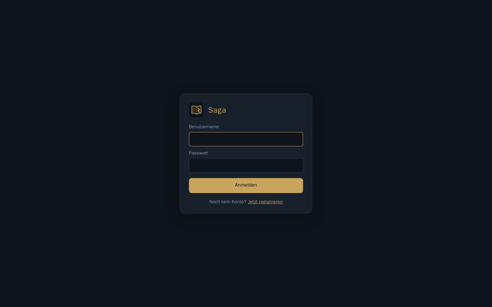

## 3. HTTPS con proxy inverso

Saga solo habla HTTP. En producción debe ir detrás de un proxy inverso con HTTPS. Importante:

- `BASE_URL` en el `.env` tiene que ser la **dirección https** con la que se abre Saga.
- `TRUSTED_PROXIES` = IP del proxy, para que Saga vea la dirección real de los visitantes (necesaria para el
  bloqueo tras intentos fallidos). Si el proxy está en el mismo servidor, basta con abrir el puerto solo en
  local (`HOST_BIND=127.0.0.1`) y poner `TRUSTED_PROXIES=*`.
- Las peticiones con otros nombres de host se redirigen a `BASE_URL` (`CANONICAL_REDIRECT=true`).

**Caddy** (obtiene el certificado automáticamente):

```
saga.example.org {
    request_body {
        max_size 12MB                      # petición más grande: subida de archivo (ATTACH_MAX_MB + 2)
    }
    reverse_proxy 127.0.0.1:8080
}
```

**nginx:**

```nginx
server {
    listen 443 ssl http2;
    server_name saga.example.org;
    # ssl_certificate ... / ssl_certificate_key ...
    client_max_body_size 12m;              # petición más grande: subida de archivo (ATTACH_MAX_MB + 2)
    location / {
        proxy_pass http://127.0.0.1:8080;
        proxy_set_header Host $host;
        proxy_set_header X-Forwarded-For $proxy_add_x_forwarded_for;
        proxy_set_header X-Forwarded-Proto $scheme;
    }
}
```

**Canal en directo (notificaciones, presencia, actualización en directo):** Saga envía las novedades por una
conexión que permanece abierta (server-sent events, `GET /api/events`), por el mismo puerto que todo lo demás, sin
WebSocket y sin puerto adicional. El proxy no debe almacenar en búfer esta respuesta ni cerrar la conexión al poco
tiempo. Saga ayuda por sí mismo: envía `X-Accel-Buffering: no` y `Cache-Control: no-cache`, y cada 25 segundos una
línea de latido para que no salten los tiempos de inactividad.

- **Caddy:** no hay que hacer nada: `reverse_proxy` pasa `text/event-stream` al instante.
- **nginx:** ya funciona con la configuración de arriba (comprobado: sin búfer, la conexión sigue abierta más allá del
  `proxy_read_timeout` predeterminado de 60 s). Se recomienda, y es necesario si delante hay otro proxy con búfer, un
  bloque propio dentro de `server { … }`:

```nginx
    location /api/events {                 # canal en directo: sin búfer, mantener abierto
        proxy_pass http://127.0.0.1:8080;
        proxy_set_header Host $host;
        proxy_set_header X-Forwarded-For $proxy_add_x_forwarded_for;
        proxy_set_header X-Forwarded-Proto $scheme;
        proxy_http_version 1.1;
        proxy_set_header Connection "";
        proxy_buffering off;
        proxy_cache off;
        proxy_read_timeout 1h;
    }
```

- **Traefik:** funciona sin ajustes. No pongas un middleware `buffering` en el router ni tiempos de inactividad por
  debajo de 30 segundos.
- **Proxy inverso de NetBird y otros:** están comprobados Caddy 2, nginx 1.27 y Traefik 3.1. Para comprobar tu proxy:
  inicia sesión con dos cuentas en dos navegadores y comparte una página de una con la otra; la campana del otro
  navegador debe mostrar un 1 al instante. En las herramientas de desarrollo (red), `/api/events` queda abierto como
  «eventsource». Si un proxy usa búfer o corta la conexión, Saga pasa por sí mismo a consultar cada 60 segundos: todo
  llega, solo que más tarde.

**Tamaño de las peticiones:** Saga rechaza por sí mismo las peticiones demasiado grandes con 413: en general por
encima de 2 MB (`REQUEST_MAX_MB`), las subidas de archivos por encima de `ATTACH_MAX_MB` (más un pequeño margen del
formulario) y el área de administración por encima de 1 MB. Aun así, conviene poner un límite en el proxy inverso
(como arriba, algo por encima de `ATTACH_MAX_MB`): así las peticiones enormes ni siquiera llegan a Saga. Si subes
`ATTACH_MAX_MB`, sube también el límite del proxy.

### Ruta de medios (saga-media)

Desde la 2.4 el contenedor incluye un pequeño servicio adicional, **saga-media** (Go, solo biblioteca estándar, código en
`media/`). Escucha en el puerto habitual 8080 y reenvía todo a Saga, con una excepción: entrega él mismo los adjuntos del
chat (`GET /api/chat/files/…`) directamente desde el disco, con rangos (Range), `sendfile` y límites de tiempo. Los bytes
de los archivos ya no pasan por Python, así que muchas descargas simultáneas no frenan el servidor. Quién puede ver qué
lo sigue decidiendo Saga: saga-media pregunta una vez por archivo y sesión y recuerda la respuesta como máximo
60 segundos. Si alguien sale de un chat o se borra un mensaje, el cambio surte efecto como muy tarde al cabo de un minuto
(un archivo borrado, al instante). Las partes de las subidas de vídeos grandes (sección 9, «Vídeos») también las escribe
saga-media directamente en el disco; Python solo registra los metadatos.

- **Nada que configurar:** ningún puerto nuevo, ningún cambio en el proxy inverso, `TRUSTED_PROXIES` funciona como antes.
  Dentro del contenedor, Saga solo escucha ahora en `127.0.0.1:8079` (`MEDIA_INTERNAL_PORT`).
- **Desactivarlo:** `SAGA_MEDIA=off` en el `.env`; Saga funciona entonces directamente en el puerto 8080, como hasta la 2.3.
- El área de administración muestra en Resumen → «Medios» cómo se entregan los adjuntos del chat.
- **Límites (normalmente no hay que cambiar nada):** como máximo `MEDIA_MAX_CONNS_IP` (por defecto 256) conexiones
  abiertas por dirección de cliente; IPv6 cuenta por red /64 y los proxies de confianza de `TRUSTED_PROXIES` quedan
  exentos. Al alcanzar el límite, saga-media cierra primero la conexión inactiva más antigua de esa dirección en lugar de
  hacer esperar a las nuevas, así nadie puede bloquear a otros con conexiones inactivas. Las conexiones sin inicio de
  sesión confirmado terminan tras `MEDIA_IDLE_UNAUTH` (10 s) de inactividad, las subidas y descargas atascadas tras
  `MEDIA_STALL_TIMEOUT` (60 s), y las cabeceras deben llegar en 15 s. Además hay topes para todas las conexiones y las
  descargas simultáneas (`MEDIA_MAX_CONNS`, `MEDIA_MAX_STREAMS`, `MEDIA_MAX_STREAMS_IP`). Importante: si hay un proxy
  inverso delante, debe figurar en `TRUSTED_PROXIES`; si no, todos los visitantes cuentan como una sola dirección. Todos
  los valores en la sección 13.

**Sin contenedor** (Saga con `python run.py`): o bien compilar saga-media y arrancarlo delante
(`cd media && CGO_ENABLED=0 go build -o saga-media .`, luego `saga-media -- python run.py` con las mismas variables de
entorno), o dejar que el proxy inverso entregue los archivos (`MEDIA_ACCEL`). Tras comprobar los permisos, Saga solo
responde con una cabecera `X-Accel-Redirect` y el proxy lee el archivo del disco. El proxy necesita permiso de lectura en
`STATE_DIR/chat` (en los ejemplos, `/var/lib/saga/chat`).

`MEDIA_ACCEL=nginx` – añadir dentro de `server { … }`:

```nginx
    location /_saga_media/ {               # adjuntos del chat: solo interno, directo del disco
        internal;
        alias /var/lib/saga/chat/;         # STATE_DIR/chat
        types { }
        default_type application/octet-stream;
        add_header X-Content-Type-Options nosniff always;
        add_header Content-Security-Policy "sandbox; default-src 'none'" always;
    }
```

`MEDIA_ACCEL=caddy` – en el bloque `reverse_proxy`:

```
saga.example.org {
    reverse_proxy 127.0.0.1:8080 {
        @accel header X-Accel-Redirect *
        handle_response @accel {
            root * /var/lib/saga/chat         # STATE_DIR/chat
            rewrite * {rp.header.X-Accel-Redirect}
            copy_response_headers {
                include Cache-Control Content-Disposition
            }
            header Content-Type application/octet-stream
            header X-Content-Type-Options nosniff
            header Content-Security-Policy "sandbox; default-src 'none'"
            file_server
        }
    }
}
```

Ambos ejemplos están probados con nginx 1.24 y Caddy 2.8 (`tests/medienpfad.py`). Sin saga-media y sin `MEDIA_ACCEL`,
Saga entrega los archivos él mismo como antes, pero como máximo `MEDIA_PY_STREAMS` (4 por defecto) a la vez; las demás
descargas esperan un momento. El área de administración lo indica.

## 4. El área de administración

El área de administración funciona en un **puerto propio (8081)** con su propio inicio de sesión. Por defecto
solo es accesible desde el propio servidor (`ADMIN_BIND=127.0.0.1`). Desde tu ordenador llegas con un túnel SSH:

```sh
ssh -L 8081:127.0.0.1:8081 usuario@servidor
# después, en el navegador: http://localhost:8081
```

Para acceder desde tu red local, puedes poner en `ADMIN_BIND` la IP LAN del servidor. **No expongas nunca el
puerto de administración a internet.**

Pueden iniciar sesión todas las cuentas con permisos de administración, locales o de LDAP, aunque las cuentas
locales estén desactivadas en la página de inicio de sesión normal.

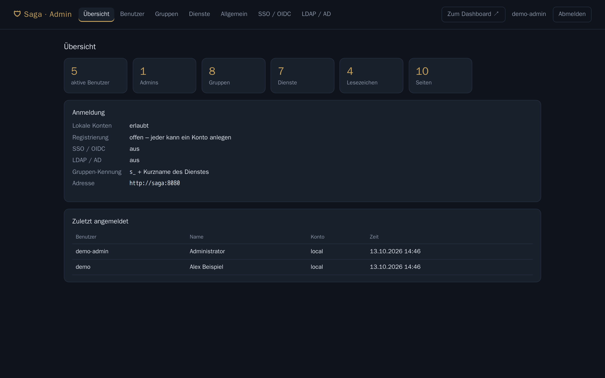

En **General** puedes ajustar:

| Ajuste | Efecto |
|---|---|
| Título | Nombre arriba en el panel y en la página de inicio de sesión |
| Permitir registro | Cualquiera que llegue a la página puede crearse una cuenta |
| Inicio de sesión con cuentas locales | Desactivado = la página de inicio de sesión solo ofrece LDAP/SSO |
| Grupos por defecto | Los recibe cada cuenta nueva (p. ej. `s_wiki` para un servicio que todos deben ver) |
| Prefijo de grupo | Prefijo de los grupos de acceso a servicios, por defecto `s_` (ver sección 6) |
| Direcciones internas | Si los usuarios pueden conectar calendarios/Immich de la red local (ver sección 9) |
| Idioma predeterminado | Idioma de la página de inicio de sesión, del área de administración y de todas las cuentas en "Automático"; por defecto: Automático (navegador) |

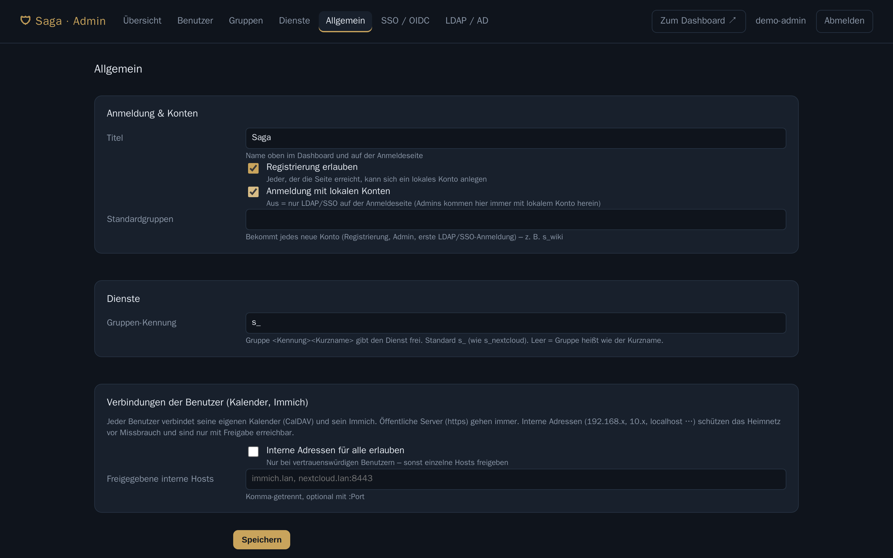

## 5. Usuarios y registro

En **Usuarios** creas cuentas, pones contraseñas y asignas grupos y permisos de administración.

- Las **cuentas locales** tienen su contraseña en Saga (al menos 10 caracteres, guardada como hash scrypt).
- Las **cuentas LDAP y SSO** se crean normalmente solas en el primer inicio de sesión. Si "crear
  automáticamente" está desactivado, créalas aquí de antemano con el tipo de cuenta LDAP o SSO.
- **Bloquear** cierra al instante todas las sesiones, los inicios de sesión de apps y las claves de app de la
  cuenta.
- **Cerrar sesión en todas partes** ayuda si se ha perdido un dispositivo.
- **Levantar bloqueo** (desde 2.4): Saga solo frena las contraseñas erróneas para la dirección de la que vienen. Solo
  tras muchísimos intentos fallidos desde muchas direcciones bloquea el inicio de sesión con contraseña de una cuenta
  durante una hora; entonces aparece «Inicio de sesión bloqueado» en el resumen, en la lista de usuarios y en la cuenta,
  y ahí levantas el bloqueo (**Establecer contraseña** también lo levanta). Detalles en la sección 12, «Demasiados
  intentos fallidos».
- **Restablecer 2FA** (tarjeta «Segundo factor»): elimina las llaves de acceso, la app de autenticación y los
  códigos de recuperación de una cuenta; solo si la persona lo ha perdido todo y estás seguro de que es ella.
  Quién lo restableció y cuándo aparece en el log y en la página del usuario.
- **Exigir 2FA** (General → «Segundo factor»): a nadie (predeterminado), solo a administradores o a todas las
  cuentas locales y LDAP. Quien esté afectado y aún no tenga segundo factor irá a la configuración tras iniciar
  sesión: nadie queda bloqueado y las apps y sesiones conectadas siguen conectadas. Esto vale también para el
  propio **área de administración**: un administrador sin factor configura una app de autenticación tras la
  contraseña (código QR y luego código) y después entra; las sesiones de administración ya abiertas se mantienen.
  Con «todas», los **nuevos inicios de sesión de apps** (ventana de inicio de sesión de la app, emparejamiento por
  QR) también necesitan un factor. Detalles en la sección 9 «Llaves de acceso e inicio de sesión en dos pasos»;
  comandos de emergencia en la sección 2.
- **Eliminar** borra la cuenta **con todos sus datos** (páginas, tareas, archivos, marcadores, conexiones).
  Mejor bloquear las cuentas externas: si no, en el siguiente inicio de sesión se crearía una cuenta nueva y vacía.

El contenido de los usuarios es privado: ni siquiera los administradores ven las páginas, solo cuántas hay.

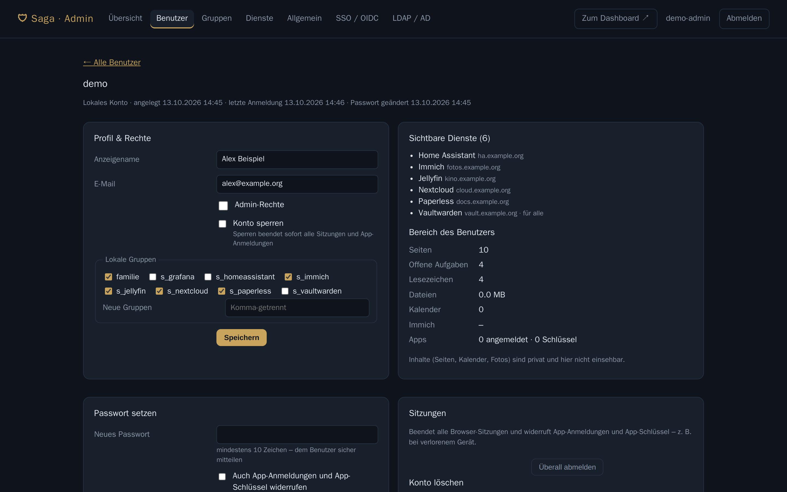

**Registro propio:** activa "Permitir registro" en General. La página de inicio de sesión mostrará entonces un
enlace para registrarse. Las cuentas nuevas reciben los grupos por defecto. Con LDAP activo, nadie puede
registrar un nombre que ya exista en el directorio.

## 6. Grupos y servicios

Los **servicios** son los mosaicos del panel (Nextcloud, Jellyfin, Home Assistant…). Quién ve cada servicio se
controla con grupos:

> Un servicio con el nombre corto **`nextcloud`** es visible para todos los miembros del grupo
> **`s_nextcloud`** (prefijo de grupo `s_` + nombre corto).

Funciona igual con **grupos locales** que con grupos de **LDAP/AD** o del **proveedor SSO**: basta con crear
allí un grupo `s_nextcloud`. Al crear un servicio, Saga crea automáticamente el grupo local correspondiente.

Además, para cada servicio puedes indicar:

- **Más grupos**, p. ej. `familia` o `admins`
- **Para todos los usuarios con sesión iniciada**
- **Icono**: el nombre de [selfh.st/icons](https://selfh.st/icons), p. ej. `jellyfin`, `home-assistant`
- **Categoría** y **orden**
- **Comprobar disponibilidad**: Saga consulta la dirección cada minuto y muestra un punto de estado

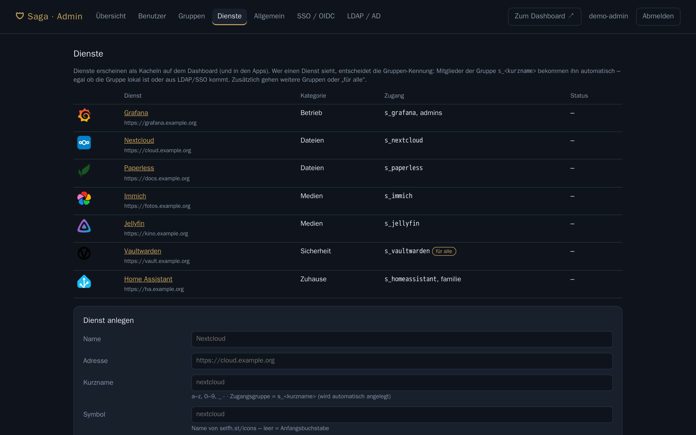

**Servicios desde LDAP (estilo FreeIPA):** en LDAP puedes activar "Tomar servicios de las descripciones de
grupo". Así, cada grupo con el prefijo cuya descripción tenga esta forma se convierte en un servicio:

```
Texto cualquiera || Nextcloud|https://cloud.example.org|nextcloud|Archivos
```

Varios servicios por grupo: añade más `|| Nombre|URL|Icono|Categoría`.

## 7. LDAP / Active Directory

Los usuarios inician sesión en la página normal con la contraseña de su directorio. Saga vuelve a leer sus
grupos en cada inicio de sesión (y cuando una app renueva su sesión).

1. Abre **LDAP / AD**, elige una **plantilla** (FreeIPA, Active Directory, OpenLDAP) y aplícala.
2. Introduce el **servidor**: `ldaps://ipa.example.org` o `ldap://dc1.example.org` con StartTLS.
3. Introduce una **cuenta de servicio** (solo lectura) y su contraseña.
4. Ajusta la **base de búsqueda** de usuarios y grupos.
5. Escribe abajo un nombre de usuario y pulsa **Probar conexión**: Saga muestra DN, nombre, correo y grupos.
6. **Activa LDAP** y guarda.

| | FreeIPA | Active Directory | OpenLDAP |
|---|---|---|---|
| Servidor | `ldaps://ipa.example.org` | `ldaps://dc1.example.org` | `ldap://ldap.example.org` + StartTLS |
| Cuenta de servicio | `uid=saga,cn=sysaccounts,cn=etc,dc=example,dc=org` | `CN=saga,OU=Servicios,DC=example,DC=org` | `cn=saga,dc=example,dc=org` |
| Base de búsqueda de usuarios | `cn=users,cn=accounts,dc=example,dc=org` | `OU=Usuarios,DC=example,DC=org` | `ou=people,dc=example,dc=org` |
| Grupos | memberOf en el usuario | AD, incluidos grupos anidados | buscar grupos |

Más opciones: solo los **miembros de este grupo** pueden iniciar sesión; los miembros del **grupo de
administración** son administradores. ¿Usas tu propia autoridad de certificación (CA)? Pon el archivo como
`.crt` en la carpeta `certs/`, junto a `docker-compose.yml`, y ejecuta `docker compose restart saga`.

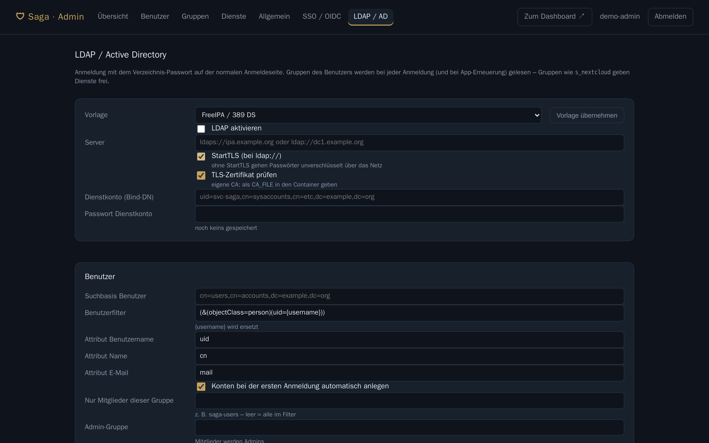

## 8. SSO con OpenID Connect

Inicio de sesión con Keycloak, Authentik, Authelia, Zitadel, Entra ID, Google y similares. En el proveedor,
crea un **cliente confidencial** (authorization code, PKCE):

- **URI de redirección:** `https://saga.example.org/auth/callback`
- **URI de redirección tras cerrar sesión:** `https://saga.example.org/login?bye=1`

En Saga, en **SSO / OIDC**, introduce:

| Campo | Ejemplo (Keycloak) |
|---|---|
| URL del emisor (issuer) | `https://sso.example.org/realms/home` |
| ID de cliente / secreto de cliente | del cliente en el proveedor |
| Claim del nombre de usuario | `preferred_username` |
| Claim de grupos | `groups` (en Keycloak, crea un mapper "Group Membership" con "Full group path" desactivado) |

**Probar conexión** comprueba el documento de descubrimiento del proveedor. Después, **activa SSO** y guarda:
en la página de inicio de sesión aparece el botón de SSO. Si las cuentas locales están desactivadas y LDAP no
está activo, la página de inicio de sesión lleva directamente al proveedor.

Los grupos como `s_nextcloud` del proveedor SSO dan acceso a servicios igual que los grupos locales.

**Proveedor SSO con un directorio detrás** (p. ej. Keycloak conectado a FreeIPA o AD): en lugar de configurar
un claim de grupos, Saga puede leer los grupos directamente del directorio. Para ello, introduce el directorio
en **LDAP / AD** y activa **"Leer los grupos de las cuentas SSO desde el directorio"**. Si la página de inicio
de sesión solo debe ofrecer SSO, desactiva "Inicio de sesión con la contraseña del directorio". Las cuentas
bloqueadas en el directorio pierden entonces también al instante el acceso a Saga (en FreeIPA, mediante la
plantilla). **Miembros de este grupo** y **grupo de administración** funcionan igual que con LDAP.

> **Seguridad:** un inicio de sesión SSO o LDAP nunca se apropia de una cuenta existente de otro origen con el
> mismo nombre. Si el registro está abierto, alguien podría ocupar un nombre de antemano: con SSO, deja el
> registro desactivado o crea las cuentas por adelantado.

**Identificador SSO fijo:** en el primer inicio de sesión SSO, Saga guarda el identificador del proveedor
(`sub`). Si más tarde alguien inicia sesión con el mismo nombre de usuario pero otro identificador, se rechaza
("vinculada a otra identidad SSO"). **¿Has cambiado de proveedor** (todos los identificadores son nuevos)? En el
área de administración, abre Usuarios → la cuenta → **"Eliminar vínculo SSO"**: el próximo inicio de sesión SSO
con ese nombre de usuario vuelve a vincular la cuenta y se conservan todos los datos. Hazlo solo si estás seguro
de que en el proveedor es la misma persona quien tiene ese nombre.

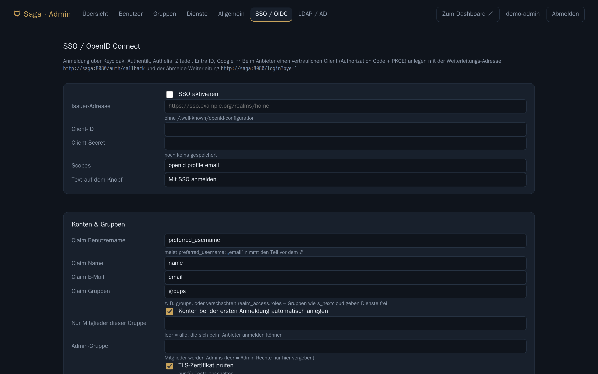

## 9. Usar Saga

### Panel

Mosaicos para tus servicios y marcadores, ordenados por categorías. **★** marca un mosaico como favorito.
A la derecha están tus tareas pendientes y los eventos de hoy y mañana. La búsqueda encuentra servicios,
marcadores y, debajo, también tus **páginas** (título y contenido).

| Tecla | Acción |
|---|---|
| `/` | Buscar |
| `1`–`9` | Abrir mosaico |
| `Enter` | Primer resultado (si no, búsqueda web) |
| `t` | Nueva tarea |
| `n` | Páginas |

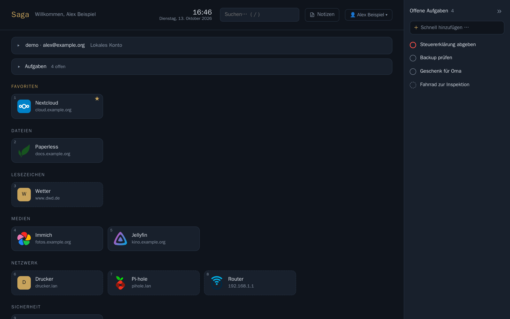

### Marcadores

**+ Marcador** abajo en el panel, o en el menú de usuario, en Ajustes. Tus marcadores solo los ves tú, también
en las apps; el administrador solo ve cuántos hay. Basta con la dirección: sin nombre, el mosaico se llama como
el host (p. ej. `wiki.example.org`). Icono: un nombre de [selfh.st/icons](https://selfh.st/icons). Sin icono,
Saga busca uno por sí mismo: primero uno de selfh.st según el nombre de dominio (`youtube.com` → `youtube`,
`jellyfin.example.org` → `jellyfin`) y, si no, el favicon del sitio; solo si no hay ninguno aparece la inicial.
Se editan con **✎** en el mosaico.

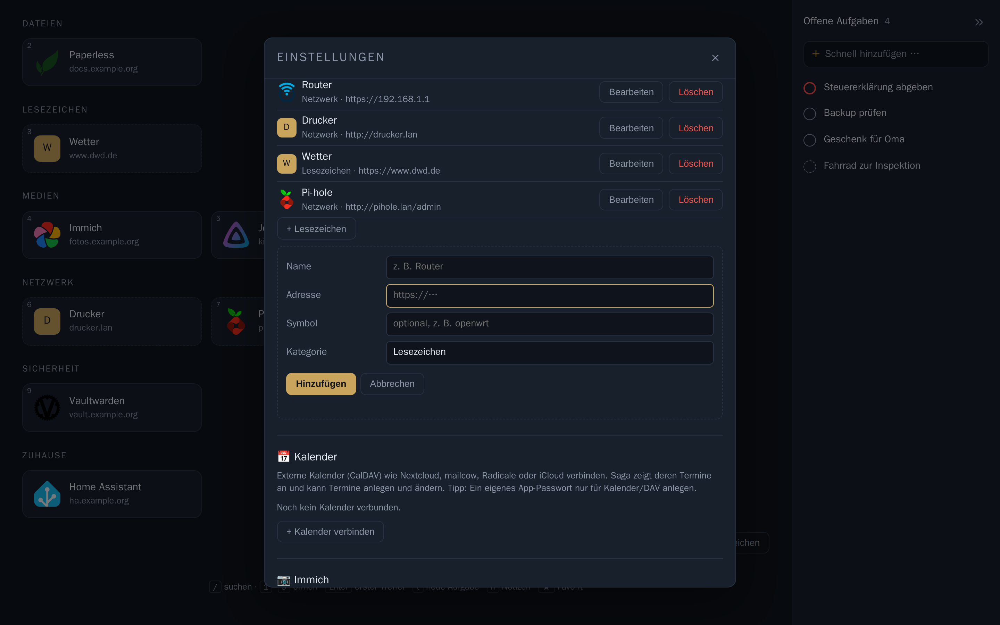

### Tareas

- **Crear:** escribe en **Añadir rápido …** en la barra de la derecha y pulsa `Enter` (la tecla `t` salta allí).
  Si la barra está contraída (**»**) o la ventana es estrecha, las tareas aparecen en el recuadro **Tareas** del
  área principal, nunca en los dos sitios a la vez. Ahí puedes fijar al crearlas la **prioridad**, la
  **repetición** (diariamente, días laborables…) y la **fecha de vencimiento** (iconos en el campo de entrada).
  **Todas las tareas …**, abajo en la barra, abre ese recuadro.
- **Fecha:** con el icono de calendario al crearla o más tarde con **⋯** en la tarea → **Elegir fecha …**. Las
  que vencen hoy muestran «hoy»; las atrasadas aparecen en rojo.
- **Completar:** haz clic en el círculo delante de la tarea. Abajo aparece **«Tarea completada · Deshacer»**;
  durante unos 8 segundos **Deshacer** la recupera. En las tareas repetidas se muestra la próxima fecha, y Deshacer
  también quita la siguiente tarea ya creada.
- **Completadas:** **Mostrar completadas** debajo de la lista. Un clic en la marca vuelve a abrir una tarea,
  **×** la elimina.

Las mismas tareas están en las apps y, como bloque `/Tareas`, también en las páginas.

### Páginas y bases de datos

En **Páginas** está tu árbol de páginas. Escribe `/` para añadir bloques: títulos, listas, listas de
verificación, tablas, código, imágenes, archivos, columnas, enlaces a otras páginas, eventos y más. Si sigues
escribiendo, el menú se filtra; `Enter` elige el primer resultado y `Esc` lo cierra y quita la «/». `Ctrl`+`K`
(Mac: `⌘`+`K`) busca en títulos y contenido. Las páginas tienen versiones y papelera (30 días) y se pueden
exportar como Markdown.
**Copiar imágenes:** un clic en una imagen la selecciona; `Ctrl`+`C`/`X` (Mac: `⌘`) la copia o la corta y `Ctrl`+`V` la
pega en esta u otra página (también en otra pestaña), con su pie de foto. En una página de otra cuenta, su propietario
recibe su propia copia del archivo. Otras aplicaciones reciben la imagen como PNG cuando el navegador lo permite.

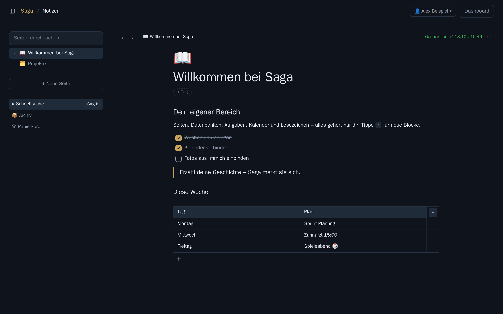

Las **bases de datos** reúnen entradas con propiedades (estado, fecha, número, selección, relación, fórmula…)
y las muestran como tabla, tablero, lista, galería o calendario, con filtros, orden y totales. En una tabla,
`Enter` en el nombre pasa a la fila siguiente; en la última crea directamente la próxima entrada.

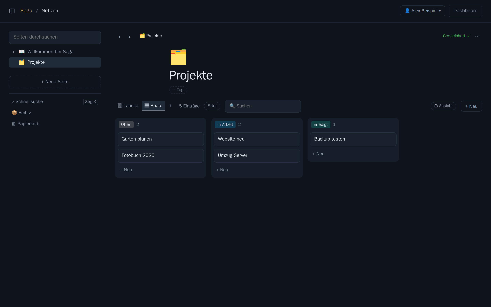

**Archivos de Nextcloud en las páginas:** en Ajustes → **Nextcloud** vinculas tu **propio** Nextcloud (escribe la
dirección, entra en Nextcloud en la pestaña nueva y permite el acceso: Saga recibe una contraseña de aplicación propia
y nunca ve tu contraseña). Después, el menú «/» ofrece **«Archivo de Nextcloud»**: archivos modificados recientemente,
navegar por carpetas o buscar por nombre. Un enlace de Nextcloud de tu propia instancia pegado en una página
(`…/f/123`, `…/apps/files/?fileid=123`) se convierte automáticamente en bloque. Dos formas:

- **Insertar como enlace:** el archivo se queda en Nextcloud. Las imágenes aparecen a lo ancho de la página y los demás
  archivos como tarjeta con vista previa (si Nextcloud la ofrece), «Descargar» y «Abrir en Nextcloud»; las carpetas
  muestran sus primeras entradas. **Quien ve la página ve también el archivo**: la vista previa y la descarga pasan por
  Saga con tu cuenta, también para personas sin Nextcloud propio. Si desconectas, pierdes el permiso de edición de la
  página o el archivo desaparece de Nextcloud, el bloque solo muestra una tarjeta sin contenido.
- **Copiar a Saga:** el archivo se convierte en un archivo normal de Saga (bloque de imagen o de archivo) y sigue
  entonces los permisos de Saga, también sin conexión, en la copia de seguridad y en la exportación.

Quien puede editar una página de otra cuenta solo puede insertar archivos de su **propio** Nextcloud; los bloques de
otras personas no cambian y no se pueden copiar a otras páginas. Solo quien insertó un bloque ve debajo dos
interruptores (desactivados por defecto): **«Mostrar en la página publicada»** (los visitantes ven la vista previa y la
descarga a través de la dirección de la página, nunca la dirección de Nextcloud) y **«Mostrar a través de servidores
conectados»** (personas de otras instancias de Saga con las que se comparte la página). La exportación contiene un
enlace en lugar del archivo y la búsqueda encuentra el nombre del archivo. Sin autorización en el área de
administración solo funcionan direcciones https públicas; el administrador autoriza servidores de la red local en
General → «Conexiones de los usuarios», donde también puede desactivar la función por completo. Saga guarda en caché las
miniaturas (`/data/nc-cache`, fuera de la copia de seguridad, límite `NC_CACHE_MB`).

### Publicar páginas

Cualquier página puede hacerse **pública**: se lee sin iniciar sesión, con un diseño sencillo, claro u oscuro según
el dispositivo y cómoda de leer en el móvil. En el menú de la página (**⋯** a la derecha, encima de la página, junto
a «Guardado») elige **«Publicar …»** y activa el interruptor **«Pública»** en el diálogo: desde ese momento la página
está disponible en su dirección. De arriba abajo, el diálogo muestra: el interruptor, el enlace (con Copiar y Abrir;
en el móvil también Compartir), la dirección, las opciones y «Dejar de publicar». Mientras la página es privada, la
dirección futura aparece atenuada y todavía sin enlace, y las opciones están agrupadas bajo «Se aplica cuando la
página sea pública». En una página pública, los cambios en las opciones se aplican al instante; solo una dirección
nueva se aplica expresamente con «Cambiar dirección». Los errores (p. ej., una dirección ya usada) aparecen justo
debajo del campo.

- **Nombre público:** La primera vez eliges un nombre público (sugerido a partir de tu nombre visible, 2–32
  caracteres `a–z 0–9 - _`). Aparece en todas las direcciones y es visible para todos; **nunca** es tu nombre de
  usuario (desde la 2.4 tu nombre de inicio de sesión ya no se puede elegir como nombre público; quien lo eligió así
  antes, lo conserva y ve un aviso en los ajustes). Se cambia en Ajustes → Cuenta, en su propio bloque «Nombre público» (con su propio botón «Guardar nombre»; Saga
  comprueba mientras escribes si el nombre es válido y está libre, y muestra «Nueva dirección: … (antes …)»);
  después, los enlaces antiguos dejan de funcionar.
  Nombres como `admin`, `api` o `login` están reservados.
- **Dirección:** `https://saga.example.org/@nombre/direccion-de-la-pagina`. La dirección se sugiere a partir del
  título y se puede cambiar (2–60 caracteres): en cuanto lo que escribes difiere de la dirección guardada, aparece
  el botón **«Cambiar dirección»**; tras confirmar, porque el enlace actual deja de funcionar. Saga redirige las mayúsculas o una «/» final a la dirección correcta.
- **Publicar también las subpáginas:** Todas las subpáginas (y las entradas de bases de datos) bajo esta página
  también serán legibles, en `/@nombre/direccion-de-la-pagina/<número>`. Sin esta opción siguen siendo privadas. Esas subpáginas muestran
  «🌐 Pública (a través de «página superior»)» en la cabecera; su diálogo lo explica y lleva a la página superior.
- **Permitir buscadores:** Desactivado por defecto: la página pide entonces a los buscadores que no la indexen.
- **Como página de perfil:** Esta página aparece en `/@nombre` (como máximo una por cuenta). Sin página de perfil,
  `/@nombre` muestra una lista sencilla de tus páginas públicas. Si otra página ya es tu página de perfil, el
  diálogo la nombra: la nueva la sustituye. Si la página es tu página de perfil, el diálogo muestra además, debajo
  del enlace, la **dirección del perfil** `…/@nombre` para copiarla.
- **Copiar enlace / Abrir** (en el móvil también **Compartir**) y **Dejar de publicar** (con confirmación). Las páginas publicadas muestran «🌐 Pública» en la cabecera;
  un clic abre el diálogo y «↗», a su lado, la página pública.
- **Al dejar de publicar se guarda todo:** la dirección y los ajustes se conservan (la dirección queda reservada para
  esta página). Si vuelves a publicarla, usa la misma dirección que antes.

**Qué se publica y qué no:** título, icono, portada y contenido (texto, encabezados, listas, listas de comprobación,
citas, código, imágenes, tablas, columnas, avisos, desplegables). Las bases de datos aparecen como una tabla sencilla
(título y propiedades visibles de la vista). Las inserciones se convierten en enlaces. **No** se publican los bloques
de tareas, calendario e Immich, los botones ni los archivos adjuntos. Los enlaces a otras páginas solo siguen siendo
enlaces si la página de destino también es pública; si no, queda solo el texto. Saga solo entrega imágenes que se
usan exactamente en esta página.

**Cómo ven la página los visitantes:** Debajo del título aparece «@nombre · actualizado el 14/10/2026», y arriba a la
izquierda tu `@nombre` (en la página de inicio para visitantes, el nombre de la instancia). La barra, la fecha y los
mensajes aparecen en el idioma del visitante; el contenido se marca con el idioma de tu cuenta (importante para
lectores de pantalla y la división de palabras). El texto tiene un ancho de lectura cómodo; las imágenes y tablas
pueden ser más anchas. Una dirección que no existe ofrece un siguiente paso: «Ir a la página de inicio» (si el admin
eligió una) o «Iniciar sesión».

**Papelera y archivo:** Las páginas archivadas o en la papelera no son accesibles («No encontrado»). La publicación
se conserva: si recuperas la página, vuelve a ser pública en la misma dirección. Solo desaparece al eliminar la
página definitivamente (o al eliminar la cuenta).

**Para el administrador** (área de administración → General → «Publicar»):

- **Permitir publicar** (activado por defecto). Desactivado = todas las direcciones públicas devuelven «No
  encontrado» al instante; los ajustes de las páginas se conservan.
- **Página de inicio para visitantes:** una página ya publicada que ven en `/` los visitantes sin cuenta (arriba a
  la derecha, «Iniciar sesión»). Los usuarios con sesión iniciada siguen viendo su panel.
- **Publicadas** (pestaña propia): todas las páginas públicas con cuenta, nombre y fecha; **Retirar** termina una
  publicación al instante (tras confirmar). La persona ve en el diálogo «Retirada por el administrador el …»; la
  dirección y los ajustes se conservan.

Cualquier error (nombre desconocido, página privada, publicación desactivada) devuelve la misma página neutral
«No encontrado». Las páginas públicas funcionan sin JavaScript y sin cookies; cada dirección IP puede hacer 120
solicitudes por minuto (`PUBLIC_RATE`). Si Saga funciona detrás de un proxy inverso, añádelo a `TRUSTED_PROXIES`
(sección 3); de lo contrario, todos los visitantes comparten un único límite.

**Dominio propio:** Para mostrar las páginas públicas en, por ejemplo, `blog.example.org`, haz que el DNS del dominio
apunte a tu servidor, redirígelo a Saga en el proxy inverso (como en la sección 3) y añádelo al `.env`:
`PUBLIC_HOSTS=blog.example.org` (después, `docker compose up -d`). `BASE_URL` sigue siendo tu dirección principal.
En el dominio propio Saga solo entrega la página de inicio para visitantes (`/`; elige una en el área de
administración), las direcciones `/@…` y los archivos necesarios; el inicio de sesión y todo lo demás redirige a
`BASE_URL`. Abiertas a través de ese dominio, las páginas lo indican también como dirección principal (`canonical`).
Ejemplo para Caddy:

```
blog.example.org {
    reverse_proxy 127.0.0.1:8080
}
```

### Compartir y comentar

Las páginas y bases de datos se pueden compartir con **otras cuentas** y **grupos** de la misma instancia de Saga.
Usa el botón **«Compartir»** arriba a la derecha de tu propia página (o el menú de la página **⋯** → «Compartir …»):
busca una persona o un grupo (a partir de 3 caracteres; nunca una lista de todas las cuentas), elige un rol y pulsa el
resultado. Verás el nombre visible y debajo el nombre público o un **handle** (`~` y 16 caracteres), para distinguir a
personas con el mismo nombre. Desde la 2.4 Saga no muestra en ningún sitio el **nombre de inicio de sesión** de otras
cuentas: ni en la búsqueda, ni en usos compartidos, «Compartido conmigo», comentarios, notificaciones, presencia,
versiones o listas de miembros de chats. Las personas se encuentran por nombre visible, nombre público, el handle exacto
y, mientras el administrador lo permita, por el nombre de inicio de sesión escrito exactamente (ver abajo). El diálogo solo ofrece grupos a los que perteneces,
tanto locales como de LDAP o SSO; con el campo de búsqueda vacío aparecen como chips («Tus grupos:»), y una línea bajo
el campo explica qué puede hacer el rol elegido. En la lista de abajo cambias el rol o quitas el acceso (con
confirmación; el acceso termina al instante). La lista muestra el rol real: si alguien tiene más permisos a través de
un grupo, se indica («Comentar (a través de team: Editar)»), y la confirmación al quitarlo nombra el acceso
que se mantiene. Los usos compartidos de páginas superiores aparecen en una sección propia, de solo lectura, con
enlace a la página superior. Abajo puedes copiar el enlace de la página: la abre para todas las personas con acceso.

| Rol | puede |
|---|---|
| **Ver** | leer la página, las subpáginas y las entradas de bases de datos, exportar, leer comentarios |
| **Comentar** | además comentar, responder y resolver conversaciones |
| **Editar** | además cambiar título, contenido, icono, portada, etiquetas y propiedades, crear subpáginas y entradas, subir imágenes |

- **Las subpáginas se incluyen:** un uso compartido vale también para todas las subpáginas y para las entradas de las
  bases de datos que hay debajo. Cuenta el rol más alto (persona o grupo, esta página o una superior). Las páginas
  archivadas, las de la papelera y las plantillas solo las ve el propietario.
- **Solo el propietario puede:** eliminar, archivar, mover libremente, bloquear, marcar como plantilla, publicar y
  gestionar el acceso. Desde 2.3, quien tiene «Editar» puede ver y restaurar versiones (el estado anterior se guarda como
  versión) y mover páginas **dentro del área compartida**, solo a lugares con exactamente los mismos permisos («⋯» →
  «Mover a»). Lo que otros crean o suben pertenece al propietario de la página; las versiones se
  guardan con él. Así, las personas con «Editar» usan el **espacio del propietario**: sus imágenes y archivos cuentan
  en él.
- **Compartir y publicar:** si una página es pública con «Publicar también las subpáginas» y además está compartida
  con «Editar», las subpáginas e imágenes que creen esas personas se publican de inmediato; el diálogo de publicación
  lo indica.
- **Compartido conmigo:** en la barra lateral, la sección «Compartido conmigo» muestra las páginas que otros han
  compartido contigo (con el nombre del propietario). Tus propias páginas compartidas llevan un símbolo de personas en el árbol. Los
  comentarios nuevos de otras personas se ven como un punto en la página del árbol, como número en «Compartido
  conmigo» y como «💬 n» en el botón «Páginas» de la página de inicio. Si compartir está desactivado en la
  administración, aparece un aviso.
- **Quién cambió qué:** bajo el título ves «Último cambio de Nombre · hace 5 min» (si no fuiste tú) y, en las páginas
  que creó otra persona, «Creada por Nombre». El historial de versiones indica el autor de cada versión guardada.
- **Las páginas de otros** muestran «Compartido por Nombre · Puedes ver/comentar/editar» bajo el título (y debajo, quién
  hizo el último cambio). Si el propietario cambia tu rol, la página lo muestra al guardar o al volver a la pestaña. Con «Ver» o «Comentar» el editor
  es de solo lectura; las bases de datos muestran «Solo lectura» (ordenar y filtrar funciona, pero no se guarda). Los
  bloques de tareas, calendario e Immich solo muestran «Solo visible para el propietario», nunca los datos del
  propietario ni los tuyos. Los enlaces a páginas que no se han compartido contigo aparecen como «Página sin acceso».
- **Editar a la vez:** si dos personas guardan casi al mismo tiempo, aparece el aviso de conflicto de siempre, con
  nombre: «Bert acaba de cambiar esta página». **«Cargar la nueva versión»** carga la versión de Bert y muestra tu
  texto sin guardar para copiarlo. **«Conservar mi versión»** pregunta antes; la versión de Bert queda entonces en el
  historial de versiones del propietario: nada se pierde sin dejar rastro.
- **El acceso termina mientras escribes:** si el propietario quita tu acceso (o lo baja a «Ver», o la
  administración desactiva compartir), un diálogo muestra tu último texto para copiarlo. Los enlaces antiguos a
  páginas sin acceso muestran «Sin acceso a esta página» con «Reintentar» e «Ir a «Compartido conmigo»».

**Los comentarios** van unidos a un bloque y son discretos: en el margen solo aparece un número pequeño (💬 2), y
solo mientras haya conversaciones abiertas. Se comenta desde el menú del bloque (**⋮⋮** a la izquierda del bloque →
«Comentar», o Ctrl/⌘ + / → «Comentar»); al pasar sobre un bloque aparece además un pequeño botón 💬+ (en pantallas táctiles con páginas de solo lectura, tras tocar el bloque). La
conversación se abre en una barra lateral a la derecha (en el móvil, desde abajo). Allí respondes, editas o eliminas
tus comentarios (el propietario de la página puede eliminar todos) y cierras una conversación con **«✓ Resolver»** (queda como «Resuelto»):
se contrae y desaparece; el interruptor **«Mostrar resueltos»** la recupera y «Reabrir» la vuelve a activar. «💬 3» en
la cabecera de la página abre todas las conversaciones; un punto pequeño marca lo no leído. Editar y eliminar un
comentario están en su menú ⋯; el propietario encuentra también todas las conversaciones en el menú de la página **⋯**
→ «Comentarios» (con el número de resueltas). Los comentarios son texto
plano (como máximo 2000 caracteres, se permiten saltos de línea; los enlaces se reconocen), como máximo 30 comentarios
por minuto. También puedes comentar en tus páginas no compartidas, como nota para ti. Si se elimina un bloque, su
conversación queda en la lista como «Bloque eliminado». Si eliminas el primer comentario de una conversación en la
que otros han respondido, las respuestas se mantienen y tu comentario aparece como «Comentario eliminado»; el
propietario de la página puede eliminar toda la conversación (tras confirmarlo).

**Para el administrador** (área de administración → General → «Compartir»): **Permitir compartir** (activado por
defecto; desactivado = todos los usos compartidos dejan de funcionar al instante, pero se conservan) y **Solo dentro
de grupos en común** (desactivado por defecto; búsqueda de personas y compartir solo con cuentas que tienen un grupo
en común contigo; solo afecta a los nuevos usos compartidos: los existentes se mantienen si lo activas más tarde).
**Buscar por nombre de inicio de sesión** (activado por defecto): la búsqueda de personas, compartir y los chats
también encuentran una cuenta por su nombre de inicio de sesión escrito exactamente, nunca por partes. Desactivado:
solo por nombre visible, nombre público o handle; así nadie puede probar qué nombres existen, pero las cuentas
sin nombre visible propio solo se encuentran por su nombre público. Compartir e iniciar un chat solo aceptan entonces un
nombre de inicio de sesión para personas con las que ya chateas o con las que ya compartes. Límite: quien puede chatear
con una cuenta conoce técnicamente su nombre de inicio de sesión al crear un chat directo (las claves del chat dependen
de él), aunque la interfaz no lo muestre; solo se puede restringir con «Solo dentro de grupos en común».
Saga toma los grupos de LDAP o SSO al iniciar sesión: si allí cambia la pertenencia, los usos compartidos con grupos
lo reflejan a partir del siguiente inicio de sesión de la cuenta. El detalle del usuario solo muestra el número de
usos compartidos, nunca contenidos. Al eliminar
una cuenta desaparecen sus usos compartidos y los que se le dieron; sus comentarios en páginas de otros quedan como
«Cuenta eliminada». Al eliminar un grupo terminan los usos compartidos con él.

### Compartir con otras instancias de Saga (federación)

Se pueden conectar varios servidores Saga (por ejemplo, el tuyo y el de una asociación). Después, una página también
se puede compartir con **nombre@servidor**: una persona de allí (con su nombre público, ver «Publicar páginas») o un
grupo de allí (**grupo@servidor**). El contenido siempre se queda en el servidor del propietario: la otra persona lee,
comenta y edita a través de su propio servidor Saga, que consulta al servidor del propietario en segundo plano. El rol
lo decide siempre el servidor del propietario; retirar el acceso surte efecto al instante. Todo pasa por el puerto
HTTPS normal; no hay ningún servicio adicional.

**Conectar (administradores de ambos servidores):**
1. Área de administración → **Federación** → «Activar la federación» (por defecto: desactivada). Ahí aparecen tu
   dirección y tu **huella** (forma corta de la clave pública de este servidor).
2. Servidor A: **«Crear código de invitación»**: da la dirección y el código al administrador del servidor B (el código
   vale 24 horas y una sola vez).
3. Servidor B: en «Conectar con una instancia», escribe la dirección y el código → Saga muestra la huella de A. Si
   coincide con la que te dio A (mejor compararla por una segunda vía) → «La huella coincide: conectar».
4. Servidor A: la solicitud aparece en «Instancias conectadas» con la huella de B → **Confirmar**. Ya están
   conectados. Si B no estaba disponible en ese momento, usa allí «Comprobar estado».

**Desconectar** (cualquiera de las dos partes, en cualquier momento) surte efecto al instante: terminan todos los usos
compartidos con personas y grupos del otro servidor y desaparecen las páginas de allí. El **registro de auditoría**
muestra conexiones, usos compartidos entre servidores y solicitudes rechazadas, nunca contenido. Saga solo accede a
direcciones internas (192.168.x, 10.x …) si figuran en General → «Hosts internos permitidos»; los otros servidores
solo se conectan por https.

**Compartir:** en el diálogo de compartir, escribe `nombre@servidor` (o `@nombre@servidor`): Saga pregunta al servidor
conectado si existe la persona o el grupo y lo muestra con su origen («Bert (bert@asociacion.example)»). Con servidores
2.3 también encuentras a las personas de allí por su nombre visible (libreta de direcciones); así se puede compartir
también con personas sin nombre público (mediante un identificador aleatorio y fijo, nunca el nombre de inicio de
sesión). Con servidores más antiguos necesitas un nombre público (Ajustes → Cuenta). Las personas de otros servidores
aparecen siempre con `@servidor` en «Compartido conmigo», en los comentarios y en las notificaciones, para que nadie se
confunda con una cuenta de aquí del mismo nombre. Si está activado «Compartir solo dentro de grupos comunes», no se
puede compartir con otros servidores, salvo con aquellos para los que el administrador haya activado la excepción (ver
más abajo).

**Recibir:** las páginas de otros servidores aparecen en **«Compartido conmigo»** (con `nombre@servidor`), se abren en
el editor normal y, según el rol, se pueden leer, comentar y editar (título y contenido; si se edita a la vez aparece
el aviso de conflicto de siempre). Las imágenes llegan a través de tu propio servidor. Con servidores anteriores a la
2.3 necesitas para ello un nombre público. Las notificaciones («ha compartido una página contigo», «ha respondido»)
también funcionan entre servidores, sin el texto del comentario.

**Protocolo 2 y funciones por servidor (2.3):** los servidores conectados con Saga 2.3 acuerdan al conectarse (y luego
cada 6 horas) lo que pueden hacer ambos; los servidores 2.1 siguen conectados como hasta ahora (compartir, comentarios,
notificaciones). En **Administración → Federación → «Funciones por instancia»** aparecen, para cada servidor conectado,
el protocolo, las capacidades comunes y los interruptores:
- **Chat** (chats directos entre servidores, ver más abajo) y **llamadas**: activados por defecto.
- **Compartir la libreta de direcciones con esta instancia**: activado por defecto. Las personas de allí encuentran
  entonces a las de aquí por su nombre visible (búsqueda del chat y de compartir, «Anna Berg · b.example»). Solo se
  transmiten el nombre visible, la foto de perfil y un identificador aleatorio y fijo (`~…@servidor`), nunca nombres de
  inicio de sesión, direcciones de correo ni grupos. Opcionalmente solo personas de ciertos grupos. Nunca aparecen las
  cuentas sin nombre visible, las desactivadas ni quien desactive «Aparecer en las libretas de direcciones de servidores
  conectados» en Ajustes → Cuenta. Al desactivarlo o desconectar, la libreta se borra al instante en ambos lados.
- **Excepción de «Compartir solo dentro de grupos comunes»**: desactivada por defecto. Si esa restricción (General) está
  activada, se bloquean los usos compartidos, la libreta y los chats con otros servidores; con la excepción se permiten
  para este servidor.
Los eventos entre servidores salen de inmediato («express», como máximo 5 s de espera, `FED_EXPRESS_TIMEOUT`); si el
otro servidor no está disponible, el evento espera en la bandeja de salida y se entrega después en el orden correcto
(hasta 3 días). Para scripts, el área de administración ofrece `GET /api/federation` y
`PUT /api/federation/peers/{id}` (`{"chat": false, …}`, sesión de administración y cabecera `X-CSRF-Token`).

**Chats y llamadas entre servidores (2.3, ambos servidores 2.3):** en los chats, en **«+ Nueva»**, escribe el nombre:
las personas de servidores conectados aparecen con su origen («Bert Invitado · asociacion.example»). Un clic inicia el
chat directo; a la otra persona le aparece como **solicitud de mensaje** arriba en la lista, sin notificación, push ni
timbre hasta que la **acepta**. También puede **rechazarla** o **bloquear** (a la persona o al servidor entero); la otra
parte no se entera. Las personas bloqueadas aparecen en «Chats y dispositivos», donde se pueden desbloquear. Los
mensajes siguen cifrados de extremo a extremo; los servidores solo ven datos cifrados.
- El servidor de quien inicia el chat es su **hogar**: decide el orden y reparte los mensajes, los borrados, «Eliminar
  automáticamente tras …» y el interruptor de la IA. Si no está disponible un momento, el mensaje espera en tu propio
  servidor («⏳ entregando») y sale después en el orden correcto (hasta 3 días; si no, «⚠ no entregado» con «Enviar de
  nuevo»).
- Los **adjuntos** se quedan en el servidor de quien los envía; la otra parte los obtiene al abrirlos (las miniaturas,
  enseguida).
- El **número de seguridad** y «Marcar como verificado» funcionan como en los chats locales. Si cambia la clave de la
  otra persona, aparece un aviso hasta que lo confirmes; si estaba marcada como «verificada», no se puede enviar hasta
  que vuelvas a comparar el número.
- La **IA en el chat** está desactivada en estos chats hasta que alguien la active; todos lo ven como aviso en el chat.
- Las **llamadas** funcionan desde chats directos aceptados como siempre; cada lado usa su propio servidor TURN.
- **Desconectar** los servidores deja estos chats en solo lectura (el historial sigue legible) y termina las llamadas
  en curso; si se elimina una cuenta, sus chats directos desaparecen también en el otro servidor.
- Las apps antiguas solo muestran estos chats con el aviso «actualiza la app».

**Páginas de otros servidores, completas (2.3, ambos servidores 2.3):** las páginas compartidas de otros servidores se
pueden usar como las propias, según el rol, que siempre comprueba el servidor de la página:
- Abrir, filtrar, ordenar, agrupar y paginar **bases de datos** (también grandes); con «Editar», cambiar valores,
  columnas y vistas y **crear entradas**. Funcionan las relaciones con otras bases de datos compartidas del mismo
  servidor; los enlaces a páginas que no se han compartido contigo desaparecen.
- **Crear subpáginas** y **moverlas** dentro del área compartida (mismos usos compartidos, ver «Roles» más abajo).
- **Subir imágenes y archivos** (editor, icono, portada): se guardan en el servidor de la página y cuentan para el
  propietario. Además, cada persona de otro servidor tiene allí su propio límite (`FED_UPLOAD_QUOTA_MB`, 200 MB por
  defecto). Justo después de subirlo solo lo ve quien lo sube; tras guardar, todos los que tienen acceso.
- **Historial de versiones** (con «Editar») y **exportación** (Markdown, con subpáginas como ZIP).
- **«Quién está aquí» y actualización en directo:** mientras la página está abierta, tu servidor mantiene una
  suscripción corta con el servidor de la página (caduca a los 90 segundos sin renovarse, `FED_WATCH_TTL`). Por ella
  llegan cambios, presencia y contadores de comentarios, nunca contenido. Las subpáginas nuevas o movidas en áreas
  compartidas actualizan solas «Compartido conmigo».
- No entre servidores: eliminar, archivar, publicar, gestionar usos compartidos, enlaces entrantes, IA en la página.
Con servidores 2.1 se sigue pudiendo leer, comentar y editar título y contenido; las funciones nuevas indican entonces
«El servidor … todavía no puede hacer esto». **Roles (también en local):** quien puede «Editar» ahora también ve las
versiones y las restaura (las páginas bloqueadas, solo el propietario) y mueve páginas dentro de un área compartida,
solo a lugares con exactamente los mismos usos compartidos. Quien cambia su nombre público o elimina su cuenta pierde
los usos compartidos de otros servidores (se eliminan allí); el nombre antiguo queda bloqueado para otras cuentas.

**Grupos y chats de página entre servidores (2.3, todos los servidores implicados 2.3):**
- **Grupo libre:** en «+ Nueva» → «+ Grupo con varias personas…» también se pueden elegir personas de servidores
  conectados. Tu servidor se convierte en el **hogar** del grupo; a los demás les aparece como **solicitud de mensaje**
  (aceptar, rechazar o bloquear a quien invita o a su servidor). Los administradores del grupo añaden o quitan
  personas, también desde otro servidor; el cambio pasa siempre por el hogar. Cada cambio aparece para todos como aviso
  en el chat, con su origen («Anna Berg (a.example) ha añadido a Bert (b.example)»).
- **Chat de página:** si una página está compartida con personas o grupos de otros servidores, forman parte de su chat
  de página (el hogar es el servidor de la página). Los miembros de un grupo de otro servidor solo los comunica ese
  servidor, y solo si allí el grupo es destino de un uso compartido. El chat también se abre desde una página de otro
  servidor («💬 Chat»). Un chat de página existente se cambia al nuevo formato; los mensajes antiguos siguen legibles
  para todos los miembros anteriores y la IA queda desactivada.
- Las personas de un tercer servidor con el que el tuyo no está conectado también participan: claves y adjuntos llegan
  a través del hogar y tu app comprueba las claves por sí misma (número de seguridad, aviso si cambian).
- **Desconectar:** si el hogar se desconecta de un servidor, sus personas dejan de ser miembros (aviso en el chat); en
  el servidor desconectado, el chat queda en solo lectura.

**Para administradores: resumen, privacidad, mensajes de error**

*En resumen:* activar la federación → crear un código de invitación → el otro administrador se conecta y compara la
huella → confirmar. Después, decide por servidor en **«Funciones por instancia»** qué se permite: **chat**,
**llamadas**, **compartir la libreta de direcciones con esta instancia** (opcionalmente solo ciertos grupos) y la
**excepción de «Compartir solo dentro de grupos comunes»**. Cada cambio surte efecto al instante; «Desconectar» lo
termina todo con ese servidor.

*Privacidad: lo que un servidor conectado sabe de aquí:*
- Al compartir y comentar: el nombre público o un identificador aleatorio y fijo (`~…`) y el nombre visible de quien
  actúa, los grupos que él mismo ha indicado como destino de un uso compartido y el contenido de las páginas
  compartidas con personas de allí. **Nunca** nombres de inicio de sesión, direcciones de correo, contraseñas ni otros
  grupos.
- En la libreta de direcciones (solo si el interruptor está activado): nombre visible, versión de la foto de perfil,
  identificador y, si existe, el nombre público. Quien desactiva «Aparecer en las libretas de direcciones de servidores
  conectados» en Ajustes → Cuenta desaparece allí al instante; los otros servidores borran también el nombre guardado
  si la persona no aparece en ningún otro sitio (los comentarios y los historiales de chat lo conservan).
- Chats y llamadas: solo datos cifrados y los identificadores de los participantes; ningún servidor ve el contenido.
- **Desconectar** borra usos compartidos, libreta, caché de claves, eventos pendientes y nombres de personas del otro
  servidor, en la medida en que ya no aparezcan aquí.
- Indica en tu política de privacidad con qué servidores estáis conectados y que los nombres visibles se transmiten a
  ellos (libreta de direcciones).

*Protección frente a un servidor defectuoso o malicioso:* cada solicitud y respuesta va firmada; Saga comprueba por sí
mismo remitente, orden y firmas, frena las avalanchas por servidor (solicitudes, eventos, mensajes, búsqueda de
nombres, subidas) y deja que un servidor lento ocupe como mucho unas pocas tareas en segundo plano; los demás
servidores no lo notan. Lo rechazado figura en el **registro de auditoría** (sin contenido).

*Mensajes de error:*

| Mensaje / entrada del registro de auditoría | Significado y qué hacer |
|---|---|
| «Dirección no permitida (dirección interna …)» | El otro servidor tiene una dirección interna: añádela en General → «Hosts internos autorizados» |
| «no es una instancia de Saga con federación» / «no disponible» | La federación está desactivada allí, la dirección es incorrecta o hay un problema de certificado/proxy: comprueba la dirección en el navegador y luego «Comprobar estado» |
| «La huella ha cambiado» al conectar | El servidor indica una clave distinta de la esperada: **no** conectes, acláralo con el otro administrador |
| «Sin capacidades adicionales» / protocolo 1 | El otro servidor tiene la 2.1: compartir y comentar funcionan; chats, libreta y demás, tras su actualización |
| «Retroceso al protocolo 1» | Un servidor con protocolo 2 indica de repente protocolo 1 (se restauró una versión anterior, o un ataque). Los chats con él se pausan y los eventos pendientes se quedan en la bandeja de salida hasta que vuelva a indicar protocolo 2 |
| «El otro servidor limita (demasiadas solicitudes)» | El otro servidor nos frena: Saga espera el tiempo indicado y después lo entrega todo |
| `event.stuck` / `event.dropped` | Un evento se rechaza repetidamente o se descartó tras 3 días; suele ser una diferencia de versión o un error del otro servidor |
| `sig.rejected` / `sig.replay` | Solicitud con firma incorrecta o repetida (comprueba la hora de ambos servidores; basta una diferencia de más de 5 minutos) |
| `chat.forged`, `chat.badsig`, `chat.replay`, `chat.reorder`, `chat.keymismatch` | El otro servidor envió datos de chat falsificados, mal firmados, repetidos o reordenados: rechazados. Si se acumulan, revisa la conexión o desconecta |
| `chat.gap` | Faltaban mensajes: se volvieron a pedir al hogar (raro con un servidor sano) |
| `chat.rate` | Avalancha de un servidor frenada (mensajes, solicitudes, listas de miembros, resolución de nombres): no se pierde nada, llega más tarde |
| `chat.cache` | Copias en caché de adjuntos de otros servidores por encima del límite (`FED_CHAT_CACHE_MB`): se quitaron las menos usadas y se vuelven a obtener cuando hace falta |

### Notificaciones y actualización en directo

Saga mantiene al día el panel y las páginas abiertas, sin recargar.

- **Campana** arriba a la derecha (panel y páginas): el número indica las notificaciones sin leer; un clic abre la
  lista (en el móvil, desde abajo). Recibes una notificación cuando alguien comparte una página contigo o cambia tu rol,
  cuando alguien comenta tu página, cuando alguien responde en una conversación en la que participas y cuando un
  administrador retira una de tus páginas publicadas; nunca por tus propias acciones. Varios comentarios de la misma
  conversación en 10 minutos se agrupan («3 respuestas nuevas en una conversación»). Un clic abre la página (en los
  comentarios, directamente la conversación) y marca la entrada como leída; **«Marcar todo como leído»** lo marca todo.
  El título y el extracto del comentario solo aparecen mientras tengas acceso; después, la entrada muestra «Ya no tienes acceso».
  Las notificaciones se guardan 90 días.
- **Ajustes → Cuenta → Notificaciones:** activa o desactiva cada tipo.
- **Quién está aquí:** si otras personas tienen la página abierta, sus iniciales aparecen en la cabecera («Bert también
  está aquí»); un anillo significa «Bert está editando».
- **La página cambia mientras la tienes abierta:** sin cambios sin guardar, Saga carga la versión nueva en silencio
  (la posición de desplazamiento y el cursor se mantienen en lo posible). Si estás escribiendo, aparece «Anna ha
  cambiado esta página» con **Recargar**; si guardas de todos modos, actúa el aviso de conflicto de siempre.
- Los comentarios, los puntos de no leído, «Compartido conmigo» y «💬 n» en el botón «Páginas» también se actualizan al
  instante.
- Sin conexión en directo (el proxy usa búfer, más de 5 pestañas abiertas de la misma cuenta) Saga consulta cada 60
  segundos. Para el proxy inverso, consulta la sección 3; el área de administración muestra en General el número de
  conexiones en directo activas.

### Chats (cifrado de extremo a extremo)

El botón **«Chats»** en la cabecera del panel y de las páginas (con el número de mensajes sin leer) abre los chats en una
pestaña propia. Todos los mensajes, adjuntos y los nombres de los grupos libres se cifran **en tus dispositivos**: el
servidor solo guarda datos cifrados. Tampoco el administrador puede leer el contenido.

- **Configurar (una vez por cuenta):** la primera vez, Saga crea tus claves y muestra una **clave de recuperación**
  (32 caracteres, p. ej. `ABCD-EFGH-…`). Anótala o guárdala en un gestor de contraseñas («Copiar», «Guardar como
  archivo») y confirma los últimos cuatro caracteres. Sin ella y sin otro dispositivo configurado tus mensajes se
  pierden: tampoco el administrador puede recuperarlos.
- **Dispositivo o navegador nuevo:** o bien **«Confirmar con otro dispositivo»** – en un dispositivo donde los chats ya
  funcionan aparece la solicitud con un código de 20 cifras (cuatro grupos de cinco); confírmala solo si coincide por completo con el código del dispositivo
  nuevo – o **introducir la clave de recuperación**. Después, el dispositivo nuevo también lee el historial. Si no tienes
  ninguna de las dos, puedes **empezar de nuevo** (claves nuevas; los mensajes anteriores ya no se podrán leer).
  Antes, Saga te pide la contraseña; con cuentas SSO vuelves a iniciar sesión (después tienes 5 minutos).
- **Conversaciones:** **«+ Nuevo»** → busca una persona (mín. 3 caracteres) para un **chat directo**, uno de tus grupos
  para un **chat de grupo** (los miembros siguen al grupo, también desde LDAP/SSO) o «grupo con varias personas» para un
  **grupo libre** (quien lo crea invita y elimina; el nombre va cifrado). En páginas compartidas, **«💬 Chat»** en la
  cabecera abre el **chat de la página** con todos los que pueden verla: si cambian los permisos, cambian los miembros.
  Quien se une solo ve los mensajes desde su incorporación; quien sale no recibe nada nuevo.
- **Escribir:** Intro envía, Mayús+Intro añade una línea. 📎 adjunta imágenes o archivos (cifrados, hasta el tamaño
  habitual de los adjuntos); **@** enlaza una página: los demás solo ven el título si pueden ver la página. Las imágenes aparecen en el
  historial como una vista previa pequeña (creada al enviar, también cifrada); el original solo se carga al tocarla. El
  navegador guarda las imágenes cargadas cifradas (hasta 200 MB; se borran al cerrar sesión). Con «⋯» en un
  mensaje: **responder**, copiar texto, **eliminar para todos** (tus mensajes). «está escribiendo…» y los mensajes nuevos
  aparecen al instante (canal en directo).
- **Menú del chat (⋯ arriba):** **número de seguridad** (60 cifras, igual en ambos lados: compáralo en persona o por
  teléfono y «Marcar como verificado»; si cambia, el chat avisa), miembros, **silenciar** (sin notificación, no cuenta
  como no leído), **eliminar mensajes automáticamente tras** 1 hora … 1 año (para mensajes nuevos), cambiar el nombre de
  un grupo libre o salir de él. La lupa busca en los mensajes cargados, solo en este dispositivo.
- **Archivar y eliminar:** en el menú del chat (⋯) o con clic derecho o pulsación larga en la lista de chats.
  **Archivar** mueve el chat a la sección **«Archivados»** al final de la lista: ya no cuenta como no leído y vuelve
  solo con el próximo mensaje (los silenciados siguen archivados). **Eliminar chat …** pregunta: **Solo para mí** – el
  historial desaparece solo para ti, en todos tus dispositivos (el servidor borra las claves); un chat directo sale de la
  lista hasta que llegue un mensaje nuevo, los demás chats se archivan; en un grupo libre también puedes salir.
  **Para todos** – chat directo (ambas personas) y grupo libre (sus administradores): el chat desaparece para todos con
  todos los mensajes, adjuntos y llamadas; los demás ven «Nombre eliminó el chat». Chat de grupo (administradores de
  Saga) y chat de página (quien es propietario de la página): solo se elimina el historial, el chat se mantiene. Ninguna
  de las dos opciones se puede deshacer; quien ya haya visto mensajes puede tener copias. API para apps:
  `docs/APP-API-CHAT.md`.
- **⚙ Chats y dispositivos:** dispositivos con acceso, quitar dispositivos (dejan de recibir al instante), crear una
  nueva clave de recuperación (la anterior deja de funcionar).
- **Leído y en línea (2.4):** tus mensajes muestran **✓** (llegó al servidor) y **✓✓** en cuanto la otra persona los
  ha leído; en los grupos el visto cuenta, y con un clic aparece **«Leído por»** con la hora. En la cabecera de un chat
  directo pone **«en línea»** o **«en línea por última vez hace …»** (redondeado a 5 minutos); en la lista, un anillo
  verde. Ambas cosas están activadas por defecto y se pueden desactivar por separado en **«⚙ Chats y dispositivos» →
  Privacidad**, de forma recíproca: si desactivas las confirmaciones de lectura o el estado en línea, tampoco los ves en
  los demás. La confirmación de lectura está cifrada de extremo a extremo (el servidor solo ve que existe); el estado en
  línea solo lo ven las personas con las que tienes un chat. Entre servidores funciona si ambos tienen la versión 2.4.
- Notificación «Nuevo mensaje de Nombre», sin contenido; se puede desactivar en Ajustes → Cuenta → Notificaciones.

**Administración:** General → «Chats»: **Permitir chats** (activado por defecto) y **Conservar mensajes como máximo
(días)**: el servidor elimina cada hora los mensajes y adjuntos más antiguos, aunque un chat tenga un plazo mayor. En el
usuario solo aparecen recuentos (chats, dispositivos). Eliminar una cuenta borra claves, dispositivos, pertenencias,
mensajes enviados y adjuntos; los chats directos con esa cuenta desaparecen por completo. Límites: 64 KB por mensaje,
60 mensajes por minuto, 10 dispositivos por cuenta, 50 miembros por chat, **espacio para adjuntos de chat por cuenta**
(4096 MB por defecto, `CHAT_QUOTA_MB`) y **vídeo más grande en el chat** (500 MB por defecto, `VIDEO_MAX_MB`), ambos
ajustables en la administración en «Chats». Sin puerto adicional.

**Vídeos (2.4):** los vídeos muestran en la conversación una imagen de portada con la duración y se reproducen en streaming
(avanzar sin descargar todo). La portada, la duración y las dimensiones las genera el dispositivo que envía; el servidor
no ve nada de eso y nunca convierte (con cifrado de extremo a extremo tampoco sería posible). Desde el móvil los vídeos se
envían «optimizado 720p» por defecto; se puede elegir «Original». Los vídeos por encima de `ATTACH_MAX_MB` usan el formato
por bloques `saga-file/v2` con subida reanudable (partes de hasta 8 MB: basta el límite del proxy de la sección 3); las
apps antiguas los muestran como adjunto con el aviso «Abrir con Saga 2.4». Las subidas en curso cuentan en el espacio y
caducan a las 24 horas. Entre servidores, tu servidor obtiene los vídeos grandes solo por tramos del servidor del
remitente (copia en caché, `FED_CHAT_CACHE_MB`); con servidores en Saga 2.3 solo funcionan adjuntos de hasta
`ATTACH_MAX_MB`.

**Técnica (formato v1):** solo libsodium (navegador: libsodium.js, incluido en `static/vendor/libsodium`). Por cuenta una
clave de identidad (Ed25519) y una clave de copia de seguridad (X25519); por dispositivo X25519 + Ed25519, firmadas por
la clave de identidad. Cada mensaje: clave aleatoria, XChaCha20-Poly1305 (`crypto_aead_xchacha20poly1305_ietf`), la clave
sellada con `crypto_box_seal` para cada dispositivo y la clave de copia de seguridad de cada miembro, firmado por el
dispositivo (`crypto_sign_detached`). El paquete de claves del servidor está cifrado con una clave derivada de la clave de
recuperación mediante `crypto_pwhash` (Argon2id). Formato exacto: cabecera de `saga/chat.py`; vectores de prueba para
clientes propios: `tests/chat_vectors.json` (comprobar con `python3 tools/chat_vectors.py check` o
`node tools/chat_vectors.mjs`). En el navegador, las claves privadas están en IndexedDB; en una ventana privada los chats
no funcionan.

### Llamadas (audio, vídeo, pantalla)

En un **chat directo** hay dos botones arriba: **📞 Llamar** y **🎥 Videollamada** (en chats de grupo, libres y de
página inician una llamada en grupo desde la 2.4, ver abajo). Saga conecta los dos dispositivos
directamente (WebRTC): los medios no pasan por el servidor de Saga y están **cifrados de extremo a extremo**. Sin puerto
adicional: Saga coordina la llamada por el puerto web normal (canal en vivo + peticiones normales).

- **Tono de llamada:** la otra persona ve «Nombre está llamando» con Responder/Rechazar en **cualquier página de Saga**
  (panel, páginas, chats) – en videollamadas también «Responder solo con audio» –, además de un tono (🔔/🔕 lo apaga en
  este navegador) y una **notificación push** al móvil/ordenador («Llamada de Nombre», o sin nombre si «Mostrar
  nombres» está desactivado). Suenan todos los dispositivos y pestañas de la persona; al responder en uno, los demás
  dejan de sonar. Responder en el panel o en una página abre la llamada en la pestaña de chats (ahí están las claves
  de este navegador).
- **Durante la llamada:** imagen grande de la otra persona, imagen propia pequeña, **silenciar**, **cámara sí/no**
  (también después en una llamada de audio), **compartir pantalla** (en el ordenador), **colgar**; «▭» reduce la
  ventana a una esquina (para seguir escribiendo). Arriba: duración, calidad de la conexión y el camino – **directo** o
  **por relé (TURN)** – y «🔒 Cifrado de extremo a extremo» en cuanto la comprobación (abajo) ha funcionado. Desde la
  2.4 Saga ya no cuelga si la conexión se corta o cambia la red (wifi ↔ datos móviles), sino que vuelve a conectar (hasta
  tres intentos en 20 segundos), y adapta la tasa de bits al camino (directo, relé por UDP o por TCP por el puerto 443).
- **Imagen en imagen (desde 2.4, web):** el botón **Imagen en imagen** de la ventana de llamada lleva la llamada a una
  ventana pequeña que queda encima de otros programas. En Chrome y Edge es una ventana propia con silenciar, volver y
  colgar; en otros navegadores, la imagen en imagen de vídeo del navegador. Si el navegador no admite ninguna de las dos
  (p. ej. Firefox), el botón no aparece. Mientras la otra persona solo te ve en pequeño (imagen en imagen, pestaña en
  segundo plano), tu dispositivo envía con menos tasa de bits (como máximo 300 kbit/s), lo que ahorra conexión y batería.
- **Compartir pantalla (desde 2.4):** antes de compartir por primera vez, Saga recuerda que todo lo que hay en la
  selección es visible, también notificaciones y otras ventanas (consejo: comparte solo una ventana o pestaña). Mientras
  compartes, arriba aparece una barra roja «Estás compartiendo tu pantalla» con **Dejar de compartir**. Si ambos usan Saga 2.4, la
  cámara sigue activa: la otra persona ve la pantalla grande y la cámara pequeña (tócala o ⇆ para intercambiar). En
  Chrome/Edge se puede enviar el sonido de la pestaña (en Windows también el del sistema). No se graba ni se guarda nada
  en el servidor.
- **Otro dispositivo (desde 2.4):** mientras hay una llamada en el móvil, tus otros dispositivos muestran «Llamada en
  curso en <dispositivo>». **Añadir** suma el portátil como **dispositivo acompañante**, sin micrófono ni sonido (sin eco
  en la misma sala), p. ej. para compartir la pantalla desde ahí. **Pasar aquí** lleva la llamada a este dispositivo sin
  interrupción: el nuevo se conecta, asume sonido y micrófono y el anterior se silencia. El acompañante tiene el mismo
  botón. Los dispositivos acompañantes son visibles para todos en la llamada.
- **Llamadas en grupo (desde 2.4):** en chats de grupo, libres y de página, 📞/🎥 inician una **llamada en grupo**.
  Suena para todos los miembros con Saga 2.4 (en chats de más de 8 miembros solo un aviso silencioso «Llamada en grupo en
  curso – Unirse»); se puede entrar y salir en cualquier momento y la llamada sigue mientras haya al menos dos personas.
  Como máximo **4 dispositivos con vídeo** o **6 solo con audio** (cuentan tus dispositivos adicionales; el administrador solo puede reducir estos límites en General → «Llamadas»).
  Cada persona
  aparece como mosaico y quien habla tiene un marco verde; compartir pantalla funciona como en los chats directos. Cifrado
  de extremo a extremo como siempre (cada conexión por separado, el servidor no ve nada). Quien aún tenga una app antigua
  ve «necesita Saga 2.4»; entre servidores solo funciona si todos los servidores Saga implicados tienen 2.4.
- **Sin respuesta:** tras la duración del tono (por defecto 45 s) la llamada cuenta como **perdida**. En el chat
  aparece «Llamada perdida» (con «Devolver llamada») y una notificación «Llamada perdida de Nombre» (desactivable en
  notificaciones o push → «Llamadas»). Las llamadas finalizadas, rechazadas y ocupadas también aparecen en el chat.
- **Ocupado:** quien ya está en una llamada no recibe una segunda; quien llama ve «Ocupado».
- **¿Quién puede llamar?** En un chat directo solo las dos personas; en una llamada en grupo, los miembros del chat;
  siempre con los chats configurados. Los chats
  silenciados no hacen sonar el móvil. Contra el spam: como máximo 3 llamadas por minuto a la misma persona.
- **Cámara/micrófono:** el navegador pregunta en la primera llamada. Si se denegó, Saga explica dónde volver a
  permitirlo (icono de candado junto a la dirección). Las llamadas necesitan `https`.

**Accesibilidad:** en la misma red y entre conexiones domésticas habituales, la conexión directa casi siempre funciona;
para ello los dispositivos preguntan a un **servidor STUN** por su dirección pública (por defecto:
`stun:stun.nextcloud.com:443`). **Privacidad:** el servidor STUN ve la dirección IP de quienes llaman en cada llamada. De
fábrica es un servidor ajeno (Nextcloud), para que las llamadas funcionen detrás de routers desde el principio; el área
de administración lo indica en «Llamadas». **Recomendación: usar un servidor TURN/STUN propio por el
puerto 443** (coturn, ver «TURN por el puerto 443» abajo) e indicarlo como servidor STUN y TURN. Desde la 2.4 compensa
aún más: en una llamada en grupo cada dispositivo se conecta con todos los demás, y los dispositivos acompañantes añaden
más conexiones; cuantas más conexiones, más probable es que alguna falle sin TURN. Por TURN sobre TCP en el puerto 443
Saga envía con una tasa de bits adaptada (al compartir pantalla, la cámara se pausa). Detrás de cortafuegos corporativos estrictos, en algunas redes móviles (CGNAT) o si un
lado solo puede usar el puerto 443 hacia fuera, hace falta un **servidor TURN** que reenvíe los medios (siguen
cifrados: el servidor TURN no puede escuchar). Sin él se ve «No es posible una conexión directa … El administrador
puede configurar un servidor TURN».

**Administración → General → «Llamadas»:** **Permitir llamadas** (activado por defecto; requiere los chats), **servidor
STUN** (vacío = ninguno; privacidad: el servidor STUN ve las direcciones IP de quienes llaman; si no se quiere, usar uno
propio, p. ej. el propio coturn), **servidor TURN** con **secreto compartido** (recomendado: Saga genera credenciales por
llamada según el esquema TURN REST, válidas 12 horas; el servidor TURN solo ve un hash en lugar del nombre de la cuenta)
o con **usuario/contraseña fijos**, **Conectar solo a través de TURN** (los dispositivos no ven la dirección IP de la
otra persona) y la **duración del tono** (15–120 s). Los secretos se guardan cifrados; «Borrar credenciales TURN» los
elimina.

#### TURN por el puerto 443 (coturn detrás del proxy inverso, mediante SNI)

Saga no abre ningún puerto, y TURN tampoco lo necesita: al iniciar la conexión, el proxy inverso mira el nombre en el
saludo TLS (SNI) y pasa `turn.example.org` sin cambios a coturn; todo lo demás va como antes a los servidores web. Solo
hace falta un nombre DNS más (y un certificado para él).

1. Instalar **coturn** (paquete `coturn` o contenedor `coturn/coturn`) y `/etc/turnserver.conf`:

```ini
use-auth-secret
static-auth-secret=A-LONG-RANDOM-SECRET                  # p. ej. openssl rand -hex 32 - el mismo en la administracion de Saga
realm=turn.example.org
listening-ip=127.0.0.1                                   # solo el proxy habla con coturn
tls-listening-port=5349
cert=/etc/coturn/fullchain.pem                          # certificado para turn.example.org
pkey=/etc/coturn/privkey.pem
fingerprint
no-cli
no-multicast-peers
# sin reenvio hacia la red propia (evita el abuso como tunel) ...
denied-peer-ip=10.0.0.0-10.255.255.255
denied-peer-ip=172.16.0.0-172.31.255.255
denied-peer-ip=192.168.0.0-192.168.255.255
# ... salvo a las propias direcciones de rele (ambos lados por TURN): IP de este servidor
allowed-peer-ip=192.0.2.10                               # IP de ejemplo - sustituir por la propia
relay-ip=192.0.2.10
```

2. Repartir el puerto 443 por SNI en el **proxy inverso**. Los servidores HTTPS existentes escuchan entonces
   internamente (aquí 8443).

nginx (módulo `stream`, `ssl_preread`):

```nginx
stream {
    map $ssl_preread_server_name $backend {
        turn.example.org  127.0.0.1:5349;     # coturn (hace TLS el mismo)
        default           127.0.0.1:8443;     # todos los servidores https anteriores: "listen 127.0.0.1:8443 ssl;"
    }
    server {
        listen 443;
        listen [::]:443;
        ssl_preread on;
        proxy_pass $backend;
    }
}
```

HAProxy:

```
frontend tls443
    bind :443
    mode tcp
    tcp-request inspect-delay 5s
    tcp-request content accept if { req.ssl_hello_type 1 }
    use_backend coturn if { req.ssl_sni -i turn.example.org }
    default_backend web
backend coturn
    mode tcp
    server turn 127.0.0.1:5349
backend web
    mode tcp
    server web 127.0.0.1:8443
```

Traefik (router TCP con TLS passthrough, punto de entrada `websecure` = 443):

```yaml
tcp:
  routers:
    turn:
      entryPoints: [websecure]
      rule: "HostSNI(`turn.example.org`)"
      service: coturn
      tls:
        passthrough: true
  services:
    coturn:
      loadBalancer:
        servers:
          - address: "127.0.0.1:5349"
```

Caddy solo puede hacerlo con el plugin `caddy-l4` (matcher `tls sni turn.example.org` → `proxy 127.0.0.1:5349`).

3. En la **administración de Saga**: servidor TURN `turns:turn.example.org:443?transport=tcp`, acceso «Secreto
   compartido» y el mismo secreto que en coturn. Opcional: «Conectar solo a través de TURN».
4. **Comprobar:** llamada entre un dispositivo en wifi y un móvil con datos; la ventana de llamada muestra «por relé
   (TURN)». Sin llamada: `turnutils_uclient -t -S -p 443 -W <secreto> turn.example.org` (del paquete coturn).

Notas: TURN sobre TLS/TCP en el 443 atraviesa casi cualquier cortafuegos, pero añade algo de latencia. El reenvío
entre dos dispositivos ocurre dentro de coturn (ambos lados obtienen una dirección de relé), así que el rango de puertos
de relé (`min-port`/`max-port`) no tiene que ser accesible desde fuera. Si además se puede abrir UDP 3478, añadir
`turn:turn.example.org:3478` como segunda dirección (más rápido donde UDP está permitido).

**Técnica (formato `saga-call/v1`):** WebRTC con DTLS-SRTP. Cada mensaje de señalización (oferta/respuesta SDP,
candidatos ICE, estado) lo firma el **dispositivo de chat** emisor con su clave Ed25519 – sobre
`LP("saga-call/v1/signal", call_id, de_cuenta, de_dispositivo, a_cuenta, a_dispositivo, body)` – y lo sella con
`crypto_box_seal` para el dispositivo de destino. El servidor no ve ni el SDP ni las direcciones IP y no puede colar su
propia clave DTLS: el SDP con la huella DTLS está firmado, el certificado del dispositivo depende de la clave de
identidad (número de seguridad en el chat) y, tras conectar, el navegador compara otra vez la huella de la otra parte
con el SDP firmado. Si algo no coincide, la llamada se cancela con un mensaje claro. Endpoints: `/api/calls/config`,
`POST /api/calls`, `/api/calls/{id}` (`answer`, `decline`, `signal`, `end`, `alive`), `/api/calls/active`; eventos en
vivo `call.ring`, `call.signal`, `call.state`. Vectores de prueba para clientes propios: `tests/call_vectors.json`
(`python3 tools/call_vectors.py check`, `node tools/call_vectors.mjs`). Las llamadas aparecen en el chat como entrada con
metadatos (tipo, resultado, duración: solo lo que el servidor ya sabe); las apps las reciben con `?calls=1`. Push: tipo
`call` con prioridad alta y vida corta (ntfy prioridad 5); para la app de iOS/macOS además push VoIP de Apple (PushKit,
tipo de suscripción `apns-voip`, topic `<bundle-id>.voip`). El registro de accesos no contiene direcciones IP para
`/api/calls…`.

**Técnica desde la 2.4 (`saga-call` v3, grupos):** las llamadas se pueden renegociar durante la conversación (segunda
pista de vídeo para compartir pantalla, un dispositivo nuevo, reconexión tras un cambio de red); firma y cifrado siguen
como arriba. Cada llamada es una sala con puntos finales por dispositivo; una llamada 1:1 es la sala con dos
dispositivos. Las llamadas en grupo funcionan como **malla**: cada par de dispositivos crea su propia conexión cifrada
con DTLS-SRTP, las señales se sellan y firman para cada dispositivo de destino, y cada dispositivo nuevo se comprueba
contra la lista de dispositivos firmada de su persona (los desconocidos se rechazan). El servidor solo reenvía las
señales (en estrella a través del servidor que dirige la llamada, también entre servidores que no están conectados
directamente) y no ve ni SDP ni medios. De ahí el límite de 4 dispositivos con vídeo o 6 solo con audio; para grupos más
grandes haría falta un servidor de reenvío (SFU) con cifrado adicional del contenido, que todavía no forma parte de Saga.
Interfaz para apps: `docs/APP-API.md`, secciones «Anrufe: saga-call v3», «Anrufe: Bildschirm v2» y «Anrufe: Mehrgeräte
und Gruppen».

### Notificaciones push al móvil y al ordenador

La campana lo muestra todo mientras Saga está abierta. Para cuando no estás, Saga envía **notificaciones push**,
incluso con Saga cerrado. Actívalas en **Ajustes → Notificaciones push**:

- **Este navegador:** «Activar en este navegador» y permitir la pregunta del navegador (Chrome, Edge, Firefox,
  Safari). En **iPhone y iPad** solo funciona si Saga está en la pantalla de inicio (Compartir → «Añadir a pantalla de
  inicio»): ábrela desde allí y actívala. Requiere `https`. Al cerrar sesión en este navegador termina la suscripción;
  «cerrar sesión en todas partes» y un cambio de contraseña terminan todas las suscripciones de navegador.
- **ntfy:** en la app [ntfy](https://ntfy.sh) (Android, iPhone, Linux), suscríbete a un tema con un nombre difícil de
  adivinar e introduce su dirección en «Añadir ntfy» (p. ej. `https://ntfy.sh/mi-tema-secreto`, con token de acceso en
  temas protegidos). Los servidores ntfy propios en la red doméstica los permite el administrador en General.
- **Apps:** las apps de Android y Linux se registran mediante UnifiedPush; la app de iOS/macOS, mediante Apple Push
  (APNs, lo configura el administrador). Aparecen en la lista de dispositivos.
- **Dispositivos:** todos los navegadores, temas de ntfy y apps con «Probar» y «Eliminar»; «Último error» ayuda si no
  llega nada.
- **¿Sobre qué?** Activa o desactiva por separado compartir, comentarios, chat y publicación. Con **Mostrar nombres**
  desactivado → solo «Comentario nuevo en tu página» en lugar de «Jonas ha comentado tu página». **Horas de silencio**
  (p. ej. 22:00–07:00, en tu zona horaria): sin notificaciones push en ese tiempo; la campana lo sigue mostrando todo.

Privacidad: las notificaciones push solo contienen una frase corta y el enlace, nunca títulos de páginas, comentarios
ni contenido de chats. Las notificaciones del navegador están cifradas de extremo a extremo (Web Push, RFC 8291): el
servicio push del navegador (Google, Mozilla, Apple, Microsoft) solo ve datos cifrados. Por **ntfy** (y UnifiedPush
sin cifrado) **nunca se envían nombres**, porque el servidor ntfy puede leer el texto. Antes de entregar, Saga
comprueba que todavía puedes ver la página. Saga solo se conecta **hacia fuera**: sin puerto adicional.

**Administración → Notificaciones push:** desactivar canales por separado (Web Push, ntfy, UnifiedPush) y configurar
Apple Push: en la cuenta de Apple Developer, en *Certificates, Identifiers & Profiles → Keys*, crea una clave con
«Apple Push Notifications service (APNs)», sube el archivo `.p8` (solo se ofrece una vez) e indica Team ID, Key ID y
el bundle ID de la app. La clave se guarda cifrada. Sin clave, Apple Push queda desactivado. Saga crea por sí misma
la clave de Web Push (VAPID) cuando la necesita por primera vez; depende de `SECRET_KEY`.

### Asistente de IA (opcional)

Si el asistente está activado, la vista de páginas muestra arriba **Pregunta a Saga IA** (o el nombre que haya elegido
el administrador, p. ej. «Pregunta a Marin») con su foto de perfil. Funciona con un modelo de lenguaje que
configura el administrador (p. ej. Ollama en tu propia red). **Todo lo que le das al asistente – tu pregunta y los
fragmentos de páginas correspondientes – se envía a ese endpoint**; su dirección aparece abajo en el panel lateral.

- **Pregunta a tus páginas:** Saga busca en las páginas que *tú* puedes ver (las tuyas y las compartidas contigo; no la
  papelera ni el archivo), envía los fragmentos más adecuados y muestra la respuesta mientras se escribe. Los números
  **[1]**, **[2]** llevan a las páginas de origen; debajo aparecen todas las fuentes. Los enlaces a páginas que no puedes
  ver solo se envían como «Página sin acceso». El asistente solo incluye **tareas** y **calendario** si activas los
  interruptores bajo el campo de entrada. Nunca lee chats (cifrados de extremo a extremo) ni
  páginas de otras instancias de Saga (federación).
- **Esta página** (también en el menú de página «…» → Asistente de IA): **Resumir**, **Sugerir tareas** (marca las que
  quieras → «Añadir a tareas» o «Insertar como lista de comprobación»), **Mejorar el texto seleccionado** y
  **Traducir a …** para los bloques que hayas seleccionado. El resultado es siempre solo una **sugerencia**:
  «Reemplazar» (tras confirmar), «Insertar debajo» o «Copiar»; el asistente no puede cambiar nada por sí mismo.
  Reemplazar e insertar solo aparecen si puedes editar la página; las versiones anteriores están en el historial de
  versiones.
- **Historial:** desactivado por defecto. En «Historial» puedes activarlo y eliminar entradas sueltas o todo; al
  desactivarlo se borra el historial guardado. Las fuentes a las que ya no tienes acceso no muestran título.
- El administrador puede limitar las solicitudes por día («Quedan 12 de 50 solicitudes hoy»). Solo se ejecuta una
  solicitud por persona a la vez; **Detener** cancela una respuesta.

**Para administradores:** área de administración → **Asistente de IA**. Predeterminado: desactivado.

| Campo | Significado |
|---|---|
| Proveedor | *Compatible con OpenAI* (`/v1/chat/completions` – OpenAI, Ollama, LM Studio, vLLM …) u *Ollama* (API propia `/api/chat`) |
| Dirección | p. ej. `http://ollama.lan:11434/v1` (compatible con OpenAI) o `http://ollama.lan:11434` (Ollama). `http` solo para direcciones internas |
| Modelo | p. ej. `llama3.1:8b`; «Probar conexión» lista los modelos ofrecidos y pide una respuesta corta |
| Clave API | opcional, se guarda cifrada (como LDAP/OIDC); vacío = conservar |
| Solo para estos grupos | vacío = todas las cuentas; si no, solo los miembros (grupos locales, LDAP o SSO) |
| Tiempo límite, solicitudes por persona y día, contenido de páginas por solicitud | límites (0 solicitudes = ilimitado) |
| Permitir historial | las personas pueden activar su historial |

Saga solo abre conexiones **salientes** a exactamente esta dirección; no hay ningún puerto adicional. Se permiten
direcciones internas (Ollama en la LAN), pero solo con las direcciones IP resueltas al guardar («Direcciones fijadas»);
si la dirección cambia en el DNS, vuelve a guardar. Saga no sigue redirecciones. `AI_MAX_PARALLEL` limita las solicitudes
simultáneas en total (por defecto 4). Las preguntas, el contenido y las respuestas nunca acaban en el registro.

Para protegerse de instrucciones inyectadas («Ignora todas las reglas …» dentro de una página), Saga marca el contenido
de las páginas como datos para el modelo y no da al asistente ningún permiso de escritura. Aun así, un modelo de lenguaje
puede equivocarse o dejarse influir por el contenido: revisa las respuestas, sobre todo en páginas compartidas.

**Persona:** en el área de administración → Asistente de IA → **Persona** la IA recibe un nombre (vacío = «Saga KI» /
«Saga AI» / «Saga IA» según el idioma), una **foto de perfil** (PNG, JPEG, GIF, WebP o HEIC; se comprueba como las fotos de
perfil, se recorta en cuadrado y se vuelve a codificar; sin foto, Saga muestra un símbolo ✦ neutro) y, opcionalmente, una
breve **personalidad y tono** (como máximo 500 caracteres). El tono solo influye en la redacción de sus propias respuestas;
las reglas, las fuentes y los formatos tienen prioridad, y mejorar y traducir mantienen el tono del texto. La web y las
apps muestran el nombre y la foto allí donde aparece la IA y aplican los cambios al instante.

**IA en los chats, solo si se la menciona:** si el administrador activa «Permitir la IA en los chats» (por defecto:
desactivado), la IA puede permitirse en chats concretos (menú del chat «…» → «Permitir a Marin en este chat»: en grupos
libres, los administradores del chat; en chats directos, ambas personas; en chats de grupo, los administradores de
Saga; en chats de página, el propietario de la página). Todos los miembros ven entonces un aviso arriba en el chat.
Quien escribe **@Marin** (al teclear «@» se sugiere la IA) envía **ese mensaje y hasta 12 mensajes anteriores en texto
claro** al endpoint de IA; todo lo demás sigue cifrado de extremo a extremo. La IA no ve páginas, tareas ni
calendarios. El dispositivo de quien pregunta cifra la respuesta como cualquier mensaje para todos los miembros;
aparece con el nombre y la foto de la IA («preguntado por …»). El servidor no guarda ni la pregunta ni la respuesta,
solo una suma de comprobación con la que los demás dispositivos verifican que de verdad viene de la IA. Se aplican la
cuota y los grupos del asistente y, además, como máximo 6 preguntas por minuto.

**Búsqueda web para la IA:** si la búsqueda web (sección 10) está configurada, el administrador puede activar «Permitir
búsqueda web» en Asistente de IA (por defecto: desactivado). Entonces la IA busca por sí misma en la web cuando se
pregunta por cosas actuales (tiempo, noticias, horarios): el modelo decide antes si hace falta buscar y forma como
máximo dos términos de búsqueda breves, que llegan a los buscadores a través de SearXNG. Saga además lee el texto de los
mejores resultados (solo direcciones públicas). La respuesta indica las fuentes web con enlace; mientras tanto aparece
«Marin está buscando en la web …». En el asistente se puede desactivar en cada pregunta con «Buscar en la web»;
resumir, mejorar, traducir y sugerir tareas nunca buscan en la web. Cada búsqueda web cuenta como una solicitud más en
la cuota.

### Cuenta, calendarios, Immich, apps

En el menú de usuario, arriba a la derecha, en **Ajustes** (una pestaña para cada cosa):

- **Cuenta:** cambiar nombre, correo y contraseña (en cuentas LDAP/SSO, en el proveedor). Al cambiar la
  contraseña se cierra la sesión en los demás navegadores **y en todas las apps**, salvo en esta sesión y en la
  app que estás usando ahora. Las apps tendrán que iniciar sesión una vez más. Aquí también se cambia el
  **nombre público** (ver «Publicar páginas»).
- **Calendarios:** conectar cuentas CalDAV (Nextcloud: `https://cloud.example.org/remote.php/dav/`).
  Lo mejor es crear una contraseña de aplicación solo para calendarios.
- **Immich:** introduce la dirección y una clave de API con los permisos `album.read`, `asset.read`,
  `asset.view`, `asset.download`, `user.read`. Así podrás usar tus fotos como imágenes y portadas.
- **Nextcloud:** vincula tu propio Nextcloud (Login Flow, contraseña de aplicación propia; «Desconectar» la revoca),
  para los archivos de Nextcloud en las páginas (ver «Páginas y bases de datos»).
- **Mi copia de seguridad:** guarda tu propio espacio, cifrado, en **tu propio** destino (ver «Copia de seguridad
  personal» en la sección 11).
- **Apps y dispositivos:** lista de todas las apps con sesión iniciada. Cada una lleva una pequeña clave para el
  widget, la extensión para compartir y los atajos; **Cerrar sesión** elimina ambas cosas. Las claves creadas a
  mano (p. ej. para scripts) aparecen plegadas en "Más claves".
- **Iniciar sesión con código QR:** en "Apps y dispositivos" aparece un código QR válido durante dos minutos y
  de un solo uso. Escanéalo con la cámara del móvil: la app toma la dirección del servidor y el inicio de
  sesión, sin escribir ninguna contraseña en el dispositivo. Para las apps de Mac y Linux hay debajo un botón
  **"Copiar enlace"**: pega el enlace de vinculación en la app al iniciar sesión.
- **Iniciar sesión en una app a través del navegador:** la app abre la página de inicio de sesión de Saga. Si
  ya tienes la sesión iniciada allí, Saga pregunta antes ("Iniciar sesión en la app"): confírmalo solo si acabas
  de iniciar tú mismo el inicio de sesión en la app. Si inicias sesión en ese momento en esa ventana (contraseña
  o SSO), no hay pregunta adicional. **Cancelar** te devuelve a la app.

Los servidores públicos de calendario e Immich (https) funcionan siempre. Los **servidores de la red local**
(p. ej. `192.168.1.20` o `nextcloud.lan`) tiene que permitirlos antes el administrador en General: así la red
interna no puede consultarse a través de Saga. Saga se conecta directamente a la dirección comprobada; para
calendarios e Immich **no** se usa un proxy de salida (`HTTPS_PROXY`/`HTTP_PROXY`).

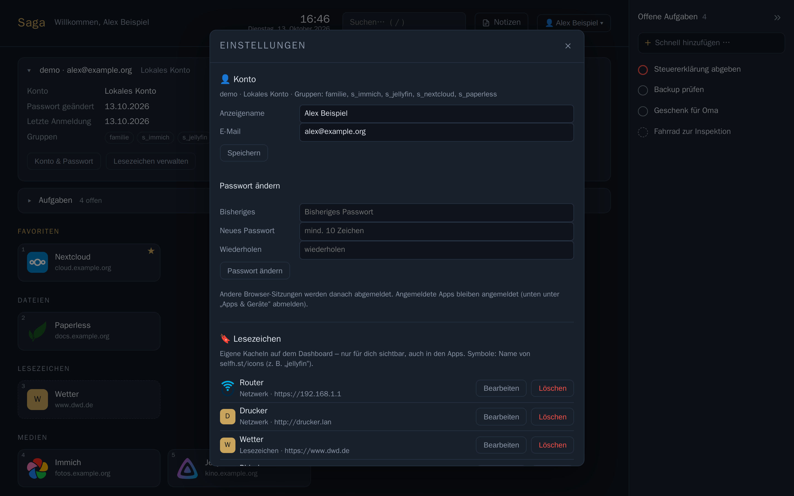

### Llaves de acceso e inicio de sesión en dos pasos

En **Ajustes → Cuenta → Inicio de sesión y seguridad** proteges una cuenta local o LDAP además de con la contraseña
(las cuentas SSO lo hacen en su servicio de inicio de sesión, ver abajo):

- **Llaves de acceso (passkeys):** el navegador o el móvil crea una clave que se guarda en el gestor de
  contraseñas del dispositivo (Llavero de iCloud, Gestor de contraseñas de Google, 1Password, Bitwarden …) o en una
  llave de seguridad (YubiKey). Con ella inicias sesión **sin contraseña**: «Iniciar sesión con llave de acceso» en
  la página de inicio de sesión o directamente desde las sugerencias del nombre de usuario, y confirmas con huella,
  cara o PIN del dispositivo. Si inicias sesión con contraseña, la llave de acceso sirve de segundo factor. Puedes
  añadir varias (p. ej. móvil y portátil); cada una tiene nombre, «creada» y «último uso».
- **App de autenticación** (TOTP: Aegis, 2FAS, Google/Microsoft Authenticator …): escanea el código QR o escribe
  la clave y luego introduce un código. Saga pide el código de 6 cifras tras la contraseña; cada código sirve una
  sola vez.
- **Códigos de recuperación:** con el primer factor recibes 10 códigos de un solo uso; imprímelos o guárdalos en
  el gestor de contraseñas, Saga solo los muestra una vez. Te permiten entrar si te faltan el móvil o la llave de
  acceso. «Generar códigos nuevos» invalida los anteriores.

**Inicio de sesión:** contraseña correcta → Saga pide el segundo factor (llave de acceso, código o código de
recuperación). Este paso vale 5 minutos y solo en este navegador; tras 5 códigos erróneos hay una pausa de 15
minutos. A propósito no existe la opción «confiar en este navegador».

**Confirmar antes de cambios (más estricto desde la 2.4):** **eliminar** un segundo factor (llave de acceso, app de
autenticación) exige siempre una confirmación expresa con contraseña, código o llave de acceso de como máximo 5 minutos
de antigüedad; un inicio de sesión reciente no basta. La misma confirmación hace falta para **añadir otro factor** o
generar **códigos de recuperación nuevos** en cuanto la cuenta ya tiene una llave de acceso o una app de autenticación;
solo la primera configuración sigue funcionando durante 5 minutos tras iniciar sesión. Un factor añadido después del
inicio de sesión de esta sesión no cuenta y no se ofrece en el diálogo. Así, quien se haya apoderado de una sesión no
puede crear su propia llave de acceso y eliminar con ella los factores reales. En la web Saga lo pide por sí sola y
luego continúa. «Empezar de nuevo» en los chats también se confirma con contraseña, llave de acceso o código.

**Apps:** las apps inician sesión a través de la página de inicio de sesión de Saga en la ventana del navegador
del sistema; allí aparece también el segundo paso, y las llaves de acceso funcionan en iPhone, iPad, Mac y Android.
Las apps ya conectadas siguen conectadas aunque actives el 2FA o el administrador lo exija. El emparejamiento por
código QR no necesita segundo paso (parte de una sesión ya iniciada). Si el administrador exige 2FA a todos y tu
cuenta aún no tiene factor, un inicio de sesión **nuevo** de una app lleva primero a la configuración («Continuar»
vuelve después a la app); el código QR para emparejar solo está disponible después.

**Requisito para las llaves de acceso:** `BASE_URL` con nombre de host y `https://` (p. ej.
`https://saga.example.org`; solo `http://localhost` funciona sin https). Si Saga se abre con otra dirección que
`BASE_URL`, Saga lo explica en lugar de fallar en silencio. Las llaves de acceso pertenecen al dominio: si
`BASE_URL` pasa más tarde a otro dominio, las existentes dejan de funcionar (iniciar sesión con contraseña +
código/código de recuperación sigue funcionando). Para que valgan en varios subdominios, pon `PASSKEY_RP_ID` en el
dominio común. En el **área de administración** solo funcionan si `ADMIN_URL` está en el mismo dominio; si no, usa
allí un código o un código de recuperación. Por eso, cuando la política exige un factor, un administrador sin
factor configura allí una app de autenticación (llaves de acceso en la página principal, en «Inicio de sesión y
seguridad»).

**SSO (OIDC):** Saga no ofrece su propio 2FA a las cuentas SSO: el servicio de inicio de sesión (p. ej. Keycloak)
pide el segundo factor. Con el interruptor de administración «Exigir un segundo factor con SSO», Saga solo acepta
inicios de sesión SSO si el proveedor indica uno (`amr` con `mfa`, `otp`, `hwk` …) o uno de los valores `acr`
configurados (que Saga también solicita al proveedor).

**¿Perdiste el móvil?** Inicia sesión con un código de recuperación y vuelve a configurar el factor. Sin códigos,
el administrador restablece el segundo factor (sección 5) o, si el propio administrador no puede entrar, en el
servidor `docker compose exec saga python run.py 2fa-zuruecksetzen <nombre>` (sección 2).

### Fotos de perfil

En lugar de las iniciales de color, Saga muestra una **foto de perfil**: en la cabecera, en los comentarios, en la
presencia de una página, en las notificaciones, en el diálogo de compartir y la búsqueda de personas, en los chats
(lista, conversación, miembros) y en el historial de versiones («de …»). Sin imagen se quedan las iniciales.

- **Imagen propia:** Ajustes → Cuenta → Foto de perfil → «Subir imagen …». En el navegador eliges un recorte
  cuadrado (mover, ampliar). Se permiten PNG, JPEG, GIF, WebP y HEIC hasta `AVATAR_MAX_MB` (por defecto 5 MB). El
  servidor vuelve a codificar cada imagen (64/128/256 píxeles, WebP y PNG/JPEG) y elimina todos los metadatos
  (EXIF con cámara, lugar, fecha). «Quitar mi imagen» la borra de nuevo.
- **Gravatar solo con consentimiento (desde 2.4):** sin imagen propia y tras activarlo en los ajustes («Usar Gravatar
  si no tengo imagen propia», **desactivado** de fábrica) se usa tu [Gravatar](https://gravatar.com), si la cuenta
  tiene dirección de correo. Privacidad: se envía a Gravatar un hash (SHA-256) de la dirección; **solo el servidor**
  consulta Gravatar y guarda el resultado un día, también «sin imagen». Los navegadores y las apps nunca consultan
  Gravatar directamente, así que Gravatar no sabe quién mira una imagen. El admin puede prohibir Gravatar para todos
  (General → Fotos de perfil). También las cuentas que ya existían antes de
  2.4 empiezan con «desactivado» tras la actualización (el antiguo valor «activado» no era un consentimiento); quien quiera
  Gravatar lo vuelve a activar una vez.
- **Imagen del proveedor de identidad (opcional, admin):** «Usar la imagen del SSO» toma la dirección del claim
  OIDC `picture` (la obtiene el servidor, no el navegador); «Usar la imagen de LDAP» lee `jpegPhoto` o
  `thumbnailPhoto` al iniciar sesión. Saga solo obtiene direcciones internas incluidas en «Hosts internos
  permitidos» (protección contra SSRF); las imágenes obtenidas se limitan a 2 MB y pocos segundos.
- **Orden:** imagen propia → imagen del proveedor de identidad → Gravatar → iniciales.
- **¿Quién ve la imagen?** Las direcciones contienen una clave imposible de adivinar (`/api/avatar/<clave>`); solo
  las personas (o apps) con sesión iniciada pueden cargarlas y no se pueden enumerar las cuentas. En las **páginas
  publicadas** tu imagen aparece junto a «@nombre» solo si activas «Mostrar también en mis páginas publicadas»
  (por defecto: desactivado).
- **Federación:** las personas de otras instancias de Saga también muestran su imagen. Tu servidor la obtiene de
  su instancia con una petición firmada (máximo 512 KB), la vuelve a codificar y la guarda un día; al desconectar
  la instancia se borra la caché.
- **Borrar una cuenta** elimina su imagen, sus ajustes y todas las imágenes guardadas.

### Idioma

Saga habla español, inglés, alemán, ruso (Русский) y tailandés (ไทย); esta guía está en español, inglés y
alemán. El idioma que ves se decide en este orden:

1. tu propia elección en **Ajustes** → **Cuenta** → **Idioma** (o menú de usuario → **Idioma**): se aplica al
   instante y en cualquier navegador, porque se guarda en tu cuenta,
2. el **selector 🌐 de la página de inicio de sesión**, para un ordenador ajeno que no habla tu idioma. También vale
   para el paso de 2FA, el registro y las páginas de error; el navegador solo recuerda el idioma (cookie
   `saga_lang`, sin seguimiento) y "Automático (navegador)" lo borra,
3. el idioma de la app, cuando una app abre el inicio de sesión en el navegador,
4. el **idioma predeterminado** que el administrador fija en General,
5. el idioma de tu navegador,
6. si no, inglés (también para cualquier otro idioma del navegador).

"Automático" significa siempre: decide el paso siguiente. Las fechas y los números siguen el idioma elegido. El
área de administración también tiene selector (cabecera e inicio de sesión). En las apps eliges el idioma en
Ajustes → Idioma (Automático, Deutsch, English, Español, Русский, ไทย). El ruso y el tailandés son traducciones
automáticas; se agradecen mejoras de hablantes nativos.

### En el móvil

Saga se adapta a pantallas pequeñas y se puede añadir a la pantalla de inicio como una app ("Añadir a pantalla
de inicio" en el menú del navegador). En las páginas, el contenido aparece arriba del todo; el árbol de páginas
se abre como un cajón con el botón de arriba a la izquierda. `/` abre el menú de bloques como una hoja desde
abajo: toca una entrada, o sigue escribiendo (filtra) y pulsa `Enter`. Las barras de pestañas (ajustes, área de
administración) se pueden deslizar de lado.

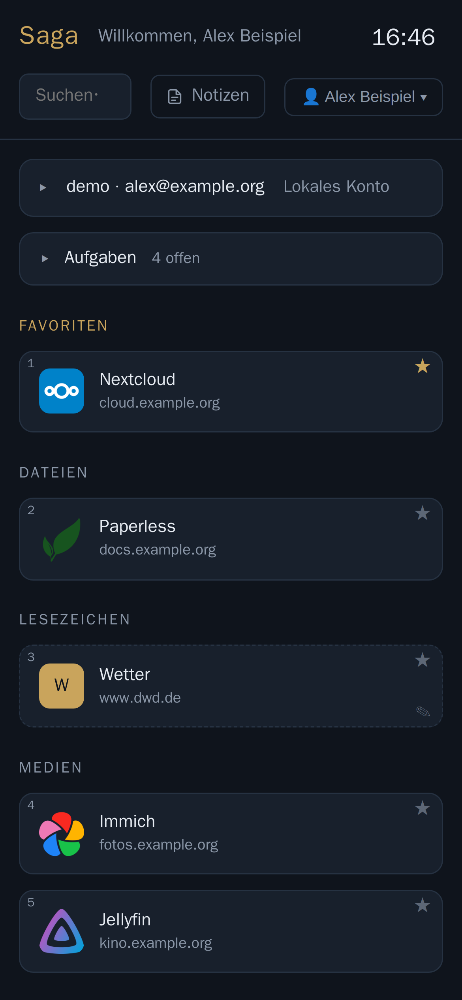

## 10. Búsqueda web (opcional)

El campo de búsqueda también puede buscar en la web, a través de una instancia propia de SearXNG a la que solo
accede Saga:

```sh
# en el .env
COMPOSE_PROFILES=search
SEARXNG_URL=http://searxng:8080
SEARXNG_SECRET=<openssl rand -hex 32>
```

Después, `docker compose up -d`. Las búsquedas solo van a tu servidor, no directamente a los buscadores.
La IA puede usar la misma conexión («Permitir búsqueda web» en Asistente de IA, ver arriba).

## 11. Copias de seguridad, restauración y actualizaciones

**Qué hay que guardar:**

1. la base de datos,
2. el volumen `saga-data` (imágenes y archivos de las páginas),
3. el archivo `.env` (sobre todo la `SECRET_KEY`).

```sh
# copia de la base de datos
docker compose exec -T db pg_dump -U saga -d saga -Fc > saga-$(date +%F).dump
# copia de los archivos
docker run --rm -v saga_saga-data:/data -v "$PWD":/backup alpine tar czf /backup/saga-data-$(date +%F).tgz -C /data .
```

```sh
# restaurar (instalación vacía, misma SECRET_KEY)
docker compose up -d db
docker compose exec -T db pg_restore -U saga -d saga --clean --if-exists < saga-2026-10-13.dump
docker run --rm -v saga_saga-data:/data -v "$PWD":/backup alpine tar xzf /backup/saga-data-2026-10-13.tgz -C /data
docker compose up -d
```

(El nombre del volumen empieza por el nombre de la carpeta del proyecto: `docker volume ls` lo muestra.)

Lo más fácil es que lo haga Saga: **copias de seguridad cifradas en S3, en una carpeta o en Nextcloud/WebDAV** (área de
administración → Copias de seguridad, ver más abajo).

Las copias que crea Saga (`/data/backups`, ver Actualizaciones) se restauran con `python run.py restore` (apartado
«Volver a la versión anterior»), no con el `pg_restore` del contenedor de la base de datos: proceden de `pg_dump` 17 de
la imagen de Saga, y `pg_restore` 16 de `postgres:16` indica para ellas «unsupported version (1.16) in file header».

### Copias de seguridad cifradas (S3, carpeta, Nextcloud/WebDAV)

Área de administración → **Copias de seguridad**: cada día (a la hora que elijas) Saga guarda la base de datos, los
archivos (`/data/files` sin miniaturas, `/data/chat`, `/data/svc-icons`) y, si quieres, las claves del `.env`
(`SECRET_KEY`, `CAL_SECRET_KEY`), cifrado, en un destino: **S3** (MinIO, Garage, Backblaze B2, Hetzner Object Storage,
Wasabi, AWS…), una **carpeta en el contenedor** (p. ej. una unidad montada o un recurso compartido de un NAS) o
**WebDAV** (Nextcloud, ownCloud, Storage Box…). Las copias locales antes de las actualizaciones (`/data/backups`,
`run.py backup`/`restore`) no cambian. La copia del servidor contiene los datos de **todas** las personas: el destino
debe estar pensado para ello (bucket o cuenta propios), no el almacenamiento privado en la nube de alguien.

1. **Conectar un destino**: elige el tipo.

   **S3.** Endpoint (`https://host[:puerto]`, sin el bucket), región (vacía = `us-east-1`; Garage: `garage`, Hetzner
   p. ej. `fsn1`, Backblaze p. ej. `eu-central-003`), bucket (debe existir: Saga no lo crea), prefijo (carpeta dentro
   del bucket, por defecto `saga-backups`), clave de acceso y clave secreta (ambas guardadas cifradas como los demás
   secretos de administración). El direccionamiento «automático» usa virtual-hosted en AWS (`https://bucket.host/…`) y
   path-style en los demás (`https://host/bucket/…`, MinIO/Garage); si hace falta, fíjalo. Saga firma cada solicitud
   por sí mismo (AWS Signature v4, sin bibliotecas adicionales) con el SHA-256 del contenido; los archivos grandes se
   suben como subida multiparte (partes de `BACKUP_CHUNK_MB`, 32 MB por defecto; las subidas interrumpidas se
   descartan). Recomendación: una clave solo para este bucket con lectura/escritura/borrado/listado; el versionado o
   Object Lock protegen además de que un servidor comprometido borre las copias; en ese caso, limpia las versiones
   antiguas con una regla de ciclo de vida del bucket (Saga borra según la regla de retención de abajo). S3 no indica
   el espacio libre; la comprobación previa se omite.

   **Carpeta en el contenedor.** Solo por debajo de las raíces de `SAGA_BACKUP_DIRS` (por defecto `/backup`, varias
   separadas por comas); Saga rechaza rutas con `..` o enlaces simbólicos hacia fuera. Monta la carpeta como volumen
   adicional y da permiso de escritura al usuario de Saga (UID 10001):

   ```yaml
   # docker-compose.yml, servicio saga
       volumes:
         - saga-data:/data
         - ./certs:/certs:ro
         - /srv/saga-backups:/backup        # volumen adicional para las copias (carpeta del host o montaje NAS)
   ```

   ```sh
   sudo mkdir -p /srv/saga-backups && sudo chown 10001 /srv/saga-backups
   docker compose up -d
   ```

   Después, en el área de administración, escribe `/backup` (o `/backup/saga`). Si la carpeta está en el mismo
   servidor, solo protege frente a errores de Saga o de la base de datos, no frente a la pérdida del servidor: copia la
   carpeta además a otro lugar (restic, rsync…); los archivos ya están cifrados.

   **WebDAV/Nextcloud.** Con Nextcloud basta la dirección (`https://cloud.example.org`): Saga detecta Nextcloud,
   muestra un enlace de inicio de sesión, entras en Nextcloud y permites el acceso (Login Flow v2). Saga solo guarda el
   nombre de usuario y una **contraseña de aplicación** propia (cifrada); «Desconectar» la revoca en Nextcloud. Otro
   WebDAV: dirección de la carpeta más usuario y contraseña. Recomendación: una **cuenta de Nextcloud propia** solo para
   las copias (una contraseña de aplicación puede hacer todo lo que puede la cuenta) con papelera corta y pocas
   versiones; si no, las copias antiguas borradas siguen ocupando espacio en la papelera. Las direcciones internas
   (homelab) funcionan sin más autorización.
2. **Clave.** Se cifra con [age](https://age-encryption.org) y una clave **pública**. O bien «Generar par de claves»:
   Saga muestra la clave privada una sola vez (texto y descarga `saga-backup-<servidor>.key`) y **no** la guarda; para
   confirmar, escribe los 6 últimos caracteres. O bien introduce tu propia clave pública (`age-keygen -o
   saga-backup.key` en tu ordenador y copia la línea `# public key: age1…`; también sirve `ssh-ed25519 …`). Se pueden
   indicar varios destinatarios (p. ej. una segunda clave en una caja fuerte). Sin la clave privada no se puede
   restaurar ninguna copia, ni siquiera nosotros.
3. **Programación y retención.** «Copia automática diaria», hora (zona horaria `TIMEZONE`), retención
   «abuelo-padre-hijo»: por defecto 7 diarias, 4 semanales y 6 mensuales (la más reciente de cada día/semana/mes; las
   de las últimas 24 horas se conservan siempre). Antes de subir, Saga comprueba el espacio libre; después, el tamaño y
   la suma de comprobación (hasta `BACKUP_VERIFY_MB` enseguida, los archivos más grandes los domingos). Los archivos
   grandes se suben por partes en Nextcloud (Chunking v2) y como subida multiparte en S3. La ejecución tiene prioridad
   baja (`nice`/`ionice`); si varios procesos de Saga usan la misma base de datos, solo uno hace la copia.
4. **Errores.** Estado en el área de administración (último éxito, próxima ejecución, historial). Si falla una
   ejecución o no ha habido ningún éxito en 48 horas, todos los administradores reciben una notificación (campana y, si
   está configurado, en el móvil); opcionalmente también un webhook (tema de ntfy, Gotify `…/message?token=…` o
   cualquier dirección).

**Qué hay en el destino**: una carpeta (en S3: prefijo) por ejecución, `saga-AAAAMMDD-hhmmss/`:

| Archivo | Contenido |
|---|---|
| `db.dump.age` | Base de datos (`pg_dump --format=custom`, comprobada con `pg_restore --list` antes de cifrarla) |
| `dateien.tar.age` | `files/` (sin `thumbs`), `chat/`, `svc-icons/` |
| `geheimnisse.env.age` | `SECRET_KEY`, `CAL_SECRET_KEY` (desactivable) |
| `manifest.json.age` | Sumas de comprobación del contenido sin cifrar |
| `manifest.json` | sin cifrar, sin nombres ni nombres de host: versión de Saga, versión del esquema, tamaños y SHA-256 de los archivos `.age`, huellas de las claves. Se sube al final: una carpeta sin `manifest.json` está incompleta. |

**Restaurar con Saga** (servidor nuevo, pila instalada como en la sección 2):

```sh
# 1. leer los secretos y copiar SECRET_KEY / CAL_SECRET_KEY al .env (archivo del destino, p. ej. con el cliente de Nextcloud)
age -d -i saga-backup.key geheimnisse.env.age
# 2. detener Saga, obtener la ejecución, comprobar, descifrar, restaurar base de datos y archivos
docker compose stop saga
docker compose run --rm -v "$PWD/saga-backup.key:/key:ro" \
  -e SAGA_BACKUP_S3_ENDPOINT=https://s3.example.org -e SAGA_BACKUP_S3_BUCKET=saga-backups \
  -e SAGA_BACKUP_S3_ACCESS_KEY='…' -e SAGA_BACKUP_S3_SECRET_KEY='…' -e SAGA_BACKUP_S3_PREFIX=saga-backups \
  saga python run.py restore --schluessel /key saga-20261019-032000
docker compose up -d
```

En una pila nueva, el destino se toma del entorno:

| Destino | Datos |
|---|---|
| S3 | `SAGA_BACKUP_S3_ENDPOINT`, `SAGA_BACKUP_S3_BUCKET`, `SAGA_BACKUP_S3_ACCESS_KEY`, `SAGA_BACKUP_S3_SECRET_KEY`, opcionalmente `SAGA_BACKUP_S3_REGION`, `SAGA_BACKUP_S3_PREFIX`, `SAGA_BACKUP_S3_STYLE` (`auto`/`path`/`virtual`) |
| Carpeta | `SAGA_BACKUP_PATH=/backup` (volumen montado como arriba), o directamente la carpeta de la ejecución en lugar de un nombre |
| WebDAV/Nextcloud | `SAGA_BACKUP_URL` (dirección WebDAV de la carpeta de copias, p. ej. `https://cloud.example.org/remote.php/dav/files/saga-backup/Saga-Backups`), `SAGA_BACKUP_USER`, `SAGA_BACKUP_PASSWORD` |

Sin nombre de ejecución, Saga toma la más reciente completa; `run.py backup-holen --liste` las muestra todas. Si el
destino ya está configurado en el área de administración (misma base de datos), no hacen falta los datos
`SAGA_BACKUP_*`. En lugar de un nombre también vale una carpeta local con la ejecución descargada (guárdala en
`/data/…`). Saga compara las sumas de `manifest.json` antes de descifrar. La base de datos se restaura con el mismo
`db.restore` que `run.py restore` (todo o nada); los secretos se guardan además en
`/data/backups/<ejecución>-geheimnisse.env` (legible solo para Saga), y Saga avisa si difieren del `.env`.

**Restaurar sin Saga** (solo `age` y las herramientas de PostgreSQL; `age` existe para Linux, macOS y Windows):

```sh
cd saga-20261019-032000
sha256sum db.dump.age dateien.tar.age      # comparar con manifest.json
age -d -i saga-backup.key db.dump.age > db.dump
age -d -i saga-backup.key dateien.tar.age | tar -x -C /ruta/a/data
age -d -i saga-backup.key geheimnisse.env.age
pg_restore --list db.dump | head           # ver el contenido; restaurar p. ej. con pg_restore -d ... --clean --if-exists
```

**Restauración de prueba.** Recomendada una vez al mes (el área de administración lo recuerda):

```sh
docker compose run --rm -v "$PWD/saga-backup.key:/key:ro" saga python run.py backup-pruefen --schluessel /key
```

obtiene la ejecución más reciente, compara las sumas, lo descifra todo, restaura la base de datos en una **base de
datos desechable** (se borra después) y comprueba el archivo de ficheros; la base de datos real no se toca.

**Atención, identidad:** una copia restaurada *es* la instancia, incluida su clave de federación. Si pruebas una copia
en un segundo servidor, pon allí `SAGA_RESTORE_TEST=1` en el `.env`: Saga no establece entonces conexiones salientes con
los servicios de la instancia real: ni federación, ni notificaciones, ni copias de seguridad (tampoco limpieza en el
destino ni revocación de la contraseña de aplicación de Nextcloud), ni aviso de versiones, ni sincronización de
calendarios, ni IA, ni Immich, ni búsqueda web, ni avatares externos. Saga en sí, el inicio de sesión (también
LDAP/OIDC) y el estado de los servicios en el panel siguen funcionando. Solo se permite *leer* del destino configurado
desde la línea de comandos (`backup-holen`, `restore --schluessel`, `backup-pruefen`): únicamente a su dirección y solo
lectura (WebDAV GET/PROPFIND, S3 GET/listado); subir, borrar y limpiar en el destino siguen bloqueados.

Carpeta de trabajo: durante una ejecución, las partes (antes de cifrar, brevemente también `db.dump` sin cifrar) están
en `/data/backups/extern-tmp/`, la ejecución y `backup-pruefen` cada una en su propia subcarpeta; Saga borra los restos
de una ejecución interrumpida en el siguiente arranque.

### Copia de seguridad personal (por persona)

En **Ajustes → Mi copia de seguridad** cada persona guarda **su propio** espacio, independientemente de la copia del
servidor que hace el administrador, en **su propio** destino y con **su propia** clave.

1. **Destino:** tu propio Nextcloud (solo escribe la dirección, entra en Nextcloud y permite el acceso: Saga recibe una
   contraseña de aplicación propia, «Desconectar» la revoca) u otro destino WebDAV (dirección de la carpeta, usuario,
   contraseña). Solo se permiten **direcciones https en Internet**; servidores de la red interna solo si el
   administrador los autoriza en Copias de seguridad → Copias de seguridad personales (protección de la red interna).
2. **Clave:** como para el administrador: «Generar par de claves» (la clave privada se muestra una sola vez y no se
   guarda; se confirma con los 6 últimos caracteres) o introduce tu propia clave pública (`age1…`, `ssh-ed25519 …`);
   hasta 5 destinatarios.
3. **Qué se guarda:** solo lo que es tuyo: tus páginas y subpáginas, bases de datos con sus entradas, tus archivos e
   imágenes, plantillas, archivo, papelera, versiones, tus comentarios en tus páginas, tareas, marcadores, perfil y
   ajustes. Cada categoría se puede desactivar; se pueden excluir **árboles de páginas** concretos (con todas las
   subpáginas y los archivos que solo aparecen allí). **Nunca** se incluyen: páginas y archivos de otras personas (ni
   siquiera «Compartido conmigo»), listas de usos compartidos ni chats (cifrados de extremo a extremo, pertenecen a
   todos los participantes y no se pueden restaurar sin las claves de los dispositivos). Los **comentarios de otros** en
   tus páginas están **desactivados** por defecto (pertenecen a quien los escribió) y se pueden activar. Los nombres de
   otras personas (p. ej. quién escribió una versión) se omiten.
4. **Programación:** desactivada, semanal o diaria (hora, día de la semana); «Copias a conservar» = cuántas de las más
   recientes se quedan en el destino. «Hacer copia ahora» empieza enseguida. Si falla una copia, aparece una
   notificación en la campana.

**Formato** (abierto, legible sin Saga): `saga-AAAAMMDD-hhmmss.zip.age`, un ZIP cifrado con age, y a su lado
`….zip.age.sha256` (suma de comprobación, funciona `sha256sum -c`). Dentro del ZIP: `manifest.json` (SHA-256 de cada
archivo), `daten.json` (todo completo, para restaurar), `seiten/`, `vorlagen/`, `archiv/`, `papierkorb/` (Markdown como
en la exportación, con enlaces relativos), `dateien/`, `profil/` y `LIESMICH.txt`. Descifrar sin Saga:

```bash
age -d -i saga-backup.key -o backup.zip saga-20261019-024000.zip.age
```

**Restaurar copia** (misma pestaña): sube un archivo (`.zip.age` o un `.zip` ya descifrado) o elige una copia de tu
destino y pega la clave privada (solo se envía al servidor para esta operación, no se guarda). Saga restaura **solo en
tu propia cuenta**, como **páginas nuevas**: los enlaces entre páginas, las relaciones de bases de datos, las bases de
datos incrustadas, los botones y las imágenes apuntan después a las páginas y archivos nuevos; las páginas existentes no
cambian. Por defecto: en una página nueva «Restaurado <fecha>»; papelera, tareas y marcadores si quieres. Los
comentarios y ajustes están en la copia para consultarlos, pero no se restauran. Una exportación Markdown (página →
Exportar) no contiene `daten.json` y por eso no se puede restaurar. Límites al restaurar: `daten.json` como máximo 64 MB
(`USER_BACKUP_DATA_MB`), como máximo 20.000 archivos (`USER_BACKUP_FILES_MAX`), las 50 versiones más recientes por
página. El archivo subido se borra justo después de restaurar, también tras un error; solo tras una clave incorrecta se
conserva una copia cifrada para otro intento (como máximo 30 minutos).

**Para administradores: privacidad.** La **copia del servidor** (arriba) guarda todo lo necesario para el
funcionamiento en *tu* destino. Las **copias personales** van solo al destino de cada persona, cifradas con su clave:
no tienes que meter datos privados de tus usuarios en tu nube y Saga nunca ve una clave privada. En el área de
administración, en **Copias de seguridad → Copias de seguridad personales**: activar/desactivar (activado por defecto;
desactivado = sin ejecuciones, sin conectar, sin restaurar), **tamaño por copia** (1024 MB por defecto, límite superior
`USER_BACKUP_MAX_MB`, 4096 por defecto), **intervalo mínimo** para «Hacer copia ahora», **programación más frecuente**
(diaria/semanal) y **hosts internos autorizados** (si no, solo direcciones https públicas). Con `SAGA_RESTORE_TEST=1`
Saga tampoco se conecta a ningún sitio para las copias personales.

### Actualizaciones

Saga usa números de versión según [Semantic Versioning](https://semver.org/lang/es/): **1.2.3** =
mayor.menor.parche. Los cambios están en el [registro de cambios](../../CHANGELOG.md) (en alemán) y en las
[versiones publicadas](https://github.com/yggdrasil-sh/saga/releases). La versión instalada aparece abajo en el
área de administración; ahí también verás un aviso cuando haya una nueva (se puede desactivar en General).

Qué versión se ejecuta lo decide `SAGA_VERSION` en el `.env`:

| Valor | Significado |
|---|---|
| `2` (por defecto) | siempre la 2.x más reciente: funciones nuevas y correcciones, nada que requiera trabajo manual |
| `2.4` | solo correcciones de la 2.4 |
| `2.4.0` | exactamente esta versión |
| `1` | se queda en la 1.x más reciente (1.2); las instalaciones antiguas aún tienen este valor en el `.env` |
| `testing` (o `rc`) | **Versión candidata:** lo último de la rama `testing`, antes de publicarse. Puede tener errores; solo para probar |

**Actualizar:**

```sh
git pull                                  # docker-compose.yml y guía al día
docker compose pull                       # imagen nueva
docker compose up -d                      # reiniciar
docker compose logs saga | grep saga:     # copia de seguridad y migración de la base de datos en el log
```

Si una actualización cambia la base de datos, Saga **crea antes una copia de seguridad automáticamente** en
`/data/backups` (en el volumen `saga-data`; se conservan las 10 últimas, ver `BACKUP_KEEP` en el `.env`).
Una copia a mano:

```sh
docker compose exec saga python run.py backup              # solo la base de datos
docker compose exec saga python run.py backup --dateien    # además, imágenes/archivos de las páginas como tar.gz
docker compose exec saga ls -l /data/backups
```

Las imágenes y archivos de las páginas (`/data/files`) **no** están en la copia de la base de datos. `--dateien`
(o `--files`) crea además `saga-dateien-<fecha>.tar.gz` (sin miniaturas, se vuelven a generar); se restaura con
`docker compose exec saga tar -xzf /data/backups/<archivo> -C /data`. Si ya haces copia del volumen `saga-data`
(ver arriba), no necesitas la opción.

**Versiones candidatas (canal `testing`):** con `SAGA_VERSION=testing` (equivalente: `rc`) recibes las funciones
nuevas en cuanto están listas, antes de publicarse. Cada compilación es una versión candidata (release candidate) de
la siguiente versión, por ejemplo `2.5.0-rc.7` (7 cambios desde la última versión; abajo en el área de
administración como «2.5.0-rc.7 (1cc210f)» con 🧪 Versión candidata, seguido del commit). Una versión candidata
siempre es más nueva que la versión estable anterior (2.4.0 < 2.5.0-rc.7 < 2.5.0): el aviso de nuevas versiones solo
aparece cuando se publica la 2.5.0. Las versiones de pruebas anteriores se llamaban `x.y.z-testing.<commit>`. Para volver a la versión estable: `SAGA_VERSION=2` y después
`docker compose pull && docker compose up -d`. Si la versión de pruebas ya ha modificado la base de datos, la
versión estable solo arrancará cuando incluya también ese cambio (como muy tarde con la siguiente versión), o
bien restauras la copia de seguridad de antes del cambio.

Una nueva **versión mayor** puede requerir trabajo manual; lo indicará el registro de cambios y solo llega si
pones `SAGA_VERSION` en la nueva versión mayor.

**De 1.x a 2.0:** si tu `.env` todavía dice `SAGA_VERSION=1`, te quedas en la 1.2. Para Saga 2.0 pon
`SAGA_VERSION=2` y actualiza como arriba: la base de datos se adapta sola (antes se hace una copia de seguridad).
Después, si los quieres, configura en el área de administración el asistente de IA, la federación y las
notificaciones de Apple (APNs) (están desactivados) y revisa el proxy inverso para el canal en vivo (sección 3).
Todo lo demás está en el [registro de cambios](../../CHANGELOG.md).

**De 2.0 a 2.1:** con `SAGA_VERSION=2`, la 2.1 llega con la actualización normal. La base de datos pasa al
esquema 6 (antes copia de seguridad; después no se puede volver a 2.0.x salvo con esa copia). Nuevo y activo desde
el principio: fotos de perfil con **Gravatar** (se desactiva en General → Fotos de perfil) y **llamadas** con el
servidor STUN `stun:stun.nextcloud.com:443` (General → Llamadas; TURN opcional, ver «Llamadas»). Las passkeys
necesitan un nombre de host en `BASE_URL`, no una dirección IP; la política de 2FA está en «nadie». **La IA en el
chat** y la **búsqueda web de la IA** siguen desactivadas hasta que las actives en Asistente de IA (la búsqueda web
solo con SearXNG, sección 10).

**De 2.1 a 2.3:** no existe la versión 2.2: con `SAGA_VERSION=2`, la 2.3 llega directamente desde la 2.1 con la
actualización normal. Qué ocurre y qué conviene tener en cuenta:

1. **Copia previa (recomendada):** Saga crea por sí mismo una copia antes de modificar la base de datos; una adicional
   con los archivos no sobra: `docker compose exec saga python run.py backup --dateien`. Si ya tienes un destino para
   copias cifradas, inicia allí «Hacer copia ahora».
2. **Actualizar** como arriba (`git pull`, `docker compose pull`, `docker compose up -d`). La base de datos pasa del
   esquema 6 al **9** (migraciones 7–9 para la federación; antes, copia `…-vor-schema-9.dump` en `/data/backups`). El
   log muestra líneas `saga:` con la copia y la migración. En el primer arranque Saga indexa una vez todas las páginas
   para la búsqueda, los enlaces entrantes y los usos compartidos (unos 1–2 s por cada 1.000 páginas, en segundo
   plano: Saga ya se puede usar y los resultados son correctos desde el principio).
3. **Revisar la federación:** los servidores conectados con la 2.3 reciben por servidor **chat, llamadas y libreta de
   direcciones**, activados por defecto. Así, los nombres visibles y las fotos de perfil de tus personas llegan a esos
   servidores. Si no lo quieres, desactívalo en Administración → Federación → «Funciones por instancia» (o comparte solo
   ciertos grupos) e informa a las personas de la opción de exclusión en Ajustes → Cuenta. Los servidores 2.1 siguen
   conectados como hasta ahora.
4. **Configurar las funciones nuevas (opcional):** copias cifradas en Administración → **Copias de seguridad**
   (desactivadas hasta configurar un destino; un destino de carpeta necesita un volumen adicional, ver «Copias de
   seguridad cifradas»). Las **copias personales** y los **archivos de Nextcloud en las páginas** están permitidos,
   pero solo hacia direcciones https públicas hasta que autorices hosts internos (Copias de seguridad → Copias de
   seguridad personales y General → «Conexiones de los usuarios»; ahí también se pueden desactivar).
5. **Nuevos ajustes del `.env`**, todos opcionales; los valores por defecto suelen servir (sección 13): `FED_*`
   (federación: límite de subidas, entrega, límites de ritmo, caché de adjuntos de chat), `SAGA_BACKUP_DIRS` (raíces
   para el destino de carpeta) y `SAGA_BACKUP_*` (solo para restaurar en un servidor nuevo), `BACKUP_VERIFY_MB`,
   `BACKUP_CHUNK_MB`, `USER_BACKUP_*` (copias personales), `NC_*` (archivos de Nextcloud), `SAGA_RESTORE_TEST`
   (restauración de prueba), `GZIP_LEVEL`/`GZIP_MIN_BYTES`, `NOTE_ROW_MAX_COUNT`, `SAGA_ORJSON`.
6. **Apps:** se recomiendan las apps 2.3 ([apps de Saga](https://github.com/yggdrasil-sh/saga-apps/releases)), con
   chats y llamadas federados, compartir entre servidores y «Mi copia de seguridad». Las apps 2.1 siguen funcionando,
   solo que sin estas funciones; muestran los chats con personas de otros servidores con el aviso «actualiza la app».

**De 2.3 a 2.4:** con `SAGA_VERSION=2`, la 2.4 llega con la actualización normal. Qué ocurre y a qué prestar
atención:

1. **Hacer copia antes (recomendado):** Saga crea una copia por sí misma antes de modificar la base de datos; una
   adicional con los archivos no sobra: `docker compose exec saga python run.py backup --dateien` (o «Hacer copia ahora»
   en las copias cifradas).
2. **Actualizar** como arriba (`git pull`, `docker compose pull`, `docker compose up -d`). La base de datos pasa de la
   versión de esquema 9 a la **14** (migraciones 10–14: llamadas, vídeos, llamada como sala, leído/en línea, ajustes
   posteriores; antes, copia `…-vor-schema-14.dump` en `/data/backups`). Las copias de la 2.3 se pueden seguir
   restaurando con la 2.4.
3. **Gravatar queda desactivado para todas las cuentas.** Hasta la 2.3 «Usar Gravatar» venía activado de fábrica, y eso
   no era un consentimiento. Por eso la actualización lo desactiva para todos y borra las imágenes de Gravatar en caché;
   quien quiera Gravatar lo vuelve a activar en Ajustes → Cuenta → Foto de perfil. Las imágenes propias y las del
   servicio de inicio de sesión se mantienen. Conviene avisar a las personas.
4. **Nuevo en el contenedor: saga-media.** Los adjuntos del chat y los vídeos los entrega ahora el pequeño servicio
   saga-media (sección 3, «Ruta de medios»): ningún puerto nuevo, nada que cambiar en el proxy inverso; solo
   `TRUSTED_PROXIES` debe estar bien, como antes. Para volver al camino anterior, `SAGA_MEDIA=off`. **Sin contenedor**
   (Saga directamente con Python) hay dos alternativas: compilar saga-media y arrancarlo delante, o dejar que el proxy
   inverso entregue los archivos (`MEDIA_ACCEL=nginx` o `caddy`); si no, Python los entrega como antes, pero como máximo
   `MEDIA_PY_STREAMS` a la vez.
5. **Revisar el área de administración:** en General → «Chats» los nuevos límites **Vídeo más grande en el chat** (por
   defecto 500 MB) y **Almacenamiento para adjuntos de chat por cuenta** (ahora 4096 en lugar de 1024 MB: ¿hay espacio
   suficiente en el volumen?); en «Compartir» el nuevo interruptor **Buscar por nombre de inicio de sesión** (activado
   por defecto, ver «Compartir y comentar»); en «Llamadas» los dispositivos por llamada en grupo (4 con vídeo, 6 solo
   con audio, solo se pueden reducir) y el **aviso sobre el servidor STUN**: el servidor STUN ajeno que viene de fábrica
   ve las direcciones IP de quienes llaman. Para llamadas en grupo y dispositivos acompañantes se recomienda un servidor
   TURN propio por el puerto 443 (sección 9, «TURN por el puerto 443»).
6. **Inicio de sesión:** las contraseñas erróneas ahora solo frenan la dirección de la que vienen; un bloqueo duro solo
   llega tras muchísimos intentos desde muchas direcciones, y lo levantas en la cuenta con «Levantar bloqueo»
   (sección 12). Eliminar o añadir un segundo factor y generar códigos de recuperación nuevos exigen una confirmación
   reciente (sección 9).
7. **Nuevos ajustes del `.env`**, todos opcionales (sección 13): `SAGA_MEDIA`, `MEDIA_*` (p. ej. `MEDIA_MAX_CONNS_IP`,
   `MEDIA_IDLE_UNAUTH`, `MEDIA_STALL_TIMEOUT`, `MEDIA_AUTHZ_TTL`, `MEDIA_ACCEL`, `MEDIA_PY_STREAMS`), `VIDEO_MAX_MB`,
   `CHAT_QUOTA_MB` (nuevo valor por defecto 4096), `CHAT_OFFLINE_GRACE`.
8. **Apps:** se recomiendan las apps 2.4 ([apps de Saga](https://github.com/yggdrasil-sh/saga-apps/releases)), con
   vídeos, llamadas en grupo, otro dispositivo en la llamada y confirmaciones de lectura. Las apps 2.3 y 2.1 siguen
   funcionando, solo que sin estas funciones; las llamadas en grupo muestran ahí «necesita Saga 2.4» y los vídeos grandes
   aparecen como adjunto «Abrir con Saga 2.4». Los servidores conectados con 2.3 siguen conectados; llamadas en grupo,
   leído/en línea y vídeos grandes solo funcionan entre servidores con 2.4.

**Volver de 2.4 a 2.3:** solo con la copia de antes de la actualización (`…-vor-schema-14.dump`), restaurada **con la
2.4**, y después `SAGA_VERSION=2.3`; ver abajo. La 2.3 no arranca sobre la versión de esquema 14.

**Volver de 2.3 a 2.1:** solo con la copia de antes de la actualización (`…-vor-schema-9.dump`), ver abajo. Sobre la
base de datos modificada, la 2.1 indica «Die Datenbank hat Schema-Stand 9, diese Saga-Version kennt nur 6» y no arranca.

**Volver a la versión anterior:** una versión antigua de Saga no arranca sobre una base de datos que una versión
más nueva ya ha modificado (lo indica en el log en lugar de dañar datos). Esto vale para **2.4 → 2.3** (copia `…-vor-schema-14.dump`), **2.3 → 2.1** (copia
`…-vor-schema-9.dump`) y también para **2.1 → 2.0.x**:
2.1 sube el esquema a la versión 6 (copia `…-vor-schema-6.dump`) y 2.0.x se detiene con «Die Datenbank hat
Schema-Stand 6, diese Saga-Version kennt nur 5»; si no, 2.0 seguiría funcionando y dejaría entrar a cuentas con
segundo factor solo con la contraseña. En ese caso, restaura la copia de seguridad de antes de la actualización:

```sh
docker compose stop saga
docker compose run --rm saga ls /data/backups                     # p. ej. saga-20261013-183000-vor-schema-3.dump
docker compose run --rm saga python run.py restore /data/backups/saga-20261013-183000-vor-schema-3.dump
# poner en el .env SAGA_VERSION a la versión antigua (p. ej. 1.2.3) y después:
docker compose pull && docker compose up -d
```

Todo lo que se haya cambiado después de la copia se pierde, así que hazlo solo poco después de una
actualización fallida.

Por tanto, restaura **antes** de cambiar `SAGA_VERSION`, con la versión más nueva (como arriba): restaura la copia en
una sola transacción (si algo falla, todo queda como estaba), funciona con `postgres:16` y `:17` y elimina antes las
tablas que una versión antigua no conoce. Las versiones antiguas de Saga fallan al restaurar con `postgres:16` por
«unrecognized configuration parameter transaction_timeout» y, en una base de datos que ya ha usado la 2.3 (o una versión
de pruebas 2.2.0-rc), por las nuevas tablas `note_derived`, `note_link` y `note_stale` («cannot drop table note because
other objects depend on it»). Si ya has cambiado, usa la versión más nueva solo para restaurar, p. ej.
`docker compose run --rm saga …` con `SAGA_VERSION=2` (o `testing`) en el `.env`. También puedes eliminar las tres tablas
a mano (la 2.3 las vuelve a crear en el siguiente arranque):
`docker compose exec -T db psql -U saga -d saga -c "DROP TABLE IF EXISTS note_link, note_stale, note_derived"`.

**Apps:** al arrancar, las apps comprueban la versión del servidor. Si una app es demasiado antigua para el
servidor, te pide que la actualices. En los ajustes de la app aparecen la versión de la app y la del servidor.

## 12. Solución de problemas

**Después de iniciar sesión vuelvo a la página de inicio de sesión.**
`BASE_URL` debe ser exactamente la dirección que aparece en el navegador (incluido `https://`). Con `https`,
Saga solo envía cookies por HTTPS.

**"Demasiados intentos fallidos".**
Saga frena las contraseñas incorrectas en lugar de bloquear cuentas (desde 2.4): tras 8 intentos fallidos para una
cuenta desde la misma dirección, *esa dirección* debe esperar 2, 4, 8 … segundos (como máximo 15 minutos); lo mismo
tras 30 intentos fallidos desde una dirección (sean cuales sean las cuentas). Desde otras direcciones la persona entra
con normalidad: un extraño ya no puede bloquear una cuenta con unas pocas contraseñas incorrectas. Solo con muchísimos
intentos (100 en una hora) desde muchas direcciones (al menos 10) Saga bloquea el inicio de sesión con contraseña
durante una hora: la persona recibe una notificación, el administrador ve el bloqueo en el resumen y en la lista de
usuarios («Inicio de sesión bloqueado») y lo levanta en la cuenta con **Levantar bloqueo**; **Establecer contraseña**
también lo levanta. Las llaves de acceso y las sesiones abiertas siguen funcionando durante el bloqueo. Las cuentas
LDAP se frenan igual (menos binds, así el bloqueo del directorio ocurre con menos frecuencia); SSO no se ve afectado.
Detrás de un proxy inverso, configura `TRUSTED_PROXIES`; si no, todos los visitantes comparten la dirección del proxy y
se frenan juntos.

**Llave de acceso: «El navegador indica la dirección …, pero Saga está configurado para …».**
Saga se abrió con otra dirección que `BASE_URL` (p. ej. una IP o un nombre antiguo). Las llaves de acceso están
ligadas a la dirección: abre Saga a través de `BASE_URL` o corrige `BASE_URL`. «Las llaves de acceso necesitan una
dirección con nombre de host»: `BASE_URL` contiene una IP o no empieza por `https://`.

**Faltan los iconos de los servicios.**
Saga los descarga una vez de `cdn.jsdelivr.net` (selfh.st) y los guarda. Sin internet aparece la inicial. Con
`ICON_CDN=` (vacío), Saga no descarga nada de internet.

**Favicons de los sitios (mosaicos sin icono).** Si ningún icono de selfh.st coincide con el nombre de dominio, Saga
descarga el favicon del sitio (`<link rel="icon">`/`apple-touch-icon` de la cabecera HTML o `/favicon.ico`), lo
convierte en PNG (como máximo 256 px) y lo guarda en `/data/site-icons`; lo que no encuentra no lo vuelve a buscar
durante un día. Saga solo contacta direcciones **públicas** (ninguna interna como 192.168.x, 10.x o localhost, tampoco
tras redirecciones), solo http/https en los puertos estándar, con límites de tiempo y tamaño, solo imágenes rasterizadas
(sin SVG) y como máximo `FAVICON_RATE` sitios por cuenta cada 10 minutos. Los servicios internos conservan la
inicial: pon su icono a mano. Desactivar: área de administración → General → Servicios → **Cargar favicons**, o
`FAVICONS=0` (solo selfh.st).

Al **adivinar**, Saga pide al CDN de iconos partes del nombre del host, también de servicios internos: para
`nextcloud.interno.example`, por ejemplo, solicita `nextcloud.png` (y `interno.png`) a `cdn.jsdelivr.net` como nombre
de archivo. No se envían el nombre completo del host, la dirección ni la IP. Si tampoco quieres eso, define
`ICON_CDN=` (vacío): Saga no descarga iconos de internet ni adivina (los favicons de sitios públicos siguen
funcionando mientras «Cargar favicons» esté activado). Si el CDN o un sitio no responde en ese momento, el mosaico
muestra la inicial y Saga lo reintenta pasados unos minutos. Saga elimina cada hora las marcas antiguas de «no
encontrado» y los favicons (se descargan de nuevo a los 30 días).

**LDAP: falla el inicio de sesión de la cuenta de servicio, o errores de certificado.**
Compruébalo con "Probar conexión". Con una CA propia, pon el archivo en `certs/` (sección 7).

**SSO: falla el inicio de sesión SSO.**
Revisa la URI de redirección en el proveedor (`BASE_URL/auth/callback`) y comprueba el documento de
descubrimiento con "Probar conexión". Los detalles están en `docker compose logs saga`.

**Calendario: el servidor no es accesible o no está permitido.**
Los servidores internos deben estar permitidos en Administración → General. Los calendarios e Immich no pasan por
`HTTPS_PROXY`/`HTTP_PROXY` (para que la comprobación no se pueda saltar a través del proxy): Saga necesita una
conexión directa con esos servidores.

**"Hay demasiados inicios de sesión ahora mismo. Inténtalo de nuevo en un momento."**
Saga comprueba como mucho `KDF_PARALLEL` contraseñas a la vez (por defecto 4, unos 32 MB de memoria cada una) y
espera como mucho 2 segundos a que quede un hueco libre. Si pasa a menudo (muchos usuarios, servidor potente),
sube `KDF_PARALLEL` en el `.env`.

**Llamada: «No es posible una conexión directa», o suena pero no conecta.**
Un lado está detrás de un cortafuegos estricto o de CGNAT móvil. Configurar un servidor TURN (sección «Llamadas» →
«TURN por el puerto 443»). Si la ventana de llamada muestra «por relé (TURN)», TURN funciona. «Cámara/micrófono no
permitidos»: permitirlo en el navegador con el icono de candado junto a la dirección; las llamadas necesitan `https`.
Si no suena en otras páginas, comprobar que el canal en vivo atraviesa el proxy (sección 3).

**Subir o guardar falla con "demasiado grande" (413).**
Archivos: `ATTACH_MAX_MB` (por defecto 10). Todo lo demás, p. ej. páginas muy largas: `REQUEST_MAX_MB` (por
defecto 2). Si el mensaje viene del proxy inverso, sube allí el límite (sección 3).

**Después de cambiar la contraseña tengo que volver a iniciar sesión en las apps.**
Es lo previsto: una contraseña nueva cierra la sesión en todos los demás navegadores y apps (p. ej. por si se
perdió un dispositivo). Solo siguen con la sesión iniciada la sesión y la app en las que cambiaste la contraseña.

**La campana solo se actualiza al cabo de un minuto y las páginas abiertas no se actualizan al instante.**
Entonces el canal en directo no llega y Saga consulta cada 60 segundos. Lo habitual es que el proxy inverso use búfer
con la respuesta de `/api/events` o la cierre al poco tiempo; los ajustes están en la sección 3. Más de cinco pestañas
abiertas con la misma cuenta también pasan las más antiguas a consulta periódica.

## 13. Todos los ajustes del .env

| Variable | Por defecto | Significado |
|---|---|---|
| `BASE_URL` | – (obligatorio) | Dirección pública de Saga |
| `SECRET_KEY` | – (obligatorio) | Al menos 32 caracteres, no cambiarla nunca |
| `POSTGRES_PASSWORD` | – (obligatorio) | Contraseña de la base de datos |
| `POSTGRES_USER` / `POSTGRES_DB` | `saga` | Usuario y nombre de la base de datos |
| `ADMIN_URL` | – | Enlace "Área de administración" en el menú de usuario de los administradores |
| `ADMIN_USERNAME` / `ADMIN_PASSWORD` | `admin` / generada | Primera cuenta de administración |
| `HOST_BIND` / `HOST_PORT` | `0.0.0.0` / `8080` | Dónde escucha Saga en el servidor |
| `ADMIN_BIND` / `ADMIN_HOST_PORT` | `127.0.0.1` / `8081` | Dónde escucha el área de administración |
| `TRUSTED_PROXIES` | `127.0.0.1` | IP del proxy inverso (`*` = todas) |
| `CANONICAL_REDIRECT` | `true` | Redirigir otros nombres de host a `BASE_URL` |
| `HSTS` | `true` | Con `https://` en `BASE_URL`: `Strict-Transport-Security: max-age=31536000` (sin `includeSubDomains`/`preload`); `false` lo desactiva |
| `PUBLIC_HOSTS` | – | Dominios propios solo para páginas públicas (separados por comas, sección 9 «Publicar páginas») |
| `PUBLIC_RATE` | `120` | Solicitudes a páginas públicas por dirección IP y minuto (imágenes: cinco veces más) |
| `SESSION_HOURS` | `12` | Duración de una sesión del navegador (las apps siguen con la sesión iniciada) |
| `PASSKEY_RP_ID` | nombre de host de `BASE_URL` | Dominio de las llaves de acceso; solo si deben valer para un dominio superior (p. ej. `example.org`) |
| `SAGA_VERSION` | `2` | Qué versión descarga `docker compose pull`: `2`, `2.3`, `2.3.0` o `testing` (sección 11) |
| `BACKUP_KEEP` | `10` | Cuántas copias automáticas/manuales se conservan en `/data/backups` |
| `BACKUP_VERIFY_MB` | `512` | Copias cifradas (sección 11): los archivos hasta este tamaño se vuelven a descargar enteros tras subirlos y se comparan (los más grandes, los domingos) |
| `BACKUP_CHUNK_MB` / `BACKUP_CHUNK_MIN_MB` | `32` / `10` | Tamaño de las partes al subir por partes (Nextcloud Chunking v2, multiparte de S3) y a partir de qué tamaño de archivo |
| `USER_BACKUP_MAX_MB` | `4096` | Copias personales (sección 11): límite superior del tamaño por copia y de las subidas al restaurar (el límite del área de administración solo puede ser menor) |
| `USER_BACKUP_DATA_MB` / `USER_BACKUP_FILES_MAX` | `64` / `20000` | Restaurar copias personales: tamaño de `daten.json` y número de archivos por copia |
| `SAGA_BACKUP_DIRS` | `/backup` | Copias cifradas, destino «Carpeta en el contenedor»: solo por debajo de estas raíces (separadas por comas) |
| `SAGA_BACKUP_URL` / `SAGA_BACKUP_USER` / `SAGA_BACKUP_PASSWORD` | – | Solo para `run.py backup-holen`/`restore --schluessel` en un servidor nuevo: dirección WebDAV de la carpeta de copias y acceso |
| `SAGA_BACKUP_S3_ENDPOINT` / `_BUCKET` / `_ACCESS_KEY` / `_SECRET_KEY` / `_REGION` / `_PREFIX` / `_STYLE` | – | Lo mismo para un destino S3 (sección 11, «Restaurar con Saga») |
| `SAGA_BACKUP_PATH` | – | Lo mismo para un destino de carpeta (p. ej. `/backup`) |
| `SAGA_RESTORE_TEST` | – | `1` = restauración de prueba: sin conexiones salientes (federación, notificaciones, copias, aviso de versiones, calendarios, IA, Immich, búsqueda web, avatares); solo se permite leer del destino de copias desde la línea de comandos |
| `SAGA_UPDATE_CHECK` | `1` | `0` = no preguntar nunca a GitHub por versiones nuevas (también desactivable en el área de administración) |
| `ADMIN_SESSION_HOURS` | `4` | Duración de una sesión en el área de administración |
| `TIMEZONE` | `Europe/Berlin` | Zona horaria para exportaciones |
| `ATTACH_MAX_MB` / `ATTACH_QUOTA_MB` | `10` / `500` | Tamaño por archivo / espacio por usuario |
| `AVATAR_MAX_MB` | `5` | Archivo más grande al subir una foto de perfil |
| `CHAT_QUOTA_MB` | `4096` | Espacio para adjuntos de chat por usuario (cifrados, en `STATE_DIR/chat`; cuentan las subidas en curso). Ajustable en la administración |
| `VIDEO_MAX_MB` | `500` | Vídeo más grande en el chat (formato `saga-file/v2`, subida reanudable). Ajustable en la administración |
| `SAGA_MEDIA` | `on` | `off` = arrancar el contenedor sin saga-media (Saga directamente en el puerto 8080, como hasta la 2.3; sección 3 «Ruta de medios») |
| `MEDIA_INTERNAL_PORT` | `8079` | Con saga-media: puerto interno de Saga (solo `127.0.0.1`) |
| `MEDIA_AUTHZ_TTL` | `60` | saga-media: segundos que como máximo vale un permiso de lectura de un adjunto (0–60) |
| `MEDIA_MAX_CONNS` / `MEDIA_MAX_STREAMS` / `MEDIA_MAX_STREAMS_IP` | `4096` / `1024` / `128` | saga-media: conexiones abiertas / descargas simultáneas en total / por dirección de cliente |
| `MEDIA_MAX_CONNS_IP` / `MEDIA_IDLE_UNAUTH` | `256` / `10` | saga-media (desde 2.4): conexiones abiertas por dirección de cliente (los proxys de confianza de `TRUSTED_PROXIES` quedan exentos; por encima se cierra primero la conexión inactiva más antigua de esa dirección) / segundos de inactividad keep-alive sin credenciales. Al alcanzar `MEDIA_MAX_CONNS`, saga-media cierra conexiones inactivas en lugar de hacer esperar a las nuevas |
| `MEDIA_STALL_TIMEOUT` | `60` | saga-media: segundos sin avance al subir o descargar antes de cerrar la conexión |
| `MEDIA_ACCEL` / `MEDIA_ACCEL_PREFIX` | `off` / `/_saga_media/` (Caddy `/`) | Sin saga-media: `nginx` o `caddy` = el proxy inverso entrega los adjuntos del chat mediante `X-Accel-Redirect` |
| `MEDIA_PY_STREAMS` | `4` | Sin saga-media ni `MEDIA_ACCEL`: Python entrega como máximo tantos adjuntos a la vez |
| `CHAT_OFFLINE_GRACE` | `30` | Segundos sin conexión en vivo hasta que una persona cuenta como desconectada (estado en línea en chats, 2.4) |
| `REQUEST_MAX_MB` | `2` | Petición más grande salvo subidas de archivos (p. ej. páginas muy largas); las mayores reciben 413 |
| `KDF_PARALLEL` | `4` | Comprobaciones de contraseña a la vez (unos 32 MB de memoria cada una); las demás esperan hasta 2 s |
| `NOTE_MAX_COUNT` | `5000` | Páginas por usuario (sin entradas de bases de datos ni papelera) |
| `NOTE_ROW_MAX_COUNT` | `50000` (mín. 10 × `NOTE_MAX_COUNT`) | Entradas de bases de datos por usuario (sin papelera). Red de seguridad: todo junto, incl. papelera, como máximo 2 × (ambos límites) |
| `GZIP_LEVEL` / `GZIP_MIN_BYTES` | `5` / `1024` | Compresión (gzip) para JSON, texto, JS y CSS a partir de este tamaño; `0` = desactivada. Nunca para el canal en vivo, imágenes ni archivos |
| `SAGA_ORJSON` | `1` | `0` = respuestas JSON con la biblioteca estándar en lugar de `orjson` (misma salida, solo más lenta) |
| `IMMICH_URL` | – | Sugerencia en el diálogo de Immich (se permite automáticamente) |
| `NEXTCLOUD_URL` | – | Sugerencia en la pestaña «Nextcloud» de los ajustes (el host se permite automáticamente) |
| `NC_CACHE_MB` | `300` | Archivos de Nextcloud en las páginas: límite de miniaturas en caché (`/data/nc-cache`, se borran primero las más antiguas) |
| `NC_DOWNLOAD_MAX_MB` | `2048` | Archivos de Nextcloud en las páginas: descarga más grande a través de Saga (en streaming) |
| `NC_FED_MAX_MB` | `50` | Archivos de Nextcloud en las páginas: descarga más grande para personas de otras instancias de Saga |
| `ICON_CDN` | selfh.st vía jsDelivr | Origen de los iconos de servicios; vacío = ninguno |
| `FAVICONS` | `1` | `0` = no cargar nunca favicons de sitios (mosaicos sin icono), sea cual sea «Cargar favicons» |
| `FAVICON_RATE` | `30` | Descargas de favicons por cuenta cada 10 minutos |
| `STATUS_INTERVAL` | `60` | Segundos entre comprobaciones de estado |
| `CACHE_TTL` | `60` | Segundos que se guardan en caché los datos de cuentas y servicios |
| `LIVE_PING` | `25` | Segundos hasta la línea de latido del canal en directo (mantiene abiertos los proxies) |
| `LIVE_MAX_PER_USER` / `LIVE_MAX_TOTAL` | `5` / `2000` | Conexiones en directo por cuenta (se cierra la más antigua) / en total |
| `LIVE_MAX_AGE` | `3600` | Tras estos segundos el navegador vuelve a abrir la conexión en directo (se comprueba de nuevo la sesión) |
| `FED_ALLOW_HTTP` | – | `1` = federación también por http (solo para pruebas; si no, solo https) |
| `FED_RATE` / `FED_TIMEOUT` | `600` / `10` | Solicitudes por minuto e instancia conectada / segundos hasta el tiempo de espera |
| `FED_UPLOAD_QUOTA_MB` | `200` | Espacio por persona de otro servidor para subidas a páginas de aquí (cuenta también para el propietario) |
| `FED_WATCH_TTL` | `90` | Segundos que dura sin renovarse una suscripción (directo/presencia) a una página de otro servidor |
| `FED_EXPRESS_TIMEOUT` / `FED_EXPRESS_WORKERS` | `5` / `8` | Segundos para la entrega inmediata (después, bandeja de salida) / hilos para ello |
| `FED_PEER_SLOTS` / `FED_OUT_WORKERS` | `3` / `4` | Tareas en segundo plano simultáneas por servidor conectado (un servidor lento no ocupa más) / hilos de la bandeja de salida |
| `FED_CHAT_IN_RATE` | `1200` | Mensajes de chat por minuto que un servidor, como hogar, puede entregar aquí (por encima: más tarde, de nuevo) |
| `FED_CHAT_CACHE_MB` / `FED_CHAT_CACHE_DAYS` | `1024` / `30` | Copias en caché de adjuntos de chat de otros servidores: espacio por servidor / días sin acceso hasta que caducan (se vuelven a obtener cuando hace falta; las de servidores desconectados se conservan) |
| `SEARXNG_URL` / `SEARXNG_SECRET` | – | Búsqueda web (sección 10) |
| `AI_WEB_FETCH` / `AI_WEB_RATE` | `2` / `10` | Búsqueda web de la IA: páginas de resultados cuyo texto se lee (0 = solo fragmentos); búsquedas web por persona en 10 minutos |
| `SEARCH_LANGUAGE` / `SEARCH_SAFESEARCH` | `de-DE` / `0` | Idioma y filtro de la búsqueda web |
| `LOG_LEVEL` | `info` | Nivel de detalle del log |
| `DATABASE_URL` | de `POSTGRES_*` | Conexión propia a la base de datos (en lugar del contenedor `db`) |
