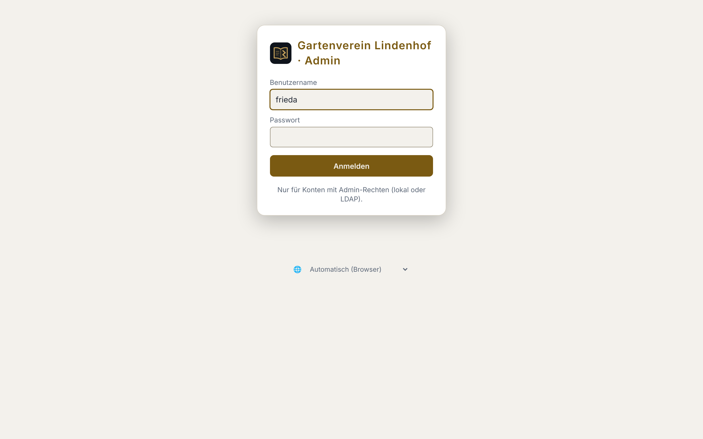
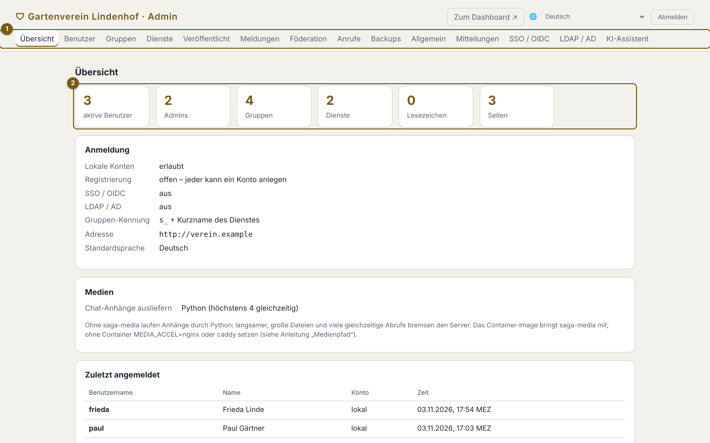
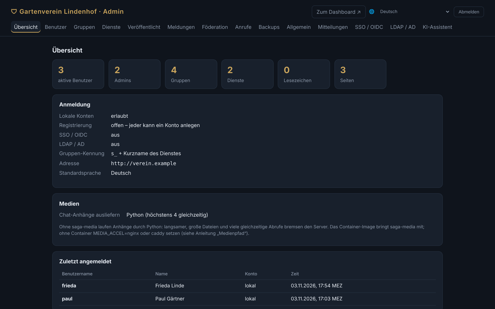

# A01 Überblick und Admin-Bereich

**Gilt für:** Web (am Computer)

[← Übersicht](../README.md) · [Weiter: A02 Benutzer, Registrierung, Gruppen →](02-benutzer-gruppen.md)

---

## Typische Aufgaben

- **Montags kurz nachsehen.** Frieda öffnet die Übersicht des Gartenvereins: 23 aktive Mitglieder, keine gesperrten
  Anmeldungen, alles in Ordnung.
- **Neue Leute aufnehmen.** Ein neues Mitglied braucht ein Konto – Frieda legt es unter **Benutzer** an.
- **Etwas für alle einschalten.** Anna schaltet für die Familie das Wetter-Widget ein – unter **Allgemein**.
- **Auf Hinweise reagieren.** Oben in der Übersicht erscheint ein gelber Hinweis zum Reverse Proxy; Anna liest nach,
  was zu tun ist.

## Wofür ist das?

Der **Admin-Bereich** ist die Schaltzentrale von Saga. Hier legst du Konten an, richtest Dienste ein, stellst ein,
welche Funktionen eure Leute nutzen können, und verbindest euren Server mit anderen.

Der Admin-Bereich ist **getrennt** von der normalen Saga-Oberfläche: eigene Adresse, eigene Anmeldung. Das schützt
ihn vor Angriffen aus dem Internet.

> **Datenschutz:** Auch als Admin siehst du **keine Inhalte** deiner Leute – keine Seiten, Kalender, Fotos oder
> Chats. Du siehst nur Anzahlen (wie viele Seiten, wie viele Chats). Chats sind ohnehin Ende-zu-Ende verschlüsselt.

Wie du Saga installierst, sicherst und aktualisierst, steht in der [Anleitung](../../ANLEITUNG.md). Dieses Handbuch
erklärt die Bedienung des Admin-Bereichs.

---

## Schritt für Schritt

### 1. Den Admin-Bereich öffnen

Der Admin-Bereich läuft auf einem **eigenen Port** (Standard 8081) und ist ab Werk nur auf dem Server selbst
erreichbar. Von deinem Rechner aus kommst du meist über einen SSH-Tunnel hin. Wie das geht und wie du ihn im Heimnetz
erreichbar machst, steht in der Anleitung, [Abschnitt 4 „Der Admin-Bereich“](../../ANLEITUNG.md#4-der-admin-bereich).

> **Wichtig:** Stell den Admin-Port nie direkt ins Internet.

### 2. Anmelden

1. Öffne die Adresse des Admin-Bereichs im Browser.
2. Melde dich mit einem Konto an, das **Admin-Rechte** hat – lokal oder per LDAP.
3. Verlangt Saga für Admins einen zweiten Faktor, gibst du danach den Code aus deiner Authenticator-App ein. Hast du
   noch keinen, führt Saga dich durch die Einrichtung.

> **Hinweis:** Passkeys funktionieren im Admin-Bereich nur, wenn er unter derselben Domain läuft wie Saga selbst.
> Sonst nimmst du dort die Authenticator-App oder einen Wiederherstellungscode. Mehr in
> [A04 Anmeldung und Sicherheit](04-anmeldung.md).

### 3. Die Übersicht

Nach der Anmeldung landest du auf der **Übersicht**.

Was die Nummern bedeuten:

- ① Das **Menü** des Admin-Bereichs.
- ② Die **Kennzahlen** auf einen Blick.

Die Übersicht zeigt:

- **Aktive Benutzer**, Admins, Gruppen, Dienste, Lesezeichen und Seiten (nur Anzahlen).
- **Anmeldung:** ob lokale Konten erlaubt sind, ob die Registrierung offen ist, die Gruppen-Kennung und die
  Standardsprache.
- **Medien:** wie Chat-Anhänge ausgeliefert werden. Steht dort „Python“, laufen große Dateien langsamer – Hinweise
  dazu in der Anleitung, Abschnitt „Medienpfad (saga-media)“.
- **Gesperrte Anmeldungen:** Konten, deren Passwort-Anmeldung nach sehr vielen Fehlversuchen vorübergehend gesperrt
  ist (siehe [A04](04-anmeldung.md)).
- **Zuletzt angemeldet:** wer sich wann angemeldet hat.

Oben erscheinen außerdem **Hinweise**, wenn etwas zu tun ist – etwa eine neue Saga-Version (siehe
[A10](10-updates.md)) oder ein Problem mit dem Reverse Proxy (siehe [A04](04-anmeldung.md)).

### 4. Das Menü

| Menüpunkt | Was du dort machst | Kapitel |
|---|---|---|
| Übersicht | Kennzahlen und Hinweise | dieses Kapitel |
| Benutzer | Konten anlegen, sperren, Passwort setzen, 2FA zurücksetzen | [A02](02-benutzer-gruppen.md) |
| Gruppen | Gruppen anlegen und ansehen | [A02](02-benutzer-gruppen.md) |
| Dienste | Kacheln für eure Dienste | [A03](03-dienste.md) |
| Veröffentlicht | öffentliche Seiten im Blick, zurückziehen | [A08](08-inhalte-meldungen.md) |
| Meldungen | gemeldete Chat-Nachrichten | [A08](08-inhalte-meldungen.md) |
| Föderation | mit anderen Saga-Servern verbinden | [A07](07-foederation.md) |
| Anrufe | TURN, große Gruppenanrufe, Knoten | [A06](06-anrufe-knoten.md) |
| Backups | Server-Backups und persönliche Backups | Anleitung, Abschnitt 11 |
| Allgemein | fast alle Schalter | [A05](05-allgemein.md) |
| Mitteilungen | Web Push, ntfy, UnifiedPush, Apple Push | [A05](05-allgemein.md) |
| KI-Assistent | Sprachmodell, Persona, Websuche | [A05](05-allgemein.md) |
| SSO / OIDC, LDAP / AD | Anmeldung über einen Anmeldedienst | [A04](04-anmeldung.md) |

Oben rechts kommst du mit **Zum Dashboard** in die normale Saga-Oberfläche und mit **Abmelden** hinaus. Unten auf
jeder Seite steht die installierte Version.

### 5. Hell oder dunkel, Sprache

Der Admin-Bereich folgt der Hell-/Dunkel-Einstellung deines Systems. Die Sprache stellst du über den Umschalter in
der Kopfzeile oder auf der Anmeldeseite um.

---

## Beispiel aus dem Alltag

**Frieda macht ihren Montags-Check.** Frieda ist Vorsitzende und Admin des Gartenvereins auf `verein.example`.

1. Frieda öffnet den Admin-Bereich und meldet sich mit Passwort und Code aus ihrer Authenticator-App an.
2. In der Übersicht sieht sie: 23 aktive Benutzer, 2 Admins, keine gesperrten Anmeldungen.
3. Unter **Zuletzt angemeldet** sieht sie, dass Paul gestern die Kassenseite bearbeitet hat – alles normal.
4. Oben steht ein Hinweis: „Saga 2.5.1 ist erschienen“. Frieda notiert sich, am Wochenende zu aktualisieren (siehe
   [A10](10-updates.md)).
5. Unter **Meldungen** ist nichts Neues. Frieda meldet sich ab.

---

## Häufige Fragen

**Ich komme nicht an den Admin-Bereich heran.**
Ab Werk ist er nur auf dem Server selbst erreichbar. Nutze einen SSH-Tunnel oder stell ihn fürs Heimnetz frei – siehe
Anleitung, Abschnitt 4.

**Kann ich die Seiten meiner Leute lesen?**
Nein. Admins sehen nur Anzahlen. Das ist Absicht.

**Wer darf in den Admin-Bereich?**
Alle Konten mit dem Haken **Admin-Rechte** (siehe [A02](02-benutzer-gruppen.md)). Sie können sich hier auch dann
anmelden, wenn lokale Konten auf der normalen Anmeldeseite abgeschaltet sind.

**Ich habe mich als einziger Admin ausgesperrt.**
Die Notfall-Befehle auf dem Server (Passwort, zweiter Faktor) stehen in der Anleitung, Abschnitt 2.

---

## Auf dem Handy und in den Apps

Der Admin-Bereich ist für den Computer gemacht. Im Handy-Browser funktioniert er auch – die Reiterleisten lassen sich
seitlich wischen. In den Apps gibt es keinen Admin-Bereich.

---

[← Übersicht](../README.md) · [Weiter: A02 Benutzer, Registrierung, Gruppen →](02-benutzer-gruppen.md)
