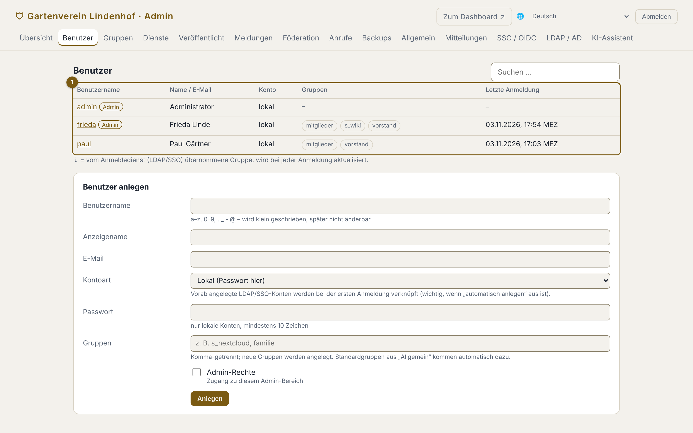
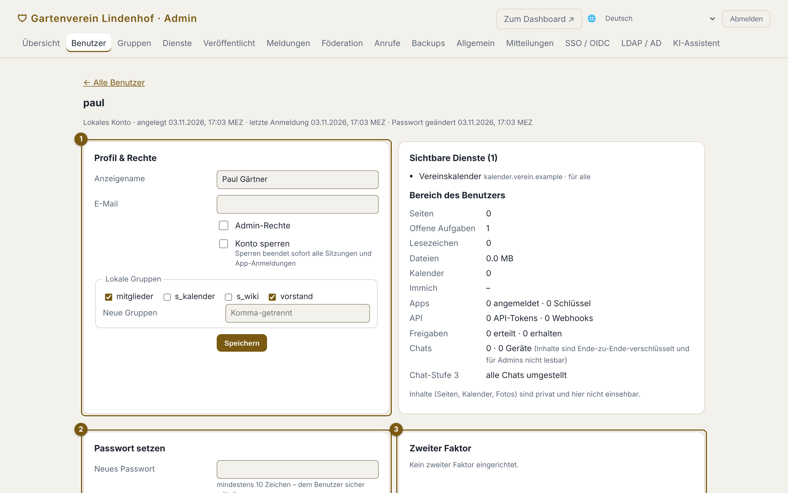
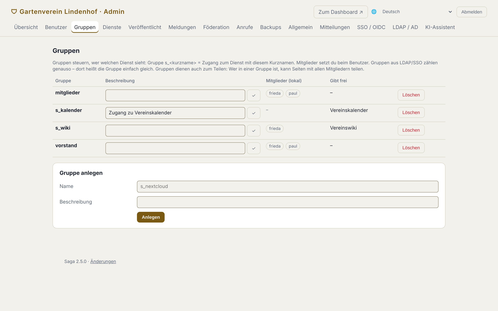

# A02 Benutzer, Registrierung, Gruppen

**Gilt für:** Web (Admin-Bereich)

[← Übersicht](../README.md) · [Weiter: A03 Dienste →](03-dienste.md)

---

## Typische Aufgaben

- **Neues Mitglied aufnehmen.** Paul wird Kassenwart im Gartenverein. Frieda legt ihm ein Konto an und gibt ihm die
  Gruppe `vorstand`.
- **Passwort vergessen.** Oma Lena kommt nicht mehr hinein. Anna setzt ihr ein neues Passwort.
- **Handy verloren.** Ben hat sein Handy im Zug liegen lassen. Anna klickt bei ihm auf **Überall abmelden**.
- **Mitglied tritt aus.** Ein Mitglied verlässt den Verein. Frieda sperrt das Konto erst und löscht es später.
- **Jeder darf sich selbst anmelden.** Für das Sommerfest-Wochenende schaltet Frieda die Selbst-Registrierung ein.

## Wofür ist das?

Unter **Benutzer** verwaltest du alle Konten: anlegen, Rechte geben, Passwort setzen, sperren, löschen. Unter
**Gruppen** ordnest du die Konten. Gruppen entscheiden in Saga zwei Dinge:

- **Wer welchen Dienst sieht** – über eine Gruppen-Kennung wie `s_wiki` (siehe [A03 Dienste](03-dienste.md)).
- **Mit wem man teilen kann** – wer in einer Gruppe ist, kann Seiten mit allen Mitgliedern teilen.

Gruppen können in Saga selbst angelegt werden oder aus LDAP bzw. einem SSO-Anbieter kommen. Für Saga zählen beide
gleich.

---

## Schritt für Schritt

### 1. Die Benutzerliste

Klick im Menü auf **Benutzer**.

Was die Nummern bedeuten:

- ① Die Liste – ein Klick auf den Namen öffnet das Konto.

Du siehst je Konto: Benutzername, Name und E-Mail, Kontoart (lokal, LDAP, SSO), Gruppen und letzte Anmeldung.
Markierungen wie **Admin**, **gesperrt** oder **Anmeldung gesperrt** fallen sofort auf. Gruppen mit ⇣ kommen vom
Anmeldedienst und werden bei jeder Anmeldung aktualisiert.

### 2. Ein Konto anlegen

Unter der Liste steht **Benutzer anlegen**:

1. **Benutzername:** nur `a–z`, `0–9`, `.`, `_`, `-` und `@`. Er wird klein geschrieben und lässt sich später **nicht
   ändern**.
2. **Anzeigename** und **E-Mail** (optional).
3. **Kontoart:**
   - **Lokal (Passwort hier)** – das Passwort liegt in Saga.
   - **LDAP/AD** bzw. **SSO** – nur nötig, wenn diese Konten nicht automatisch angelegt werden. Die Person meldet
     sich dann mit ihrem Verzeichnis- bzw. SSO-Passwort an.
4. **Passwort** (nur lokale Konten, mindestens 10 Zeichen).
5. **Gruppen**, mit Komma getrennt. Gruppen, die es noch nicht gibt, legt Saga an. Die **Standardgruppen** aus
   „Allgemein“ kommen automatisch dazu.
6. **Admin-Rechte** nur ankreuzen, wenn die Person in diesen Admin-Bereich darf.
7. Klick auf **Anlegen**.

Teil der Person den Benutzernamen und das Passwort auf einem sicheren Weg mit. Sie kann danach ihr Passwort selbst
ändern und sich einen zweiten Faktor einrichten (Benutzer-Handbuch, [Erste Schritte](../benutzer/01-erste-schritte.md)).

### 3. Ein Konto bearbeiten

Ein Klick auf den Namen öffnet die Kontoseite.

Was die Nummern bedeuten:

- ① **Profil & Rechte**: Anzeigename, E-Mail, Admin-Rechte, Gruppen.
- ② **Passwort setzen**.
- ③ **2FA zurücksetzen**.

Was du hier tun kannst:

- **Profil & Rechte:** Anzeigename, E-Mail, **Admin-Rechte**, **Konto sperren** und lokale Gruppen ändern. Bei
  LDAP/SSO-Konten überschreibt der Anmeldedienst manches bei jeder Anmeldung.
- **Passwort setzen** (nur lokale Konten): neues Passwort mit mindestens 10 Zeichen. Mit **Auch App-Anmeldungen und
  App-Schlüssel widerrufen** werden auch alle Apps abgemeldet. Passwort setzen hebt eine Anmeldesperre auf.
- **Sperre aufheben:** Nach sehr vielen falschen Passwörtern von vielen Adressen sperrt Saga die Passwort-Anmeldung
  eines Kontos für eine Stunde (Passkeys gehen weiter). Hier hebst du die Sperre vorzeitig auf.
- **Zweiter Faktor:** zeigt, ob Passkeys, Authenticator-App und wie viele Wiederherstellungscodes da sind.
  **2FA zurücksetzen** entfernt alles – nur, wenn die Person wirklich alles verloren hat **und** du sicher bist, dass
  sie es ist.
- **SSO-Verknüpfung lösen:** nach einem Wechsel des SSO-Anbieters, wenn die Person sonst nicht mehr hineinkommt.
- **Sitzungen → Überall abmelden:** beendet alle Browser-Sitzungen und meldet alle Apps ab – zum Beispiel bei einem
  verlorenen Gerät.
- **API-Tokens widerrufen:** sperrt alle Tokens des Kontos; die zugehörigen Webhooks werden abgeschaltet.
- **Konto löschen:** löscht das Konto mit **allen** Seiten, Aufgaben, Dateien und Verbindungen endgültig. Zur
  Bestätigung tippst du den Benutzernamen ein.

Daneben steht der **Bereich des Benutzers**: wie viele Seiten, Aufgaben, Lesezeichen, Dateien, Apps, Tokens,
Freigaben und Chat-Geräte es gibt. Inhalte siehst du nicht.

> **Tipp:** Bei LDAP- und SSO-Konten lieber **sperren** als löschen. Sonst entsteht bei der nächsten Anmeldung ein
> neues, leeres Konto.

### 4. Selbst-Registrierung

Soll sich jeder selbst ein Konto anlegen können, schalte unter **Allgemein → Anmeldung & Konten → Registrierung
erlauben** ein. Auf der Anmeldeseite erscheint dann „Jetzt registrieren“. Neue Konten bekommen automatisch die
**Standardgruppen** (gleiche Stelle).

> **Wichtig:** Ist der Server aus dem Internet erreichbar, kann sich dann **jeder** ein Konto anlegen. Schalte die
> Registrierung nur ein, wenn du das willst – oder nur für kurze Zeit.

### 5. Gruppen

Klick im Menü auf **Gruppen**.

- **Gruppe anlegen:** Name eintragen, **Anlegen**.
- Die **Mitglieder** setzt du beim jeweiligen Benutzer (Abschnitt 3).
- Gruppen, die mit der **Gruppen-Kennung** beginnen (Standard `s_`), geben Zugang zu einem Dienst: `s_wiki` sieht den
  Dienst mit dem Kurznamen `wiki` (siehe [A03 Dienste](03-dienste.md)). Die Spalte **Gibt frei** zeigt das.
- Darunter stehen die **Gruppen vom Anmeldedienst (LDAP/SSO)**. Sie zählen genauso.

Wie LDAP- und SSO-Gruppen übernommen werden, steht in der Anleitung, Abschnitte
[7 „LDAP / Active Directory“](../../ANLEITUNG.md#7-ldap--active-directory) und
[8 „SSO mit OpenID Connect“](../../ANLEITUNG.md#8-sso-mit-openid-connect).

---

## Beispiel aus dem Alltag

**Paul wird Kassenwart.** Paul ist neu im Vorstand des Gartenvereins und braucht ein Konto.

1. Frieda öffnet **Benutzer** und scrollt zu **Benutzer anlegen**.
2. Benutzername `paul`, Anzeigename „Paul“, Kontoart **Lokal**, ein vorläufiges Passwort mit 14 Zeichen.
3. Bei **Gruppen** trägt sie `vorstand` ein. `mitglieder` kommt als Standardgruppe von selbst dazu.
4. Admin-Rechte lässt sie aus – Paul braucht den Admin-Bereich nicht.
5. Sie klickt auf **Anlegen** und gibt Paul Benutzernamen und Passwort persönlich.
6. Paul meldet sich an, ändert sein Passwort und richtet einen Passkey ein.

**Ben hat sein Handy verloren.** Ben ruft Anna aus dem Büro an.

1. Anna öffnet **Benutzer → ben**.
2. Unter **Sitzungen** klickt sie auf **Überall abmelden**. Alle Browser und Apps von Ben sind sofort abgemeldet.
3. Ben meldet sich am Büro-Rechner neu an und entfernt das verlorene Handy zusätzlich unter **Chats → ⚙ Chats &
   Geräte**.

---

## Häufige Fragen

**Kann ich einen Benutzernamen ändern?**
Nein. Leg bei Bedarf ein neues Konto an. Den **Anzeigenamen** kannst du jederzeit ändern.

**Jemand hat Passkey, Handy und Wiederherstellungscodes verloren.**
Prüfe, dass es wirklich die Person ist, und klick auf **2FA zurücksetzen**. Danach meldet sie sich nur mit dem
Passwort an und richtet einen neuen Faktor ein.

**Warum steht „Anmeldung gesperrt“ beim Konto?**
Jemand hat sehr oft ein falsches Passwort probiert, von vielen Adressen aus. Saga schützt das Konto eine Stunde lang.
Die Person wurde benachrichtigt. Mit **Sperre aufheben** oder **Passwort setzen** ist es sofort vorbei.

**Was passiert beim Löschen mit geteilten Seiten?**
Die Seiten der Person sind weg – auch für alle, mit denen sie geteilt waren. Wer Inhalte behalten will, sollte sie
vorher übernehmen.

---

## Auf dem Handy und in den Apps

Die Verwaltung gibt es nur im Admin-Bereich im Browser. Nach **Überall abmelden** oder **Passwort setzen** mit
Widerruf melden sich die Apps der Person einmal neu an.

---

[← Übersicht](../README.md) · [Weiter: A03 Dienste →](03-dienste.md)
