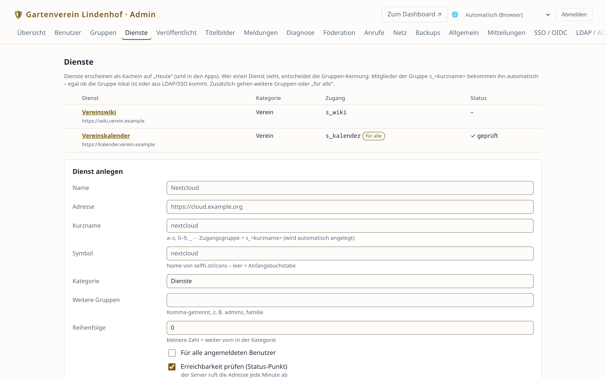
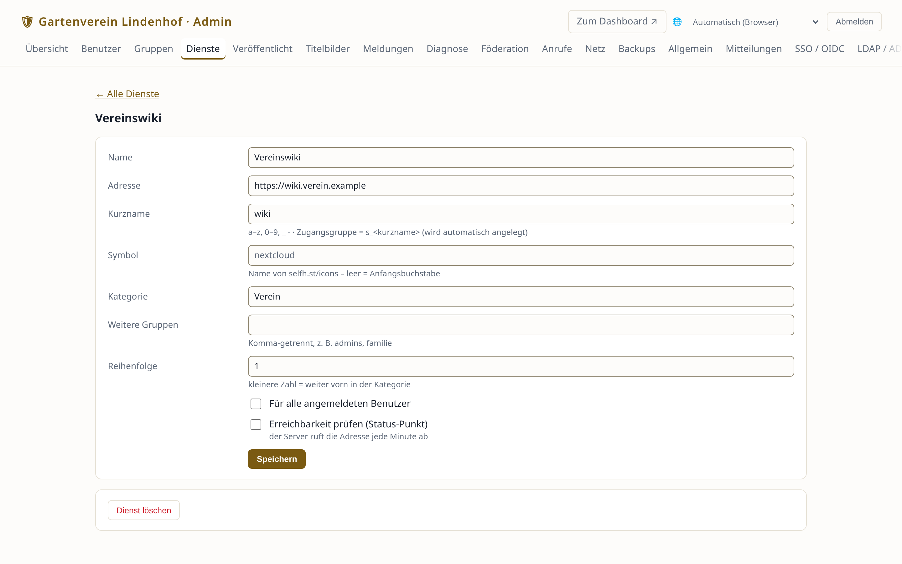

# A03 Dienste – Kacheln für eure Dienste

**Gilt für:** Web (Admin-Bereich) · Anzeige in allen Apps

[← Übersicht](../README.md) · [Weiter: A04 Anmeldung und Sicherheit →](04-anmeldung.md)

---

## Typische Aufgaben

- **Das Vereinswiki nur für Berechtigte.** Frieda legt die Kachel „Vereinswiki“ an. Sie erscheint nur bei Leuten in
  der Gruppe `s_wiki`.
- **Etwas für alle.** Der „Vereinskalender“ soll bei jedem Mitglied auf „Heute“ stehen – Haken **Für alle
  angemeldeten Benutzer**.
- **Ordnung schaffen.** Anna sortiert die Familiendienste in Kategorien: „Medien“ (Jellyfin), „Haus“ (Home Assistant),
  „Dateien“ (Nextcloud).
- **Sehen, ob etwas läuft.** Mit **Erreichbarkeit prüfen** zeigt jede Kachel einen grünen oder roten Punkt.

## Wofür ist das?

**Dienste** sind die Kacheln auf „Heute“ bei euren Leuten – Links zu den Programmen, die ihr selbst betreibt. Anders
als Lesezeichen (die jede Person für sich anlegt) richtest du Dienste für alle ein und bestimmst, wer welchen sieht.

Das Prinzip ist einfach: Ein Dienst hat einen **Kurznamen**, zum Beispiel `wiki`. Wer in der Gruppe **`s_wiki`** ist,
sieht ihn. `s_` ist die **Gruppen-Kennung** (änderbar unter Allgemein → Dienste). Das klappt mit Saga-Gruppen genauso
wie mit Gruppen aus LDAP oder SSO.

---

## Schritt für Schritt

### 1. Die Dienste-Liste

Klick im Menü auf **Dienste**.

Du siehst je Dienst: Name, Kategorie, wer Zugang hat und – wenn eingeschaltet – den Status (✓ geprüft).

### 2. Einen Dienst anlegen

Unter der Liste steht **Dienst anlegen**:

1. **Name:** so heißt die Kachel, zum Beispiel „Vereinswiki“.
2. **Adresse:** wohin die Kachel führt, zum Beispiel `https://wiki.verein.example`.
3. **Kurzname:** `a–z`, `0–9`, `_`, `-`. Daraus entsteht die Zugangsgruppe – bei `wiki` also `s_wiki`. Saga legt sie
   automatisch an.
4. **Symbol:** ein Name aus [selfh.st/icons](https://selfh.st/icons), zum Beispiel `nextcloud` oder
   `home-assistant`. Leer = Anfangsbuchstabe.
5. **Kategorie:** Überschrift, unter der die Kachel steht (Standard „Dienste“).
6. **Weitere Gruppen:** mit Komma getrennt, zum Beispiel `vorstand, familie`. Mitglieder dieser Gruppen sehen den
   Dienst zusätzlich.
7. **Reihenfolge:** kleinere Zahl = weiter vorn in der Kategorie.
8. **Für alle angemeldeten Benutzer:** Haken setzen, wenn jeder den Dienst sehen soll.
9. **Erreichbarkeit prüfen:** Der Server ruft die Adresse jede Minute ab und zeigt einen Status-Punkt auf der Kachel.
10. Klick auf **Anlegen**.

Danach gibst du den passenden Leuten die Gruppe `s_wiki` – beim Benutzer (siehe
[A02](02-benutzer-gruppen.md)) oder in eurem LDAP bzw. SSO.

> **Tipp:** Soll ein Dienst bei jedem neuen Konto erscheinen, trag seine Gruppe (zum Beispiel `s_wiki`) unter
> **Allgemein → Standardgruppen** ein.

### 3. Dienste aus LDAP

Nutzt ihr LDAP (zum Beispiel FreeIPA), kann Saga Dienste auch aus den **Beschreibungen** von LDAP-Gruppen übernehmen.
Diese stehen dann unter „Aus LDAP-Gruppenbeschreibungen“ und lassen sich nur im Verzeichnis ändern. Ein Dienst mit
gleichem Kurznamen im Admin-Bereich hat Vorrang. Das Format steht in der Anleitung,
[Abschnitt 6 „Gruppen und Dienste“](../../ANLEITUNG.md#6-gruppen-und-dienste).

### 4. Favicons

Dienste zeigen immer ihr festes Symbol oder den Anfangsbuchstaben. Der Schalter **Allgemein → Dienste → Favicons
laden** betrifft nur die **Lesezeichen** eurer Leute: Saga sucht dann für Lesezeichen ohne Symbol ein passendes
Symbol oder das Bildchen der Webseite.

---

## Beispiel aus dem Alltag

**Frieda richtet das Vereinswiki ein.** Der Verein betreibt ein Wiki unter `wiki.verein.example`. Nur der Vorstand
und die Wiki-Redaktion sollen es auf „Heute“ sehen.

1. Frieda öffnet **Dienste** und füllt **Dienst anlegen** aus: Name „Vereinswiki“, Adresse
   `https://wiki.verein.example`, Kurzname `wiki`, Symbol `bookstack`, Kategorie „Verein“.
2. Bei **Weitere Gruppen** trägt sie `vorstand` ein.
3. Sie setzt den Haken bei **Erreichbarkeit prüfen** und klickt auf **Anlegen**.
4. Saga legt die Gruppe `s_wiki` an. Frieda gibt sie unter **Benutzer** den zwei Leuten aus der Redaktion.
5. Paul (im Vorstand) und die Redaktion sehen die Kachel jetzt mit grünem Punkt. Alle anderen nicht.

**Anna ordnet die Familien-Kacheln.** Anna hat Nextcloud, Jellyfin und Home Assistant als Dienste.

1. Sie öffnet jeden Dienst und setzt die Kategorien „Dateien“, „Medien“ und „Haus“.
2. Bei allen dreien setzt sie den Haken **Für alle angemeldeten Benutzer**.
3. Bei Home Assistant setzt sie die Reihenfolge auf `1`, damit die Kachel ganz vorn steht.

---

## Häufige Fragen

**Jemand sieht einen Dienst nicht.**
Prüfe beim Benutzer, ob er in der Gruppe `s_<kurzname>` oder einer der weiteren Gruppen ist. LDAP/SSO-Gruppen kommen
erst mit der nächsten Anmeldung an.

**Der Status-Punkt ist rot, der Dienst geht aber.**
Geprüft wird vom Saga-Server aus, nicht von deinem Gerät. Erreicht der Server die Adresse nicht – zum Beispiel, weil
sie nur in deinem WLAN oder über ein VPN auflöst –, bleibt der Punkt rot. Prüfe Namensauflösung und Firewall des
Servers (bei Docker: aus dem Container heraus).

**Kann ich die Gruppen-Kennung ändern?**
Ja, unter **Allgemein → Dienste → Gruppen-Kennung**. Bestehende Gruppen werden dabei nicht umbenannt.

---

## Auf dem Handy und in den Apps

Dienste legst du nur im Admin-Bereich an. Angezeigt werden sie überall: auf „Heute“ im Browser und in allen
Apps unter **Dienste**.

---

[← Übersicht](../README.md) · [Weiter: A04 Anmeldung und Sicherheit →](04-anmeldung.md)
