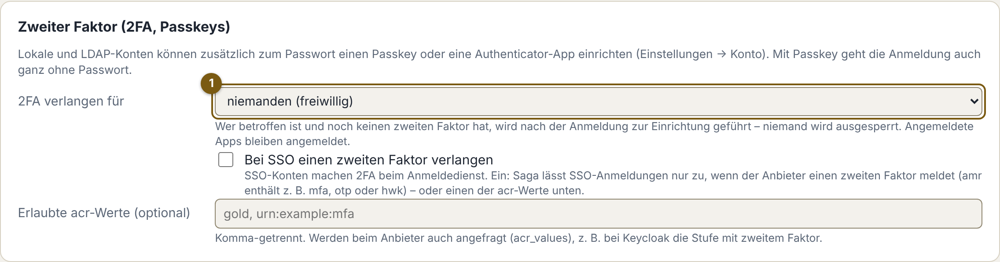
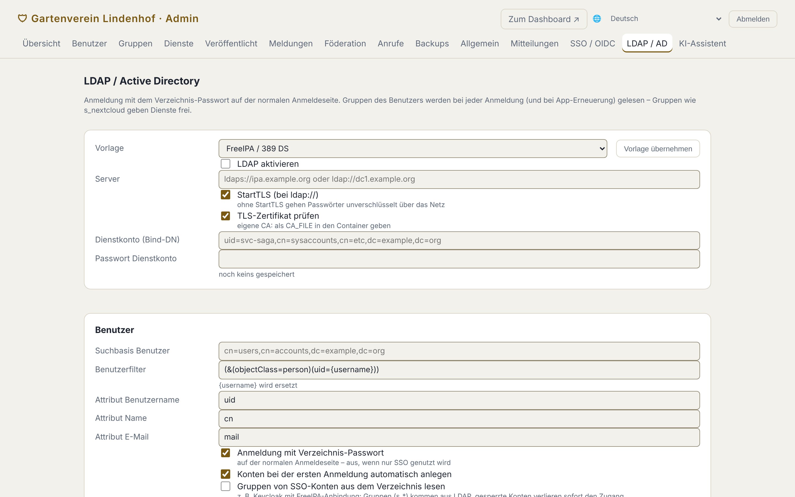
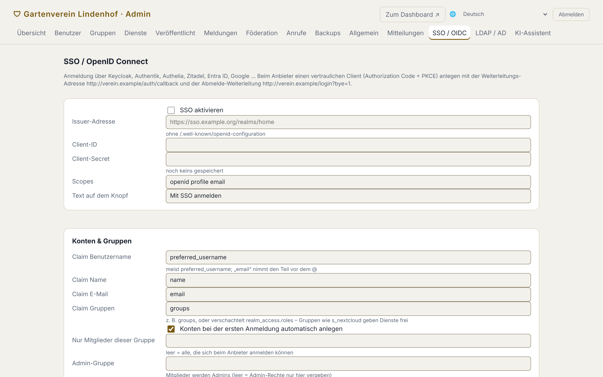
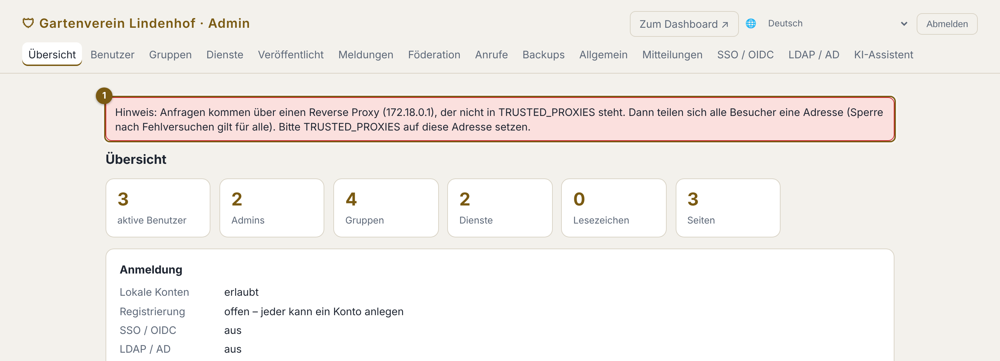

# A04 Anmeldung und Sicherheit

**Gilt für:** Web (Admin-Bereich)

[← Übersicht](../README.md) · [Weiter: A05 Schalter unter „Allgemein“ →](05-allgemein.md)

---

## Typische Aufgaben

- **Admins besser schützen.** Frieda verlangt für alle Admins des Gartenvereins einen zweiten Faktor.
- **Ein Konto für alles.** Der Verein hat schon ein Verzeichnis (LDAP) – Frieda bindet es an, damit niemand ein
  weiteres Passwort braucht.
- **Anmelden über SSO.** Anna verbindet das Familien-Saga mit ihrem Anmeldedienst (zum Beispiel Keycloak). Auf der
  Anmeldeseite steht dann „Mit Familienkonto anmelden“.
- **Einen Hinweis verstehen.** Oben im Admin-Bereich steht „Hinweis: Anfragen kommen über einen Reverse Proxy …“ –
  Anna weiß, was zu tun ist.

## Wofür ist das?

Hier legst du fest, **wie** sich eure Leute anmelden und **wie sicher** das ist:

- mit lokalen Konten (Passwort in Saga), über **LDAP/Active Directory** oder über einen **SSO-Anbieter** (OpenID
  Connect),
- mit oder ohne **zweiten Faktor** (Passkey oder Authenticator-App),
- und mit einer eingebauten Bremse gegen das Durchprobieren von Passwörtern.

Die technische Einrichtung von LDAP und SSO (Adressen, Dienstkonto, Client beim Anbieter) steht in der Anleitung,
[Abschnitt 7 „LDAP / Active Directory“](../../ANLEITUNG.md#7-ldap--active-directory) und
[Abschnitt 8 „SSO mit OpenID Connect“](../../ANLEITUNG.md#8-sso-mit-openid-connect). Hier geht es um den Überblick
und die Schalter.

---

## Schritt für Schritt

### 1. Lokale Konten an oder aus

Unter **Allgemein → Anmeldung & Konten → Anmeldung mit lokalen Konten**:

- **an** – auf der Anmeldeseite gibt es Benutzername und Passwort.
- **aus** – auf der Anmeldeseite nur LDAP bzw. SSO. Im Admin-Bereich können sich Admins mit lokalem Konto trotzdem
  weiter anmelden.

### 2. Zweiten Faktor verlangen

Jede Person kann sich selbst einen Passkey oder eine Authenticator-App einrichten (Benutzer-Handbuch,
[Erste Schritte](../benutzer/01-erste-schritte.md)). Du kannst das auch **verlangen**:

1. Öffne **Allgemein → Zweiter Faktor (2FA, Passkeys)**.
2. Wähl bei ① **2FA verlangen für**: **niemanden (freiwillig)**, **Admins** oder **alle lokalen und LDAP-Konten**.
3. Klick auf **Speichern**.

Was die Nummern bedeuten:

- ① **2FA verlangen für** – die Richtlinie.

Was dann passiert:

- Wer betroffen ist und noch keinen Faktor hat, wird **nach der Anmeldung zur Einrichtung geführt**. Ausgesperrt
  wird niemand.
- Schon angemeldete Apps und Sitzungen bleiben angemeldet.
- Bei „alle“ brauchen auch **neue App-Anmeldungen** einen Faktor.
- Auch im **Admin-Bereich** gilt die Regel: Ein Admin ohne Faktor richtet nach dem Passwort eine Authenticator-App
  ein.

**SSO-Konten** machen den zweiten Faktor beim Anmeldedienst. Mit **Bei SSO einen zweiten Faktor verlangen** lässt
Saga SSO-Anmeldungen nur zu, wenn der Anbieter einen zweiten Faktor meldet. Optional kannst du dafür **erlaubte
acr-Werte** eintragen.

> **Tipp:** Hat jemand Passkey, Handy und Wiederherstellungscodes verloren, setzt du den zweiten Faktor beim Konto
> zurück (siehe [A02](02-benutzer-gruppen.md)).

### 3. LDAP / Active Directory

Klick im Menü auf **LDAP / AD**.

Kurz zusammengefasst:

1. Wähl eine **Vorlage** (FreeIPA, 389 DS, Active Directory …). Sie füllt die typischen Felder vor.
2. Trag Server, Dienstkonto und Suchbasis ein (Werte siehe Anleitung, Abschnitt 7).
3. Mit **Testen** prüfst du die Verbindung und die Suche nach einem Benutzer.
4. Speichern – ab jetzt melden sich Verzeichnis-Konten mit ihrem gewohnten Passwort an. Ihre Gruppen kommen bei jeder
   Anmeldung mit.

### 4. SSO mit OpenID Connect

Klick im Menü auf **SSO / OIDC**.

1. Leg beim Anbieter (zum Beispiel Keycloak, Authentik) einen Client an. Die **Weiterleitungs-Adresse**, die du dort
   brauchst, zeigt dir Saga auf dieser Seite.
2. Trag Issuer-Adresse, Client-ID und Client-Secret ein.
3. Leg fest, wie Benutzername und Gruppen übernommen werden.
4. Speichern – auf der Anmeldeseite erscheint ein Knopf für die SSO-Anmeldung.

Die Felder im Einzelnen erklärt die Anleitung, Abschnitt 8.

### 5. Profilbilder

Unter **Allgemein → Profilbilder** legst du fest, woher Profilbilder kommen dürfen:

- **Gravatar verwenden** – für Konten ohne eigenes Bild, nur wenn die Person das selbst einschaltet.
- **Bild aus dem SSO übernehmen** – das Bild, das der Anmeldedienst meldet.
- **Bild aus LDAP übernehmen** – das Foto aus dem Verzeichnis.

Eigene Bilder können alle jederzeit hochladen.

### 6. Fehlversuche und Sperren

Saga sperrt Konten nicht nach ein paar falschen Passwörtern. Es **bremst** stattdessen die Adresse, von der die
Fehlversuche kommen. So kann niemand ein fremdes Konto einfach durch falsche Eingaben aussperren.

Nur bei sehr vielen Fehlversuchen von vielen verschiedenen Adressen sperrt Saga die Anmeldung mit Passwort für eine
Stunde. Dann:

- steht das Konto auf der **Übersicht** unter „Gesperrte Anmeldungen“ und in der Benutzerliste mit
  „Anmeldung gesperrt“,
- bekommt die Person eine Benachrichtigung,
- funktionieren Passkeys und offene Sitzungen weiter,
- hebst du die Sperre beim Konto mit **Sperre aufheben** auf (siehe [A02](02-benutzer-gruppen.md)).

Die genauen Grenzen stehen in der Anleitung, Abschnitt 12, „Zu viele Fehlversuche“.

### 7. Hinweise zum Reverse Proxy

Damit die Bremse richtig funktioniert, muss Saga die **echte Adresse** jeder Person sehen. Klappt das nicht, zeigt der
Admin-Bereich oben einen Hinweis.

Was die Nummern bedeuten:

- ① Der Hinweis. Er erscheint, solange das Problem besteht, und verschwindet 24 Stunden nach dem letzten Auftreten.

Es gibt zwei Hinweise:

- **„Anfragen kommen über einen Reverse Proxy (…), der nicht in TRUSTED_PROXIES steht.“** Saga sieht nur die
  Adresse des Proxys. Dann teilen sich alle Besucher eine Adresse – und eine Bremse.
- **„Anmeldungen kommen vom Docker-Gateway (…) statt von der echten Adresse der Besucher.“** Das passiert meist bei
  IPv6-Zugriffen, wenn Docker die Verbindung weiterreicht.

Beides behebst du in der Server-Konfiguration – Schritt für Schritt erklärt in der Anleitung,
[Abschnitt 3 „HTTPS mit Reverse Proxy“](../../ANLEITUNG.md#3-https-mit-reverse-proxy) (Einstellung `TRUSTED_PROXIES`
und Absatz „IPv6 und Docker“).

---

## Beispiel aus dem Alltag

**Frieda verlangt 2FA für alle Admins.** Im Gartenverein haben Frieda und ihr Stellvertreter Admin-Rechte. Frieda
will die Admin-Konten besser schützen.

1. Frieda richtet sich selbst zuerst einen Passkey und eine Authenticator-App ein (Einstellungen → Konto →
   Anmeldung & Sicherheit).
2. Im Admin-Bereich öffnet sie **Allgemein → Zweiter Faktor**.
3. Bei **2FA verlangen für** wählt sie **Admins** und speichert.
4. Ihr Stellvertreter meldet sich am Abend an. Saga führt ihn nach dem Passwort zur Einrichtung. Er scannt den
   QR-Code mit seiner Authenticator-App, tippt einen Code ein – fertig.
5. Die normalen Mitglieder merken nichts davon.

---

## Häufige Fragen

**Kann ich 2FA für SSO-Konten in Saga einschalten?**
Nein. SSO-Konten machen den zweiten Faktor beim Anmeldedienst. Mit **Bei SSO einen zweiten Faktor verlangen** stellst
du sicher, dass er dort auch wirklich abgefragt wurde.

**Passkeys gehen im Admin-Bereich nicht.**
Passkeys gehören zu einer Domain. Läuft der Admin-Bereich unter einer anderen Adresse als Saga, nimm dort die
Authenticator-App. Details: Anleitung, Abschnitt 9, „Passkeys und Zwei-Faktor-Anmeldung“.

**Ich habe mich als einziger Admin selbst ausgesperrt.**
Die Notfall-Befehle für Passwort und zweiten Faktor stehen in der Anleitung, Abschnitt 2.

**Muss ich mich um die Hinweise sofort kümmern?**
Saga läuft weiter. Aber solange der Hinweis da ist, teilen sich viele Besucher eine Bremse – im schlimmsten Fall
müssen alle warten, weil einer sich vertippt. Kümmere dich bald darum.

---

## Auf dem Handy und in den Apps

Die Apps melden sich über die Anmeldeseite von Saga im Browserfenster an – deshalb gelten dort dieselben Regeln:
LDAP, SSO, Passkeys und zweiter Faktor funktionieren in der App genauso. Die Einstellungen dazu gibt es nur im
Admin-Bereich.

---

[← Übersicht](../README.md) · [Weiter: A05 Schalter unter „Allgemein“ →](05-allgemein.md)
