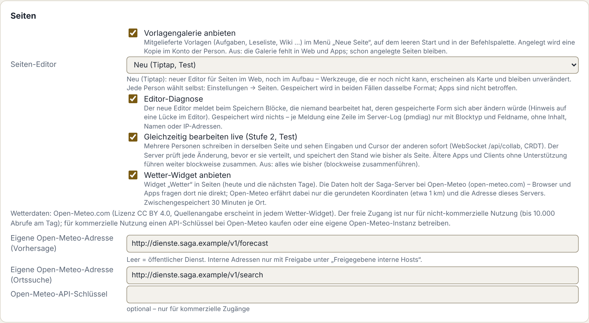
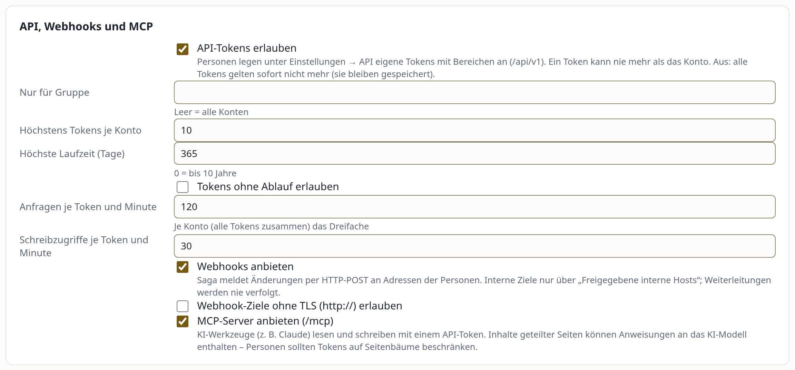
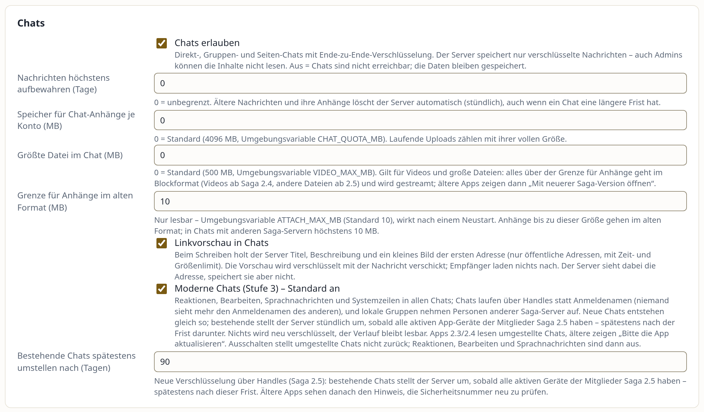
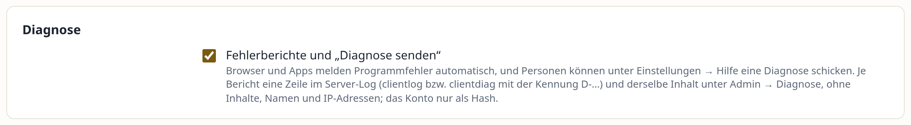
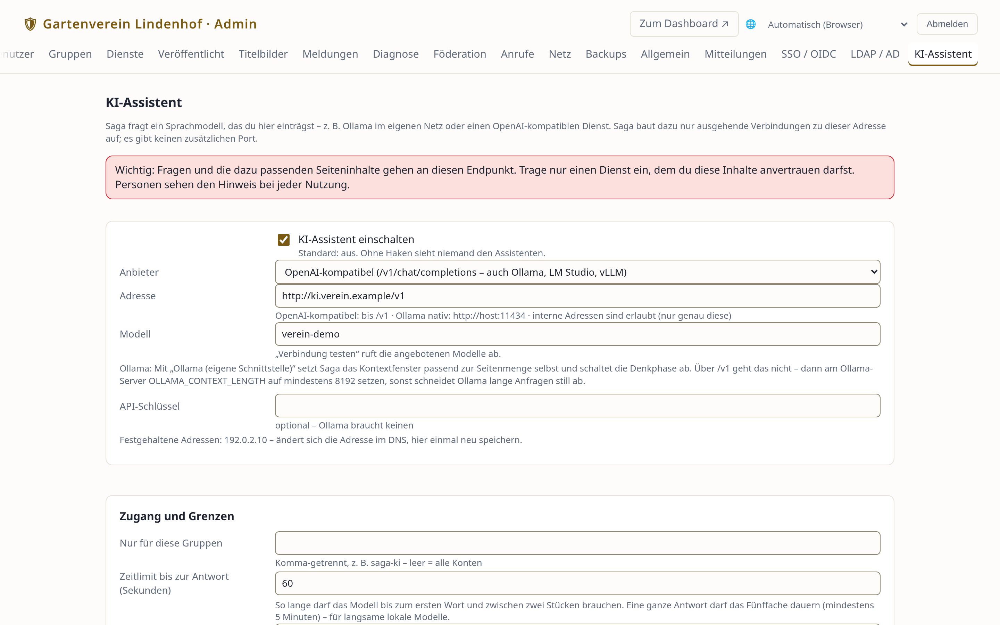
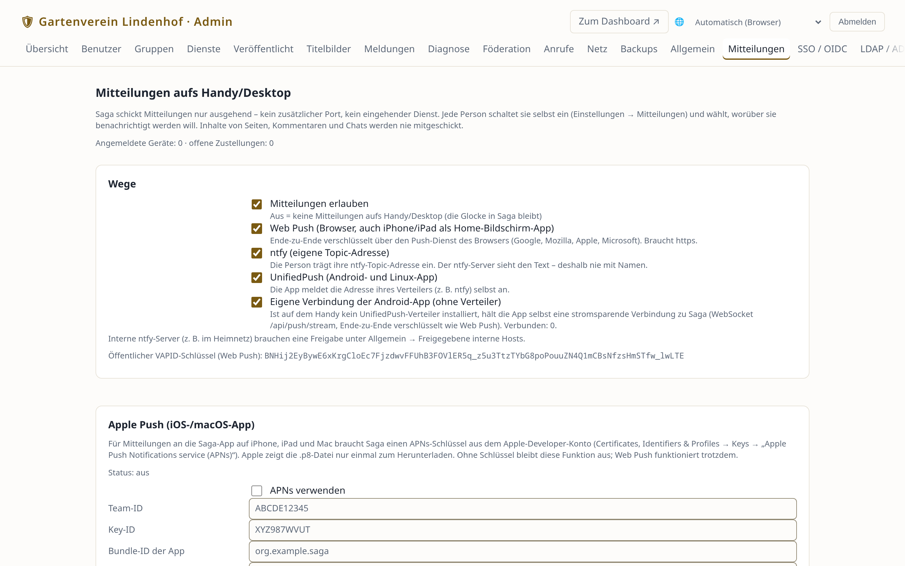

# A05 Schalter unter „Allgemein“

**Gilt für:** Web (Admin-Bereich)

[← Übersicht](../README.md) · [Weiter: A06 Anrufe und Knoten →](06-anrufe-knoten.md)

---

## Typische Aufgaben

- **Zusammen schreiben.** Anna lässt den **Seiten-Editor** auf „Standard (Tiptap)“ und schaltet
  **Gleichzeitig bearbeiten live** ein, damit Ben und Clara zusammen an der Urlaubsseite schreiben können.
- **Wetter auf die Startseite.** Anna schaltet das **Wetter-Widget** ein – die Vorlage „Home-Dashboard“ zeigt danach
  das Wetter für ihren Ort.
- **Chats aufräumen.** Frieda legt fest, dass Chat-Nachrichten im Verein nach 365 Tagen gelöscht werden.
- **Nur im Verein teilen.** Frieda schaltet **Nur innerhalb gemeinsamer Gruppen** ein, damit Mitglieder Seiten nur
  mit Leuten aus ihren eigenen Gruppen teilen.
- **Mitteilungen aufs iPhone.** Anna trägt den Apple-Push-Schlüssel ein, damit die iPhone-App klingelt und Mitteilungen
  bekommt.

## Wofür ist das?

Unter **Allgemein** legst du fest, was Saga euren Leuten anbietet. Fast jede Funktion lässt sich hier ein- oder
ausschalten. Dazu kommen drei eigene Seiten im Menü: **Mitteilungen**, **KI-Assistent** und **Anrufe** (siehe
[A06](06-anrufe-knoten.md)).

Jeder Abschnitt hat eine kurze Erklärung direkt unter dem Schalter. Dieses Kapitel fasst zusammen, was wichtig ist,
und am Ende steht eine Tabelle mit allen Schaltern und ihrem Standardwert.

> **Hinweis:** Einstellungen in der `.env`-Datei des Servers (Adressen, Grenzen, Geheimnisse) stehen nicht hier,
> sondern in der Anleitung, [Abschnitt 13 „Alle Einstellungen der .env“](../../ANLEITUNG.md#13-alle-einstellungen-der-env).

---

## Schritt für Schritt

### 1. Anmeldung & Konten, Dienste, Verbindungen

- **Titel** – der Name oben in der Seitenleiste und auf der Anmeldeseite, zum Beispiel „Gartenverein Lindenhof“.
- **Registrierung erlauben**, **Anmeldung mit lokalen Konten**, **Standardgruppen** – siehe
  [A02](02-benutzer-gruppen.md) und [A04](04-anmeldung.md).
- **Standardsprache** – für Anmeldeseite, Admin-Bereich und alle Konten mit „Automatisch“.
- **Zweiter Faktor** – siehe [A04](04-anmeldung.md).
- **Dienste: Gruppen-Kennung, Favicons laden** – siehe [A03](03-dienste.md).
- **Verbindungen der Benutzer (Kalender, Immich, Nextcloud):** Öffentliche `https`-Server gehen immer. Server im
  Heimnetz trägst du unter **Freigegebene interne Hosts** ein (mit Komma getrennt, optional mit `:Port`), zum
  Beispiel `nextcloud.lan, immich.lan:2283`. **Interne Adressen für alle erlauben** nur, wenn du allen Konten
  vertraust. **Nextcloud-Dateien in Seiten erlauben** schaltet den Nextcloud-Block ein oder aus.

> **Tipp:** „Freigegebene interne Hosts“ wird an vielen Stellen gebraucht: Kalender, Immich, Nextcloud, Webhooks,
> ntfy, Wetter, Föderation. Trag einen internen Dienst einmal hier ein.

### 2. Seiten

- **Vorlagengalerie anbieten** – die fertigen Vorlagen beim Anlegen einer Seite.
- **Seiten-Editor** – **Klassisch (Editor.js)**, **Standard (Tiptap)** oder **Jede Person wählt selbst** (dann unter
  Einstellungen → Seiten). Gespeichert wird in beiden Fällen dasselbe; du kannst also jederzeit wechseln.
- **Editor-Diagnose** – der neue Editor meldet beim Speichern Stellen, die er noch nicht sauber kann. Gespeichert wird
  eine Zeile im Server-Log und derselbe Inhalt unter **Diagnose** (siehe [A09](09-diagnose.md)).
- **Gleichzeitig bearbeiten live** – mehrere Personen schreiben in derselben Seite und sehen Eingaben und Cursor der
  anderen sofort. Standard: aus. Das läuft über eine WebSocket-Verbindung – hinter Nginx Proxy Manager muss beim
  Proxy-Host „Websockets Support“ an sein.
- **Wetter-Widget anbieten** – Standard: aus. Die Daten holt der Saga-Server bei Open-Meteo; Browser und Apps fragen
  dort nie selbst. Der freie Zugang ist nur für **nicht-kommerzielle** Nutzung. Optional eigene Open-Meteo-Adressen
  oder ein API-Schlüssel.

> **Wichtig:** Das Benutzer-Handbuch zeigt den Standard-Editor **Tiptap**. Steht bei euch „Klassisch (Editor.js)“,
> sehen Seiten etwas anders aus. Der klassische Editor wird in einer späteren Version entfernt.

### 3. API, Webhooks und MCP

- **API-Tokens erlauben** – Personen legen unter Einstellungen → API eigene Tokens an (siehe Benutzer-Handbuch,
  [B18](../benutzer/18-api-webhooks-mcp.md)). Aus: alle Tokens gelten sofort nicht mehr.
- **Nur für Gruppe** – leer = alle Konten.
- **Höchstens Tokens je Konto**, **Höchste Laufzeit (Tage)**, **Tokens ohne Ablauf erlauben**.
- **Anfragen je Token und Minute**, **Schreibzugriffe je Token und Minute** – Ratenbremse.
- **Webhooks anbieten**, **Webhook-Ziele ohne TLS (http://) erlauben**.
- **MCP-Server anbieten (/mcp)** – für KI-Werkzeuge.

### 4. Veröffentlichen, Teilen, Profilbilder

- **Veröffentlichen erlauben** – Personen dürfen eigene Seiten öffentlich machen. Aus: alle öffentlichen Adressen
  liefern sofort „Nicht gefunden“.
- **Startseite für Besucher** – welche veröffentlichte Seite Besucher ohne Anmeldung unter eurer Adresse sehen.
- **Teilen erlauben** – Seiten mit anderen Konten und Gruppen teilen.
- **Nur innerhalb gemeinsamer Gruppen** – teilen und Personensuche nur mit Konten, die eine Gruppe mit einem
  gemeinsam haben. Gilt für neue Freigaben; Föderation siehe [A07](07-foederation.md).
- **Suche nach Anmeldename** – Personen findet man auch über den genau eingegebenen Anmeldenamen. Aus: nur über
  Anzeigenamen.
- **Profilbilder** – siehe [A04](04-anmeldung.md).

### 5. Chats

- **Chats erlauben** – Direkt-, Gruppen- und Seiten-Chats. Aus: Chats sind nicht erreichbar, die Daten bleiben.
- **Nachrichten höchstens aufbewahren (Tage)** – 0 = unbegrenzt. Ältere Nachrichten löscht der Server stündlich.
- **Speicher für Chat-Anhänge je Konto (MB)** und **Größtes Video im Chat (MB)** – 0 = Standardwert des Servers.
- **Linkvorschau in Chats** – der Server holt Titel und Bild der ersten Adresse einer Nachricht. Er sieht dabei die
  Adresse, speichert sie aber nicht.
- **Moderne Chats (Stufe 3) – Standard an** – Reaktionen, Bearbeiten, Sprachnachrichten und Systemzeilen. Bestehende
  Chats stellt der Server nach und nach um, sobald alle aktiven Geräte der Mitglieder Saga 2.5 haben – spätestens nach
  **Bestehende Chats spätestens umstellen nach (Tagen)**. Wo es hängt, siehst du beim Benutzer unter „Chat-Stufe 3“.

Admins können Chats nicht lesen – sie sind Ende-zu-Ende verschlüsselt.

### 6. Live-Kanal, Diagnose, Updates

- **Live-Kanal** – zeigt nur, wie viele Browser und Apps gerade live verbunden sind. Damit das klappt, muss der
  Reverse Proxy mitspielen (Anleitung, Abschnitt 3).
- **Diagnose: Fehlerberichte und „Diagnose senden“** – Browser und Apps melden Programmfehler, und Personen können
  eine Diagnose schicken (Benutzer-Handbuch, [B19](../benutzer/19-hilfe.md)). Gespeichert wird eine Zeile im
  Server-Log und derselbe Inhalt unter **Diagnose**, ohne Inhalte und Namen (siehe [A09](09-diagnose.md)).

- **Updates: Auf neue Versionen hinweisen** – siehe [A10](10-updates.md).

Klick nach Änderungen unten auf **Speichern**.

### 7. Eigene Seite: KI-Assistent

Klick im Menü auf **KI-Assistent**.

1. **KI-Assistent einschalten** (Standard: aus).
2. **Anbieter:** *OpenAI-kompatibel* (auch Ollama, LM Studio, vLLM) oder *Ollama* (eigene Schnittstelle).
3. **Adresse** und **Modell** eintragen. **Verbindung testen** zeigt die angebotenen Modelle.
4. Optional **API-Schlüssel** (wird verschlüsselt gespeichert).
5. **Zugang und Grenzen:** nur für bestimmte Gruppen, Zeitlimit, Anfragen je Person und Tag, Seiteninhalt je Anfrage.
6. **Personen dürfen einen Verlauf einschalten**, **KI in Chats erlauben (nur auf Zuruf)**, **Websuche erlauben** –
  alle drei sind Zusatzschalter. Für die Websuche muss SearXNG eingerichtet sein (Anleitung, Abschnitt 10).
7. **Persona:** Name, Profilbild und Tonfall der KI – so erscheint sie überall in Saga und in den Apps.

> **Wichtig:** Fragen und passende Seiteninhalte gehen an den Endpunkt, den du hier einträgst. Trag nur einen Dienst
> ein, dem du diese Inhalte anvertrauen darfst – am besten ein Modell im eigenen Netz.

Die Felder im Detail: Anleitung, Abschnitt 9, „KI-Assistent (optional)“.

### 8. Eigene Seite: Mitteilungen

Klick im Menü auf **Mitteilungen**.

- **Mitteilungen erlauben** – Hauptschalter. Aus: keine Mitteilungen aufs Handy oder den Computer (die Glocke bleibt).
- **Web Push**, **ntfy**, **UnifiedPush** und **Eigene Verbindung der Android-App** einzeln an- oder abschalten.
- **Apple Push (iOS-/macOS-App):** Für die iPhone-, iPad- und Mac-App braucht Saga einen APNs-Schlüssel aus einem
  Apple-Developer-Konto. Trag **Team-ID**, **Key-ID**, **Bundle-ID der App** und die Schlüsseldatei **(.p8)** ein und
  setz den Haken **APNs verwenden**. Ohne Schlüssel bekommen die Apple-Apps keine Mitteilungen und klingeln nicht.

Wie du den Schlüssel bei Apple anlegst: Anleitung, Abschnitt 9, „Mitteilungen aufs Handy und den Computer“.

---

## Alle Schalter auf einen Blick

| Schalter | Wo | Standard | Wirkung |
|---|---|---|---|
| Registrierung erlauben | Anmeldung & Konten | aus | jeder kann sich ein Konto anlegen |
| Anmeldung mit lokalen Konten | Anmeldung & Konten | an | aus = nur LDAP/SSO auf der Anmeldeseite |
| 2FA verlangen für | Zweiter Faktor | niemanden | Admins oder alle müssen einen Faktor einrichten |
| Bei SSO einen zweiten Faktor verlangen | Zweiter Faktor | aus | SSO nur mit gemeldetem zweitem Faktor |
| Favicons laden | Dienste | an | Symbole für Lesezeichen ohne Symbol |
| Interne Adressen für alle erlauben | Verbindungen | aus | Heimnetz-Server ohne einzelne Freigabe |
| Nextcloud-Dateien in Seiten erlauben | Verbindungen | an | Nextcloud-Block in Seiten |
| Vorlagengalerie anbieten | Seiten | an | Vorlagen beim Anlegen einer Seite |
| Seiten-Editor | Seiten | Standard (Tiptap) | Standard (Tiptap), Klassisch (Editor.js) oder jede Person wählt |
| Editor-Diagnose | Seiten | an | Lücken des Editors im Server-Log |
| Gleichzeitig bearbeiten live | Seiten | aus | live zusammen schreiben |
| Wetter-Widget anbieten | Seiten | aus | Wetter in Seiten (Open-Meteo) |
| API-Tokens erlauben | API | an | eigene Tokens für Skripte |
| Tokens ohne Ablauf erlauben | API | aus | Tokens, die nie ablaufen |
| Webhooks anbieten | API | an | Saga meldet Änderungen an Adressen |
| Webhook-Ziele ohne TLS erlauben | API | aus | auch `http://` als Ziel |
| MCP-Server anbieten | API | an | KI-Werkzeuge über `/mcp` |
| Veröffentlichen erlauben | Veröffentlichen | an | öffentliche Seiten |
| Teilen erlauben | Teilen | an | Seiten mit anderen teilen |
| Nur innerhalb gemeinsamer Gruppen | Teilen | aus | teilen nur mit gemeinsamen Gruppen |
| Suche nach Anmeldename | Teilen | an | Personen auch über genauen Anmeldenamen finden |
| Gravatar verwenden | Profilbilder | an | Gravatar, wenn die Person es einschaltet |
| Bild aus dem SSO / aus LDAP übernehmen | Profilbilder | aus | Profilbild vom Anmeldedienst |
| Chats erlauben | Chats | an | Ende-zu-Ende-verschlüsselte Chats |
| Linkvorschau in Chats | Chats | an | Vorschau für Adressen in Nachrichten |
| Moderne Chats (Stufe 3) | Chats | an | Reaktionen, Bearbeiten, Sprachnachrichten |
| Fehlerberichte und „Diagnose senden“ | Diagnose | an | Fehler und Diagnosen im Server-Log |
| Auf neue Versionen hinweisen | Updates | an | Hinweis bei neuer Version |
| KI-Assistent einschalten | KI-Assistent | aus | Assistent für alle bzw. bestimmte Gruppen |
| KI in Chats erlauben / Websuche erlauben | KI-Assistent | aus | KI im Chat auf Zuruf / Suche im Web |
| Mitteilungen erlauben | Mitteilungen | an | Mitteilungen aufs Handy und den Computer |
| APNs verwenden | Mitteilungen | aus | Mitteilungen an die Apple-Apps |

---

## Beispiel aus dem Alltag

**Anna richtet das Familien-Saga für das Handbuch ein.** Anna hat Saga frisch installiert und möchte, dass alles so
aussieht wie im Benutzer-Handbuch.

1. Anna öffnet **Allgemein** und trägt als **Titel** „Familie Sommer“ ein.
2. Unter **Seiten** stellt sie den **Seiten-Editor** auf **Standard (Tiptap)** und setzt die Haken bei **Gleichzeitig
   bearbeiten live** und **Wetter-Widget anbieten**.
3. Unter **Verbindungen der Benutzer** trägt sie bei **Freigegebene interne Hosts** ihre Nextcloud im Heimnetz ein.
4. Sie klickt auf **Speichern**.
5. Unter **Mitteilungen** prüft sie, dass Web Push und ntfy an sind.
6. Unter **KI-Assistent** trägt sie das Ollama aus ihrem Heimnetz ein, testet die Verbindung, nennt die KI „Saga KI“
   und schaltet sie ein.

---

## Häufige Fragen

**Ich habe einen Schalter ausgeschaltet – sind die Daten jetzt weg?**
Nein. Fast alle Schalter blenden eine Funktion nur aus. Die Daten bleiben gespeichert und sind beim Einschalten
wieder da.

**Was ist der Unterschied zwischen „Interne Adressen für alle erlauben“ und „Freigegebene interne Hosts“?**
Der erste Schalter öffnet das ganze Heimnetz für alle Konten. Mit der Liste gibst du nur einzelne Server frei – das ist
sicherer.

**Wo stelle ich Anrufe und TURN ein?**
Auf der eigenen Seite **Anrufe** – siehe [A06](06-anrufe-knoten.md).

---

## Auf dem Handy und in den Apps

Die Schalter gibt es nur im Admin-Bereich. Browser und Apps übernehmen Änderungen beim nächsten Laden; eine Funktion,
die du ausschaltest, verschwindet auch in den Apps.

---

[← Übersicht](../README.md) · [Weiter: A06 Anrufe und Knoten →](06-anrufe-knoten.md)
