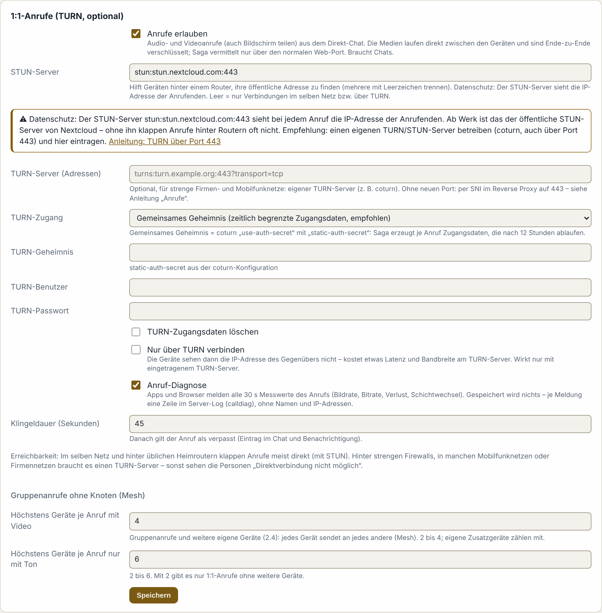
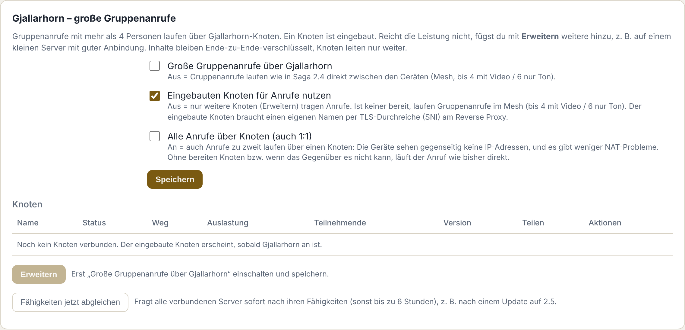
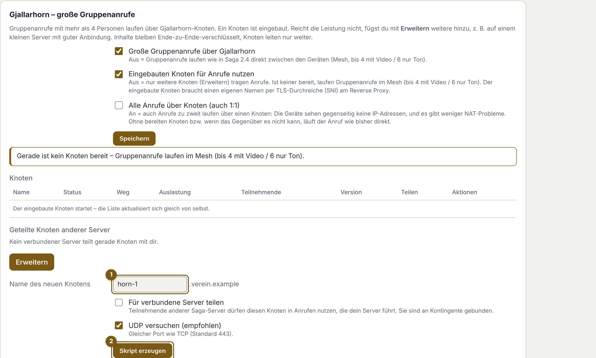

# A06 Anrufe und Knoten

**Gilt für:** Web (Admin-Bereich)

[← Übersicht](../README.md) · [Weiter: A07 Föderation →](07-foederation.md)

---

## Typische Aufgaben

- **Anrufe auch aus dem Mobilfunknetz.** Bens Anrufe aus dem Zug brechen ab („Direktverbindung nicht möglich“). Anna
  trägt einen eigenen TURN-Server ein – ab jetzt klappt es.
- **Die Mitgliederversammlung per Video.** 15 Vereinsmitglieder wollen sich per Video treffen. Frieda schaltet
  **Große Gruppenanrufe über Gjallarhorn** ein – der eingebaute Knoten trägt den Anruf.
- **Mehr Leistung.** Der Verein wächst. Frieda koppelt einen zweiten Knoten auf einem kleinen Server mit guter
  Anbindung.
- **Datenschutz.** Anna ersetzt den voreingestellten fremden STUN-Server durch ihren eigenen, damit niemand Fremdes
  die IP-Adressen ihrer Familie sieht.

## Wofür ist das?

Saga verbindet Anrufe möglichst **direkt** zwischen den Geräten. Bild und Ton sind dabei Ende-zu-Ende verschlüsselt.
Auf der Seite **Anrufe** im Admin-Bereich stellst du ein, was dafür nötig ist:

- **1:1-Anrufe (TURN, optional):** Hilfsserver, damit Anrufe auch durch strenge Firewalls und Mobilfunknetze kommen.
- **Gruppenanrufe ohne Knoten (Mesh):** Grenzen, wie viele Geräte direkt miteinander telefonieren.
- **Gjallarhorn – große Gruppenanrufe:** Knoten, die Gruppenanrufe mit vielen Personen weiterleiten. Inhalte bleiben
  Ende-zu-Ende verschlüsselt; die Knoten leiten nur weiter.

Wie Anrufe für eure Leute aussehen, steht im Benutzer-Handbuch, [B13 Anrufe](../benutzer/13-anrufe.md).

---

## Schritt für Schritt

### 1. Anrufe erlauben, STUN und TURN

Scroll auf der Seite **Anrufe** zu **1:1-Anrufe (TURN, optional)**.

- **Anrufe erlauben** – Standard: an. Braucht Chats.
- **STUN-Server** – hilft Geräten hinter einem Router, ihre öffentliche Adresse zu finden. Ab Werk ist das ein
  öffentlicher Server von Nextcloud. **Datenschutz:** Der STUN-Server sieht bei jedem Anruf die IP-Adressen. Saga
  weist darauf hin; besser ist ein eigener Server.
- **TURN-Server (Adressen)** – für strenge Firmen- und Mobilfunknetze. Er reicht die (weiter verschlüsselten) Medien
  durch, wenn keine direkte Verbindung klappt.
- **TURN-Zugang** – empfohlen ist **Gemeinsames Geheimnis**: Saga erzeugt je Anruf Zugangsdaten, die nach 12 Stunden
  ablaufen. Alternativ **Fester Benutzer und Passwort**. Geheimnisse werden verschlüsselt gespeichert; leer lassen =
  behalten.
- **Nur über TURN verbinden** – die Geräte sehen dann die IP-Adresse des Gegenübers nicht. Kostet etwas Latenz.
- **Anruf-Diagnose** – Browser und Apps melden alle 30 Sekunden Messwerte (Bildrate, Verlust …). Gespeichert wird
  nichts außer einer Zeile im Server-Log, ohne Namen und IP-Adressen.
- **Klingeldauer (Sekunden)** – danach gilt ein Anruf als verpasst.

Wie du einen eigenen TURN-Server (coturn) **ohne zusätzlichen Port** über 443 betreibst, beschreibt die Anleitung
Schritt für Schritt: Abschnitt 9, „Anrufe (Audio, Video, Bildschirm)“, Unterabschnitt
[„TURN über Port 443“](../../ANLEITUNG.md#turn-über-port-443-coturn-hinter-dem-reverse-proxy-per-sni).

> **Tipp:** Prüfen geht einfach: ein Anruf zwischen einem Gerät im WLAN und einem Handy im Mobilfunknetz. Oben im
> Anruffenster steht dann „über Relais (TURN)“.

### 2. Gruppenanrufe ohne Knoten (Mesh)

Ohne Knoten sendet in einem Gruppenanruf jedes Gerät an jedes andere. Das klappt gut bis **4 Geräte mit Video** bzw.
**6 nur mit Ton**. Unter **Gruppenanrufe ohne Knoten (Mesh)** kannst du diese Grenzen nur **senken**:

- **Höchstens Geräte je Anruf mit Video** – 2 bis 4.
- **Höchstens Geräte je Anruf nur mit Ton** – 2 bis 6. Mit 2 gibt es nur 1:1-Anrufe.

### 3. Gjallarhorn einschalten

Ganz oben auf der Seite steht **Gjallarhorn – große Gruppenanrufe**.

1. Setz den Haken bei **Große Gruppenanrufe über Gjallarhorn**.
2. Lass **Eingebauten Knoten für Anrufe nutzen** an – er steckt schon in Saga.
3. Optional: **Alle Anrufe über Knoten (auch 1:1)**. Dann sehen sich die Geräte auch zu zweit gegenseitig keine
   IP-Adressen, und es gibt weniger Netzwerkprobleme.
4. Klick auf **Speichern**.

> **Hinweis:** Der eingebaute Knoten braucht einen **eigenen Namen** (zum Beispiel `horn.verein.example`), den dein
> Reverse Proxy per TLS-Durchreiche (SNI) an Saga weitergibt – ähnlich wie beim TURN-Server über 443. UDP ist
> optional, aber empfohlen; dafür gibst du den UDP-Port des Knotens direkt am Server frei. Die Seite zeigt dir, welche
> Ports nötig sind.

Aus: Gruppenanrufe laufen wie bisher direkt zwischen den Geräten (bis 4 mit Video / 6 nur mit Ton).

### 4. Die Knoten-Liste

Je Knoten siehst du:

- **Status** (bereit, wartet auf Kopplung, Zertifikat fehlt, aktualisiert sich …),
- **Weg** – ob TCP und UDP erreichbar sind,
- **Auslastung** – CPU und Upload,
- **Teilnehmende** – wie viele gerade darüber telefonieren,
- **Version** und ob der Knoten **geteilt** ist.

Knöpfe je Knoten:

- **Port prüfen** – zeigt die nötigen Ports (eingehend TCP, empfohlen UDP, ausgehend zu Saga) mit Prüfergebnis und
  Beispielen für die Firewall.
- **Teilen an / aus** – ob verbundene Server diesen Knoten nutzen dürfen (siehe Abschnitt 6).
- **Leeren** – der Knoten nimmt keine neuen Anrufe mehr an; laufende Anrufe dürfen zu Ende gehen. Gut vor Wartungen.

Unter **Grenzen** legst du fest, ab wie vielen Mitgliedern ein Gruppenanruf über einen Knoten läuft (**Über Knoten
ab**), wie viele Personen mit Video bzw. nur mit Ton in einen Anruf dürfen, und das **Kontingent je verbundenem
Server**.

### 5. Einen weiteren Knoten koppeln (Erweitern)

Reicht der eingebaute Knoten nicht, holst du dir einen zweiten dazu – zum Beispiel auf einem kleinen gemieteten
Server mit guter Anbindung.

1. Klick unter der Liste auf **Erweitern**.
2. Gib bei ① den **Namen des neuen Knotens** ein.
3. Wähl die Optionen: **Für verbundene Server teilen** und **UDP versuchen (empfohlen)**.
4. Klick auf ② **Skript erzeugen**.
5. Saga zeigt ein Skript (mit Docker, oder **Ohne Docker: systemd unter Debian**). Es enthält einen **einmaligen
   Kopplungs-Code** mit Ablaufzeit. **Kopieren** oder **Herunterladen** und auf dem neuen Server ausführen.
6. Die Seite zeigt den Fortschritt: **Gekoppelt**, **DNS eingetragen**, **Zertifikat erhalten**, **Port erreichbar** –
   **Fertig**.

Was die Nummern bedeuten:

- ① Name des neuen Knotens.
- ② **Skript erzeugen** – das Skript führst du auf dem neuen Server aus.

**DNS:** Saga braucht für jeden Knoten einen Namen im DNS. Hast du einen Cloudflare-API-Token mit dem Recht „DNS
bearbeiten“ für **eine** Zone eingetragen, legt Saga die Einträge selbst an und räumt sie beim Entfernen wieder auf.
Ohne Token zeigt dir die Seite, welche Einträge du selbst anlegen musst, und prüft sie.

> **Wichtig:** Läuft ein Knoten bei einem Anbieter (gemieteter Server), verarbeitet dieser die IP-Adressen deiner
> Leute. Das ist eine Auftragsverarbeitung – denk an eure Datenschutzerklärung.

Knoten auf Saga-Versionen aktualisieren sich selbst, wenn gerade kein Anruf läuft. Meldet die Liste, dass ein Knoten
zu alt dafür ist, aktualisierst du ihn einmal von Hand.

### 6. Knoten mit verbundenen Servern teilen

Bist du mit anderen Saga-Servern verbunden (siehe [A07](07-foederation.md)), können Gruppenanrufe über Servergrenzen
gehen. Mit **Teilen an** dürfen Personen der verbundenen Server deinen Knoten in Anrufen nutzen, die dein Server
führt – im Rahmen des **Kontingents je verbundenem Server**.

Auf der Seite **Föderation** stellst du je Server ein, ob er deine Knoten nutzen darf, und hast dort einen **Notaus**:
Er trennt alle Teilnehmenden dieses Servers sofort von deinen Knoten. Teilen andere Server ihre Knoten mit dir, stehen
sie unter **Geteilte Knoten anderer Server**.

---

## Beispiel aus dem Alltag

**Die Mitgliederversammlung des Gartenvereins.** Der Verein will seine Jahresversammlung per Video machen – 15
Personen.

1. Frieda öffnet **Anrufe** und setzt den Haken bei **Große Gruppenanrufe über Gjallarhorn**. **Eingebauten Knoten
   für Anrufe nutzen** bleibt an. Sie speichert.
2. In der Knoten-Liste klickt sie beim eingebauten Knoten auf **Port prüfen**. TCP ist erreichbar ✓, UDP noch nicht.
3. Sie gibt den angezeigten UDP-Port in der Firewall des Servers frei und klickt auf **Erneut prüfen** – jetzt UDP ✓.
4. Am Abend der Versammlung startet Frieda im Gruppenchat „Mitglieder“ einen Videoanruf. Weil mehr als 4 Personen
   dabei sind, läuft der Anruf über den Knoten.
5. Während der Versammlung zeigt die Liste bei **Auslastung** 35 % und bei **Teilnehmende** 15.

**Anna sorgt für Anrufe aus dem Zug.** Ben ruft oft aus dem Zug an, und die Verbindung kommt nicht zustande.

1. Anna richtet nach der Anleitung („TURN über Port 443“) einen coturn auf ihrem Server ein.
2. Unter **Anrufe → 1:1-Anrufe** trägt sie die TURN-Adresse ein, wählt **Gemeinsames Geheimnis** und fügt dasselbe
   Geheimnis wie in coturn ein.
3. Den STUN-Server stellt sie gleich auf ihren eigenen coturn um.
4. Sie speichert und ruft Ben an, der im Mobilfunknetz ist. Oben steht „über Relais (TURN)“ – es klappt.

---

## Häufige Fragen

**Brauche ich einen TURN-Server?**
Für Anrufe im Heimnetz und zwischen normalen Heimanschlüssen meist nicht. Für Mobilfunk, Firmennetze und strenge
Firewalls ja.

**Kann der TURN-Server oder ein Knoten mithören?**
Nein. Beide reichen nur verschlüsselte Daten weiter.

**Was passiert, wenn kein Knoten bereit ist?**
Dann laufen Gruppenanrufe wie ohne Gjallarhorn direkt zwischen den Geräten – mit den Grenzen 4 bzw. 6.

**Ein Knoten zeigt „Zertifikat fehlt“.**
Meist fehlt der DNS-Eintrag oder der Port ist nicht erreichbar. **Port prüfen** und die DNS-Prüfung zeigen, was fehlt.

---

## Auf dem Handy und in den Apps

Die Einstellungen gibt es nur im Admin-Bereich. Die Apps nutzen dieselben TURN-Server und Knoten wie der Browser.
Damit iPhone und iPad bei Anrufen klingeln, braucht es außerdem Apple Push (siehe [A05](05-allgemein.md)).

---

[← Übersicht](../README.md) · [Weiter: A07 Föderation →](07-foederation.md)
