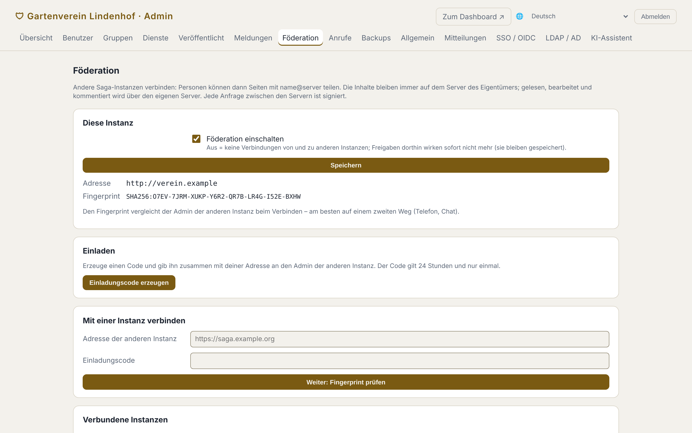
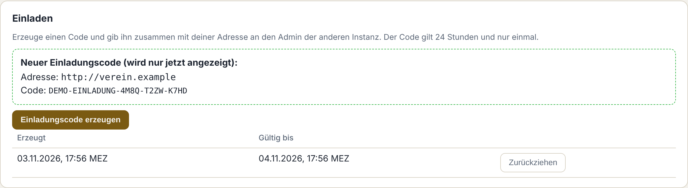
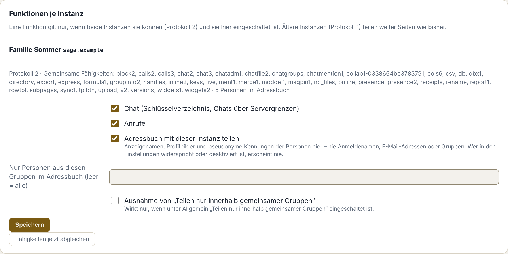

# A07 Föderation – Server verbinden

**Gilt für:** Web (Admin-Bereich)

[← Übersicht](../README.md) · [Weiter: A08 Inhalte und Meldungen →](08-inhalte-meldungen.md)

---

## Typische Aufgaben

- **Familie und Verein verbinden.** Anna ist Mitglied im Gartenverein. Frieda (`verein.example`) und Anna
  (`saga.example`) verbinden ihre Server, damit Anna am Vereinswiki mitarbeiten kann.
- **Nur bestimmte Funktionen.** Der Verein will Seiten teilen und chatten, aber keine Anrufe über Servergrenzen –
  Frieda schaltet **Anrufe** für diesen Server aus.
- **Adressbuch begrenzen.** Nur die Gruppe `vorstand` soll für den anderen Server über den Namen auffindbar sein.
- **Verbindung beenden.** Ein befreundeter Verein löst sich auf. Frieda klickt auf **Trennen** – alles endet sofort.

## Wofür ist das?

**Föderation** verbindet euren Saga-Server mit anderen Saga-Servern. Danach können eure Leute Seiten mit Personen dort
teilen (`name@server`), mit ihnen chatten und telefonieren – siehe Benutzer-Handbuch,
[B11 Föderation](../benutzer/11-foederation.md).

Die Inhalte bleiben immer auf dem Server, dem die Seite gehört. Alles läuft über den normalen HTTPS-Port – es gibt
keinen zusätzlichen Dienst. Jede Anfrage zwischen den Servern ist signiert.

Eine Verbindung entsteht immer **gemeinsam**: Beide Admins müssen zustimmen, und ihr prüft dabei gegenseitig den
**Fingerprint** eurer Server.

---

## Schritt für Schritt

### 1. Föderation einschalten

1. Klick im Menü auf **Föderation**.
2. Setz den Haken **Föderation einschalten** (Standard: aus) und speichere.
3. Unter **Diese Instanz** stehen jetzt eure **Adresse** und euer **Fingerprint** – eine kurze Kennung des
   Server-Schlüssels.

> **Hinweis:** Andere Server verbinden sich nur über `https`. Läuft euer Saga ohne, zeigt die Seite einen Hinweis.

### 2. Einladen (Server A)

1. Klick unter **Einladen** auf **Einladungscode erzeugen**.
2. Saga zeigt den Code – **nur jetzt**. Er gilt **24 Stunden** und nur **einmal**.
3. Gib den Code zusammen mit eurer Adresse an den Admin des anderen Servers. Nenn ihm auch euren **Fingerprint** –
   am besten auf einem zweiten Weg, zum Beispiel am Telefon.

Noch nicht benutzte Codes stehen in der Liste und lassen sich **zurückziehen**.

### 3. Verbinden (Server B)

1. Trag unter **Mit einer Instanz verbinden** die **Adresse der anderen Instanz** und den **Einladungscode** ein.
2. Klick auf **Weiter: Fingerprint prüfen**.
3. Saga zeigt den Fingerprint des anderen Servers. Vergleiche ihn mit dem, den dir der andere Admin genannt hat.
4. Nur wenn er **genau gleich** ist: **Fingerprint stimmt – verbinden**.

> **Wichtig:** Stimmt der Fingerprint nicht, verbinde **nicht**, sondern klär das mit dem anderen Admin. Ein
> falscher Fingerprint kann heißen, dass jemand dazwischen sitzt.

### 4. Bestätigen (Server A)

Unter **Verbundene Instanzen** steht jetzt die Anfrage mit „Wartet auf deine Bestätigung“ und dem Fingerprint des
anderen Servers.

1. Vergleiche auch diesen Fingerprint.
2. Klick auf **Bestätigen** (oder **Ablehnen**).

Ab jetzt sind beide Server verbunden. War der andere Server gerade nicht erreichbar, klick dort auf **Status prüfen**.

### 5. Funktionen je Instanz

Unter **Funktionen je Instanz** legst du für jeden verbundenen Server fest, was erlaubt ist.

- **Chat** – Chats über Servergrenzen. Standard: an.
- **Anrufe** – Anrufe über Servergrenzen. Standard: an.
- **Adressbuch mit dieser Instanz teilen** – Personen dort finden eure Leute über den Anzeigenamen. Übertragen werden
  nur Anzeigename, Profilbild und eine zufällige, feste Kennung – **nie** Anmeldenamen, E-Mail-Adressen oder Gruppen.
  Optional **nur Personen aus diesen Gruppen**. Wer in seinen Einstellungen widerspricht, erscheint nie.
- **Ausnahme von „Teilen nur innerhalb gemeinsamer Gruppen“** – ist diese Beschränkung unter Allgemein an, sind
  Freigaben, Adressbuch und Chats mit anderen Servern gesperrt. Mit der Ausnahme sind sie für **diesen** Server
  erlaubt.

Darüber stehen **Protokoll** und **gemeinsame Fähigkeiten**. Eine Funktion gilt nur, wenn **beide** Server sie
können. Nach einem Update fragt **Fähigkeiten jetzt abgleichen** sofort nach (sonst innerhalb von 6 Stunden).

Hier findest du auch die Einstellungen für **Gjallarhorn-Knoten** je Server und den **Notaus** (siehe
[A06](06-anrufe-knoten.md)).

### 6. Trennen und Prüfprotokoll

- **Trennen** (jederzeit, auf beiden Seiten) wirkt sofort: Alle Freigaben an Personen und Gruppen des anderen Servers
  enden, Seiten von dort verschwinden, Chats werden schreibgeschützt, laufende Anrufe enden. Saga löscht dabei auch
  Adressbuch und zwischengespeicherte Namen.
- Das **Prüfprotokoll** zeigt Verbindungen, Freigaben über Servergrenzen und abgewiesene Anfragen – **nie Inhalte**.
  Die Bedeutung der Einträge erklärt die Anleitung, Abschnitt 9, „Mit anderen Saga-Instanzen teilen
  (Föderation)“, Tabelle „Fehlerbilder“.

> **Datenschutz:** Weise eure Leute in eurer Datenschutzerklärung darauf hin, mit welchen Servern ihr verbunden seid
> und dass Anzeigenamen dorthin übertragen werden (Adressbuch).

---

## Beispiel aus dem Alltag

**Familie und Verein verbinden sich.** Anna möchte am Vereinswiki des Gartenvereins mitarbeiten, ohne ein zweites
Konto. Frieda ist Admin von `verein.example`, Anna Admin von `saga.example`.

1. Beide schalten unter **Föderation** die Föderation ein.
2. Frieda klickt auf **Einladungscode erzeugen** und schickt Anna den Code per Mail.
3. Am Telefon liest Frieda ihren Fingerprint vor.
4. Anna trägt `https://verein.example` und den Code ein, klickt auf **Weiter: Fingerprint prüfen** und vergleicht –
   er stimmt. Sie klickt auf **Fingerprint stimmt – verbinden** und liest Frieda ihren eigenen Fingerprint vor.
5. Bei Frieda steht `saga.example` mit „Wartet auf deine Bestätigung“. Sie vergleicht den Fingerprint und klickt auf
   **Bestätigen**.
6. Unter **Funktionen je Instanz** lässt Frieda Chat und Adressbuch an, schaltet **Anrufe** aber vorerst aus.
7. Frieda teilt Anna die Seite „Parzellenplan 2027“ mit `anna-sommer@saga.example` – Anna sieht sie sofort.

---

## Häufige Fragen

**„Adresse nicht erlaubt (interne Adresse …)“**
Der andere Server hat eine Adresse im Heimnetz. Trag sie unter **Allgemein → Freigegebene interne Hosts** ein.

**„nicht erreichbar“ oder „keine Saga-Instanz mit Föderation“**
Ist die Föderation dort eingeschaltet? Stimmt die Adresse? Funktioniert das Zertifikat? Öffne die Adresse im Browser
und klick dann auf **Status prüfen**.

**„Fingerprint geändert“**
Der andere Server meldet einen anderen Schlüssel als erwartet. **Nicht** verbinden – mit dem anderen Admin klären.

**„Keine Zusatzfähigkeiten“**
Der andere Server hat eine ältere Saga-Version. Teilen und Kommentare gehen, Chats und Adressbuch erst nach seinem
Update.

**Sieht der andere Server Inhalte, die nicht mit ihm geteilt sind?**
Nein. Er erfährt nur, was eure Leute ausdrücklich mit Personen oder Gruppen dort teilen.

---

## Auf dem Handy und in den Apps

Verbinden geht nur im Admin-Bereich. Die Apps zeigen Seiten, Chats und Anrufe von verbundenen Servern wie im Browser –
soweit beide Server und die App die Funktion können.

---

[← Übersicht](../README.md) · [Weiter: A08 Inhalte und Meldungen →](08-inhalte-meldungen.md)
