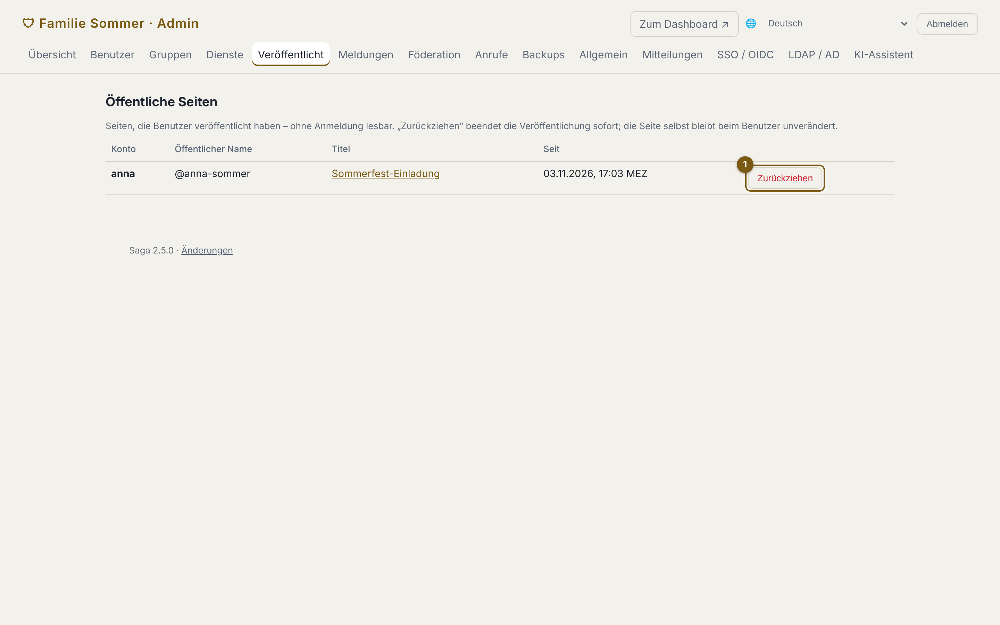
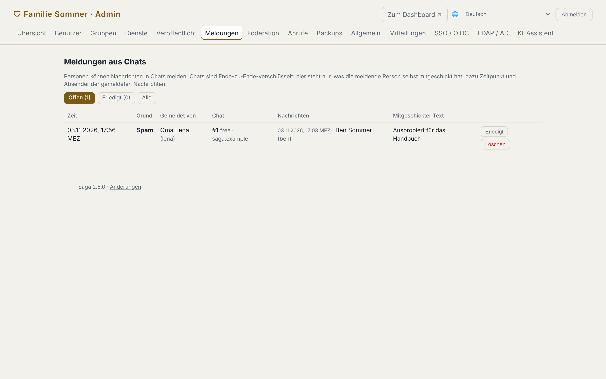

# A08 Inhalte und Meldungen

**Gilt für:** Web (Admin-Bereich)

[← Übersicht](../README.md) · [Weiter: A09 Fehler finden: Logs und Diagnose →](09-diagnose.md)

---

## Typische Aufgaben

- **Öffentliche Seiten im Blick.** Anna schaut nach, welche Seiten der Familie ohne Anmeldung lesbar sind – Annas
  „Sommerfest-Einladung“ ist die einzige.
- **Eine Veröffentlichung zurückziehen.** Clara hat aus Versehen ihre Seite mit Handynummern veröffentlicht. Anna
  zieht sie mit einem Klick zurück.
- **Auf eine Meldung reagieren.** Paul meldet eine Spam-Nachricht in einem Vereinschat. Frieda sieht die Meldung unter
  **Meldungen** und kümmert sich darum.
- **Backups prüfen.** Frieda schaut nach, ob das nächtliche Server-Backup geklappt hat.

## Wofür ist das?

Als Admin siehst du keine Inhalte deiner Leute. Es gibt aber zwei Stellen, an denen du eingreifen kannst, wenn etwas
schiefläuft:

- **Veröffentlicht** – alle Seiten, die ohne Anmeldung im Internet lesbar sind. Du kannst jede Veröffentlichung sofort
  zurückziehen.
- **Meldungen** – Chat-Nachrichten, die jemand gemeldet hat. Weil Chats Ende-zu-Ende verschlüsselt sind, siehst du nur
  das, was die meldende Person selbst mitgeschickt hat.

Dazu kommt die Seite **Backups** für die Sicherung des ganzen Servers.

---

## Schritt für Schritt

### 1. Veröffentlichte Seiten

Klick im Menü auf **Veröffentlicht**.

Was die Nummern bedeuten:

- ① **Zurückziehen** – beendet die Veröffentlichung sofort.

Du siehst je Seite: Konto, **öffentlicher Name**, Titel, seit wann sie öffentlich ist und ob Unterseiten dazugehören.
Markierungen wie **Profilseite** oder **Startseite für Besucher** fallen sofort auf. Liegt eine Seite im Papierkorb
oder Archiv, steht dort „nicht erreichbar“.

**Zurückziehen:**

1. Klick bei der Seite auf ① **Zurückziehen**.
2. Die Seite ist sofort nicht mehr öffentlich. Die Seite selbst bleibt beim Eigentümer unverändert.
3. Der Eigentümer bekommt eine Benachrichtigung („Ein Admin hat deine Veröffentlichung zurückgezogen“).

> **Tipp:** Willst du gar keine Veröffentlichungen, schalte unter **Allgemein → Veröffentlichen erlauben** aus. Dann
> liefern alle öffentlichen Adressen sofort „Nicht gefunden“ (siehe [A05](05-allgemein.md)).

### 2. Meldungen aus Chats

Personen können in jedem Chat Nachrichten melden: Menü der Nachricht → **Melden …**. Sie wählen einen **Grund**
(Spam, Belästigung oder Beleidigung, rechtswidrige Inhalte, Sonstiges) und können den **Text der gemeldeten
Nachrichten mitschicken** – vorher dürfen sie ihn ändern oder kürzen.

Bei einer neuen Meldung bekommst du als Admin eine Benachrichtigung. Klick im Menü auf **Meldungen**.

Du siehst je Meldung:

- **Zeit** und **Grund**,
- **Gemeldet von** – wer gemeldet hat,
- **Chat** und den **Absender** der gemeldeten Nachricht,
- den **Mitgeschickten Text** – oder „(kein Text mitgeschickt)“.

Oben filterst du nach **Offen**, **Erledigt** oder **Alle**.

**Was du tun kannst:**

1. Lies die Meldung. Sprich im Zweifel mit den Beteiligten.
2. Je nach Fall: Sperr den Absender (**Benutzer → Konto sperren**, siehe [A02](02-benutzer-gruppen.md)), oder lass es
   bei einem klärenden Gespräch.
3. Markier die Meldung als **erledigt**. Mit **Wieder öffnen** holst du sie zurück, mit **Löschen** entfernst du sie.

> **Hinweis:** Die gemeldeten Nachrichten selbst kannst du nicht lesen – nur den mitgeschickten Text. Ob dieser Text
> wirklich so im Chat stand, kannst du nicht prüfen. Behandle Meldungen deshalb als Hinweis, nicht als Beweis.

Die meldende Person kann zusätzlich den Absender für sich **sperren** – das erfährt der Absender nicht.

### 3. Backups

Unter **Backups** richtest du die verschlüsselte Sicherung des ganzen Servers ein (Ziel, Schlüssel, Zeitplan) und
siehst das letzte erfolgreiche Backup, den nächsten Lauf und die letzte Testwiederherstellung. Außerdem schaltest du
hier die **persönlichen Backups** eurer Leute ein oder aus (Benutzer-Handbuch, [B19](../benutzer/19-hilfe.md)).

Wie das alles eingerichtet wird, steht in der Anleitung,
[Abschnitt 11 „Sicherung, Wiederherstellung, Updates“](../../ANLEITUNG.md#11-sicherung-wiederherstellung-updates).

> **Tipp:** Mach einmal im Monat eine Testwiederherstellung. Ein Backup, das sich nicht zurückspielen lässt, hilft im
> Ernstfall nicht.

---

## Beispiel aus dem Alltag

**Paul meldet Spam.** In der Gruppe „Tauschbörse“ des Gartenvereins tauchen plötzlich Werbe-Nachrichten auf.

1. Paul öffnet an einer der Nachrichten das Menü und wählt **Melden …**.
2. Er wählt den Grund **Spam**, lässt **Text der gemeldeten Nachrichten mitschicken** an und sendet.
3. Frieda bekommt eine Benachrichtigung und öffnet **Meldungen**.
4. Sie sieht: Grund Spam, gemeldet von Paul, Absender ein Konto, das sich gestern registriert hat, dazu den Werbetext.
5. Frieda sperrt das Konto unter **Benutzer** und schaltet die Selbst-Registrierung wieder aus.
6. Sie markiert die Meldung als **erledigt**.

**Clara hat zu viel veröffentlicht.** Clara schreibt Anna: „Ich glaube, meine Seite mit den Handynummern ist
öffentlich!“

1. Anna öffnet **Veröffentlicht** und findet Claras Seite „Klassenliste“.
2. Sie klickt auf **Zurückziehen**. Die Seite ist sofort nicht mehr erreichbar.
3. Clara bekommt die Benachrichtigung und prüft in Ruhe, was sie wirklich teilen wollte.

---

## Häufige Fragen

**Kann ich eine veröffentlichte Seite lesen?**
Ja – sie ist ja öffentlich. Öffne sie einfach über ihre Adresse. Nicht veröffentlichte Seiten siehst du nicht.

**Kann ich eine gemeldete Nachricht löschen?**
Nicht im Admin-Bereich. In freien Gruppen können die Gruppen-Admins fremde Nachrichten löschen, in Gruppen-Chats
(Gruppen vom Admin) die Saga-Admins im Chat selbst.

---

## Auf dem Handy und in den Apps

Diese Seiten gibt es nur im Admin-Bereich. Melden können eure Leute im Browser und in den Apps über das Menü einer
Nachricht (in älteren App-Versionen fehlt der Menüpunkt).

---

[← Übersicht](../README.md) · [Weiter: A09 Fehler finden: Logs und Diagnose →](09-diagnose.md)
