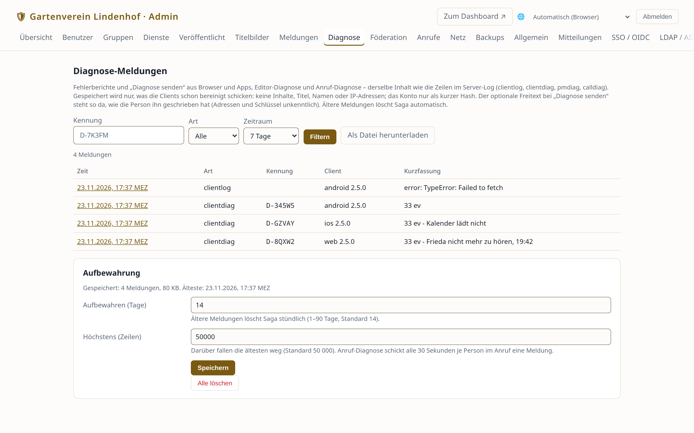
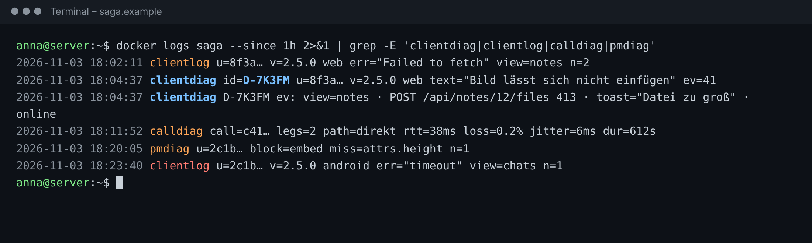

# A09 Fehler finden: Logs und Diagnose

**Gilt für:** Web (Admin-Bereich) · Server

[← Übersicht](../README.md) · [Weiter: A10 Updates und Release-Kanal →](10-updates.md)

---

## Typische Aufgaben

- **„Bei mir geht das Speichern nicht.“** Clara schickt Anna über **Diagnose senden** die Kennung `D-7K3FM`. Anna
  tippt sie unter **Diagnose** ein und sieht, dass Claras Browser offline war.
- **Ein Anruf bricht immer wieder ab.** Paul und Frieda schicken beide gleich nach dem Abbruch eine Diagnose. Frieda
  findet beide Meldungen und die Anruf-Diagnose aus derselben Minute.
- **Etwas an die Entwickler weitergeben.** Anna lädt die Meldungen eines Abends als Datei herunter und hängt sie an
  einen Fehlerbericht – ohne Inhalte, Namen oder IP-Adressen.
- **Aufräumen.** Frieda stellt ein, dass Meldungen nur 7 Tage aufbewahrt werden.

## Wofür ist das?

Wenn bei jemandem etwas nicht klappt, brauchst du als Admin Hinweise, *was* passiert ist. Saga sammelt dafür vier
Arten von Meldungen:

- **Fehlerberichte** (`clientlog`) – Browser und Apps melden Programmfehler von selbst.
- **„Diagnose senden“** (`clientdiag`) – eine Person schickt bewusst die letzten Ereignisse ihres Fensters, auf Wunsch
  mit einem Satz dazu, und bekommt eine Kennung wie `D-7K3FM` (siehe [B19 Hilfe](../benutzer/19-hilfe.md)).
- **Editor-Diagnose** (`pmdiag`) – der Seiten-Editor meldet Blöcke, deren gespeicherte Form sich ändern würde, obwohl
  niemand sie bearbeitet hat.
- **Anruf-Diagnose** (`calldiag`) – Browser und Apps melden im Anruf alle 30 Sekunden Messwerte (Bildrate, Verlust,
  Weg).

Jede Meldung steht als eine Zeile im Server-Log – und seit Saga 2.5 auch im Admin-Bereich unter **Diagnose**. Dort
findest du sie ohne Kommandozeile.

**Was darin steht – und was nicht:** Gespeichert wird nur, was Browser und Apps schon bereinigt schicken: **keine
Inhalte, Titel, Namen oder IP-Adressen**, das Konto nur als kurzer Hash. Nur den optionalen Satz bei „Diagnose senden“
speichert Saga so, wie die Person ihn geschrieben hat (Internet- und E-Mail-Adressen und Schlüssel werden unkenntlich
gemacht). Sehen können die Meldungen nur Admins. Weil sie in der Datenbank liegen, sind sie auch in den Backups.

---

## Schritt für Schritt

### 1. Die Seite „Diagnose“ öffnen

Öffne den Admin-Bereich (siehe [A01](01-ueberblick.md)) und klick oben auf **Diagnose**. Du siehst die
**Diagnose-Meldungen**, die neuesten zuerst, 100 je Seite: **Zeit**, **Art**, **Kennung**, **Client** (App oder
Browser mit Version) und **Kurzfassung**.



### 2. Eine bestimmte Diagnose finden

1. Tipp die Kennung, die dir jemand genannt hat, ins Suchfeld – zum Beispiel `D-7K3FM` (Groß- und Kleinschreibung ist
   egal). Genaue Treffer stehen oben.
2. Statt einer Kennung geht auch der Anfang einer **Anruf-ID** oder ein **Konto (Hash)**.
3. Mit **Art** und **Zeitraum** grenzt du die Liste ein. Die Arten stehen dort mit ihren technischen Namen: `clientlog`
   (Fehlerberichte), `clientdiag` („Diagnose senden“), `pmdiag` (Editor-Diagnose) und `calldiag` (Anruf-Diagnose). **Filtern** wendet die Auswahl an; **Neuere** und **Ältere** blättern.
4. Ein Klick auf die **Zeit** zeigt die ganze Meldung als übersichtlich formatierten Text. **Schließen** führt zurück
   zur Liste.

**Tipp:** Bei Anrufproblemen sieh dir auch die **Anruf-Diagnose** (`calldiag`) aus demselben Zeitraum an. Die
Anruf-ID darin kannst du ins Suchfeld übernehmen, um alle Meldungen zu diesem Anruf zu sehen.

### 3. Meldungen weitergeben oder löschen

- **Als Datei herunterladen** lädt die gerade angezeigte Auswahl als Datei herunter (JSONL: eine Meldung je Zeile).
  So kannst du sie an einen Fehlerbericht hängen.
- **Alle löschen** leert die Liste.

### 4. Aufbewahrung einstellen

Unten auf der Seite steht **Aufbewahrung**:

- **Aufbewahren (Tage)** – Standard 14, möglich 1 bis 90.
- **Höchstens (Zeilen)** – Standard 50 000. Darüber fallen die ältesten weg. Die Anruf-Diagnose schickt alle 30
  Sekunden je Person im Anruf eine Meldung; bei vielen Anrufen greift diese Grenze eher.

**Speichern** übernimmt die Werte. Ältere Meldungen löscht Saga stündlich von selbst. Darunter steht, welche Arten
gerade **abgeschaltet** sind (dann kommt von dort nichts an).

### 5. Diagnose ein- und ausschalten

- **Fehlerberichte und „Diagnose senden“** – unter **Allgemein → Diagnose** (Standard an).
- **Editor-Diagnose** – unter **Allgemein → Seiten**.
- **Anruf-Diagnose** – auf der Seite **Anrufe** (siehe [A06](06-anrufe-knoten.md)).

Aus heißt: Browser und Apps schicken nichts mehr, es wird nichts gespeichert, und der Knopf „Diagnose senden“ zeigt
„abgeschaltet“.

### 6. Für Fortgeschrittene: im Server-Log suchen

Dieselben Meldungen stehen im Log des Saga-Containers – praktisch, wenn der Admin-Bereich gerade nicht erreichbar ist
oder du ältere Zeilen brauchst (auf dem Server im Ordner mit der `docker-compose.yml`):

```sh
docker compose logs --no-log-prefix saga | grep 'clientdiag {"id":"D-7K3FM"'  # eine bestimmte Diagnose
docker compose logs --no-log-prefix saga | grep '^clientlog ' | tail -50  # die letzten automatischen Fehlerberichte
```



Wie lange die Log-Zeilen bleiben, bestimmt die Log-Aufbewahrung von Docker bzw. deines Log-Sammlers – unabhängig von
der Aufbewahrung unter **Diagnose**.

---

## Beispiel aus dem Alltag

**Paul hört Frieda im Vereinsanruf nicht.** Am Dienstagabend telefoniert der Vorstand über den Knoten. Nach zehn
Minuten hört Paul nichts mehr von Frieda.

1. Frieda bittet Paul, gleich **Einstellungen → Hilfe → Diagnose senden** zu klicken und „Frieda nicht mehr zu
   hören, 19:42“ dazuzuschreiben. Paul nennt ihr die Kennung `D-4QW2N`.
2. Frieda öffnet **Diagnose** und tippt `D-4QW2N` ein. Pauls Meldung zeigt, dass sein Gerät um 19:41 die Verbindung
   neu aufgebaut hat.
3. Sie stellt **Art** auf `calldiag` und den **Zeitraum** auf den Abend. In Pauls Anruf-Diagnose ab 19:41 steht ein
   hoher Verlust auf seinem Weg zum Knoten.
4. Paul wechselt vom WLAN im Garten ins Haus – danach ist alles gut. Frieda lädt die Meldungen trotzdem mit **Als
   Datei herunterladen** herunter und hebt sie für den Fall auf, dass es wieder passiert.

---

## Häufige Fragen

**Kann ich in den Meldungen lesen, was jemand geschrieben hat?**
Nein. Seiteninhalte, Chat-Nachrichten, Titel und Namen stehen nie darin – nur technische Angaben. Einzige Ausnahme ist
der Satz, den jemand bei „Diagnose senden“ selbst dazuschreibt.

**Die Liste ist leer.**
Entweder ist noch nichts gemeldet worden, die Meldungen sind älter als die Aufbewahrung, oder die Diagnose ist
abgeschaltet (Abschnitt 5).

**Jemand bekommt beim „Diagnose senden“ keine Kennung.**
Dann ist „Fehlerberichte und ‚Diagnose senden‘“ unter **Allgemein → Diagnose** aus, oder die Person hat in kurzer Zeit
sehr oft gesendet – Saga bremst dann für eine Weile.

**Gehören die Meldungen in die Datenschutzerklärung?**
Sie enthalten keine Namen oder IP-Adressen, das Konto nur als Hash. Weil sie aber gespeichert und mitgesichert werden,
ist ein kurzer Hinweis in eurer Datenschutzerklärung sinnvoll.

---

## Auf dem Handy und in den Apps

Die Seite **Diagnose** gibt es nur im Admin-Bereich im Browser. **Diagnose senden** gibt es für eure Leute im Browser
und in den Apps (siehe [B19 Hilfe](../benutzer/19-hilfe.md)); die Meldungen der Apps erscheinen hier mit App und Version
unter **Client**.

---

[← Übersicht](../README.md) · [Weiter: A10 Updates und Release-Kanal →](10-updates.md)
