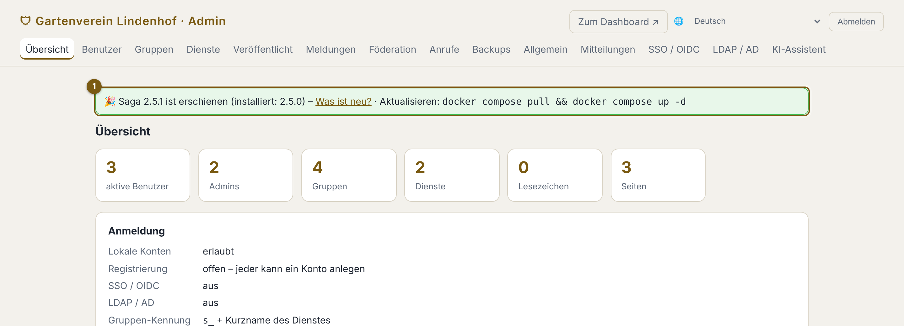

# A10 Updates und Release-Kanal

**Gilt für:** Web (Admin-Bereich) · Server

[← Übersicht](../README.md)

---

## Typische Aufgaben

- **Eine neue Version einspielen.** Frieda sieht im Admin-Bereich „Saga 2.5.1 ist erschienen“, liest „Was ist neu?“
  und aktualisiert am Samstagmorgen.
- **Neues früh ausprobieren.** Anna betreibt ein Test-Saga und stellt es auf den Kanal `testing`, um neue Funktionen
  vor dem Release zu sehen.
- **Ruhe im Verein.** Frieda bleibt bei den stabilen Versionen – der Kanal `2` bringt Fehlerbehebungen und neue
  Funktionen, aber nichts, was Handarbeit braucht.
- **Apps auf Stand halten.** Nach einem Server-Update erinnert Frieda die Mitglieder, auch die Apps zu aktualisieren.

## Wofür ist das?

Saga entwickelt sich weiter. Neue Versionen bringen Fehlerbehebungen, neue Funktionen und Sicherheitsupdates. Der
Admin-Bereich sagt dir Bescheid, wenn es eine neue Version gibt. Das Aktualisieren selbst machst du auf dem Server –
mit zwei Befehlen.

Die Versionsnummern folgen dem Schema **Major.Minor.Patch**, zum Beispiel 2.5.1:

- **Patch** (2.5.**1**) – nur Fehlerbehebungen.
- **Minor** (2.**5**.0) – neue Funktionen.
- **Major** (**3**.0.0) – kann Handarbeit brauchen. Kommt nur, wenn du es ausdrücklich einstellst.

> **Hinweis:** Wie du Saga aktualisierst, sicherst und zurückspielst, steht ausführlich in der Anleitung,
> [Abschnitt 11 „Sicherung, Wiederherstellung, Updates“](../../ANLEITUNG.md#11-sicherung-wiederherstellung-updates),
> Unterabschnitt „Updates“. Hier geht es um den Hinweis im Admin-Bereich und die Kanäle.

---

## Schritt für Schritt

### 1. Der Update-Hinweis

Gibt es eine neue Version, erscheint oben im Admin-Bereich ein Hinweis: „Saga 2.5.1 ist erschienen (installiert:
2.5.0)“.



Was die Nummern bedeuten:

- ① Der Hinweis mit **Was ist neu?** und dem Befehl zum Aktualisieren.

1. Klick auf **Was ist neu?**. Du landest bei den Änderungen dieser Version.
2. Lies vor allem, ob etwas für dich als Admin zu tun ist.
3. Aktualisiere wie unter **Aktualisieren:** angegeben (Abschnitt 2).

Die installierte Version steht immer unten auf jeder Seite des Admin-Bereichs.

Den Hinweis schaltest du unter **Allgemein → Updates → Auf neue Versionen hinweisen** ein oder aus. Saga fragt dafür
höchstens zweimal am Tag bei GitHub nach der neuesten Versionsnummer – sonst wird nichts übertragen.

### 2. Aktualisieren

Auf dem Server, im Ordner von Saga:

```sh
docker compose pull
docker compose up -d
```

Ändert ein Update die Datenbank, legt Saga **vorher automatisch ein Backup** an. Was genau passiert, wie du ein
zusätzliches Backup machst und worauf du bei größeren Sprüngen achten musst, steht in der Anleitung, Abschnitt 11,
„Updates“.

> **Tipp:** Aktualisiere, wenn gerade niemand telefoniert – zum Beispiel morgens am Wochenende. Saga ist nach dem
> Neustart in wenigen Sekunden wieder da.

### 3. Der Release-Kanal

Welche Versionen dein Server bekommt, bestimmt die Einstellung `SAGA_VERSION` in der `.env`:

| Wert | Bedeutung |
|---|---|
| `2` (Standard) | immer die neueste 2.x – neue Funktionen und Fehlerbehebungen, nichts, was Handarbeit braucht |
| `2.5` | nur Fehlerbehebungen von 2.5 |
| `2.5.1` | genau diese Version |
| `testing` | **Release Candidate:** das Neueste vor dem Release – nur zum Ausprobieren |

Auf dem Kanal `testing` zeigt der Admin-Bereich unten eine Version wie „2.6.0-rc.7“ mit dem Hinweis **Release
Candidate**. Ein Release Candidate kann Fehler haben. Für einen Server, auf den sich Familie oder Verein verlassen,
nimm den Standard `2`.

Zurück vom Testkanal und alle Einzelheiten: Anleitung, Abschnitt 11, „Updates“ (Absatz „Release Candidates“).

### 4. Apps und Versionen

Die Apps haben eigene Versionsnummern. Sie zeigen in ihren Einstellungen ihre eigene Version und die des Servers.

- Neue Funktionen des Servers brauchen oft auch eine neue App-Version. Ältere Apps laufen weiter, nur ohne die neuen
  Funktionen.
- Ist eine App für den Server zu alt, weist sie darauf hin („Bitte die App aktualisieren“).
- Bei manchen Umstellungen (zum Beispiel den modernen Chats, siehe [A05](05-allgemein.md)) wartet der Server eine
  Weile, bis alle aktiven Geräte die neue App haben.

Welche App-Version zu welcher Server-Version passt, steht bei den Updates in der Anleitung (Punkt „Apps“) und bei den
[Saga-Apps auf GitHub](https://github.com/yggdrasil-sh/saga-apps/releases).

---

## Beispiel aus dem Alltag

**Frieda spielt 2.5.1 ein.** Am Montag sieht Frieda im Admin-Bereich: „Saga 2.5.1 ist erschienen (installiert:
2.5.0)“.

1. Sie klickt auf **Was ist neu?**: nur Fehlerbehebungen, nichts für Admins zu tun.
2. Am Samstagmorgen meldet sie sich per SSH am Server an.
3. Im Saga-Ordner führt sie `docker compose pull` und `docker compose up -d` aus.
4. Nach ein paar Sekunden öffnet sie den Admin-Bereich: unten steht 2.5.1, der Hinweis ist weg.
5. Im Vereinschat schreibt sie: „Saga ist aktualisiert. Wer die App hat: bitte auch die App aktualisieren.“

---

## Häufige Fragen

**Muss ich jedes Update sofort einspielen?**
Nein, aber bald – besonders, wenn im Changelog „Sicherheit“ steht.

**Kann ich zu einer älteren Version zurück?**
Hat das Update die Datenbank umgebaut, geht das nur über das Backup von vor dem Update. Wie, steht in der Anleitung,
Abschnitt 11.

**Der Hinweis kommt nicht, obwohl es eine neue Version gibt.**
Prüfe, ob **Auf neue Versionen hinweisen** unter Allgemein an ist und ob der Server GitHub erreichen kann. Auf dem
Kanal `testing` meldet sich der Hinweis erst, wenn die nächste stabile Version erschienen ist.

**Wann kommt Saga 3?**
Eine neue Major-Version kommt nur, wenn du `SAGA_VERSION` ausdrücklich auf `3` stellst – vorher bleibt dein Server bei
2.x.

---

## Auf dem Handy und in den Apps

Den Server aktualisierst du nur auf dem Server. Die Apps aktualisierst du auf dem jeweiligen Gerät (siehe
Benutzer-Handbuch, [B17 Apps](../benutzer/17-apps.md)).

---

[← Übersicht](../README.md)
