# B00 Ideen für deinen Alltag

**Gilt für:** Web · Handy-Browser · iOS/iPadOS/Mac · Android · Linux

[← Übersicht](../README.md) · [Weiter: B01 Erste Schritte →](01-erste-schritte.md)

---

Du weißt noch nicht genau, was du mit Saga anfangen sollst? Hier findest du 20 Ideen, die Familie Sommer
(Anna, Ben, Clara und Oma Lena auf `saga.example`) und der Gartenverein Lindenhof (Frieda und Paul auf
`verein.example`) wirklich so benutzen. Jede Idee sagt dir kurz, **was du davon hast**, und verweist auf die
Kapitel, in denen du Schritt für Schritt nachliest, wie es geht.

Du musst nichts davon auf einmal einrichten. Such dir eine Idee aus, die dir heute Arbeit spart, und fang
damit an.

> **Tipp:** Viele Ideen gibt es schon als fertige Vorlage in der
> [Vorlagen-Galerie](06-galerie-widgets.md). Dann ist die Seite mit zwei Klicks da, und du passt sie nur noch an.

---

## Familie organisieren

**Die Einkaufsliste für alle**

Eine Liste, die alle in der Familie sehen und ergänzen – am Laptop, im Handy-Browser oder in der App. Wer im
Laden steht, hakt ab, und zu Hause sieht man sofort, was noch fehlt. Mit Spalten wie „Abteilung“ und „Preis“
rechnet Saga sogar die Summe aus.

- Funktionen: [Datenbank als Tabelle](07-datenbanken.md) · [Teilen mit Bearbeiten](10-teilen.md) ·
  [Gleichzeitig bearbeiten](09-gleichzeitig.md)

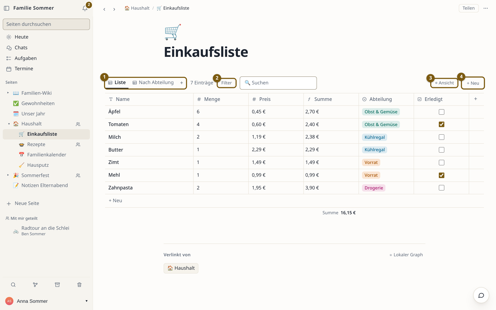

**Der Hausputzplan, den keiner vergisst**

Bad, Küche, Fenster: Jede Aufgabe ist ein Eintrag mit Raum, zuständiger Person und Status. Auf dem Board
schiebst du Karten von „Offen“ über „Dabei“ nach „Erledigt“. Machst du die Liste zur Aufgabenquelle, sieht
jeder seine eigenen Putzaufgaben direkt auf „Heute“.

- Funktionen: [Board-Ansicht](07-datenbanken.md) · [Datenbank als Aufgabenquelle](08-aufgaben.md)

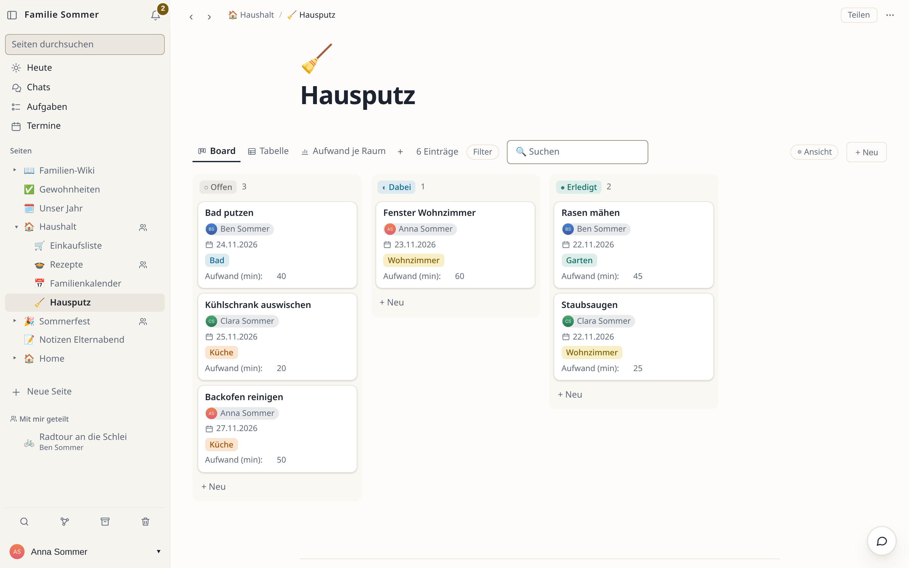

**Der Familienkalender auf einen Blick**

Zahnarzt, Elternabend, Training: Alle Termine stehen in einer gemeinsamen Datenbank mit Datum. In der
Wochenansicht siehst du, wer wann wo ist. Hast du schon einen Kalender in Nextcloud, verbindest du ihn
einfach, und seine Termine erscheinen auch rechts auf „Heute“.

- Funktionen: [Kalender-Ansicht](07-datenbanken.md) · [Kalender verbinden](16-verbindungen.md) ·
  [Heute](02-startseite.md)

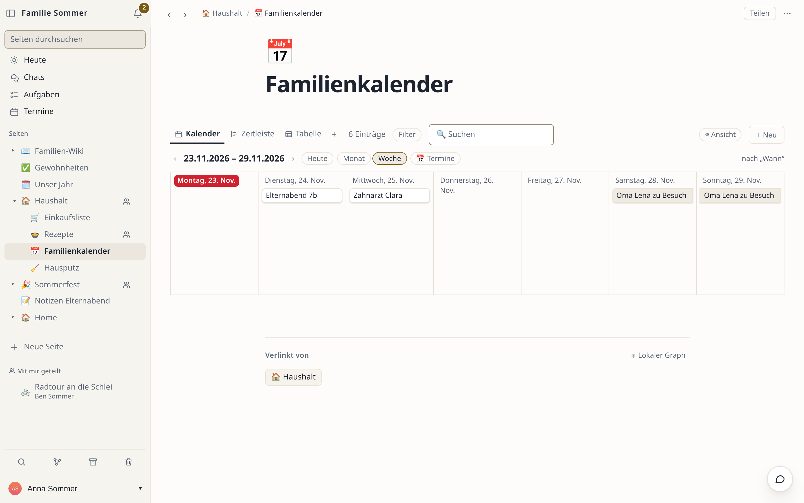

**Die Rezeptsammlung mit Fotos**

Omas Apfelkuchen, die schnelle Pasta für Mittwoch: Jedes Rezept ist eine eigene Seite mit Zutaten,
Zubereitung und Foto. In der Galerie-Ansicht blätterst du wie in einem Kochbuch, ein Tag wie „vegetarisch“
hilft beim Suchen. Die Vorlage „Rezepte & Einkauf“ bringt Wochenplan und Einkaufsliste gleich mit.

- Funktionen: [Vorlage „Rezepte & Einkauf“](06-galerie-widgets.md) · [Galerie-Ansicht](07-datenbanken.md) ·
  [Kommentare](10-teilen.md)

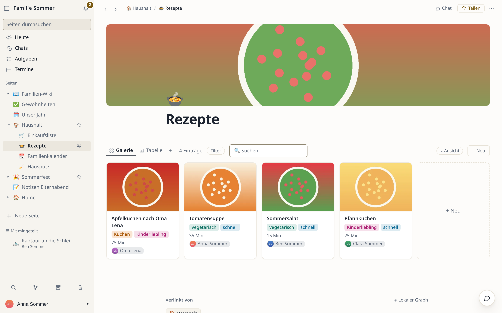

---

## Planen und Erinnern

**Der Familienurlaub mit Budget**

Anna plant „Urlaub Ostsee 2027“: Packliste zum Abhaken, zwei Unterkünfte nebeneinander zum Vergleichen, eine
Tabelle mit Kosten und Ausflügen. Ben wird für die Fährbuchung erwähnt und bekommt eine Benachrichtigung. Die
Vorlage „Reiseplaner“ bringt Countdown, Tagesplan und Ausgaben mit Budget schon mit.

- Funktionen: [Seiten und Editor](04-seiten-editor.md) · [Vorlage „Reiseplaner“](06-galerie-widgets.md) ·
  [Teilen](10-teilen.md)

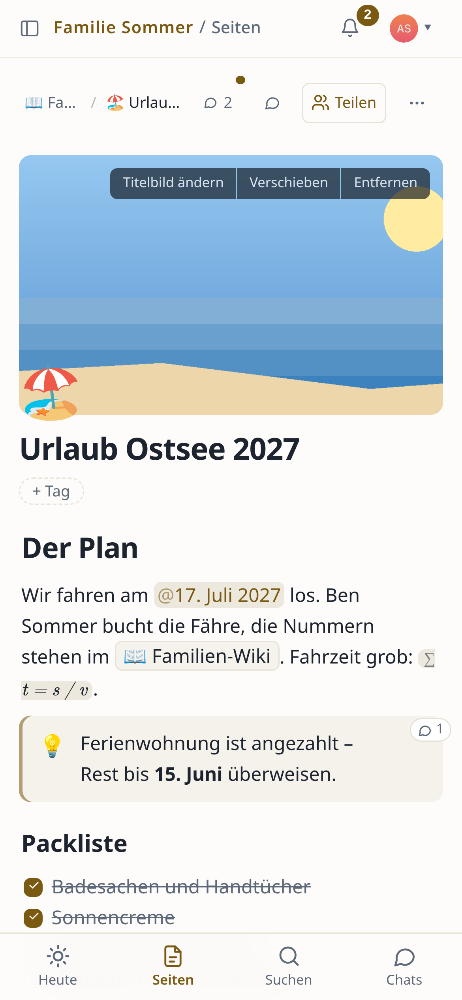

**Aufgaben, die sich selbst wiederholen**

„Müll rausbringen“ jeden Dienstag, „Blumen gießen“ alle paar Tage, „Steuererklärung“ einmal im Jahr: Du legst
die Aufgabe einmal mit Wiederholung an. Hakst du sie ab, steht sofort die nächste mit dem neuen Datum da.

- Funktionen: [Aufgaben mit Wiederholung, Priorität und Datum](08-aufgaben.md)

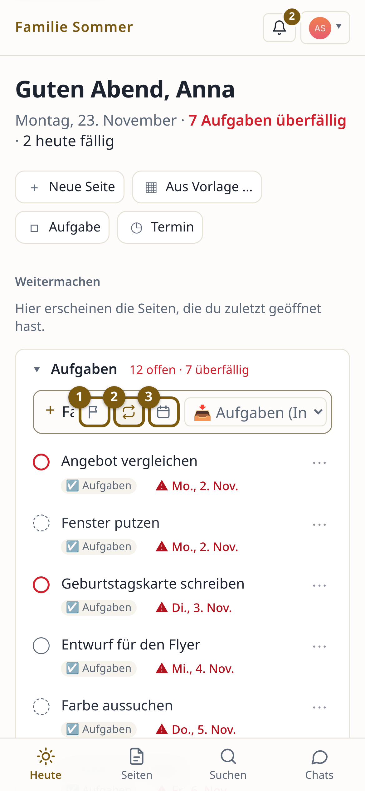

**Die Geburtstagsliste**

Eine kleine Datenbank mit Namen und Geburtstag aller Verwandten und Freunde, sortiert nach Datum. Dazu legst
du für jeden wichtigen Geburtstag eine Aufgabe „Geschenk besorgen“ mit der Wiederholung **jährlich** an – so
erinnert dich Saga jedes Jahr rechtzeitig.

- Funktionen: [Datenbanken: Datum und Sortierung](07-datenbanken.md) · [Aufgaben mit Wiederholung](08-aufgaben.md)

**Erinnerungen direkt im Text**

Du schreibst in einer Seite „Fähre buchen“ und tippst `@` – dort wählst du ein Datum oder eine Erinnerung.
Die Erinnerung legt gleich eine Aufgabe an. So geht nichts verloren, was dir beim Schreiben einfällt.

- Funktionen: [Erwähnungen und Datum im Text](04-seiten-editor.md) · [Aufgaben](08-aufgaben.md)

**Lernplan und Hausaufgaben**

Clara plant ihr Abi: eine Seite „Lernplan Abi“ mit Titelbild, Serif-Schrift und voller Breite, darin eine
Datenbank mit Fächern, Themen und Prüfungsterminen. Ein Countdown zählt die Tage bis zur ersten Prüfung, ein
Fortschrittsbalken zeigt, wie viel schon geschafft ist.

- Funktionen: [Seiten gestalten](05-gestalten.md) · [Widgets Countdown und Fortschritt](06-galerie-widgets.md) ·
  [Datenbanken](07-datenbanken.md)

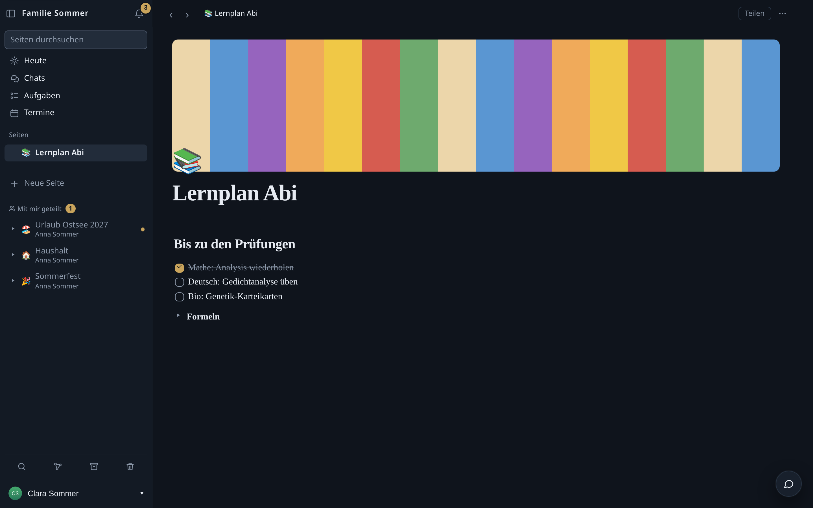

**Das Home-Dashboard als Startseite**

Ben startet jeden Morgen mit seiner eigenen Seite: Uhr, Wetter für Lübeck, Zitat des Tages, was heute fällig
ist, die Termine der Woche, Einkaufsliste und Gewohnheiten. Die Vorlage „Home-Dashboard“ legt alles in einem
Rutsch an, und mit **Als Startseite festlegen** öffnet Saga sie gleich nach der Anmeldung.

- Funktionen: [Vorlage „Home-Dashboard“ und Widgets](06-galerie-widgets.md) ·
  [Eigene Startseite](02-startseite.md)

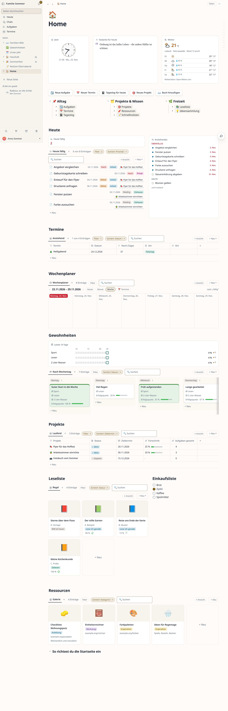

---

## Wissen sammeln

**Das Familien-Wiki mit den wichtigen Nummern**

Kinderarzt, Hausverwaltung, WLAN-Passwort für Gäste, Müllabfuhr-Termine: Alles steht in einer Seite
„Familien-Wiki“ mit Unterseiten. Die wichtigen Telefonnummern pflegst du als **synchronisierten Block** – er
erscheint zusätzlich auf „Infos für den Babysitter“ und ist überall gleich, wenn du ihn an einer Stelle
änderst.

- Funktionen: [Seitenbaum und Unterseiten](04-seiten-editor.md) · [Synchronisierte Blöcke](04-seiten-editor.md) ·
  [Vorlage „Team-Wiki“](06-galerie-widgets.md)

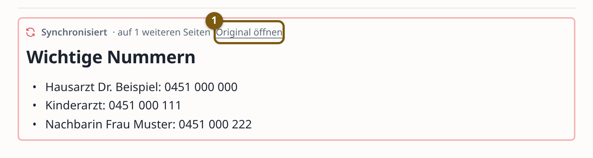

**Fotos aus Immich in deinen Seiten**

Liegen eure Urlaubsfotos in Immich, holst du sie mit einem Klick in eine Seite – als Bild oder als Titelbild.
So bekommt das Reisetagebuch „Ostsee 2026“ echte Bilder, ohne dass du Dateien hin- und herschieben musst.

- Funktionen: [Immich verbinden](16-verbindungen.md) · [Bilder in Seiten](04-seiten-editor.md) ·
  [Titelbild](05-gestalten.md)

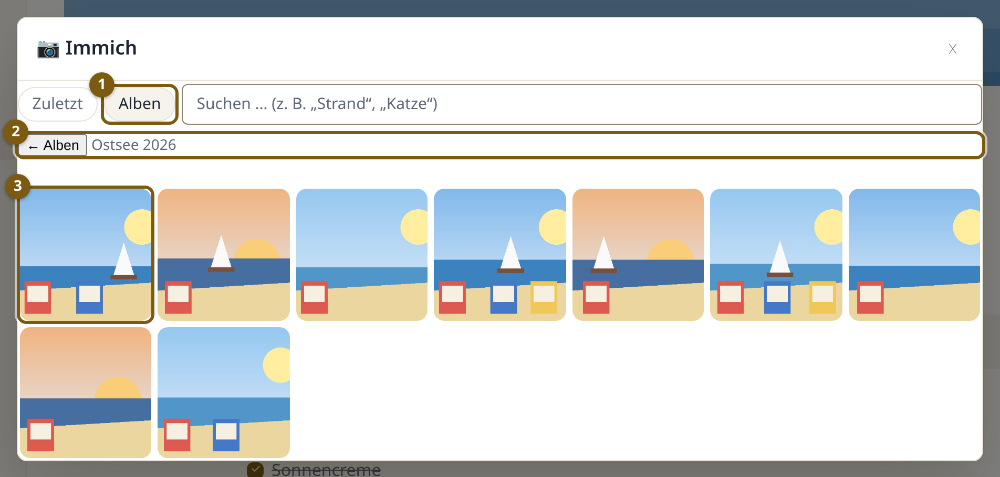

**Alte Notizen umziehen**

Du hast deine Rezepte bisher in Excel, deine Notizen in Obsidian oder in Notion? Saga übernimmt CSV-Dateien,
Markdown-Ordner und Notion-Exporte – mit Unterseiten, Datenbanken und Bildern.

- Funktionen: [Importieren](07-datenbanken.md)

---

## Zusammen arbeiten

**Gemeinsam an einem Text schreiben**

Anna und Ben schreiben gleichzeitig an der Seite „Sommerfest“: Jeder sieht, wo der andere gerade tippt, und
nichts wird überschrieben. Ging doch einmal etwas schief, holst du im Versionsverlauf eine ältere Fassung zurück.

- Funktionen: [Gleichzeitig bearbeiten und Versionen](09-gleichzeitig.md)

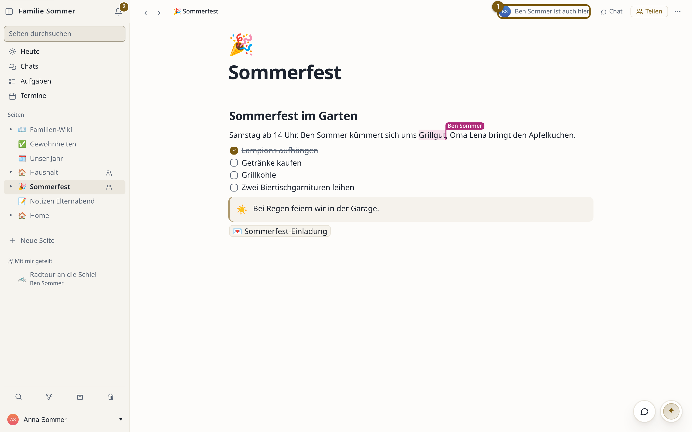

**Fragen direkt an der Stelle klären**

Statt langer Nachrichten schreibst du einen Kommentar genau an den Absatz, um den es geht: „Wer zahlt die
Restzahlung?“ Die anderen antworten dort, und wenn alles geklärt ist, klickst du auf **Erledigt**.

- Funktionen: [Kommentare](10-teilen.md) · [Benachrichtigungen](14-benachrichtigungen.md)

---

## In Kontakt bleiben

**Der Familienchat**

Alle Sommers in einem Gruppenchat „Sommers 🏡“ – mit Fotos, Reaktionen, Antworten mit Zitat und angehefteten
Nachrichten. Die Nachrichten sind Ende-zu-Ende verschlüsselt: Nicht einmal dein Admin kann sie lesen.

- Funktionen: [Chats](12-chats.md)

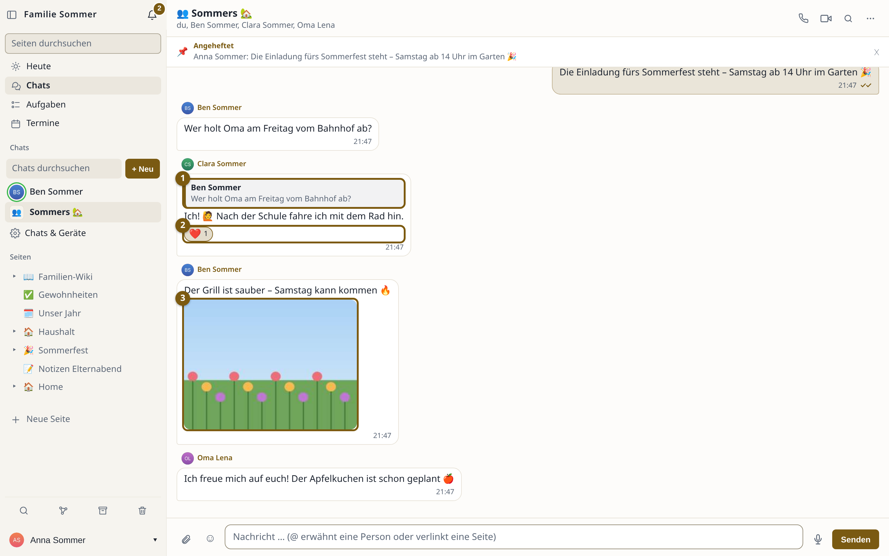

**Videoanruf mit Oma**

Oma Lena tippt in ihrem Handy auf den Anruf-Knopf im Chat, und Ben sieht sie auf seinem Laptop. Ben teilt
seinen Bildschirm und zeigt ihr die Urlaubsfotos. Auch Gruppenanrufe mit der ganzen Familie gehen.

- Funktionen: [Anrufe mit Video und Bildschirm teilen](13-anrufe.md)

---

## Im Verein

**Das Vereinsprotokoll gemeinsam schreiben**

Bei der Mitgliederversammlung schreibt Frieda das Protokoll, Paul ergänzt live die Kassenzahlen. Wer nicht
da war, liest es danach und stellt Fragen über Kommentare. Die Vorlage „Meeting-Notizen“ gibt Agenda,
Entscheidungen und Aufgaben vor.

- Funktionen: [Vorlage „Meeting-Notizen“](06-galerie-widgets.md) · [Gleichzeitig bearbeiten](09-gleichzeitig.md) ·
  [Teilen mit Gruppen](10-teilen.md)

**Den Parzellenplan mit einem anderen Saga teilen**

Der Verein hat ein eigenes Saga unter `verein.example`. Frieda teilt die Seite „Parzellenplan 2027“ trotzdem
direkt mit Anna auf `saga.example` – Anna bearbeitet sie in ihrem eigenen Saga, ohne ein zweites Konto. Das
heißt **Föderation**; dein Admin muss die beiden Server einmal verbinden.

- Funktionen: [Föderation](11-foederation.md) · [Teilen](10-teilen.md)

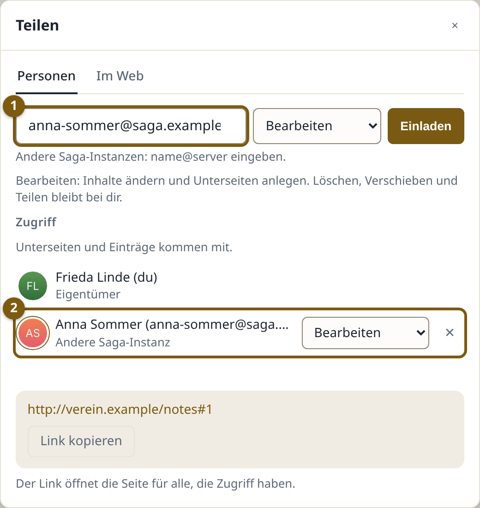

**Die Sommerfest-Einladung veröffentlichen**

Anna schreibt die Einladung zum Sommerfest als Seite und veröffentlicht sie. Jeder mit dem Link kann sie
lesen – ohne Anmeldung, auch auf dem Handy, hell oder dunkel. Ändert sie die Uhrzeit, sehen alle sofort die
neue Fassung.

- Funktionen: [Veröffentlichen](10-teilen.md)

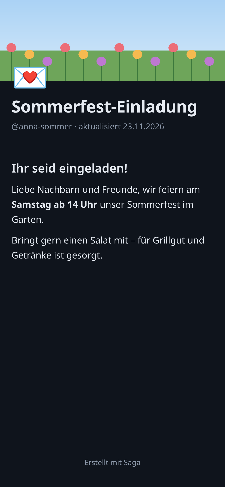

---

## Und dann?

- Noch kein Konto oder noch nie angemeldet? Weiter mit [B01 Erste Schritte](01-erste-schritte.md).
- Du willst sofort loslegen? Öffne **Seiten** → **+ Neue Seite** → **Aus der Galerie …** und such dir eine
  Vorlage aus ([B06](06-galerie-widgets.md)).
- Etwas fehlt oder klappt nicht? In [B19 Hilfe](19-hilfe.md) steht, wie du deinem Admin eine Diagnose schickst.

---

[← Übersicht](../README.md) · [Weiter: B01 Erste Schritte →](01-erste-schritte.md)
