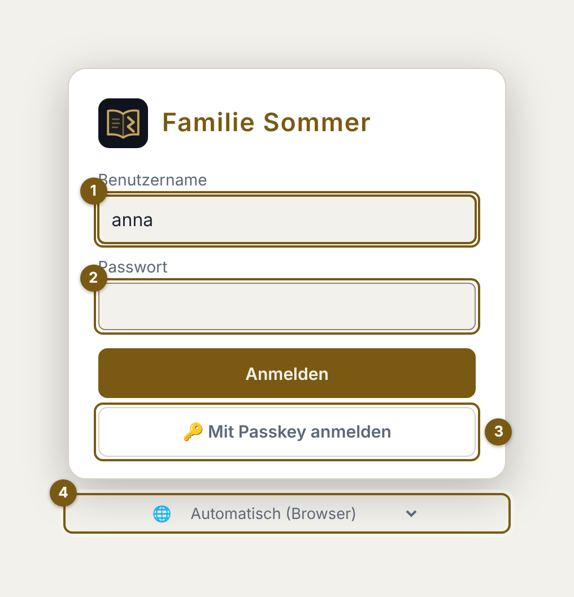
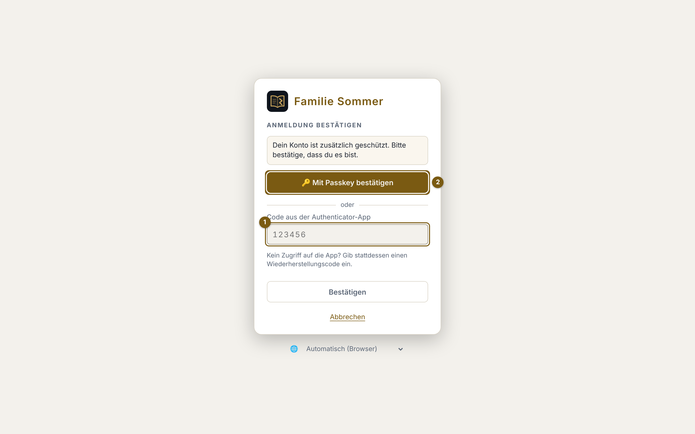
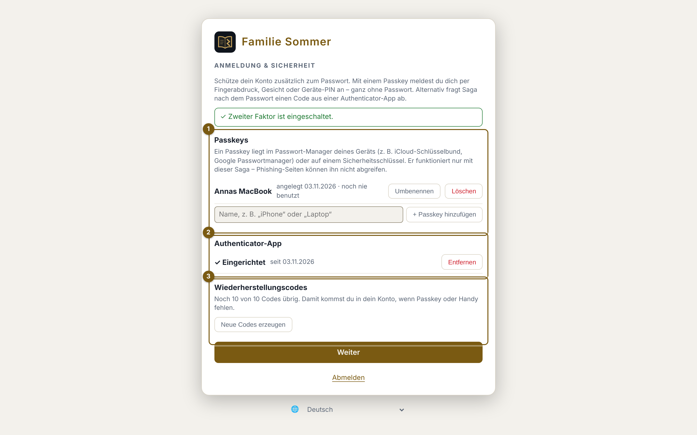
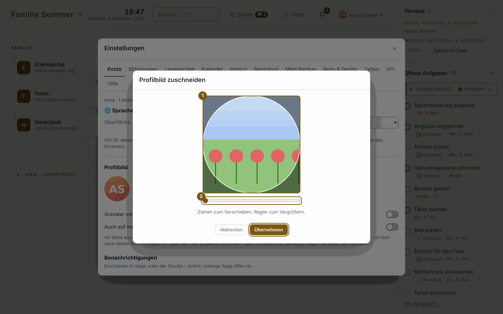
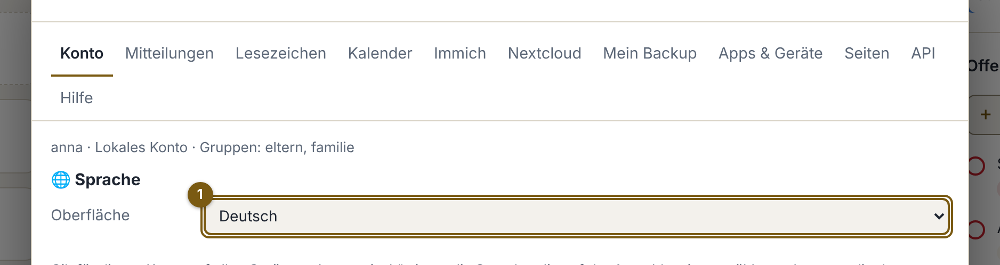
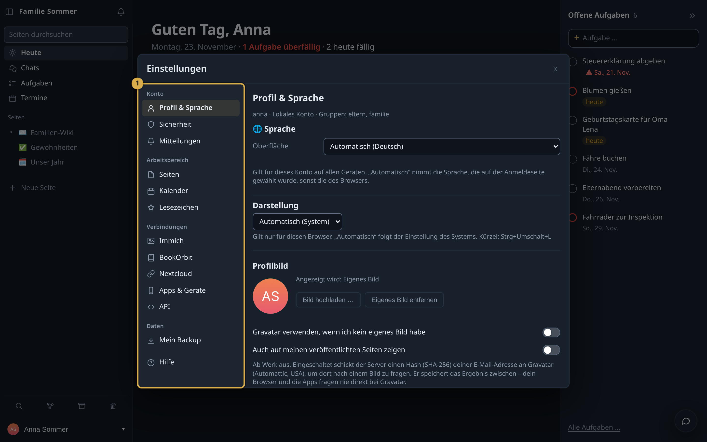
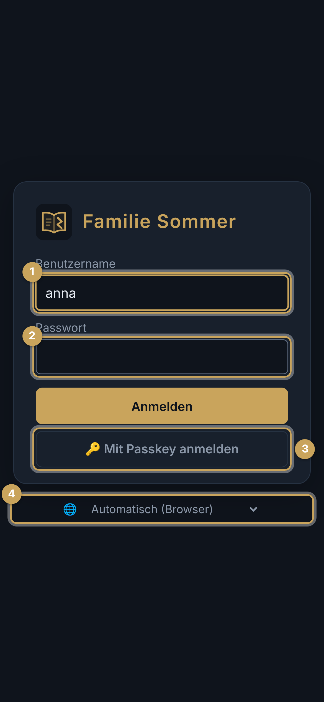

# B01 Erste Schritte

**Gilt für:** Web · Handy-Browser · iOS/iPadOS/Mac · Android · Linux

[← B00 Ideen](00-ideen.md) · [Übersicht](../README.md) · [Weiter: B02 Heute und Startseite →](02-startseite.md)

---

## Das kannst du damit machen

- **Ohne Passwort anmelden:** Mit einem Passkey legst du nur den Finger auf oder schaust ins Handy – Oma Lena
  muss sich kein Passwort mehr merken.
- **Dein Konto doppelt absichern:** Mit Passkey oder Authenticator-App kommt niemand in dein Konto, auch wenn
  jemand dein Passwort kennt.
- **Erkennbar sein:** Mit Anzeigename und Profilbild sehen Ben und Clara sofort, wer die Einkaufsliste geändert
  oder im Familienchat geschrieben hat.
- **In deiner Sprache arbeiten:** Lena stellt Saga auf Deutsch, eine Freundin der Familie auf Thai – jede Person
  für sich.
- **Ein verlorenes Handy abmelden:** Unter „Apps & Geräte“ meldest du ein verlorenes Gerät mit einem Klick ab.

## Wofür ist das?

Dieses Kapitel ist für alle, die Saga zum ersten Mal öffnen. Du meldest dich an, sicherst dein Konto mit einem
Passkey oder einer Authenticator-App ab, gibst dir einen Namen und ein Profilbild und wählst deine Sprache.
Danach weißt du, wo die Einstellungen liegen und wie du dich wieder abmeldest.

Du brauchst dafür nur die **Adresse** deines Saga (zum Beispiel `https://saga.example`) und deinen
**Benutzernamen**. Beides bekommst du von der Person, die Saga betreibt – in diesem Handbuch heißt sie
einfach „dein Admin“.

---

## Schritt für Schritt

### 1. Anmelden

1. Öffne die Adresse deines Saga im Browser. Du siehst die Anmeldeseite mit dem Namen eures Servers – bei
   Familie Sommer steht dort „Familie Sommer“.
2. Trag bei ① **Benutzername** deinen Namen ein, so wie ihn dein Admin angelegt hat (zum Beispiel `anna`).
3. Trag bei ② **Passwort** dein Passwort ein.
4. Klick auf **Anmelden**.

Was die Nummern bedeuten:

- ① Benutzername
- ② Passwort
- ③ **Mit Passkey anmelden** – ganz ohne Passwort (siehe Abschnitt 3)
- ④ Sprache schon vor der Anmeldung wählen (siehe Abschnitt 6)

> **Tipp:** Je nachdem, wie euer Saga eingerichtet ist, siehst du statt der Felder (oder zusätzlich) einen
> Knopf mit einem Schloss 🔐, zum Beispiel „Mit Firmenkonto anmelden“. Das ist die Anmeldung über einen
> zentralen Anmeldedienst (SSO). Dann klickst du einfach darauf und meldest dich dort an.

**Noch kein Konto?** Wenn dein Admin es erlaubt, steht unten auf der Anmeldeseite „Noch kein Konto?
**Jetzt registrieren**“. Dort wählst du einen Benutzernamen, einen Anzeigenamen, optional deine E-Mail-Adresse
und ein Passwort mit mindestens 10 Zeichen. Steht der Link nicht da, legt dein Admin die Konten an.

**Passwort vergessen?** Saga kann dir keine E-Mail zum Zurücksetzen schicken. Dein Passwort setzt dein Admin
zurück – frag einfach nach.

### 2. Der zweite Schritt bei der Anmeldung

Hast du dein Konto zusätzlich geschützt (siehe Abschnitt 3), fragt Saga nach dem Passwort noch einmal nach:
„Dein Konto ist zusätzlich geschützt. Bitte bestätige, dass du es bist.“

1. Entweder tippst du bei ① den **6-stelligen Code** aus deiner Authenticator-App ein und klickst auf
   **Bestätigen**. Hast du weder Handy noch Passkey zur Hand, gibst du im selben Feld ① einen deiner
   **Wiederherstellungscodes** ein,
2. oder du klickst auf ② **Mit Passkey bestätigen** und bestätigst mit Fingerabdruck, Gesicht oder der
   PIN deines Geräts.

Was die Nummern bedeuten:

- ① Code aus der Authenticator-App (oder ein Wiederherstellungscode)
- ② stattdessen mit Passkey bestätigen

> **Hinweis:** Dieser Zwischenschritt gilt 5 Minuten und nur in diesem Browser. Nach 5 falschen Codes musst
> du 15 Minuten warten. Einen Haken „Diesem Browser vertrauen“ gibt es mit Absicht nicht.

### 3. Konto absichern: Passkey, Authenticator-App, Wiederherstellungscodes

Ein Passwort allein kann erraten oder gestohlen werden. Deshalb kannst du dein Konto zusätzlich schützen.
Du findest alles unter **Einstellungen → Sicherheit**:

1. Klick unten links in der Seitenleiste auf deinen Namen (das Benutzermenü) und dann auf **⚙ Einstellungen**.
2. Wähl links unter **Konto** den Bereich **Sicherheit**.

Du siehst drei Bereiche:

**① Passkeys** – die bequemste Art. Ein Passkey ist ein Schlüssel, den dein Gerät sicher aufbewahrt (zum
Beispiel im iCloud-Schlüsselbund, im Google Passwortmanager oder auf einem Sicherheitsschlüssel). Du meldest
dich dann per Fingerabdruck, Gesicht oder Geräte-PIN an – ganz ohne Passwort. Ein Passkey funktioniert nur mit
deinem Saga; eine gefälschte Seite kann ihn nicht abgreifen.

1. Gib dem Passkey einen Namen, an dem du das Gerät erkennst, zum Beispiel „iPhone“ oder „Laptop“.
2. Klick auf **+ Passkey hinzufügen**.
3. Dein Browser bzw. dein Handy fragt, ob du einen Passkey sichern willst. Bestätige mit Fingerabdruck,
   Gesicht oder PIN.
4. Fertig – der Passkey steht jetzt in der Liste, mit Datum „angelegt“ und „zuletzt benutzt“.

Du kannst mehrere Passkeys anlegen, zum Beispiel einen fürs Handy und einen für den Laptop. Mit **Umbenennen**
und **Löschen** verwaltest du sie.

**② Authenticator-App** – für alle, die lieber eine Code-App benutzen (zum Beispiel Aegis, 2FAS, Google oder
Microsoft Authenticator). Die App zeigt alle 30 Sekunden einen neuen 6-stelligen Code.

1. Klick bei „Authenticator-App“ auf **Einrichten**.
2. Scanne den QR-Code mit deiner Authenticator-App. Geht das nicht, tippst du den angezeigten Schlüssel von
   Hand in die App ein.
3. Gib den Code ein, den die App jetzt anzeigt, und klick auf **Bestätigen**.

**③ Wiederherstellungscodes** – deine Notfall-Schlüssel. Sobald du deinen ersten Passkey oder die
Authenticator-App eingerichtet hast, zeigt Saga dir **10 Einmal-Codes**.

1. Speichere sie sicher: **Kopieren** (zum Beispiel in deinen Passwort-Manager), **Als Datei speichern** oder
   ausdrucken.
2. Klick auf **Ich habe sie gespeichert**.

> **Wichtig:** Saga zeigt dir die Codes **nur dieses eine Mal**. Jeder Code gilt einmal. Mit **Neue Codes
> erzeugen** bekommst du später einen frischen Satz – die alten gelten dann nicht mehr.

### 4. „Zur Sicherheit bitte bestätigen“

Manche Änderungen sind so wichtig, dass Saga noch einmal nachfragt, ob wirklich du vor dem Bildschirm sitzt:

- einen Passkey oder die Authenticator-App **entfernen**,
- einen **weiteren** Passkey hinzufügen, wenn schon einer da ist,
- **neue Wiederherstellungscodes** erzeugen.

Dann erscheint „Zur Sicherheit bitte bestätigen, dass du es bist.“ Du gibst dein **Passwort** oder einen
**Code** aus der Authenticator-App ein oder klickst auf **Mit Passkey bestätigen**. Danach macht Saga einfach
weiter. Das schützt dich, falls jemand an deinem offenen Laptop sitzt.

### 5. Profil: Name und Profilbild

Unter **Einstellungen → Profil & Sprache** stellst du ein, wie andere dich sehen.

**Anzeigename und E-Mail**

1. Trag bei **Anzeigename** ein, wie du heißen möchtest, zum Beispiel „Anna Sommer“. Den Namen sehen alle, mit
   denen du chattest oder Seiten teilst.
2. Optional: deine **E-Mail**-Adresse.
3. Klick auf **Speichern**.

> **Hinweis:** Meldest du dich über einen Anmeldedienst (SSO) oder ein Firmenverzeichnis an, steht dort „Name,
> E-Mail und Passwort verwaltet dein Anmeldedienst.“ Dann änderst du diese Angaben dort, nicht in Saga.

**Passwort ändern**

1. Gib unter **Einstellungen → Sicherheit** bei **Passwort ändern** dein bisheriges Passwort ein, dann zweimal das
   neue (mindestens 10 Zeichen).
2. Klick auf **Passwort ändern**.

Danach werden alle **anderen** Browser und angemeldeten Apps abgemeldet – nur der Browser, in dem du gerade
bist, bleibt angemeldet. Die Apps melden sich einmal neu an.

**Profilbild**

1. Klick bei **Profilbild** auf **Bild hochladen …** und wähle ein Foto (PNG, JPEG, GIF, WebP oder HEIC).
2. Zieh das Bild bei ① an die richtige Stelle und vergrößere es mit dem Regler ② **Zoom**.
3. Klick auf **Übernehmen**.

Dein Bild erscheint jetzt überall, wo du auftauchst: in der Seitenleiste, bei Kommentaren, im Chat und in der Liste
„Wer gerade hier ist“. Saga entfernt dabei versteckte Angaben aus dem Foto, etwa den Aufnahmeort. Mit
**Eigenes Bild entfernen** kommen wieder deine Initialen.

Darunter findest du zwei Schalter:

- **Gravatar verwenden, wenn ich kein eigenes Bild habe** – ab Werk aus. Schaltest du ihn ein, fragt dein
  Server beim Dienst Gravatar nach einem Bild zu deiner E-Mail-Adresse. Saga fragt dich vorher noch einmal.
- **Auch auf meinen veröffentlichten Seiten zeigen** – ab Werk aus. Nur wenn er an ist, sehen Besucher deiner
  öffentlichen Seiten dein Bild.

**Öffentlicher Name**

Weiter unten steht dein **öffentlicher Name**. Er erscheint in der Adresse von Seiten, die du für alle
veröffentlichst, und ist für andere Saga-Server sichtbar. Er wird beim ersten Veröffentlichen festgelegt. Mehr
dazu in [B10 Teilen, Rechte, Kommentare, Veröffentlichen](10-teilen.md#5-eine-seite-veröffentlichen).

### 6. Sprache wählen

Saga spricht Deutsch, Englisch, Spanisch, Russisch und Thai.

1. Öffne **Einstellungen → Profil & Sprache**. Schneller geht es über das Benutzermenü (dein Name unten links) →
   **🌐 Sprache**: Dort wählst du die Sprache direkt, **Mehr zur Sprache …** öffnet diese Stelle.
2. Wähle bei ① in der Liste **Oberfläche** deine Sprache: **Automatisch**, Deutsch, English, Español, Русский
   oder ไทย.
3. Die Sprache gilt sofort, und zwar für dein Konto auf **allen** Geräten.

„Automatisch“ bedeutet: Saga nimmt die Sprache, die du auf der Anmeldeseite gewählt hast, sonst die deines
Browsers.

> **Tipp:** Sitzt du an einem fremden Rechner, der eine andere Sprache spricht? Dann wähl die Sprache schon
> auf der Anmeldeseite unten bei 🌐 (④ im ersten Bild). Diese Wahl merkt sich nur dieser Browser.
> „Automatisch (Browser)“ stellt sie wieder zurück.

### 7. Hell oder dunkel

Unter **Einstellungen → Profil & Sprache → Darstellung** (direkt unter der Sprache) wählst du **Automatisch
(System)**, **Hell** oder **Dunkel**. Schneller geht es über das Benutzermenü oder mit `Strg`+`Umschalt`+`L`
(Mac: `⌘`+`⇧`+`L`). Die Wahl gilt nur für **diesen Browser**.

„Automatisch“ richtet sich nach der Einstellung deines Geräts:

- **Windows:** Einstellungen → Personalisierung → Farben → „Modus auswählen“.
- **Mac:** Systemeinstellungen → Erscheinungsbild.
- **iPhone/iPad:** Einstellungen → Anzeige & Helligkeit.
- **Android:** Einstellungen → Display → Dunkles Design (je nach Hersteller etwas anders benannt).

Stellst du dein Gerät auf „automatisch“, wird Saga abends von selbst dunkel.

### 8. Die Einstellungen im Überblick

Alle persönlichen Einstellungen liegen in einem Fenster. Du öffnest es über dein Benutzermenü (dein Name unten
links in der Seitenleiste) → **⚙ Einstellungen**. Links stehen die Bereiche, rechts der gewählte Bereich.

Die Bereiche bei ①:

- **Konto** – **Profil & Sprache** (Sprache, Darstellung, Profilbild, Name, öffentlicher Name), **Sicherheit**
  (Passwort, Passkeys, Authenticator-App) und **Mitteilungen** (was dich wann benachrichtigt, siehe
  [B14](14-benachrichtigungen.md))
- **Arbeitsbereich** – **Seiten** (Einstellungen zum Seiten-Editor), **Kalender** und **Lesezeichen** (siehe
  [B16](16-verbindungen.md) und [B03 Lesezeichen](03-lesezeichen.md))
- **Verbindungen** – **Immich**, **BookOrbit**, **Nextcloud** (siehe [B16](16-verbindungen.md)), **Apps & Geräte**
  (angemeldete Apps, App per QR-Code anmelden, siehe [B17](17-apps.md)) und **API** (für Fortgeschrittene, siehe
  [B18](18-api-webhooks-mcp.md))
- **Daten** – **Mein Backup**: deine eigenen Daten sichern (siehe [B19](19-hilfe.md))
- **Hilfe** – Saga-Version und „Diagnose senden“, wenn etwas hakt (siehe [B19](19-hilfe.md))

Welche Bereiche du siehst, hängt davon ab, was dein Admin eingeschaltet hat. Mit den Pfeiltasten wechselst du
zwischen den Bereichen. Mit **✕** oder der Taste `Esc` schließt du das Fenster.

### 9. Abmelden

1. Klick unten links in der Seitenleiste auf deinen Namen.
2. Klick auf **↪ Abmelden**.

Saga meldet dich in **diesem** Browser ab. Andere Geräte bleiben angemeldet.

- Eine **App** meldest du unter **Einstellungen → Apps & Geräte** ab: Dort steht jede angemeldete App mit einem
  Knopf **Abmelden**. Das ist praktisch, wenn ein Handy verloren geht.
- **Alle anderen** Browser und Apps auf einmal meldest du ab, indem du dein Passwort änderst (Abschnitt 5).
- **Konto löschen** kannst du nicht selbst. Das macht dein Admin für dich.

---

## Beispiel aus dem Alltag

**Oma Lena bekommt ihr eigenes Saga.** Lena nutzt nur ihr Handy. Anna hat für sie ein Konto angelegt.

1. Anna schickt Lena die Adresse `https://saga.example`, den Benutzernamen `lena` und ein Startpasswort.
2. Lena öffnet die Adresse im Handy-Browser, tippt `lena` und das Startpasswort ein und tippt auf
   **Anmelden**.
3. Sie tippt auf ihr Profilbild-Kürzel → **⚙ Einstellungen** → **Profil & Sprache** und trägt als
   Anzeigenamen „Oma Lena“ ein und tippt auf **Speichern**.
4. Unter **Sicherheit** → **Passwort ändern** ersetzt sie das Startpasswort durch ein eigenes.
5. Weiter unten bei **Anmeldung & Sicherheit** schreibt sie in das Namensfeld „Lenas Handy“ und tippt auf
   **+ Passkey hinzufügen**. Das Handy fragt nach ihrem Fingerabdruck – fertig.
6. Saga zeigt ihr jetzt 10 Wiederherstellungscodes. Anna hilft ihr, sie mit **Als Datei speichern**
   abzulegen; außerdem schreibt Lena sie auf einen Zettel für die Schublade. Dann tippt sie auf **Ich habe sie
   gespeichert**.
7. Ab jetzt tippt Lena auf der Anmeldeseite nur noch auf **🔑 Mit Passkey anmelden** und legt den Finger auf.
   Ein Passwort muss sie sich nicht mehr merken.

> **Tipp:** Damit Lena Saga wie eine App starten kann, legt Anna ihr Saga auf den Home-Bildschirm: im
> Browser-Menü **Zum Home-Bildschirm**.

**Clara verliert ihr Handy.** Auf dem Handy waren ihr Passkey, ihre Authenticator-App und die Saga-App.

1. Clara meldet sich am Familien-Laptop mit Benutzername und Passwort an.
2. Im zweiten Schritt tippt sie bei ① einen ihrer **Wiederherstellungscodes** ein (sie hat sie in ihrem
   Passwort-Manager) und klickt auf **Bestätigen**.
3. Sie öffnet **⚙ Einstellungen → Apps & Geräte** und klickt bei ihrem alten Handy auf **Abmelden**. Die App
   auf dem verlorenen Gerät kommt jetzt nicht mehr in ihr Konto.
4. Unter **Sicherheit → Anmeldung & Sicherheit** löscht sie den alten Passkey „Claras Handy“ und entfernt die
   Authenticator-App. Saga fragt dabei zur Sicherheit noch einmal nach ihrem Passwort.
5. Sobald das neue Handy da ist, legt sie dort einen neuen Passkey an und erzeugt mit **Neue Codes erzeugen**
   einen frischen Satz Wiederherstellungscodes – der benutzte Code gilt ja nicht mehr.

---

## Tipps und Tastenkürzel

- **Vorschlagsliste nutzen:** Hast du einen Passkey, bietet dein Browser ihn oft schon an, wenn du ins Feld
  **Benutzername** klickst. Einfach auswählen und bestätigen.
- **Mehrere Passkeys:** Leg für jedes Gerät, das du regelmäßig benutzt, einen eigenen Passkey an. Fällt eins
  aus, kommst du mit dem anderen weiter hinein.
- **Codes nicht nur digital:** Bewahr mindestens einen Satz Wiederherstellungscodes außerhalb deines Handys
  auf – sonst sind beim Verlust des Handys Passkey **und** Codes weg.
- **`Esc`** schließt die Einstellungen.
- **Benutzermenü → 🌐 Sprache** wechselt die Sprache direkt.

---

## Häufige Fragen

**Ich habe mein Passwort vergessen. Was jetzt?**
Hast du einen Passkey, melde dich einfach mit **Mit Passkey anmelden** an und vergib unter Konto ein neues
Passwort. Sonst setzt dein Admin das Passwort zurück.

**Mein Handy ist weg – und damit Passkey und Authenticator-App.**
Melde dich mit Passwort an und gib im zweiten Schritt einen Wiederherstellungscode ein. Entferne dann den alten
Passkey bzw. die App und richte alles neu ein. Hast du keine Codes mehr, kann dein Admin den zweiten Faktor
zurücksetzen.

**Saga sagt „Dieser Browser kann keine Passkeys verwenden.“**
Dein Browser oder Gerät unterstützt Passkeys nicht, oder euer Saga ist nicht über eine sichere Adresse
(`https://`) erreichbar. Nimm so lange die Authenticator-App und sag deinem Admin Bescheid.

**Saga verlangt nach der Anmeldung sofort einen zweiten Faktor.**
Dein Admin hat festgelegt, dass alle (oder alle Admins) einen zweiten Faktor brauchen. Richte einen Passkey oder
die Authenticator-App ein und klick dann auf **Weiter**.

**Warum ist Saga bei mir dunkel, bei Ben aber hell?**
Saga folgt der Einstellung des jeweiligen Geräts (Abschnitt 7). Stell dein Gerät um, dann wechselt auch Saga.

---

## Auf dem Handy und in den Apps

**Handy-Browser**

Die Anmeldeseite sieht auf dem Handy genauso aus, nur schmaler. Die Nummern bedeuten dasselbe wie oben.

- Passkeys anlegen und benutzen klappt auf dem Handy wie am Computer – mit Fingerabdruck oder Gesicht.
- Die Einstellungen zeigen am Handy zuerst die Liste der Bereiche; **‹ Einstellungen** führt zurück zur Liste.
- Über das Browser-Menü **Zum Home-Bildschirm** startest du Saga wie eine App.

**Apps (iOS/iPadOS/Mac, Android, Linux)**

<!-- App-Bild folgt: b01-08-anmelden-ios.png -->

- **Anmelden:** Du trägst die Adresse deines Saga ein und tippst auf **Anmelden**. Die Anmeldung öffnet sich im
  Browserfenster deines Systems – dort funktionieren Passwort, Passkey, Code und SSO genau wie im Web.
  Noch bequemer ist die Anmeldung per **QR-Code** aus **Einstellungen → Apps & Geräte** (siehe
  [B17 Apps](17-apps.md)).
- **Passkeys und Authenticator-App einrichten** geht nur im Browser. Die Apps zeigen in ihren Einstellungen den
  Stand an (Passkeys, Authenticator-App, übrige Codes).
- **Sprache:** Die Apps haben eine eigene Sprachwahl, schon vor der Anmeldung (🌐 unten im Anmeldebildschirm).
  - **iPhone/iPad:** Der Eintrag „Sprache“ öffnet die Einstellungen-App → Saga → Sprache.
  - **Mac und Linux:** Auswahl direkt in der App, sie gilt nach einem Neustart der App (die App bietet ihn an).
  - **Android:** wirkt sofort; ab Android 13 auch unter Einstellungen → Apps → Saga → Sprache.
- **Hell/dunkel:** Auch die Apps zeigen Saga hell oder dunkel.
- **Abmelden** einzelner Apps geht jederzeit im Web unter **Einstellungen → Apps & Geräte**.

<!-- App-Bild folgt: b01-09-sprache-android.png -->

---

[← B00 Ideen](00-ideen.md) · [Übersicht](../README.md) · [Weiter: B02 Heute und Startseite →](02-startseite.md)
