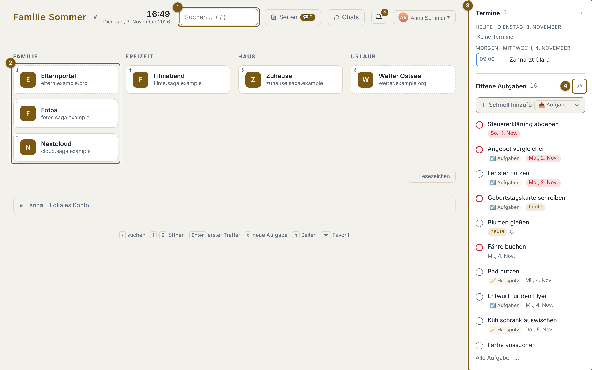
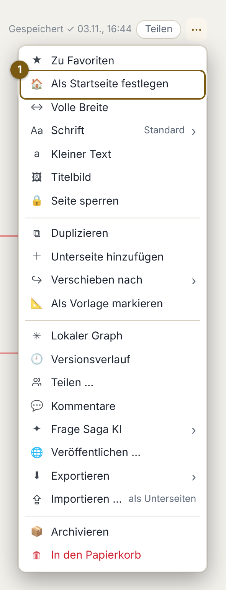
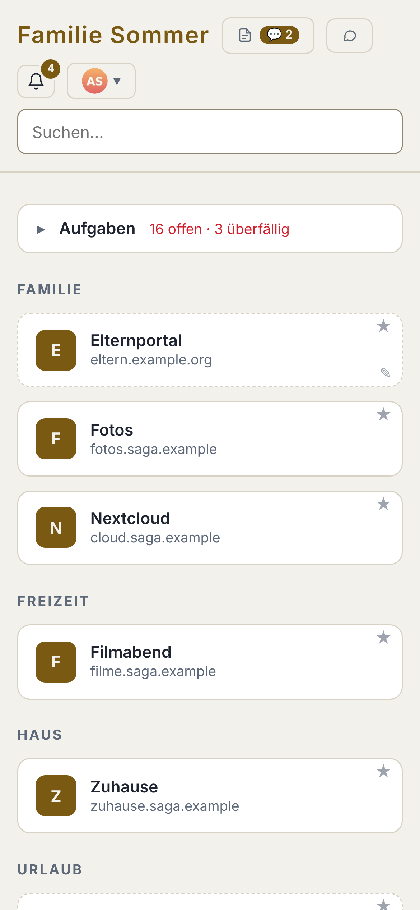

# B02 Dashboard und Startseite

**Gilt für:** Web · Handy-Browser · iOS/iPadOS/Mac · Android · Linux

[← B01 Erste Schritte](01-erste-schritte.md) · [Übersicht](../README.md) · [Weiter: B03 Lesezeichen →](03-lesezeichen.md)

---

## Das kannst du damit machen

- **Morgens alles auf einen Blick:** Anna sieht beim Kaffee den Termin „Zahnarzt Clara“ und ihre offenen
  Aufgaben wie „Fähre buchen“ – ohne eine einzige App zu öffnen.
- **Eure Dienste mit einem Tastendruck:** Fotos, Nextcloud oder Home Assistant öffnet Ben mit `1`, `2`, `3` –
  ganz ohne Adressen zu tippen.
- **Schnell eine Aufgabe notieren:** Fällt dir beim Surfen ein, dass die Milch alle ist, drückst du `t`,
  tippst „Milch kaufen“ und `Enter`.
- **Alles finden:** Die Suche oben findet Dienste, Lesezeichen und deine Seiten – etwa das Rezept
  „Apfelkuchen“.
- **Mit deiner eigenen Seite starten:** Ben lässt Saga direkt mit seinem Home-Dashboard starten.

## Wofür ist das?

Das **Dashboard** ist der Ort, an dem du nach der Anmeldung landest. Hier hast du alles für den Tag auf einen
Blick: Kacheln für eure Dienste und deine Lesezeichen, deine offenen Aufgaben und die Termine von heute und
morgen. Über die Suche oben findest du Dienste, Lesezeichen und deine Seiten.

Wenn du lieber mit einer eigenen Seite startest – zum Beispiel deinem persönlichen „Home-Dashboard“ –, kannst
du jede Seite als **Startseite** festlegen. Das Dashboard bleibt trotzdem immer erreichbar.

---

## Schritt für Schritt

### 1. Das Dashboard kennenlernen

Was die Nummern bedeuten:

- ① **Suche** – findet Dienste, Lesezeichen und Seiten
- ② **Kacheln** – eure Dienste und deine Lesezeichen, nach Kategorien geordnet
- ③ **Termine und Aufgaben** – die Leiste rechts
- ④ **Leiste einklappen** (»)

In der Kopfzeile findest du außerdem:

- den Namen eures Saga, die Uhrzeit und das Datum,
- **Seiten** – öffnet deine Seiten in einem eigenen Browser-Tab. Die Zahl mit der Sprechblase zeigt neue
  Kommentare.
- **Chats** – öffnet die Chats (wenn dein Admin sie eingeschaltet hat). Eine Zahl zeigt ungelesene Nachrichten.
- die **Glocke** mit deinen Benachrichtigungen,
- dein **Benutzermenü** mit Namen und Profilbild: Einstellungen, Sprache, Abmelden.

Ganz unten steht eine kleine Zeile mit den wichtigsten Tastenkürzeln, darüber ein aufklappbarer Kasten mit
deinem Konto (Anmeldename, Kontoart, Gruppen) und den Knöpfen **Konto & Passwort** und **Lesezeichen
verwalten**.

### 2. Kacheln benutzen

1. Klick auf eine Kachel – der Dienst oder die Webseite öffnet sich in einem **neuen Tab**.
2. Jede Kachel hat oben links eine kleine Nummer. Drückst du diese Zahl auf der Tastatur (`1` bis `9`), öffnet
   sich die Kachel direkt.

Es gibt zwei Arten von Kacheln:

- **Dienste** (durchgezogener Rahmen) – hat dein Admin für euch eingerichtet, zum Beispiel „Fotos“ oder
  „Nextcloud“. Welche Dienste du siehst, hängt von deinen Gruppen ab.
- **Lesezeichen** (gestrichelter Rahmen) – hast du selbst angelegt, zum Beispiel „Elternportal“. Nur du siehst
  sie. Wie das geht, steht in [B03 Lesezeichen](03-lesezeichen.md).

Die Kacheln stehen in **Kategorien** – bei Anna sind das „Familie“, „Freizeit“, „Haus“ und „Urlaub“. Die
Kategorien der Dienste legt dein Admin fest, die deiner Lesezeichen du selbst.

**Status-Punkt:** Bei manchen Diensten lässt dein Admin prüfen, ob sie erreichbar sind. Dann siehst du auf der
Kachel einen kleinen Punkt. Fährst du mit der Maus darüber, steht dort „online“, „langsam“ oder „nicht
erreichbar“. Saga prüft das jede Minute neu.

### 3. Favoriten ★

Kacheln, die du oft brauchst, holst du nach ganz oben:

1. Fahr mit der Maus über eine Kachel. Oben rechts erscheint ein Stern **★**.
2. Klick auf den Stern („Zu Favoriten“).
3. Die Kachel steht jetzt in der Kategorie **Favoriten** ganz oben.

Ein weiterer Klick auf den Stern („Aus Favoriten entfernen“) stellt sie zurück. Auf dem Handy ist der Stern
immer zu sehen.

### 4. Suchen

1. Klick in das Suchfeld ① oder drück einfach `/`.
2. Tipp los. Schon beim Tippen bleiben nur die passenden Kacheln stehen. Gesucht wird in Name, Adresse und
   Kategorie.
3. Ab zwei Buchstaben erscheinen darunter auch passende **Seiten** – Saga sucht dabei in Titel und Inhalt.
   Ein Klick öffnet die Seite.
4. `Enter` öffnet den ersten Treffer. `Esc` leert das Suchfeld.

**Websuche:** Hat dein Admin eine Websuche eingerichtet, steht im Suchfeld „Dienste oder Web durchsuchen…“.
Findet Saga keine passende Kachel, sucht `Enter` im Web. Mit `Shift`+`Enter` suchst du immer im Web, auch wenn
es passende Kacheln gibt. Die Ergebnisse erscheinen direkt auf dem Dashboard; **Schließen** oder `Esc` blendet
sie wieder aus.

### 5. Termine und Aufgaben in der Leiste rechts

Die Leiste ③ zeigt dir:

- **Termine** von heute und morgen aus deinen verbundenen Kalendern. Mit **+** legst du einen neuen Termin an.
  (Kalender verbindest du in den Einstellungen – siehe [B16 Verbindungen](16-verbindungen.md).)
- **Offene Aufgaben**, sortiert nach Datum. Fällige Aufgaben zeigen „heute“, überfällige sind rot. Ein kleines
  Schild wie „Aufgaben“ oder „Hausputz“ zeigt, woher eine Aufgabe stammt.

So legst du schnell eine Aufgabe an:

1. Klick in **Schnell hinzufügen …** (oder drück `t`).
2. Tipp zum Beispiel „Milch kaufen“ und drück `Enter`.

Ein Klick auf den Kreis vor einer Aufgabe hakt sie ab; für ein paar Sekunden kannst du das mit
**Rückgängig** zurücknehmen. Alles Weitere zu Aufgaben steht in [B08 Aufgaben](08-aufgaben.md).

**Leiste einklappen:** Klick auf **»** ④. Die Leiste verschwindet, und deine Aufgaben erscheinen als Kasten im
Hauptbereich – dort mit allen Möglichkeiten (Priorität, Wiederholung, Datum, Erledigte). Über den kleinen
Reiter am rechten Rand holst du die Leiste zurück. Saga merkt sich deine Wahl in diesem Browser.

### 6. Eigene Startseite festlegen

Statt des Dashboards kann Saga auch mit einer deiner Seiten starten.

1. Öffne die Seite, mit der Saga künftig starten soll.
2. Klick oben rechts auf **⋯** (das Seitenmenü).
3. Klick auf ① **🏠 Als Startseite festlegen**.

Saga bestätigt: „Startseite festgelegt – Saga startet jetzt mit dieser Seite.“ Wenn du jetzt die Adresse
deines Saga öffnest, landest du direkt auf dieser Seite.

**Zum Dashboard kommst du trotzdem:**

- In den Seiten und in den Chats steht oben der Knopf **⌂ Dashboard**. Auch ein Klick auf den Namen eures Saga
  oben links führt dorthin.
- In der Befehlspalette (`Strg`+`K` bzw. `⌘`+`K`) gibt es „Übersicht (Startseite)“.

**Zurück zum Dashboard als Start:** Öffne dieselbe Seite, klick auf **⋯** und wähle **Startseite
zurücksetzen**. Saga meldet: „Startseite zurückgesetzt – Saga startet wieder mit dem Dashboard.“

> **Hinweis:** Die Startseite gehört zu deinem **Konto**. Sie gilt also auch auf deinen anderen Geräten und in
> den Apps. Vorlagen lassen sich nicht als Startseite festlegen.

---

## Beispiel aus dem Alltag

**Ben startet den Tag mit seinem Home-Dashboard.** Ben hat sich aus der Vorlagen-Galerie die Seite
„Home-Dashboard“ angelegt – mit Uhr, Wetter, Wochenplaner und Einkaufsliste (wie das geht, zeigt
[B06 Vorlagen-Galerie und Widgets](06-galerie-widgets.md)). Diese Seite soll er morgens als Erstes sehen.

1. Ben öffnet über **Seiten** die Seite „Home-Dashboard“.
2. Er klickt oben rechts auf **⋯** → **🏠 Als Startseite festlegen**.
3. Am nächsten Morgen öffnet er `https://saga.example` – und landet direkt auf seinem Home-Dashboard.
4. Um schnell „Nextcloud“ zu öffnen, klickt er oben auf **⌂ Dashboard**, drückt `/`, tippt „next“ und drückt
   `Enter`.
5. Bevor er losfährt, drückt er auf dem Dashboard `t`, tippt „Fähre buchen“ und `Enter` – die Aufgabe steht
   sofort in seiner Leiste.

Anna dagegen behält das klassische Dashboard als Start. Jeder in der Familie entscheidet das für sich.

---

## Tipps und Tastenkürzel

Die Kürzel funktionieren auf dem Dashboard, solange du nicht gerade in ein Feld tippst.

- `/` – ins Suchfeld springen
- `1` … `9` – Kachel mit dieser Nummer öffnen
- `Enter` (im Suchfeld) – ersten Treffer öffnen; ohne Treffer Websuche, falls eingerichtet
- `Shift`+`Enter` (im Suchfeld) – immer im Web suchen, falls eingerichtet
- `Esc` (im Suchfeld) – Suche leeren bzw. Websuche schließen
- `t` – neue Aufgabe anlegen
- `n` – Seiten öffnen (immer im selben Tab)

> **Tipp:** Die Nummern auf den Kacheln passen sich beim Suchen an. Tipp „fo“ – dann ist „Fotos“ die Nummer 1,
> und `Enter` öffnet sie.

> **Tipp:** Lege die Kacheln, die du täglich brauchst, als Favoriten ★ fest. Dann haben sie die Nummern 1, 2, 3 …
> und du öffnest sie mit einem Tastendruck.

---

## Häufige Fragen

**Mein Dashboard ist fast leer.**
Dein Admin hat dir noch keine Dienste freigeschaltet. Dann steht dort „Für dich sind noch keine Dienste
freigeschaltet – lege dir eigene Lesezeichen an.“ Mit **+ Lesezeichen** kannst du sofort loslegen
([B03](03-lesezeichen.md)).

**Wo ist meine Aufgabenleiste hin?**
Du hast sie wahrscheinlich mit **»** eingeklappt. Deine Aufgaben stehen dann im Kasten **Aufgaben** im
Hauptbereich. Über den Reiter am rechten Bildschirmrand holst du die Leiste zurück. Bei einem schmalen Fenster
zeigt Saga die Aufgaben ebenfalls im Hauptbereich.

**Ich sehe keine Termine.**
Termine erscheinen erst, wenn du einen Kalender verbunden hast (Einstellungen → Kalender). Ohne Termine heute
und morgen bleibt der Bereich leer bzw. zeigt „Keine Termine“.

**Ich habe eine Startseite festgelegt und finde das Dashboard nicht mehr.**
Klick oben auf **⌂ Dashboard** oder auf den Namen eures Saga oben links.

**Warum fehlt bei mir die Websuche?**
Die Websuche muss dein Admin einrichten. Ohne sie steht im Suchfeld nur „Suchen…“.

---

## Auf dem Handy und in den Apps

**Handy-Browser**

- Die Kopfzeile bricht um: Seiten, Chats, Glocke und Profilbild stehen oben, darunter die **Suche**.
- Statt der Leiste rechts gibt es den Kasten **Aufgaben** mit der Anzahl offener und überfälliger Aufgaben.
  Antippen klappt ihn auf.
- Die Kacheln stehen untereinander. Stern ★ und Bearbeiten ✎ sind immer sichtbar.
- Tastenkürzel gibt es auf dem Handy natürlich nicht.

**Dunkler Modus**

Hell oder dunkel richtet sich nach deinem Gerät (siehe [B01, Abschnitt 7](01-erste-schritte.md#7-hell-oder-dunkel)).

**Apps (iOS/iPadOS/Mac, Android, Linux)**

<!-- App-Bild folgt: b02-05-heute-ios.png -->

- Die Apps haben kein Dashboard wie im Web. Sie starten mit **Heute** – deinen Terminen und Aufgaben des Tages.
  Die Kacheln findest du in den Apps unter **Dienste**.
- **Eigene Startseite:** Die Startseite aus deinem Konto übernehmen alle Apps. Beim Start öffnet die App diese
  Seite. Auf Android führt „Zurück“ dann zu „Heute“. Festlegen und zurücksetzen kannst du sie auch in den Apps
  über das Seitenmenü: „Als Startseite festlegen“ bzw. „Startseite zurücksetzen“.
- Bei älteren Saga-Servern merkt sich die App die Startseite nur auf dem jeweiligen Gerät.

<!-- App-Bild folgt: b02-06-dienste-android.png -->

---

[← B01 Erste Schritte](01-erste-schritte.md) · [Übersicht](../README.md) · [Weiter: B03 Lesezeichen →](03-lesezeichen.md)
