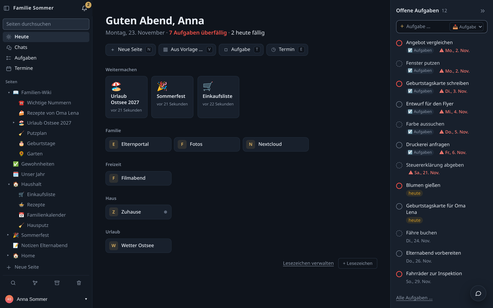

# B02 Heute und Startseite

**Gilt für:** Web · Handy-Browser · iOS/iPadOS/Mac · Android · Linux

[← B01 Erste Schritte](01-erste-schritte.md) · [Übersicht](../README.md) · [Weiter: B03 Lesezeichen →](03-lesezeichen.md)

---

## Das kannst du damit machen

- **Morgens alles auf einen Blick:** Anna sieht beim Kaffee, dass eine Aufgabe überfällig ist und zwei heute
  fällig sind – und mit welcher Seite sie gestern aufgehört hat.
- **Eure Dienste mit einem Tastendruck:** Fotos, Nextcloud oder Home Assistant öffnet Ben mit `1`, `2`, `3` –
  ganz ohne Adressen zu tippen.
- **Schnell eine Aufgabe notieren:** Fällt dir beim Surfen ein, dass die Milch alle ist, drückst du `t`,
  tippst „Milch kaufen“ und `Enter`.
- **Gleich loslegen:** Mit `n` legst du eine neue Seite an, mit `v` eine aus einer Vorlage.
- **Mit deiner eigenen Seite starten:** Ben lässt Saga direkt mit seinem Home-Dashboard starten.

## Wofür ist das?

**Heute** ist der Ort, an dem du nach der Anmeldung landest. Hier hast du alles für den Tag auf einen Blick:
eine Begrüßung mit dem Stand deiner Aufgaben, Knöpfe für das, was du oft tust, die Seiten, an denen du zuletzt
gearbeitet hast, Kacheln für eure Dienste und deine Lesezeichen – und rechts deine offenen Aufgaben und die
Termine von heute und morgen.

Links steht – wie überall in Saga – die **Seitenleiste**: mit **Heute**, **Chats**, **Aufgaben** und
**Termine**, deinen Seiten und ganz unten deinem Benutzermenü.

Wenn du lieber mit einer eigenen Seite startest – zum Beispiel deinem persönlichen „Home-Dashboard“ –, kannst
du jede Seite als **Startseite** festlegen. „Heute“ bleibt trotzdem immer erreichbar.

---

## Schritt für Schritt

### 1. Heute kennenlernen

Was die Nummern bedeuten:

- ① **Seitenleiste** – Heute, Chats, Aufgaben und Termine; darunter deine Seiten
- ② **Schnellaktionen** – Neue Seite (`n`), Aus Vorlage (`v`), Aufgabe (`t`), Termin (`e`); hat dein Admin den
  KI-Assistenten eingerichtet, steht dort auch **Frage Saga KI** (`m`)
- ③ **Kacheln** – eure Dienste und deine Lesezeichen, nach Kategorien geordnet
- ④ **Leiste einklappen** (»): die Leiste rechts mit Terminen und offenen Aufgaben

Außerdem siehst du auf „Heute“:

- oben die **Begrüßung** mit Datum und dem Stand deiner Aufgaben (zum Beispiel „1 Aufgabe überfällig · 2 heute
  fällig“),
- **Weitermachen** – die Seiten, die du zuletzt geöffnet hast. Ein Klick öffnet sie.
- **Lesen** – hast du BookOrbit verbunden, stehen hier die Bücher, die du gerade liest
  ([B16](16-verbindungen.md)).
- unter den Kacheln **Lesezeichen verwalten** und **+ Lesezeichen** ([B03](03-lesezeichen.md)).

In der Seitenleiste links findest du außerdem:

- oben den Namen eures Saga und die **Glocke** mit deinen Benachrichtigungen ([B14](14-benachrichtigungen.md)),
- **Seiten durchsuchen** – filtert deine Seiten nach dem Titel (`/` springt hinein),
- unten **Schnellsuche** (`Strg`+`K` bzw. `⌘`+`K`), **Graph**, **Archiv** und **Papierkorb**,
- ganz unten dein **Benutzermenü** mit Namen und Profilbild: Einstellungen, Sprache, Tastenkürzel, Abmelden.

Mit `Strg`+`\` (Mac: `⌘`+`\`) oder dem Knopf links oben blendest du die Seitenleiste aus und wieder ein. Unten
rechts öffnet die Sprechblase die Chats in einem kleinen Fenster, ohne „Heute“ zu verlassen.

### 2. Kacheln benutzen

1. Klick auf eine Kachel – der Dienst oder die Webseite öffnet sich in einem **neuen Tab**.
2. Die ersten neun Kacheln haben eine Nummer (sie erscheint, wenn du mit der Maus darüberfährst oder mit der
   Tabulatortaste hineinspringst). Drückst du diese Zahl auf der Tastatur (`1` bis `9`), öffnet sich die Kachel
   direkt.

Es gibt zwei Arten von Kacheln:

- **Dienste** (durchgezogener Rahmen) – hat dein Admin für euch eingerichtet, zum Beispiel „Fotos“ oder
  „Nextcloud“. Welche Dienste du siehst, hängt von deinen Gruppen ab.
- **Lesezeichen** (gestrichelter Rahmen) – hast du selbst angelegt, zum Beispiel Claras „Vertretungsplan“. Nur du siehst
  sie. Wie das geht, steht in [B03 Lesezeichen](03-lesezeichen.md).

Die Kacheln stehen in **Kategorien** – bei Anna sind das „Familie“, „Freizeit“, „Haus“ und „Urlaub“. Die
Kategorien der Dienste legt dein Admin fest, die deiner Lesezeichen du selbst.

**Status-Punkt:** Bei manchen Diensten lässt dein Admin prüfen, ob sie erreichbar sind. Dann siehst du auf der
Kachel einen kleinen Punkt. Fährst du mit der Maus darüber, steht dort „online“, „langsam“ oder „nicht
erreichbar“. Saga prüft das jede Minute neu.

### 3. Favoriten ★

Kacheln, die du oft brauchst, holst du nach ganz oben:

1. Fahr mit der Maus über eine Kachel. Oben rechts erscheint ein Stern **★**.
2. Klick auf den Stern („Zu Favoriten“).
3. Die Kachel steht jetzt in der Kategorie **Favoriten** ganz oben.

Ein weiterer Klick auf den Stern („Aus Favoriten entfernen“) stellt sie zurück. Auf dem Handy ist der Stern
immer zu sehen.

### 4. Suchen

- **Seiten durchsuchen** oben in der Seitenleiste (oder `/`): Schon beim Tippen bleiben nur die Seiten stehen,
  deren Titel passt. `Enter` öffnet den ersten Treffer.
- **Schnellsuche** (`Strg`+`K` bzw. `⌘`+`K`, oder die Lupe unten in der Seitenleiste): findet Seiten auch nach
  ihrem Inhalt, bietet Befehle wie „Neue Seite“, „Aufgaben“ oder „Einstellungen“ an und – wenn dein Admin eine
  Websuche eingerichtet hat – **Im Web suchen**. Mehr dazu in [B04](04-seiten-editor.md).

### 5. Termine und Aufgaben in der Leiste rechts

Die Leiste rechts zeigt dir:

- **Termine** von heute und morgen aus deinen verbundenen Kalendern. Mit **+** legst du einen neuen Termin an.
  (Kalender verbindest du in den Einstellungen – siehe [B16 Verbindungen](16-verbindungen.md).)
- **Offene Aufgaben**, sortiert nach Datum. Fällige Aufgaben zeigen „heute“, überfällige sind rot. Ein kleines
  Schild wie „Aufgaben“ oder „Hausputz“ zeigt, woher eine Aufgabe stammt.

So legst du schnell eine Aufgabe an:

1. Klick in **Aufgabe …** (oder drück `t`).
2. Tipp zum Beispiel „Milch kaufen“ und drück `Enter`.

Ein Klick auf den Kreis vor einer Aufgabe hakt sie ab; für ein paar Sekunden kannst du das mit
**Rückgängig** zurücknehmen. Alles Weitere zu Aufgaben steht in [B08 Aufgaben](08-aufgaben.md).

**Leiste einklappen:** Klick auf **»** ④. Die Leiste verschwindet, und deine Aufgaben erscheinen als Kasten im
Hauptbereich – dort mit allen Möglichkeiten (Priorität, Wiederholung, Datum, Erledigte). Über den kleinen
Reiter am rechten Rand holst du die Leiste zurück. Saga merkt sich deine Wahl in diesem Browser.

### 6. Eigene Startseite festlegen

Statt mit „Heute“ kann Saga auch mit einer deiner Seiten starten.

1. Öffne die Seite, mit der Saga künftig starten soll.
2. Klick oben rechts auf **⋯** (das Seitenmenü).
3. Klick auf ① **Als Startseite festlegen** (im unteren Teil des Menüs).

Saga bestätigt: „Startseite festgelegt – Saga startet jetzt mit dieser Seite.“ Wenn du jetzt die Adresse
deines Saga öffnest, landest du direkt auf dieser Seite.

**Zu „Heute“ kommst du trotzdem:**

- Klick in der Seitenleiste auf **Heute** – oder auf den Namen eures Saga oben links.
- In der Schnellsuche (`Strg`+`K` bzw. `⌘`+`K`) gibt es den Befehl „Heute“.

**Zurück zu „Heute“ als Start:** Öffne dieselbe Seite, klick auf **⋯** und wähle **Startseite
zurücksetzen**. Saga meldet: „Startseite zurückgesetzt – Saga startet wieder mit „Heute“.“

> **Hinweis:** Die Startseite gehört zu deinem **Konto**. Sie gilt also auch auf deinen anderen Geräten und in
> den Apps. Vorlagen lassen sich nicht als Startseite festlegen.

---

## Beispiel aus dem Alltag

**Ben startet den Tag mit seinem Home-Dashboard.** Ben hat sich aus der Vorlagen-Galerie die Seite
„Home-Dashboard“ angelegt – mit Uhr, Wetter, Wochenplaner und Einkaufsliste (wie das geht, zeigt
[B06 Vorlagen-Galerie und Widgets](06-galerie-widgets.md)). Diese Seite soll er morgens als Erstes sehen.

1. Ben öffnet in der Seitenleiste die Seite „Home-Dashboard“.
2. Er klickt oben rechts auf **⋯** → **Als Startseite festlegen**.
3. Am nächsten Morgen öffnet er `https://saga.example` – und landet direkt auf seinem Home-Dashboard.
4. Um schnell „Nextcloud“ zu öffnen, klickt er in der Seitenleiste auf **Heute** und drückt die Nummer der
   Kachel – bei ihm `3`.
5. Bevor er losfährt, drückt er auf „Heute“ `t`, tippt „Fähre buchen“ und `Enter` – die Aufgabe steht sofort
   in seiner Leiste.

Anna dagegen behält „Heute“ als Start. Jeder in der Familie entscheidet das für sich.

---

## Tipps und Tastenkürzel

Die Kürzel funktionieren auf „Heute“, solange du nicht gerade in ein Feld tippst.

- `/` – in „Seiten durchsuchen“ springen
- `1` … `9` – Kachel mit dieser Nummer öffnen
- `n` – neue Seite
- `v` – neue Seite aus einer Vorlage
- `t` – neue Aufgabe
- `e` – neuer Termin
- `m` – Frage Saga KI (wenn eingerichtet)
- `Strg`+`K` bzw. `⌘`+`K` – Schnellsuche
- `Strg`+`\` bzw. `⌘`+`\` – Seitenleiste ein- oder ausblenden
- `?` – alle Tastenkürzel anzeigen

> **Tipp:** Lege die Kacheln, die du täglich brauchst, als Favoriten ★ fest. Dann haben sie die Nummern 1, 2, 3 …
> und du öffnest sie mit einem Tastendruck.

---

## Häufige Fragen

**Auf „Heute“ sind keine Kacheln.**
Dein Admin hat dir noch keine Dienste freigeschaltet. Dann steht dort „Für dich sind noch keine Dienste
freigeschaltet – lege dir eigene Lesezeichen an.“ Mit **+ Lesezeichen** kannst du sofort loslegen
([B03](03-lesezeichen.md)).

**Wo ist meine Aufgabenleiste hin?**
Du hast sie wahrscheinlich mit **»** eingeklappt. Deine Aufgaben stehen dann im Kasten **Aufgaben** im
Hauptbereich. Über den Reiter am rechten Bildschirmrand holst du die Leiste zurück. Bei einem schmalen Fenster
zeigt Saga die Aufgaben ebenfalls im Hauptbereich.

**Ich sehe keine Termine.**
Termine erscheinen erst, wenn du einen Kalender verbunden hast (Einstellungen → Kalender). Ohne Termine heute
und morgen bleibt der Bereich ausgeblendet. Alle Termine siehst du in der Seitenleiste unter **Termine**.

**Ich habe eine Startseite festgelegt und finde „Heute“ nicht mehr.**
Klick in der Seitenleiste auf **Heute** oder auf den Namen eures Saga oben links.

**Wo ist die Suche über den Kacheln hin?**
Seit Saga 2.5 gibt es auf „Heute“ kein eigenes Suchfeld mehr. Kacheln öffnest du mit den Ziffern `1` bis `9`,
Seiten findest du über **Seiten durchsuchen** oder die **Schnellsuche** (`Strg`+`K`). Die Websuche steckt –
wenn dein Admin sie eingerichtet hat – in der Schnellsuche („Im Web suchen“).

---

## Auf dem Handy und in den Apps

**Handy-Browser**

- Oben stehen der Name eures Saga, die Glocke und dein Profilbild (das Benutzermenü).
- Unten wechselst du mit der Leiste zwischen **Heute**, **Seiten**, **Suchen** und **Chats**.
- Statt der Leiste rechts gibt es den Kasten **Aufgaben** mit der Anzahl offener und überfälliger Aufgaben.
  Antippen klappt ihn auf.
- Die Kacheln stehen untereinander. Stern ★ und Bearbeiten ✎ sind immer sichtbar.
- Tastenkürzel gibt es auf dem Handy natürlich nicht.

**Dunkler Modus**

Hell oder dunkel richtet sich nach deinem Gerät (siehe [B01, Abschnitt 7](01-erste-schritte.md#7-hell-oder-dunkel)).

**Apps (iOS/iPadOS/Mac, Android, Linux)**

<!-- App-Bild folgt: b02-05-heute-ios.png -->

- Auch die Apps starten mit **Heute** – deinen Terminen und Aufgaben des Tages.
  Die Kacheln findest du in den Apps unter **Dienste**.
- **Eigene Startseite:** Die Startseite aus deinem Konto übernehmen alle Apps. Beim Start öffnet die App diese
  Seite. Auf Android führt „Zurück“ dann zu „Heute“. Festlegen und zurücksetzen kannst du sie auch in den Apps
  über das Seitenmenü: „Als Startseite festlegen“ bzw. „Startseite zurücksetzen“.
- Bei älteren Saga-Servern merkt sich die App die Startseite nur auf dem jeweiligen Gerät.

<!-- App-Bild folgt: b02-06-dienste-android.png -->

---

[← B01 Erste Schritte](01-erste-schritte.md) · [Übersicht](../README.md) · [Weiter: B03 Lesezeichen →](03-lesezeichen.md)
