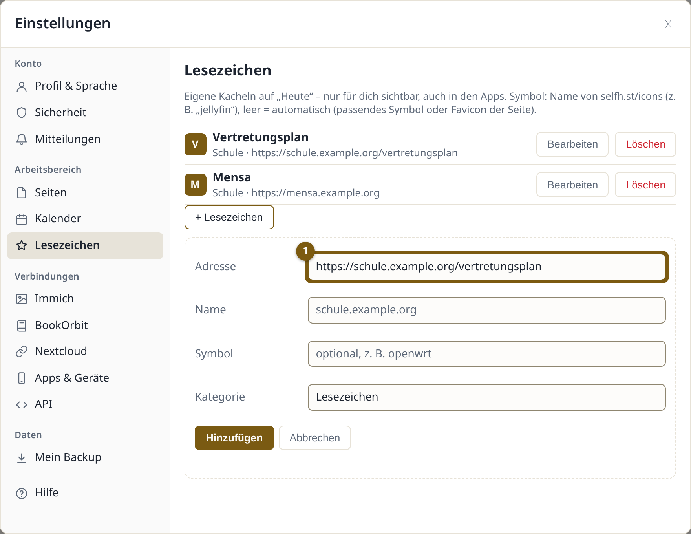
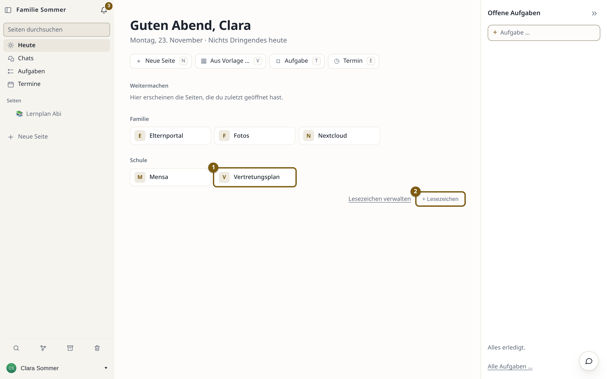
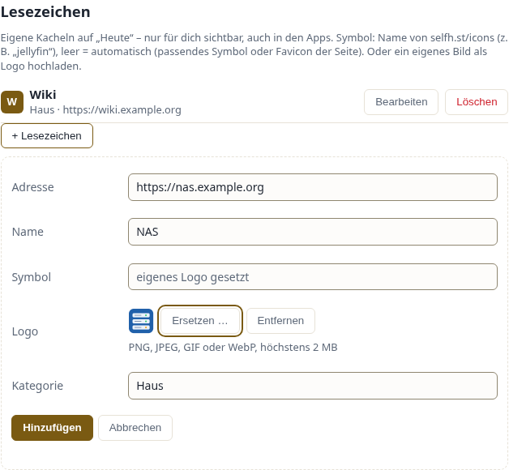

# B03 Lesezeichen

**Gilt für:** Web · Handy-Browser · iOS/iPadOS/Mac · Android · Linux (nur anzeigen)

[← B02 Heute und Startseite](02-startseite.md) · [Übersicht](../README.md) · [Weiter: B04 Seiten und Editor →](04-seiten-editor.md)

---

## Das kannst du damit machen

- **Schulportal immer griffbereit:** Clara legt sich „Vertretungsplan“ und „Mensa“ ab und öffnet den
  Vertretungsplan morgens mit der Taste `1`.
- **Die Geräte im Haus:** Ben sammelt Router, Drucker und Wetterstation in einer Kategorie „Haus“.
- **Elternportal und Kita-App:** Anna hat die Seiten der Schule und des Sportvereins als Kacheln, statt sie
  jedes Mal zu suchen.
- **Nur für dich:** Lesezeichen sieht niemand außer dir – auch nicht die anderen in der Familie.

## Wofür ist das?

Mit **Lesezeichen** legst du dir eigene Kacheln auf **Heute** – für jede Webseite, die du oft brauchst:
das Schulportal, den Router, den Lieblings-Shop. Lesezeichen sind **nur für dich sichtbar**, auch in den Apps.
Dein Admin sieht nur, wie viele du hast, nicht welche.

Lesezeichen sehen aus wie die Dienste, die dein Admin einrichtet, haben aber einen **gestrichelten Rahmen**.
So erkennst du auf einen Blick, was von dir stammt.

---

## Schritt für Schritt

### 1. Ein Lesezeichen anlegen

1. Klick auf „Heute“ unter den Kacheln auf **+ Lesezeichen**.
   (Oder: Benutzermenü unten links → **⚙ Einstellungen** → **Lesezeichen** → **+ Lesezeichen**.)
2. Das Fenster **Einstellungen** öffnet sich im Bereich **Lesezeichen**, darunter ein leeres Formular. Der
   Cursor steht schon im Feld **Adresse**.

3. Trag bei ① **Adresse** die Internetadresse ein, zum Beispiel `https://schule.example.org/vertretungsplan`.
   Das ist das einzige Pflichtfeld. Lässt du `https://` weg, ergänzt Saga es selbst.
4. **Name** (optional): So heißt die Kachel. Lässt du das Feld leer, nimmt Saga den Rechnernamen aus der
   Adresse – im Beispiel `schule.example.org`. Den Vorschlag siehst du schon beim Tippen grau im Feld.
5. **Symbol** (optional): Lass das Feld leer – Saga sucht dann selbst ein passendes Bild (mehr dazu in
   Abschnitt 3).
6. **Kategorie**: Unter dieser Überschrift erscheint die Kachel auf „Heute“. Vorgegeben ist
   „Lesezeichen“. Du kannst jeden Namen eintragen, zum Beispiel „Schule“.
7. Klick auf **Hinzufügen** (oder drück `Enter`).

Saga meldet „Lesezeichen hinzugefügt“. Wenn du das Einstellungsfenster schließt, steht die neue Kachel auf
„Heute“.

- ① ein eigenes Lesezeichen (gestrichelter Rahmen)
- ② **+ Lesezeichen** – noch eins anlegen

### 2. Kategorien geschickt nutzen

Die **Kategorie** entscheidet, unter welcher Überschrift eine Kachel steht.

- Gibst du einer neuen Kategorie einen Namen, entsteht auf „Heute“ eine neue Kategorie – zum Beispiel
  „Schule“.
- Heißt deine Kategorie genauso wie eine Kategorie der Dienste (etwa „Familie“), steht dein Lesezeichen
  **zusammen** mit diesen Diensten in derselben Kategorie. So hat Anna ihr „Elternportal“ direkt neben „Fotos“ und
  „Nextcloud“ unter „Familie“.
- Achte auf die genaue Schreibweise: „Schule“ und „schule“ wären zwei verschiedene Kategorien.

### 3. Das Symbol der Kachel

Jede Kachel zeigt links ein kleines Bild. Bei Lesezeichen kümmert sich Saga meist selbst darum:

1. **Leer lassen (empfohlen):** Saga sucht zuerst ein passendes Symbol aus der freien Sammlung
   [selfh.st/icons](https://selfh.st/icons) – passend zum Namen der Webseite. Zu `jellyfin.example.org` gehört
   zum Beispiel das Jellyfin-Symbol.
2. Findet Saga dort nichts, nimmt es das **Favicon** der Webseite – das kleine Bild, das du auch im
   Browser-Tab siehst.
3. Lässt die Webseite deinen Saga-Server nicht herein (manche Shops blockieren Server), holt **dein Browser bzw.
   deine App** das Favicon direkt von der Seite – so wie ein ganz normaler Browser-Tab.
4. Klappt nichts davon, zeigt die Kachel den **Anfangsbuchstaben** des Namens.

**Symbol selbst wählen:** Such auf [selfh.st/icons](https://selfh.st/icons) nach deinem Dienst und trag den
**Namen** des Symbols in das Feld **Symbol** ein, zum Beispiel `jellyfin`, `nextcloud` oder `openwrt`. Nur den
Namen, keine Adresse.

**Eigenes Logo hochladen:** Gibt es für deine Seite kein passendes Symbol (etwa für das NAS im Keller), nimm ein
eigenes Bild:

1. Klick im Formular in der Zeile **Logo** auf **Bild hochladen …** und wähl eine Bilddatei aus – PNG, JPEG, GIF
   oder WebP, höchstens 2 MB. Quadratische Bilder sehen am besten aus.
2. Daneben erscheint eine kleine Vorschau. Das Feld **Symbol** ist jetzt gesperrt („eigenes Logo gesetzt“) – das
   Logo hat Vorrang.
3. Klick auf **Hinzufügen** bzw. **Speichern**. Das Logo steht jetzt in der Liste, auf der Kachel auf „Heute“ und
   in den Apps.

Mit **Ersetzen …** wählst du ein anderes Bild, mit **Entfernen** (und danach **Speichern**) gehst du zurück zum
Symbol bzw. zum automatischen Bild. Das Logo siehst nur du – wie das Lesezeichen selbst. SVG-Dateien gehen nicht,
weil Saga sie beim Hochladen aus Sicherheitsgründen nicht annimmt; speichere das Logo vorher als PNG.

> **Hinweis:** Das automatische Symbol gibt es nur für Lesezeichen. Dienste vom Admin zeigen immer ihr fest
> eingestelltes Symbol oder den Anfangsbuchstaben.

### 4. Ein Lesezeichen bearbeiten

**Direkt auf „Heute“:**

1. Fahr mit der Maus über deine Lesezeichen-Kachel. Unten rechts erscheint ein Stift **✎**
   („Lesezeichen bearbeiten“).
2. Klick darauf. Die Einstellungen öffnen sich mit dem ausgefüllten Formular.
3. Ändere Adresse, Name, Symbol oder Kategorie und klick auf **Speichern**.

**Oder in den Einstellungen:** Benutzermenü unten links → **⚙ Einstellungen** → **Lesezeichen**. Dort stehen alle
deine Lesezeichen mit Kategorie und Adresse. Klick bei einem auf **Bearbeiten**.

### 5. Ein Lesezeichen löschen

1. Öffne **⚙ Einstellungen** → **Lesezeichen**.
2. Klick beim gewünschten Lesezeichen auf **Löschen**.
3. Bestätige die Rückfrage „Lesezeichen „…“ löschen?“.

Saga löscht nur das Lesezeichen in Saga – die Webseite selbst bleibt natürlich unberührt.

### 6. Lesezeichen als Favorit

Auch Lesezeichen kannst du mit dem Stern **★** oben rechts auf der Kachel zu den **Favoriten** ganz oben auf
„Heute“ holen – genau wie Dienste. Mehr dazu in
[B02, Abschnitt 3](02-startseite.md#3-favoriten-).

---

## Beispiel aus dem Alltag

**Clara legt sich den Vertretungsplan ihrer Schule ab.** Clara schaut jeden Morgen nach, ob Stunden ausfallen.
Bisher hat sie die Adresse jedes Mal im Browser gesucht.

1. Clara klickt auf „Heute“ auf **+ Lesezeichen**.
2. Bei **Adresse** fügt sie `https://schule.example.org/vertretungsplan` ein.
3. Bei **Name** schreibt sie „Vertretungsplan“.
4. **Symbol** lässt sie leer.
5. Bei **Kategorie** ersetzt sie „Lesezeichen“ durch „Schule“ und klickt auf **Hinzufügen**.
6. Gleich danach legt sie auf dieselbe Weise „Mensa“ mit `https://schule.example.org/mensa` und ebenfalls der
   Kategorie „Schule“ an.
7. Sie schließt die Einstellungen. Auf „Heute“ gibt es jetzt die Kategorie **Schule** mit beiden Kacheln.
8. Damit es morgens noch schneller geht, klickt sie beim Vertretungsplan auf **★**. Jetzt ist er die Nummer 1 –
   Clara öffnet Saga, drückt `1`, und der Vertretungsplan ist da.

Weil Lesezeichen nur für Clara sichtbar sind, sehen Anna und Ben diese Kacheln nicht auf ihrem „Heute“.

---

## Tipps und Tastenkürzel

- **Schnell anlegen:** Adresse einfügen und `Enter` – mehr braucht es nicht. Name und Symbol ergänzt Saga.
- **Nummern nutzen:** `1` bis `9` öffnet die Kachel mit dieser Nummer, auch ein Lesezeichen.
- **Eigene Ordnung:** Gib Lesezeichen, die zusammengehören, dieselbe Kategorie. Für Spontanes reicht die
  vorgegebene Kategorie „Lesezeichen“.
- **Router und Geräte im Heimnetz:** Auch Adressen wie `http://router.example.org` gehen. Saga ruft deine
  Lesezeichen nicht selbst auf, um sie zu prüfen – deshalb gibt es bei Lesezeichen keinen Status-Punkt.

---

## Häufige Fragen

**Sehen andere meine Lesezeichen?**
Nein. Lesezeichen sind nur für dich. Dein Admin sieht nur ihre Anzahl. Willst du einen Link für alle, bitte
deinen Admin, ihn als **Dienst** einzurichten.

**Saga sagt „Bitte eine Adresse mit http:// oder https:// angeben.“**
Die Adresse ist unvollständig oder hat einen Tippfehler. Kopier sie am besten direkt aus der Adresszeile deines
Browsers.

**Saga sagt „Symbol: nur der Name aus selfh.st/icons“.**
Ins Feld **Symbol** gehört nur ein Name wie `nextcloud` (kleine Buchstaben, Ziffern, Bindestrich) – keine
Adresse und kein Bild. Oder lass das Feld einfach leer.

**Meine Kachel zeigt nur einen Buchstaben.**
Saga hat weder ein passendes Symbol noch ein Favicon gefunden. Such auf selfh.st/icons nach einem passenden
Symbol und trag dessen Namen ein – oder lade ein eigenes Logo hoch (Abschnitt 3).

**Saga sagt „Logo: nur ein eigenes hochgeladenes Bild …“ oder „Logo zu groß“.**
Das Logo muss ein Bild sein, das du selbst hochgeladen hast (PNG, JPEG, GIF oder WebP), und darf höchstens 2 MB
groß sein. Verkleinere das Bild oder speichere es in einem dieser Formate.

**Gibt es eine Höchstzahl?**
Ja, aber eine großzügige: bis zu 500 Lesezeichen je Konto.

---

## Auf dem Handy und in den Apps

**Handy-Browser**

Im Handy-Browser funktioniert alles wie am Computer. Stern ★ und Stift ✎ sind auf den Kacheln immer zu sehen
(auf dem Handy gibt es ja keine Maus zum Darüberfahren). Ein Bild davon findest du in
[B02 – Auf dem Handy](02-startseite.md#auf-dem-handy-und-in-den-apps).

**iPhone, iPad und Mac**

<!-- App-Bild folgt: b03-03-dienste-ios.png -->

- Deine Lesezeichen stehen in der App unter **Dienste**, zusammen mit den Diensten deines Admins.
- **Anlegen:** in „Dienste“ auf **+** tippen. Die Felder sind dieselben: Adresse, Name, Kategorie, Symbol. Ein
  eigenes Logo lädst du im Browser hoch; die App zeigt es dann an.
- **Bearbeiten und löschen:** lange auf die Kachel drücken (iPhone/iPad) bzw. Rechtsklick (Mac).
- **Aus anderen Apps ablegen:** In Safari (oder einer anderen App) einen Link **teilen** → Saga wählen → als
  **Lesezeichen** ablegen. Der Name kommt aus dem Seitentitel, die Kategorie wählst du aus deinen vorhandenen.

<!-- App-Bild folgt: b03-04-teilen-lesezeichen-ios.png -->

**Android**

<!-- App-Bild folgt: b03-05-dienste-android.png -->

- Lesezeichen stehen unter **Dienste**.
- **Anlegen** über **+**, **bearbeiten und löschen** durch langes Drücken auf die Kachel.
- Links öffnen sich im Standard-Browser deines Handys.

**Linux**

- Die Linux-App zeigt deine Lesezeichen unter **Dienste** an. **Anlegen und bearbeiten** geht dort nicht – das
  machst du im Browser.

**In allen Apps** holt die App das Favicon notfalls direkt von der Webseite, genau wie der Browser. Ein eigenes
Logo (im Browser hochgeladen) zeigen alle Apps an.

---

[← B02 Heute und Startseite](02-startseite.md) · [Übersicht](../README.md) · [Weiter: B04 Seiten und Editor →](04-seiten-editor.md)
