# B04 Seiten und Editor

**Gilt für:** Web · Handy-Browser · iOS/iPadOS/Mac · Android · Linux

[← B03 Lesezeichen](03-lesezeichen.md) · [Übersicht](../README.md) · [Weiter: B05 Seiten gestalten →](05-gestalten.md)

---

## Das kannst du damit machen

- **Den Urlaub planen:** Anna schreibt „Urlaub Ostsee 2027“ mit Packliste zum Abhaken, zwei Unterkünften
  nebeneinander und einer Tabelle mit Ausflügen.
- **Ein Familien-Wiki anlegen:** Kinderarzt, Müllabfuhr, WLAN für Gäste – alles in Unterseiten unter
  „Familien-Wiki“, mit einem Klick zu finden.
- **Wichtiges an mehreren Stellen gleich halten:** Die Notfallnummern stehen als synchronisierter Block im
  Wiki und auf „Infos für den Babysitter“. Ändert Anna eine Nummer, stimmt sie überall.
- **Jemanden mitten im Text erinnern:** `@Ben` „bitte die Fähre buchen“ – Ben bekommt eine Benachrichtigung.
- **Mitschreiben, was im Kopf ist:** Ein Tagebuch, Notizen aus dem Elternabend, Claras Zusammenfassungen für
  die Schule – ohne Formatierungs-Fummelei.

## Wofür ist das?

**Seiten** sind deine Notizen, Dokumente und Wikis in Saga. Jede Seite kann beliebig viele **Unterseiten**
haben – so entsteht ein Seitenbaum wie ein Ordner mit Unterordnern. In einer Seite schreibst du Text und fügst
**Blöcke** ein: Überschriften, Listen, Checklisten, Tabellen, Bilder, Spalten, Datenbanken und vieles mehr.

Der Editor funktioniert ähnlich wie Notion: Du tippst einfach los, und mit `/` holst du dir jeden Block. Saga
speichert von selbst, du musst nie auf „Speichern“ klicken.

> **Hinweis:** Dieses Handbuch zeigt den Editor, der in Saga 2.5 neu ist. Sehen bei dir Menüs und Leisten etwas
> anders aus, nutzt euer Saga noch den **klassischen Editor**. Welchen Editor ihr habt, stellt dein Admin ein.
> Darf jede Person selbst wählen, findest du den Schalter unter **Einstellungen → Seiten**.

---

## Schritt für Schritt

### 1. Der Seitenbaum

Klick auf dem Dashboard oben auf **Seiten**. Die Seiten öffnen sich in einem eigenen Browser-Tab. Links steht
die Seitenleiste mit deinem Seitenbaum.

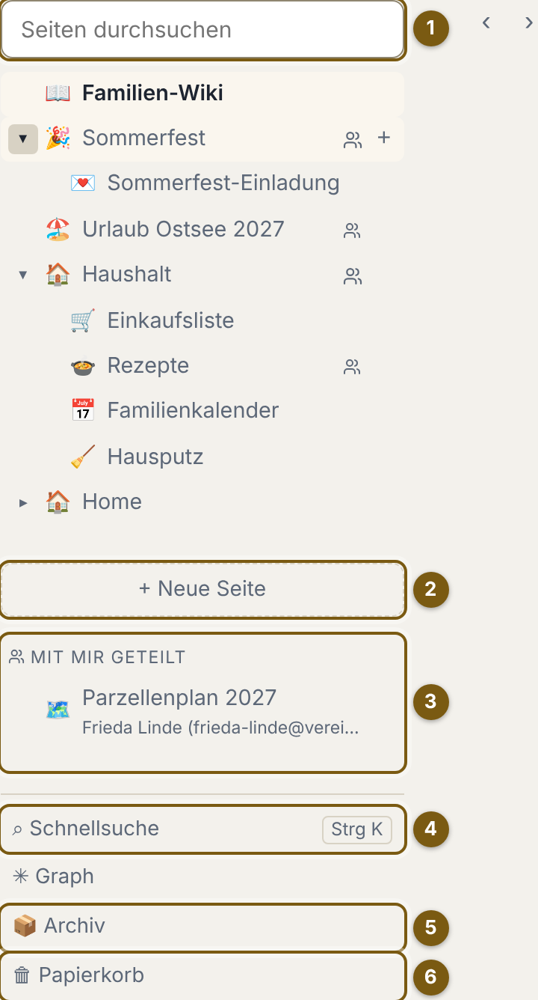

Was die Nummern bedeuten:

- ① **Seiten durchsuchen** – filtert den Baum nach Titeln
- ② **+ Neue Seite** – legt eine Seite an (oder öffnet das Menü mit weiteren Möglichkeiten)
- ③ **Mit mir geteilt** – Seiten, die andere mit dir geteilt haben (siehe [B10](10-teilen.md))
- ④ **Schnellsuche** (`Strg` + `K`, Mac: `⌘` + `K`) – sucht in Titeln und Inhalten
- ⑤ **Archiv** – Seiten, die du aus dem Weg geräumt, aber nicht gelöscht hast
- ⑥ **Papierkorb** – gelöschte Seiten bleiben hier 30 Tage

**Eine neue Seite anlegen**

1. Klick auf ② **+ Neue Seite**. Im Menü wählst du **Leere Seite**, eine **Datenbank** (siehe
   [B07](07-datenbanken.md)), **Importieren …** oder **Aus der Galerie …** (siehe [B06](06-galerie-widgets.md)).
2. Tipp oben einen **Titel** ein, zum Beispiel „Urlaub Ostsee 2027“.
3. Drück `Enter` – die Schreibmarke springt in den Text darunter.

**Eine Unterseite anlegen**

- Fahr im Seitenbaum mit der Maus über eine Seite und klick auf das kleine **+** daneben, oder
- öffne die Seite, klick oben rechts auf **⋯** (Seitenmenü) und wähle **Unterseite hinzufügen**.

Am Ende der Elternseite erscheint dann von selbst ein **Verweis** auf die neue Unterseite – mit Symbol und Titel, wie
bei Notion. So findest du sie auch beim Lesen, nicht nur im Seitenbaum. Benennst du die Unterseite gleich nach dem
Anlegen, zieht der Verweis den Titel mit. Verschiebst du sie später in eine andere Seite, wandert der Verweis mit.
Das gilt auch für Unterseiten aus Vorlagen, beim Duplizieren und beim Import – nicht für Einträge einer Datenbank.

**Alle Unterseiten auf einen Blick – Block „Unterseiten“.** Tipp in der Elternseite `/Unterseiten` (auch
`/Galerie`). Der Block zeigt die Unterseiten als **Liste** (Symbol und Titel) oder als **Galerie** mit Karten in S, M
oder L. Als Kartenbild wählst du das Titelbild der Seite, das erste Bild im Inhalt (gut für Buchcover) oder keins.
Neue, umbenannte und gelöschte Unterseiten erscheinen sofort, in der Reihenfolge des Seitenbaums. Jede Person sieht
nur die Unterseiten, die sie öffnen darf.

<!-- Bild folgt: Block „Unterseiten“ als Galerie mit Titelbildern (Familien-Wiki der Sommers) -->

**Seiten ordnen**

- **Ziehen:** Zieh eine Seite im Seitenbaum an eine andere Stelle oder auf eine andere Seite, um sie dort
  unterzuordnen.
- **Verschieben nach:** Seitenmenü **⋯** → **Verschieben nach** → Zielseite suchen oder **Oberste Ebene**.
- **Favoriten:** Seitenmenü **⋯** → **Zu Favoriten**. Favoriten stehen ganz oben in der Seitenleiste.

**Archiv und Papierkorb**

- **Archivieren** (Seitenmenü **⋯**): Die Seite verschwindet aus dem Baum und aus der Suche, Links darauf
  funktionieren aber weiter. Zurück holst du sie im ⑤ **Archiv** mit **Aus dem Archiv holen**.
- **In den Papierkorb** (Seitenmenü **⋯**): Die Seite und alle Unterseiten liegen 30 Tage im ⑥ **Papierkorb**.
  Dort stellst du sie mit **Wiederherstellen** zurück. Danach sind sie endgültig weg.

### 2. Blöcke einfügen mit dem Slash-Menü

Alles in einer Seite ist ein **Block**: ein Absatz, eine Überschrift, eine Liste, ein Bild. Neue Blöcke holst
du über das Slash-Menü.

1. Setz die Schreibmarke in eine leere Zeile.
2. Tipp `/`. Das Menü öffnet sich direkt unter der Zeile.
3. Tipp weiter, um zu filtern – zum Beispiel `/check` für die Checkliste oder `/tab` für die Tabelle.
4. Wähle mit den Pfeiltasten und `Enter` oder mit einem Klick. `Esc` schließt das Menü und nimmt das „/“
   wieder weg.

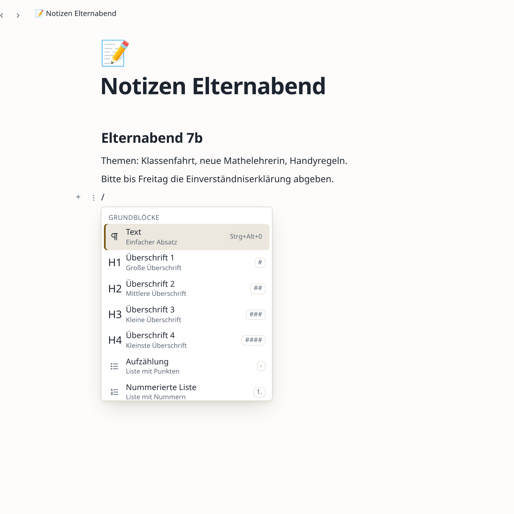

Das Menü ist in Gruppen geordnet:

- **Grundblöcke:** Text, Überschrift 1–4, Aufzählung, Nummerierte Liste, Checkliste, Zitat, Hinweis (Callout),
  Trennlinie, Tabelle, Code, Toggle (ausklappbarer Abschnitt), Toggle-Überschrift 1–3, 2 bis 6 Spalten
- **Medien:** Bild, Datei, Bild aus Immich, Nextcloud-Datei, Einbetten (YouTube, Link)
- **Datenbank:** Datenbank, Aufgaben, Kalender
- **Saga:** Person erwähnen, Seitenverweis, Datum oder Erinnerung, Formel im Text, Formel (Mathe),
  Synchronisierter Block, Unterseiten (Liste oder Galerie, siehe Abschnitt 1), Schaltflächen und Widgets (Uhr,
  Countdown, Fortschritt und weitere – siehe [B06](06-galerie-widgets.md))

Links neben jedem Block erscheinen beim Überfahren zwei kleine Griffe: **+** fügt darunter einen neuen Block ein,
**⋮⋮** öffnet das Block-Menü (Abschnitt 4).

**Noch schneller: Markdown-Kürzel.** Am Anfang einer leeren Zeile verwandeln diese Zeichen plus Leertaste die
Zeile sofort:

- `#`, `##`, `###`, `####` → Überschrift 1 bis 4
- `-` oder `*` → Aufzählung, `1.` → nummerierte Liste, `[]` → Checkliste
- `>` → Toggle, `"` → Zitat, `---` → Trennlinie, ```` ``` ```` → Code-Block

Im Text wirken `**fett**`, `*kursiv*`, `~~durchgestrichen~~`, `==markiert==`, `` `Code` `` und `$Formel$`.

### 3. Text formatieren

Markier ein paar Wörter. Über der Auswahl erscheint eine Leiste.

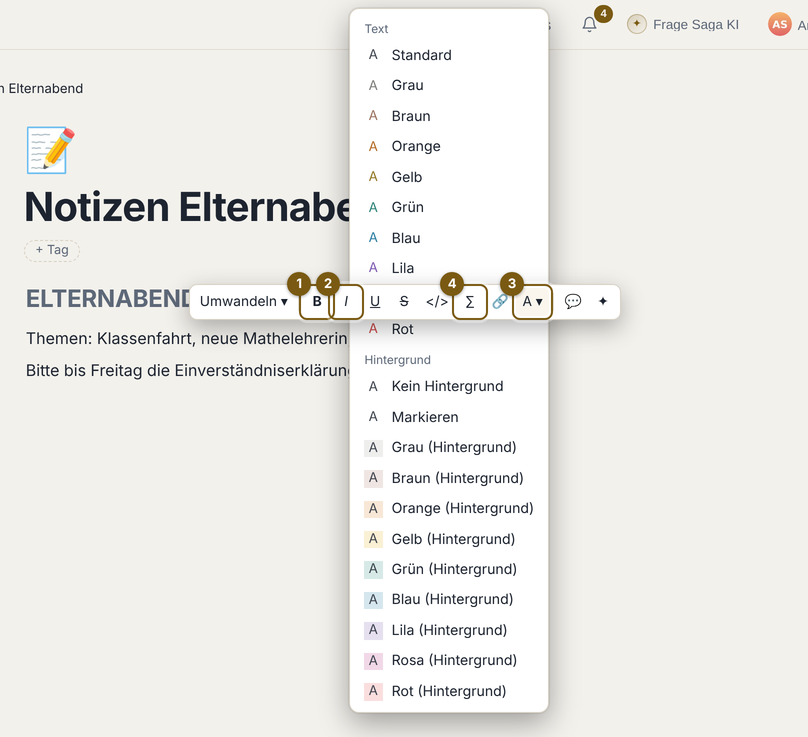

Was die Nummern bedeuten:

- ① **Fett**
- ② **Kursiv**
- ③ **A** – Text- und Hintergrundfarbe. „Standard“ entfernt die Farbe wieder.
- ④ **∑** – macht aus dem markierten Text eine Formel (siehe Abschnitt 6)

Daneben findest du Unterstrichen, Durchgestrichen, Code, Markieren und **Link**. Für einen Link fügst du die
Adresse in das Feld ein, das sich öffnet.

**Links öffnen:** Ein einfacher Klick auf einen Link öffnet ihn – Adressen im Internet in einem neuen Tab,
Seitenverweise direkt. Willst du nur die Schreibmarke in den Link setzen, klick mit gedrückter `Alt`- oder
`⇧`-Taste; Doppelklick oder Ziehen markiert Text wie gewohnt.

**Farbe per Slash:** Tipp `/rot`, `/blau` oder `/grün hintergrund` – das färbt den ganzen Block. Mit
`Strg` + `⇧` + `H` (Mac: `⌘` + `⇧` + `H`) färbst du markierten Text in der zuletzt benutzten Farbe.

### 4. Das Block-Menü

Jeder Block hat links einen Griff **⋮⋮**. Ein Klick darauf öffnet das Block-Menü, Ziehen verschiebt den
Block. Mit der Tastatur geht es mit `Strg` + `/` (Mac: `⌘` + `/`).

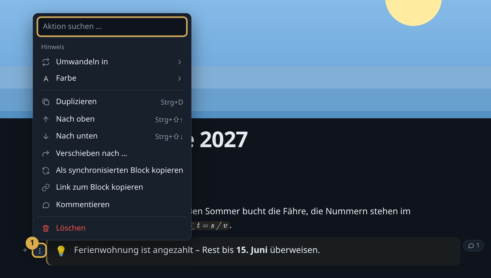

① ist der Griff **⋮⋮**. Im Menü findest du:

- **Umwandeln in** – aus einem Absatz eine Überschrift, aus einer Liste eine Checkliste machen und so weiter
- **Farbe** – Text- oder Hintergrundfarbe für den ganzen Block
- **Duplizieren** – eine Kopie direkt darunter
- **Verschieben nach …** – den Block samt Inhalt, Kommentaren und Bildern auf eine andere Seite bringen. Danach
  bietet Saga „Öffnen“ und „Rückgängig“ an.
- **Als synchronisierten Block kopieren** (Abschnitt 9)
- **Link zum Block kopieren** – ein Link, der direkt zu diesem Absatz springt
- **Kommentieren** (siehe [B10](10-teilen.md))
- **Löschen** und, je nach Block, Einstellungen wie Spaltenanzahl oder Listen-Zählart

**Mehrere Blöcke auf einmal:** Zieh mit der Maus über mehrere Blöcke oder halte `⇧` gedrückt und drück
`↑`/`↓`. Unten erscheint eine Leiste zum Löschen, Verschieben, Umwandeln, Färben, Duplizieren und Kopieren.

### 5. Spalten, Bilder und Dateien

**Spalten:** Tipp `/2 Spalten` (bis 6 Spalten), oder zieh einen Block an den linken oder rechten Rand eines
anderen Blocks – dann stehen beide nebeneinander.

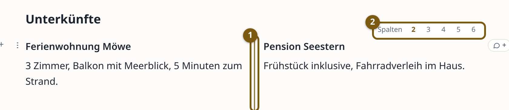

- ① Fahr mit der Maus zwischen zwei Spalten. Eine Linie erscheint – zieh daran, um die Breite zu ändern.
  Doppelklick macht alle Spalten wieder gleich breit.
- ② Im Block-Menü der Spalten stellst du die **Anzahl** ein oder löst die Spalten wieder auf.

Auf dem Handy stehen Spalten untereinander.

**Bilder:**

1. Tipp `/bild` und wähl ein Bild aus – oder zieh ein Bild einfach in die Seite, oder füge es mit
   `Strg` + `V` ein.
2. Zieh an den Griffen links oder rechts, um das Bild schmaler zu machen. Doppelklick auf einen Griff stellt die
   volle Breite wieder her.
3. Im Block-Menü wählst du die **Ausrichtung** (links, mittig, rechts), einen Rahmen oder Hintergrund.
4. Unter dem Bild kannst du eine **Bildunterschrift** schreiben.

Ein Klick aufs Bild markiert es. Mit `Strg` + `C` kopierst du es und fügst es mit `Strg` + `V` in eine andere
Seite ein – samt Bildunterschrift.

**Dateien:** `/datei` fügt eine Datei zum Herunterladen ein, etwa das PDF mit der Buchungsbestätigung.
Hast du Immich oder Nextcloud verbunden, gibt es **Bild aus Immich** und **Nextcloud-Datei** (siehe
[B16 Verbindungen](16-verbindungen.md)).

**Einbetten:** `/einbetten` und eine Adresse einfügen – YouTube-Videos erscheinen als Video, andere Adressen als
Link-Karte. Fügst du einen Link in eine leere Zeile ein, bettet Saga ihn von selbst ein.

### 6. Tabellen, Code, Formeln und Diagramme

**Tabelle:** `/tabelle` fügt eine einfache Tabelle ein. Mit `Tab` springst du in die nächste Zelle, `Enter` geht
eine Zeile nach unten.

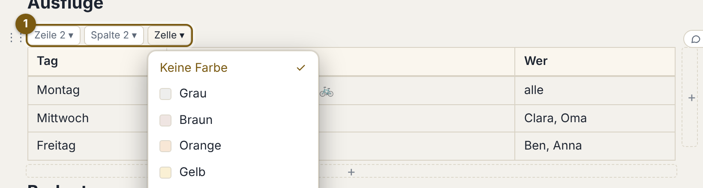

- ① Klick in eine Zelle: Die **Tabellenleiste** zeigt **Zeile**, **Spalte** und **Zelle**. Dort fügst du
  Zeilen und Spalten ein, löschst oder verschiebst sie und färbst sie ein.
- Spaltenbreiten änderst du durch Ziehen am Rand, Doppelklick macht alle gleich breit.
- Im Block-Menü schaltest du **Kopfzeile**, **Erste Spalte als Kopf** und **Volle Breite** ein.

> **Tipp:** Brauchst du Spalten mit Datum, Auswahl, Summen oder Filtern, nimm lieber eine
> [Datenbank](07-datenbanken.md). Die einfache Tabelle ist für kleine Übersichten gedacht.

**Code:** `/code` oder ```` ``` ```` am Zeilenanfang. Wähl die Programmiersprache für die Hervorhebung. `Tab` rückt
ein; mit dreimal `Enter` oder `Strg` + `Enter` verlässt du den Block.

**Formeln:** Für eine Formel mitten im Satz markierst du Text und klickst auf **∑**, oder du tippst
`$a^2 + b^2$`. Für eine große Formel als eigenen Block nimmst du `/formel`. Saga zeichnet die Formel schön
(TeX-Schreibweise).

**Diagramme:** Stell bei einem Code-Block die Sprache **Mermaid** ein. Dann zeichnet Saga aus dem Text ein
Diagramm – etwa einen Ablauf „Packen → Fähre → Ferienwohnung → Strand“.

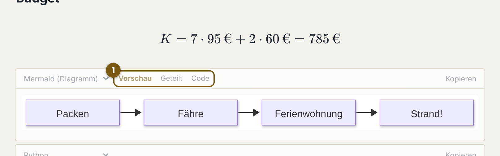

① Mit **Vorschau**, **Geteilt** und **Code** schaltest du um, ob du das Diagramm, beides nebeneinander oder nur
den Text siehst.

### 7. Personen, Datum und andere Seiten erwähnen

Tipp `@` im Text. Ein Menü zeigt Personen, Datum und Erinnerung sowie Seiten.

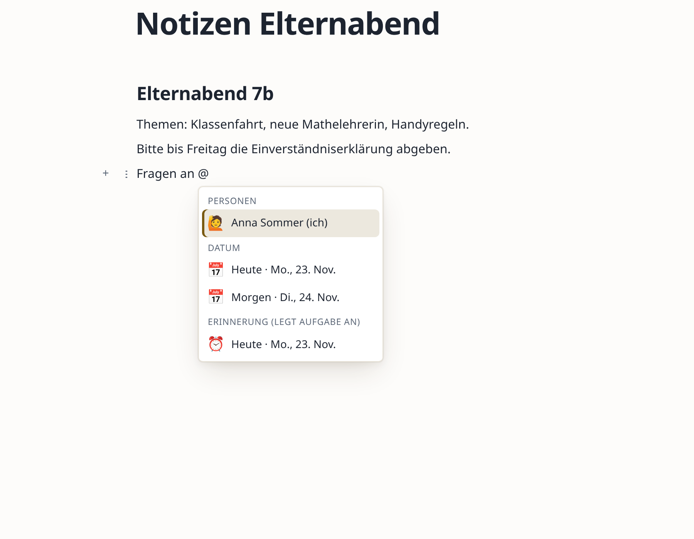

- **Person:** `@Ben` – Ben bekommt eine Benachrichtigung, dass er erwähnt wurde (wenn er die Seite sehen darf).
- **Datum:** `@morgen` oder ein Datum wählen – im Text steht dann ein Datum, das sich gut lesen lässt.
- **Erinnerung:** legt zusätzlich eine **Aufgabe** mit diesem Datum an (siehe [B08 Aufgaben](08-aufgaben.md)).
- **Seiten:** verlinkt eine andere Seite.

Weitere Kürzel:

- `[[` öffnet die Suche nach einer Seite und fügt einen **Seitenverweis** ein. Gibt es die Seite noch nicht,
  bietet Saga **+ Neue Seite „…“** an.
- **Rechtsklick** im Text → **Verweis einfügen** macht dasselbe an der Stelle, wo du klickst.
  (`⇧` + Rechtsklick zeigt das normale Menü des Browsers.)
- `:` und ein Wort, zum Beispiel `:sonne`, schlägt passende **Emojis** vor.

Am Ende einer Seite siehst du unter **Verlinkt von**, welche anderen Seiten auf sie verweisen.

### 8. Suchen und die Befehlspalette

Mit `Strg` + `K` (Mac: `⌘` + `K`) öffnest du die Befehlspalette. Sie sucht in Titeln **und** Inhalten deiner
Seiten und kennt viele Befehle.

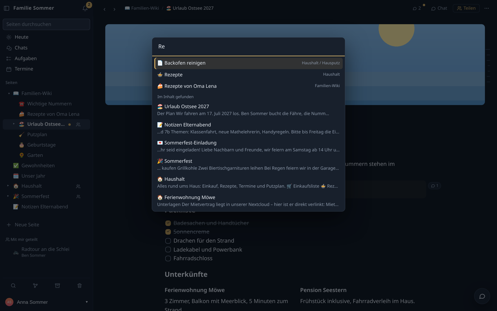

1. Drück `Strg` + `K`.
2. Tipp ein Stichwort, etwa „Apfelkuchen“ – oder einen Befehl wie „Versionsverlauf“, „Vorlagengalerie“,
   „Papierkorb“ oder „Neue Unterseite“.
3. Wähl mit den Pfeiltasten und `Enter`. `Esc` schließt.

### 9. Synchronisierte Blöcke

Ein synchronisierter Block steht auf mehreren Seiten und ist überall gleich. Änderst du ihn an einer Stelle,
ändert er sich überall.

1. Öffne das Block-Menü **⋮⋮** des Blocks, den du mehrfach brauchst, und wähle **Als synchronisierten Block
   kopieren**. Saga meldet: „Synchronisierter Block angelegt und kopiert – auf einer anderen Seite einfügen“.
2. Geh auf die andere Seite und füge ihn mit `Strg` + `V` ein.

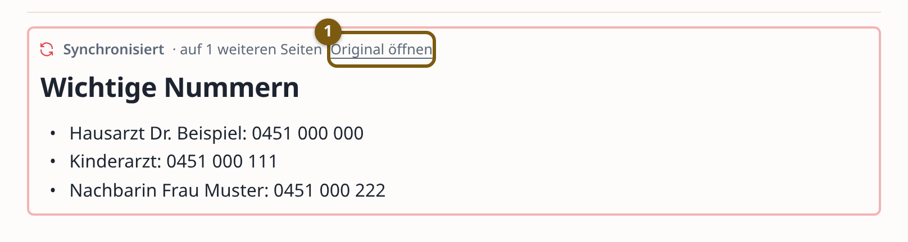

- Ein synchronisierter Block hat einen farbigen Rahmen. ① **Original öffnen** springt zu der Seite, auf der
  er zuerst stand.
- Wer die Original-Seite nicht bearbeiten darf, sieht „Synchronisiert – nur lesend“.
- **Als normale Blöcke übernehmen** löst die Kopie vom Original. Ab dann ist es ein ganz normaler Block.

### 10. Versionen, Inhaltsverzeichnis und Export

**Versionsverlauf:** Saga sichert beim Bearbeiten regelmäßig einen Stand – höchstens alle 5 Minuten, nach
einer Pause und beim Verlassen der Seite, bis zu 50 je Seite.

1. Seitenmenü **⋯** → **Versionsverlauf**.
2. Wähl links eine Version. Du siehst, wer sie wann gespeichert hat.
3. **Diese Version wiederherstellen** holt sie zurück. Der bisherige Stand bleibt als Version erhalten – es
   geht nichts verloren.

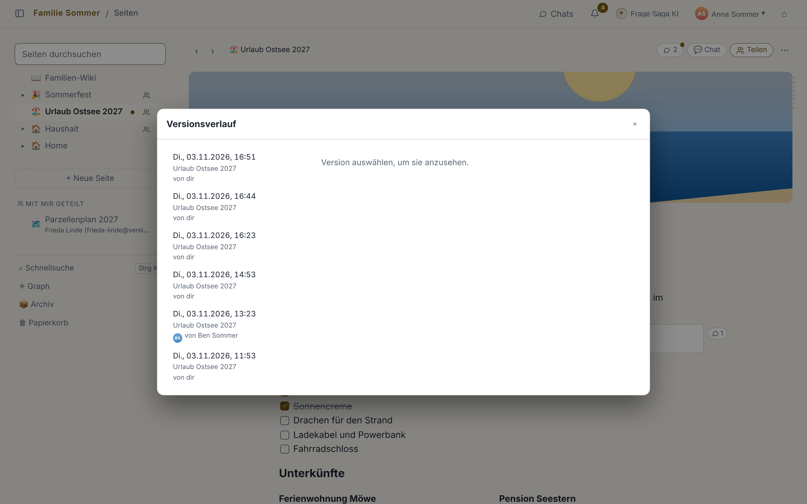

**Inhaltsverzeichnis:** In der Befehlspalette **Inhaltsverzeichnis ein/aus**. Saga zeigt am Rand die
Überschriften der Seite zum Anspringen.

**Exportieren:** Seitenmenü **⋯** → **Exportieren** → **Als Markdown (.md)** oder **Mit Unterseiten (.zip)**.

**Einfügen aus anderen Programmen:** Kopierst du Text aus Word, Google Docs oder einer Webseite und fügst ihn
ein, übernimmt Saga Überschriften, Listen, Tabellen und Links. Ganze Sammlungen aus Markdown, Obsidian oder
Notion holst du über **Importieren** (siehe [B07 Datenbanken](07-datenbanken.md#9-importieren-und-exportieren)).

---

## Beispiel aus dem Alltag

**Anna plant den Urlaub an der Ostsee.**

1. Anna öffnet **Seiten** und klickt auf **+ Neue Seite** → **Leere Seite**. Als Titel tippt sie
   „Urlaub Ostsee 2027“ und drückt `Enter`.
2. Sie tippt `## Packliste` und die Leertaste – schon ist es eine Überschrift. Darunter tippt sie `[]` und
   Leertaste und schreibt „Sonnencreme“, `Enter`, „Badesachen“, `Enter`, „Ladekabel“.
3. Für die Unterkünfte tippt sie `/2 Spalten`. In die linke Spalte schreibt sie „Ferienwohnung Möwe“ mit
   Preis und Lage, in die rechte „Pension Seestern“.
4. Unter den Spalten tippt sie `/tabelle` und legt die Tabelle „Ausflüge“ mit den Spalten Ort, Tag und
   Kosten an. Im Block-Menü schaltet sie **Kopfzeile** ein.
5. Sie schreibt `@Ben` „bitte die Fähre buchen bis“ und wählt im @-Menü **Erinnerung** mit dem Datum in zwei
   Wochen. Ben bekommt eine Benachrichtigung, und Anna hat eine Aufgabe mit Datum.
6. Die Notfallnummern hat Anna schon im Familien-Wiki als synchronisierten Block. Sie öffnet die Seite
   „Infos für den Babysitter“, fügt den Block dort ein, und beide Seiten zeigen immer dieselben Nummern.

**Clara schreibt eine Zusammenfassung für Bio.**

1. Clara legt unter ihrer Seite „Schule“ eine Unterseite „Bio – Zelle“ an (Seitenmenü **⋯** → **Unterseite
   hinzufügen**).
2. Sie gliedert mit Toggle-Überschriften: `/toggle-überschrift 2` „Zellkern“, „Mitochondrien“, „Zellmembran“.
   Zum Lernen klappt sie alle zu und deckt nach und nach auf.
3. Unter „Mitochondrien“ fügt sie mit `/hinweis` einen Hinweis-Kasten ein: „Kommt in der Klausur!“.
4. Am Ende sucht sie mit `Strg` + `K` nach „Zelle“ – Saga findet ihre Seite und den Absatz darin sofort.

---

## Tipps und Tastenkürzel

Auf dem Mac nimmst du `⌘` statt `Strg` und `⌥` statt `Alt`.

**Text**

- `Strg` + `B` fett, `Strg` + `I` kursiv, `Strg` + `U` unterstrichen
- `Strg` + `⇧` + `S` durchgestrichen, `Strg` + `E` Code im Text
- `Strg` + `⇧` + `H` markieren bzw. in der zuletzt benutzten Farbe färben
- `⇧` + `Enter` neue Zeile im selben Block
- `Tab` / `⇧` + `Tab` Listenpunkt ein- bzw. ausrücken

**Blöcke**

- `/` Slash-Menü, `@` Erwähnung, `[[` Seitenverweis, `:` Emoji
- `Strg` + `/` Block-Menü
- `Strg` + `D` Block duplizieren
- `Strg` + `⇧` + `↑` / `↓` Block nach oben bzw. unten verschieben
- `Strg` + `Alt` + `0` Text, `1`–`3` Überschrift 1–3, `4` Checkliste, `5` Aufzählung, `6` nummerierte Liste,
  `7` Toggle, `8` Code
- `⇧` + `↑` / `↓` mehrere Blöcke markieren, `Strg` + `A` zweimal markiert alles

**Seiten**

- `Strg` + `K` Befehlspalette und Suche
- `Strg` + `[` / `]` zurück bzw. vor
- `Strg` + `⇧` + `U` zur übergeordneten Seite
- `Strg` + `L` Link zur Seite kopieren
- `Strg` + `\` Seitenleiste ein- und ausblenden

---

## Häufige Fragen

**Muss ich speichern?**
Nein. Saga speichert von selbst. Nur wenn etwas schiefgeht – du bist offline oder jemand anderes hat gleichzeitig
geändert –, siehst du oben einen Hinweis.

**Ich habe aus Versehen eine Seite gelöscht.**
Öffne den **Papierkorb** unten in der Seitenleiste und klick bei der Seite auf **Wiederherstellen**. Das geht 30
Tage lang, mit allen Unterseiten.

**Ich habe aus Versehen Text gelöscht.**
`Strg` + `Z` nimmt die letzte Änderung zurück. Ist es länger her, hol eine ältere Fassung aus dem
**Versionsverlauf**.

**Warum sieht mein Editor anders aus als in diesem Handbuch?**
Seit Saga 2.5 ist der neue Editor (Tiptap) Standard. Sieht deiner anders aus, nutzt euer Saga noch den klassischen
Editor (Editor.js) – entweder hat dein Admin ihn gewählt, oder du darfst selbst wählen: **Einstellungen → Seiten**.
Der klassische Editor wird in einer späteren Version entfernt. Gespeichert wird in beiden dasselbe.

**Kann ich eine Seite als Vorlage benutzen?**
Ja: Seitenmenü **⋯** → **Als Vorlage markieren**. Sie erscheint dann unter **+ Neue Seite**. Fertige
Vorlagen gibt es in der [Vorlagen-Galerie](06-galerie-widgets.md).

---

## Auf dem Handy und in den Apps

**Handy-Browser**

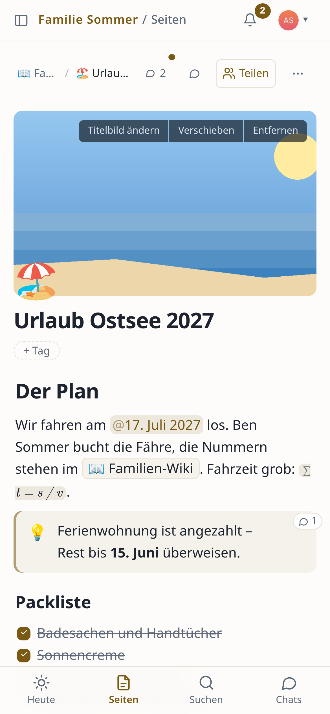

- Die Seitenleiste ist eingeklappt; du öffnest sie über das Menü oben links.
- Das Slash-Menü erscheint als Leiste am unteren Rand.
- Spalten stehen untereinander, Spaltenbreiten lassen sich nicht ziehen.
- Kommentare öffnen sich von unten.

**Apps (iOS/iPadOS/Mac, Android, Linux)**

<!-- App-Bild folgt: b04-13-editor-ios.png -->

- Die Apps haben **eigene Editoren** für Seiten. Text, Überschriften, Listen, Checklisten und die meisten Blöcke
  bearbeitest du dort genauso.
- **Formeln und Mermaid-Diagramme** zeigen die Apps als Bild. Änderst du den Text in einer App, steht dort
  „veraltet“, bis die Seite wieder einmal im Browser geöffnet wird – dann zeichnet Saga das Bild neu.
- In der **Linux-App** bearbeitest du live mit anderen zusammen. Blöcke, die eine App nicht bearbeiten kann,
  erscheinen als Karte und bleiben unverändert.
- Einfügen mit Formatierung aus Word oder Google Docs ist für den Browser beschrieben; in den Apps kann es sich
  anders verhalten.

---

[← B03 Lesezeichen](03-lesezeichen.md) · [Übersicht](../README.md) · [Weiter: B05 Seiten gestalten →](05-gestalten.md)
