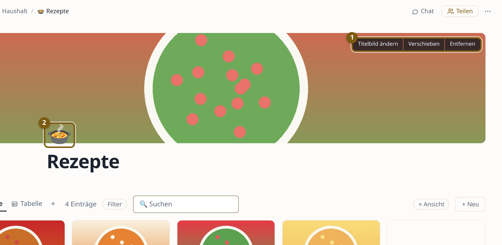
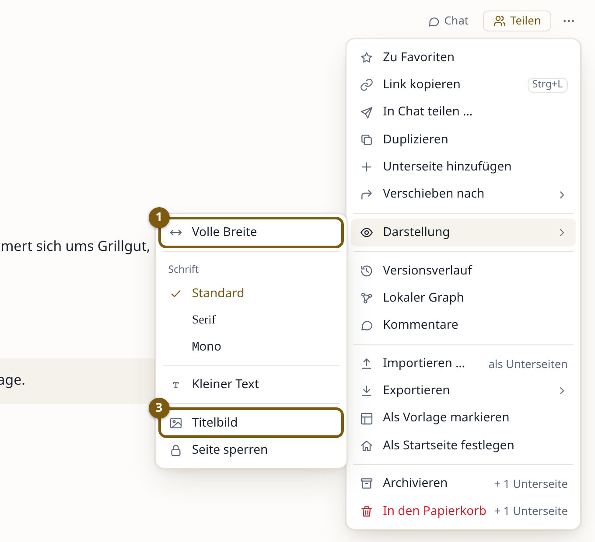
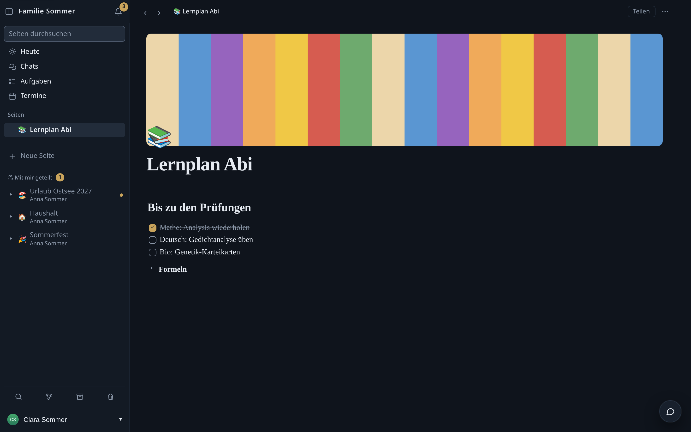

# B05 Seiten gestalten

**Gilt für:** Web · Handy-Browser · iOS/iPadOS/Mac · Android · Linux

[← B04 Seiten und Editor](04-seiten-editor.md) · [Übersicht](../README.md) · [Weiter: B06 Vorlagen-Galerie und Widgets →](06-galerie-widgets.md)

---

## Das kannst du damit machen

- **Die Rezeptsammlung appetitlich machen:** Die Datenbank „Rezepte“ bekommt ein Foto vom Sonntagsbraten als
  Titelbild und ein passendes Symbol – im Seitenbaum erkennst du sie sofort.
- **Einen Lernplan, der Lust auf Lernen macht:** Clara gibt „Lernplan Abi“ ein Titelbild, eine Serif-Schrift
  wie im Buch und die volle Breite für ihre große Tabelle.
- **Wichtiges hervorheben:** Ein gelber Hintergrund für „Bitte bis Freitag zurückgeben!“, ein roter Hinweis-Kasten
  für die Allergie-Info auf „Infos für den Babysitter“.
- **Lange Seiten ordnen:** Mit Toggle-Überschriften klappt Anna im Familien-Wiki die Abschnitte zu, die sie
  gerade nicht braucht.
- **Urlaubsfotos als Titelbild:** Ben holt das schönste Strandfoto aus Immich als Titelbild für „Ostsee 2026“.

## Wofür ist das?

Eine Seite liest sich besser, wenn sie ein Gesicht hat. Mit **Titelbild** und **Symbol** findest du sie im
Seitenbaum schneller wieder. Mit **Schrift**, **voller Breite** und **kleinem Text** passt du an, wie viel auf
den Bildschirm passt. **Farben**, **Hinweis-Kästen** und **Toggle-Überschriften** machen lange Seiten
übersichtlich.

Alles, was du hier einstellst, gilt für die ganze Seite und für alle, die sie sehen – auch auf einer
veröffentlichten Seite.

---

## Schritt für Schritt

### 1. Titelbild und Symbol

Fahr mit der Maus über den Titel einer Seite. Darüber erscheinen kleine Knöpfe für Symbol und **🖼 Titelbild**.

Was die Nummern bedeuten:

- ① **Titelbild** – ändern, verschieben oder entfernen
- ② **Symbol** (Emoji oder eigenes Bild)

**Ein Titelbild hinzufügen ①**

1. Klick auf **🖼 Titelbild**.
2. Wähl **🖼 Bild hochladen …** und ein Foto von deinem Gerät – oder **📷 Aus Immich …** (siehe
   [B16 Verbindungen](16-verbindungen.md)).
3. Das Bild erscheint oben über die ganze Breite.

Fahr danach mit der Maus über das Titelbild:

- **Titelbild ändern** – ein anderes Bild wählen
- **Verschieben** – das Bild nach oben oder unten ziehen, bis der richtige Ausschnitt zu sehen ist, dann
  **Fertig**
- **Entfernen** – Titelbild weg

**Ein Symbol wählen ②**

1. Klick auf die Stelle vor dem Titel (**Icon wählen**).
2. Wähl ein Emoji aus der Liste – zum Beispiel 🍳 für Rezepte oder 🏠 für das Familien-Wiki.
3. Lieber ein eigenes Bild? **🖼 Eigenes Bild hochladen …** oder, wenn Immich verbunden ist, **📷 Aus Immich …**.
4. **Icon entfernen** nimmt das Symbol wieder weg.

Das Symbol erscheint auch im Seitenbaum, in der Suche und in Verweisen.

### 2. Schrift, Breite und Textgröße

Diese Einstellungen findest du im Seitenmenü **⋯** oben rechts unter **Darstellung ›**.

Was die Nummern bedeuten:

- ① **Volle Breite** – die Seite nutzt die ganze Fensterbreite statt einer angenehmen Lesebreite. Gut für
  große Tabellen und Datenbanken.
- ② **Schrift** – **Standard**, **Serif** (wie in einem Buch) oder **Mono** (alle Buchstaben gleich breit, wie
  auf einer Schreibmaschine)
- ③ **Titelbild** – dasselbe wie der Knopf über dem Titel

Darunter findest du **Kleiner Text**: Die ganze Seite wird etwas kleiner geschrieben, und mehr passt auf
einen Blick.

> **Hinweis:** Diese Einstellungen kann nur ändern, wer die Seite bearbeiten darf. Sie gelten für alle, die die
> Seite öffnen.

### 3. Farben für Text und Blöcke

**Ein paar Wörter färben:** Text markieren → in der Leiste auf **A** → Text- oder Hintergrundfarbe wählen.
„Standard“ nimmt die Farbe wieder weg.

**Einen ganzen Block färben:**

- Block-Menü **⋮⋮** → **Farbe**, oder
- in einer leeren Zeile `/rot`, `/blau`, `/grün` … tippen. Mit `/gelb hintergrund` bekommt der Block einen
  farbigen Hintergrund.

Saga hat eine feste Palette (Grau, Braun, Orange, Gelb, Grün, Blau, Lila, Rosa, Rot). Die Farben sind so
gewählt, dass sie hell und dunkel gut lesbar bleiben.

### 4. Hinweis-Kästen, Zitate und Trennlinien

- **Hinweis (Callout):** `/hinweis` – ein Kasten mit Symbol, etwa 💡 für einen Tipp oder ⚠️ für eine Warnung.
  Ein Klick auf das Symbol wechselt es. Mit einer Hintergrundfarbe fällt der Kasten noch mehr auf.
- **Zitat:** `/zitat` oder `"` und Leertaste – mit Platz für die Quelle darunter.
- **Trennlinie:** `---` – eine dünne Linie zwischen zwei Abschnitten.

### 5. Toggle-Überschriften

Eine **Toggle-Überschrift** ist eine Überschrift mit einem kleinen Pfeil davor. Ein Klick darauf klappt alles
darunter zu oder auf.

1. Tipp `/toggle-überschrift` und wähl Ebene 1, 2 oder 3.
2. Schreib die Überschrift, drück `Enter` und schreib den Inhalt darunter.
3. Klick auf den Pfeil, um den Abschnitt zuzuklappen.

Toggle-Überschriften erscheinen im Inhaltsverzeichnis wie normale Überschriften. Eine vorhandene Überschrift
machst du über das Block-Menü **⋮⋮** → **Umwandeln in** → **Toggle-Überschrift** zum Toggle.

### 6. Bilder ausrichten

Bilder und YouTube-Videos lassen sich schmaler ziehen (Griffe links und rechts) und im Block-Menü **links**,
**mittig** oder **rechts** ausrichten. Doppelklick auf einen Griff macht das Bild wieder so breit wie den Text.
Mehr dazu in [B04, Abschnitt 5](04-seiten-editor.md#5-spalten-bilder-und-dateien).

---

## Beispiel aus dem Alltag

**Clara gestaltet ihren Lernplan fürs Abi.**

1. Clara öffnet ihre Seite „Lernplan Abi“.
2. Sie klickt vor den Titel auf **Icon wählen** und nimmt 📚.
3. Sie klickt auf **🖼 Titelbild** → **🖼 Bild hochladen …** und wählt ein Foto von ihrem Schreibtisch. Mit
   **Verschieben** zieht sie es so, dass die Bücher zu sehen sind, und klickt auf **Fertig**.
4. Im Seitenmenü **⋯** wählt sie **Schrift** → **Serif** – das liest sich für sie ruhiger.
5. Weil ihre Tabelle mit allen Fächern breit ist, schaltet sie **Volle Breite** ein.
6. Über die Prüfungstermine setzt sie mit `/hinweis` einen Kasten „Mündliche Prüfung: Termin noch offen!“ und
   gibt ihm über **⋮⋮** → **Farbe** einen roten Hintergrund.
7. Die Fächer gliedert sie mit Toggle-Überschriften – so sieht sie beim Lernen nur das Fach, an dem sie gerade
   sitzt.

**Anna macht die Rezeptsammlung schön.**

1. Anna öffnet die Datenbank „Rezepte“ und wählt als Symbol 🍳.
2. Als Titelbild holt sie über **📷 Aus Immich …** ein Foto vom letzten Familienessen.
3. Bei jedem Rezept setzt sie ein Foto des Gerichts als Titelbild. In der Galerie-Ansicht der Datenbank
   erscheinen diese Bilder als Karten (siehe [B07 Datenbanken](07-datenbanken.md)).

---

## Tipps und Tastenkürzel

- **Schnell färben:** `/rot` am Zeilenanfang statt Block-Menü.
- **Zuletzt benutzte Farbe:** Text markieren und `Strg` + `⇧` + `H` (Mac: `⌘` + `⇧` + `H`).
- **Weniger ist mehr:** Eine oder zwei Farben pro Seite reichen. Hinweis-Kästen wirken stärker, wenn es nicht
  zu viele sind.
- **Gleiche Optik für alle:** Markiere eine schön gestaltete Seite als Vorlage (Seitenmenü **⋯** → **Als Vorlage
  markieren**). Sie erscheint dann unter **+ Neue Seite**, und du startest jede neue Seite mit ihr als Muster.

---

## Häufige Fragen

**Kann ich die Schrift nur für mich ändern?**
Nein. Schrift, Breite und kleiner Text gehören zur Seite und gelten für alle, die sie öffnen.

**Welche Bilder kann ich als Titelbild nehmen?**
Fotos von deinem Gerät oder aus deinem verbundenen Immich. Das Bild wird in Saga gespeichert und zählt zu deinem
Speicherplatz.

**Warum kann ich bei einer geteilten Seite kein Titelbild setzen?**
Dafür brauchst du das Recht **Bearbeiten**. Mit „Lesen“ oder „Kommentieren“ siehst du die Knöpfe nicht.

**Bleiben die Farben im dunklen Modus lesbar?**
Ja. Saga passt die Palette an, wenn dein Gerät auf dunkel steht.

---

## Auf dem Handy und in den Apps

**Handy-Browser**

- Titelbild, Symbol und Seitenmenü funktionieren wie am Computer. Tipp einmal auf den Titel, damit die Knöpfe
  erscheinen.
- Volle Breite hat auf dem schmalen Handy-Bildschirm kaum Wirkung.

**Apps (iOS/iPadOS/Mac, Android, Linux)**

<!-- App-Bild folgt: b05-04-gestaltet-ios.png -->

- Die Apps zeigen Titelbild, Symbol, Schrift, Farben und Toggle-Überschriften genauso an.
- In den Apps kannst du die Darstellung einer Seite ebenfalls ändern (Titelbild, Symbol, Farbe, Schrift). Wo
  die Einstellung genau sitzt, unterscheidet sich je nach App.
- Spaltenbreiten und Bildbreiten ziehst du am besten im Browser.

---

[← B04 Seiten und Editor](04-seiten-editor.md) · [Übersicht](../README.md) · [Weiter: B06 Vorlagen-Galerie und Widgets →](06-galerie-widgets.md)
