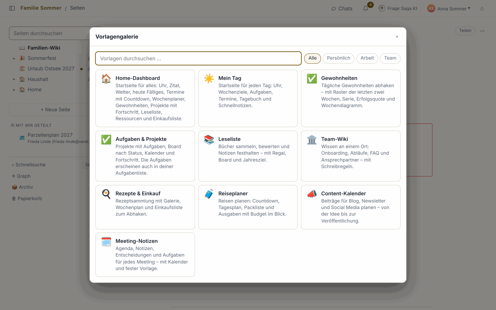
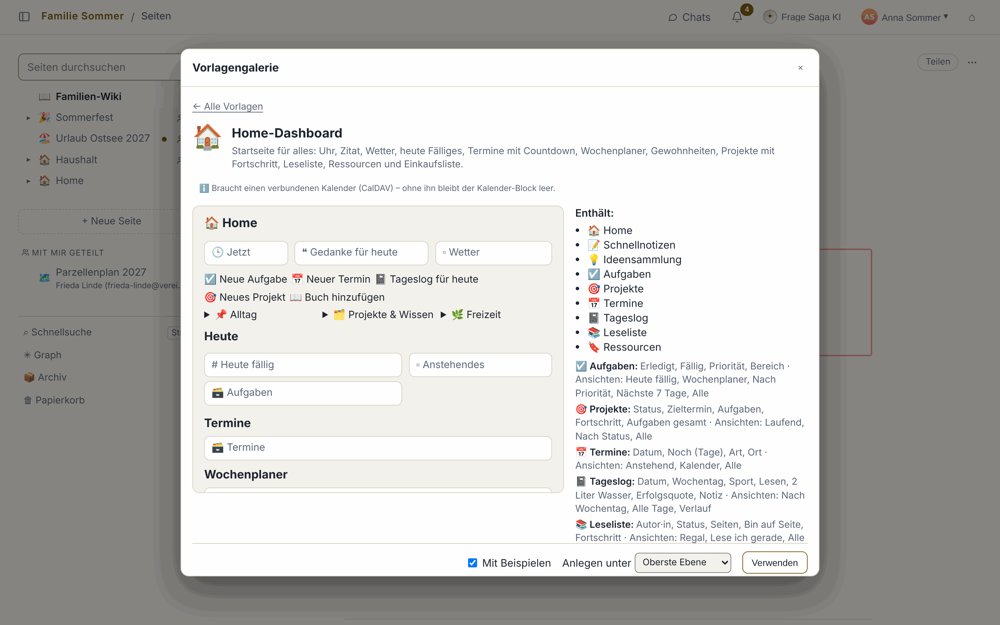
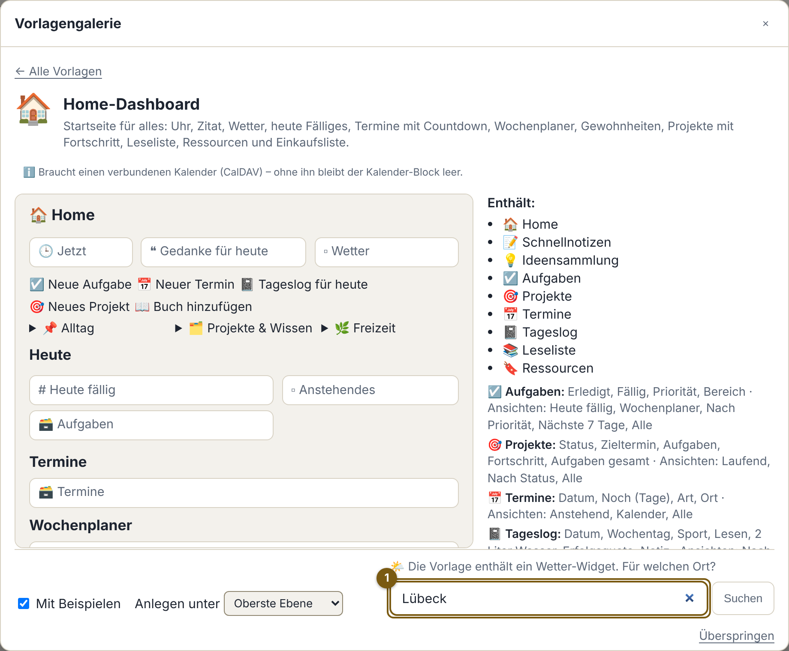
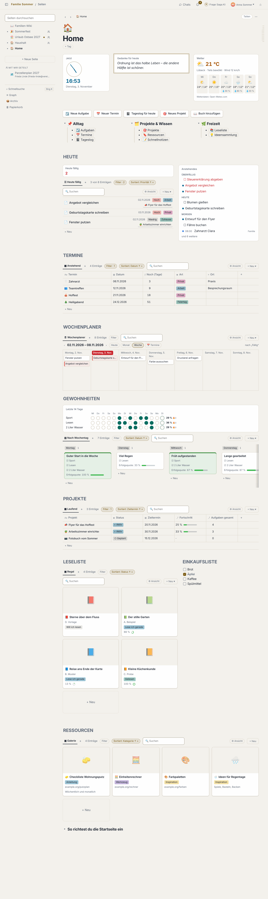
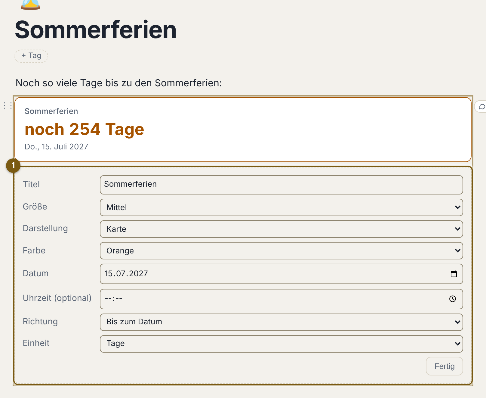
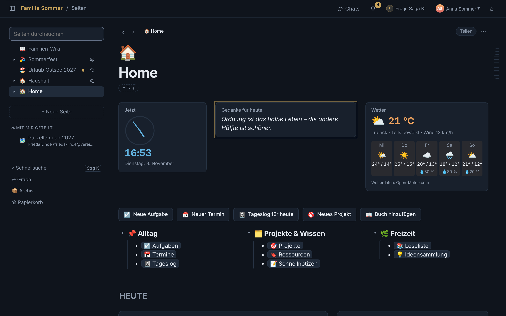
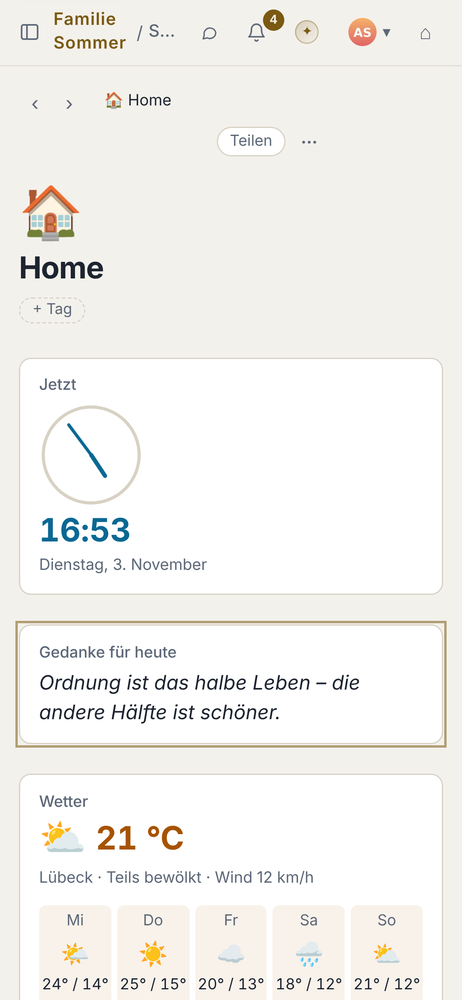

# B06 Vorlagen-Galerie und Widgets

**Gilt für:** Web · Handy-Browser · iOS/iPadOS/Mac · Android · Linux

[← B05 Seiten gestalten](05-gestalten.md) · [Übersicht](../README.md) · [Weiter: B07 Datenbanken →](07-datenbanken.md)

---

## Das kannst du damit machen

- **In zwei Minuten eine eigene Startseite:** Die Vorlage „Home-Dashboard“ legt Uhr, Wetter, heute Fälliges,
  Wochenplaner, Gewohnheiten, Leseliste und Einkaufsliste auf einmal an.
- **Bis zu den Sommerferien zählen:** Ein Countdown-Widget zeigt Clara jeden Tag, wie viele Tage es noch sind.
- **Das Wetter für den Ausflug:** Das Wetter-Widget zeigt heute und die nächsten Tage für Lübeck.
- **Gewohnheiten durchhalten:** Ben hakt jeden Tag „Laufen“ und „Wasser trinken“ ab und sieht seine Serie.
- **Rezepte, Reise oder Vereinsprotokoll sofort loslegen:** Fertige Vorlagen bringen Datenbanken, Ansichten und
  Beispiele schon mit.

## Wofür ist das?

Die **Vorlagen-Galerie** ist eine Sammlung fertiger Seiten. Du suchst dir eine aus, klickst auf
**Verwenden**, und Saga legt alles als Kopie in deinem Konto an: Seiten, Datenbanken, Ansichten und auf Wunsch
Beispieleinträge. Danach sind es ganz normale Seiten, die du ändern kannst, wie du willst.

**Widgets** sind kleine Karten in einer Seite: eine Uhr, ein Countdown, ein Fortschrittsbalken, eine Zahl aus
einer Datenbank, ein Zitat, das Wetter, ein Gewohnheiten-Raster, deine anstehenden Termine oder ein Diagramm.
Sie machen aus einer Seite ein Dashboard.

---

## Schritt für Schritt

### 1. Die Vorlagen-Galerie öffnen

Es gibt drei Wege:

- **Seiten** → **+ Neue Seite** → **Aus der Galerie …**
- auf einer leeren Startansicht ohne Seiten: **Mit einer Vorlage starten**
- in der Befehlspalette (`Strg` + `K`, Mac: `⌘` + `K`): **Vorlagengalerie**

Oben filterst du nach **Persönlich**, **Arbeit** und **Team** oder durchsuchst die Vorlagen. Die Galerie
enthält:

- **Home-Dashboard** – Startseite für alles (siehe Abschnitt 3)
- **Mein Tag** – Startseite für jeden Tag: Uhr, Wochenziele, Aufgaben, Termine, Tagebuch und Schnellnotizen
- **Aufgaben & Projekte** – Projekte mit Aufgaben, Board nach Status, Kalender und Fortschritt
- **Gewohnheiten** – tägliche Gewohnheiten abhaken, mit Serie, Erfolgsquote und Wochendiagramm
- **Leseliste** – Bücher sammeln, bewerten, Notizen festhalten, mit Jahresziel
- **Rezepte & Einkauf** – Rezeptsammlung mit Galerie, Wochenplan und Einkaufsliste zum Abhaken
- **Reiseplaner** – Countdown, Tagesplan, Packliste und Ausgaben mit Budget
- **Meeting-Notizen** – Agenda, Notizen, Entscheidungen und Aufgaben für jedes Treffen
- **Content-Kalender** – Beiträge für Blog, Newsletter und Social Media planen
- **Team-Wiki** – Wissen an einem Ort: Abläufe, häufige Fragen, Ansprechpartner

> **Hinweis:** Siehst du keinen Eintrag **Aus der Galerie …**, hat dein Admin die Galerie ausgeschaltet.

### 2. Eine Vorlage ansehen und verwenden

1. Klick auf eine Kachel. Rechts erscheint die **Vorschau** der Startseite und darunter unter **Enthält:**, was
   alles angelegt wird.
2. **Mit Beispielen** (ab Werk an) legt Beispieleinträge mit an – praktisch, um zu sehen, wie alles gedacht
   ist. Schalt es aus, wenn du gleich mit leeren Listen starten willst.
3. Bei **Anlegen unter** wählst du, wo die Vorlage landet: ganz oben in deinen Seiten oder unter der Seite,
   die gerade offen ist.
4. Klick auf **Verwenden**. Saga meldet „Vorlage angelegt“ und öffnet die neue Startseite.

**Wetter-Ort beim Anlegen:** Enthält die Vorlage ein Wetter-Widget, fragt Saga vorher: „Die Vorlage enthält
ein Wetter-Widget. Für welchen Ort?“

1. Tipp bei ① den Ort ein, zum Beispiel „Lübeck“, und klick auf **Suchen**.
2. Wähl den richtigen Treffer aus.
3. Oder klick auf **Überspringen** – dann richtest du den Ort später im Widget ein.

> **Gut zu wissen:** Eine Vorlage ist nach dem Anlegen nicht mehr mit der Galerie verbunden. Was du änderst,
> bleibt bei dir; Änderungen an der Galerie kommen nicht nachträglich in deine Seiten.

### 3. Das Home-Dashboard

Das Home-Dashboard ist die größte Vorlage: eine Startseite, auf der dein ganzer Tag Platz hat.

Von oben nach unten findest du:

- **Uhr**, **Zitat des Tages** und **Wetter** nebeneinander
- **Schaltflächen** für eine neue Aufgabe, einen Termin, einen Tageslog-Eintrag, ein Projekt oder ein Buch
- **Schnellzugriff** – drei Spalten mit aufklappbaren Listen für deine wichtigsten Links und Seiten
- **Heute fällig** – Aufgaben, die heute dran sind
- **Anstehendes** – deine Termine und fälligen Aufgaben der nächsten Tage
- **Termine** mit „noch X Tage“ und einen **Wochenplaner** als Kalender-Woche
- **Gewohnheiten** als Raster und ein **Tageslog**
- **Projekte** mit Fortschrittsbalken, eine **Leseliste**, **Ressourcen** und die **Einkaufsliste**

> **Hinweis:** Der „Schnellzugriff“ ist kein eigenes Widget, sondern besteht aus normalen Toggle-Listen in
> Spalten. Du bearbeitest ihn wie jeden Text.

Damit Saga gleich mit dieser Seite startet: Seitenmenü **⋯** → **Als Startseite festlegen** (siehe
[B02](02-startseite.md#6-eigene-startseite-festlegen)).

### 4. Ein Widget einfügen und einrichten

1. Tipp in einer leeren Zeile `/widget` – oder gleich den Namen, etwa `/countdown`, `/uhr`,
   `/fortschritt` oder `/kennzahl`.
2. Wähl das Widget aus. Es erscheint als Karte mit „Widget noch nicht fertig eingerichtet“.
3. Klick auf die Karte. Rechts öffnet sich **Widget einrichten**.
4. Stell alles ein – jede Änderung siehst du sofort in der Vorschau.
5. Klick auf **Fertig**.

① Die Einstellungen – jede Änderung erscheint sofort in der Vorschau.

Mehrere Widgets nebeneinander bekommst du, indem du sie in **Spalten** setzt (`/3 Spalten`).

### 5. Die Widgets im Überblick

- **Uhr** – analog oder digital, auch für eine andere Zeitzone (etwa die Uhrzeit bei der Tante in Bangkok).
- **Countdown** – Tage, Stunden oder Minuten **bis zum Datum** oder **seit dem Datum**.
- **Fortschritt** – ein Balken. Entweder mit festen Zahlen („12 von 20 Kapiteln“), aus einer Datenbank (zum
  Beispiel Anteil angehakter Einträge) oder aus deinen Saga-Aufgaben.
- **Kennzahl** – eine einzelne Zahl aus einer Datenbank: Anzahl, Summe, Durchschnitt, Minimum, Maximum oder
  % angehakt. Kann auch deine Aufgaben zählen: offen, heute fällig, überfällig oder diese Woche erledigt.
- **Zitat** – eigene Texte (ein Zitat je Zeile) oder aus einer Datenbank, **jeden Tag ein anderes** oder bei
  jedem Öffnen zufällig.
- **Wetter** – heute und die nächsten Tage für einen Ort. Dein Admin muss das Wetter einschalten.
- **Gewohnheiten** – ein Raster der letzten Tage mit Serie und Erfolgsquote. Ein Tippen hakt ab. Die Häkchen
  landen als Zeile je Tag in einer Datenbank – am einfachsten nimmst du die Vorlage „Gewohnheiten“.
- **Anstehendes** – deine Termine aus verbundenen Kalendern, deine fälligen Aufgaben und Einträge mit Datum
  aus gewählten Datenbanken für die nächsten Tage.
- **Diagramm** – Balken, Linie, Fläche, Kreis, Ring oder eine große Zahl aus einer Datenbank (siehe auch
  [B07, Diagramm-Ansicht](07-datenbanken.md)).

**Wer sieht was?**

- **Aufgaben und Termine** in Kennzahl, Fortschritt und Anstehendes sind persönlich: Auf einer geteilten Seite
  sieht jede Person ihre **eigenen**.
- Werte aus einer **Datenbank** sieht nur, wer die Datenbank selbst sehen darf. Alle anderen sehen „Kein Zugriff
  auf die Datenquelle“.
- Auf einer **veröffentlichten** Seite fehlt „Anstehendes“, und Werte erscheinen nur aus deinen eigenen
  Datenbanken.

### 6. Schaltflächen

Eine **Schaltfläche** legt mit einem Klick etwas Neues an – praktisch für Dinge, die du oft brauchst.

1. Tipp `/schaltflächen`.
2. Klick auf **Schaltfläche hinzufügen** und gib eine **Beschriftung** und ein Symbol ein.
3. Wähl die **Aktion**:
   - **Neue Aufgabe** – fragt „Was ist zu tun?“ und legt eine Saga-Aufgabe an. Als **Ziel** wählst du deine
     Aufgaben (Inbox) oder eine Datenbank, die Aufgabenquelle ist (siehe [B08](08-aufgaben.md)).
   - **Neuer Eintrag in Datenbank** – legt einen Eintrag in der gewählten Datenbank an, auf Wunsch aus einer
     Eintrags-Vorlage. Als Titel kannst du etwa „Tagebuch {datum}“ eintragen – `{datum}` wird beim Klick durch
     das heutige Datum ersetzt.
   - **Seite öffnen** – springt zu einer bestimmten Seite.
4. Bei **Öffnen als** wählst du, ob der Eintrag bzw. die Seite als ganze Seite, mittig oder als Seitenansicht
   rechts oder links aufgeht.

---

## Beispiel aus dem Alltag

**Familie Sommer bekommt ein Home-Dashboard.**

1. Anna öffnet **Seiten** → **+ Neue Seite** → **Aus der Galerie …** und klickt auf **Home-Dashboard**.
2. Sie lässt **Mit Beispielen** an und klickt auf **Verwenden**.
3. Saga fragt nach dem Ort fürs Wetter. Anna tippt „Lübeck“, klickt auf **Suchen** und wählt den Treffer.
4. Die Seite „Home“ öffnet sich. Anna löscht die Beispieleinträge in der Einkaufsliste und trägt „Milch“,
   „Brot“ und „Äpfel“ ein.
5. Unter dem Wetter fügt sie mit `/countdown` einen Countdown ein: Datum = erster Tag der Sommerferien,
   Richtung **Bis zum Datum**, Einheit **Tage**, Titel „Sommerferien“. Dann **Fertig**.
6. Sie teilt die Seite mit Ben und Clara (siehe [B10](10-teilen.md)). „Anstehendes“ zeigt jedem seine eigenen
   Termine und Aufgaben – Clara sieht ihre Klausur, Ben seinen Zahnarzttermin.
7. Zum Schluss: Seitenmenü **⋯** → **Als Startseite festlegen**.

**Ben will jeden Tag laufen.**

1. Ben legt aus der Galerie die Vorlage **Gewohnheiten** an.
2. In der Datenbank benennt er die Häkchen-Spalten in „Laufen“, „Wasser“ und „Lesen“ um.
3. Jeden Abend tippt er im Gewohnheiten-Widget auf das Kästchen von heute. Nach einer Woche zeigt das Widget
   seine Serie und die Erfolgsquote.

---

## Tipps und Tastenkürzel

- **Direkt einfügen:** `/uhr`, `/countdown`, `/fortschritt` und `/kennzahl` springen gleich zum richtigen Widget.
- **Galerie mit der Tastatur:** In der Galerie wählst du mit den Pfeiltasten und `Enter`.
- **Unter eine Seite anlegen:** Öffne zuerst die Seite, unter der die Vorlage landen soll, und wähle dann bei
  **Anlegen unter** diese Seite.
- **Kennzahl über eine Ansicht:** Eine Kennzahl kann über eine bestimmte **Ansicht** einer Datenbank rechnen –
  zum Beispiel „Summe Preis“ nur über die gefilterte Ansicht „Diese Woche“.

---

## Häufige Fragen

**Das Wetter-Widget zeigt „Wetter ist auf diesem Server ausgeschaltet“.**
Dein Admin muss das Wetter einschalten. Die Wetterdaten holt euer Saga-Server bei Open-Meteo; dabei wird nur der
ungefähre Ort übertragen.

**Ich sehe in einem Widget „Kein Zugriff auf die Datenquelle“.**
Das Widget rechnet mit einer Datenbank, die nicht mit dir geteilt ist. Bitte die Person, der die Datenbank
gehört, sie mit dir zu teilen.

**Kann ich eine Vorlage zweimal anlegen?**
Ja. Jede Verwendung legt eine neue, unabhängige Kopie an.

**Kann ich eigene Vorlagen in die Galerie stellen?**
Eigene Seiten markierst du über das Seitenmenü **⋯** → **Als Vorlage markieren**; sie erscheinen dann unter
**+ Neue Seite**. In die gemeinsame Galerie kommen neue Vorlagen nur über ein Saga-Update.

**Warum kann ich unter einer geteilten Seite keine Vorlage anlegen?**
Dafür brauchst du dort das Recht **Bearbeiten**. Sonst legt Saga die Vorlage in deinen eigenen Seiten an.

---

## Auf dem Handy und in den Apps

**Handy-Browser**

- Galerie und Widgets funktionieren wie am Computer. Spalten mit Widgets stehen untereinander.
- Widgets richtest du durch Antippen ein.

**Apps (iOS/iPadOS/Mac, Android, Linux)**

<!-- App-Bild folgt: b06-08-widgets-android.png -->

- Die Galerie gibt es in allen Apps: auf iPhone und iPad als einfache Auswahl, auf Android über **Aus Vorlage …**,
  in der Linux-App ebenfalls.
- Die Frage nach dem Wetter-Ort beim Anlegen gibt es nur im Browser. In den Apps legst du die Vorlage an und
  stellst den Ort danach im Widget ein.
- Die Apps zeigen Widgets an. Ob du Gewohnheiten in jeder App direkt abhaken kannst, hängt von der App ab – im
  Browser geht es immer.

---

[← B05 Seiten gestalten](05-gestalten.md) · [Übersicht](../README.md) · [Weiter: B07 Datenbanken →](07-datenbanken.md)
