# B07 Datenbanken

**Gilt für:** Web · Handy-Browser · iOS/iPadOS/Mac · Android · Linux

[← B06 Vorlagen-Galerie und Widgets](06-galerie-widgets.md) · [Übersicht](../README.md) · [Weiter: B08 Aufgaben →](08-aufgaben.md)

---

## Das kannst du damit machen

- **Die Einkaufsliste mit Summe:** Abteilung, Menge und Preis je Artikel – Saga rechnet unten die Summe aus,
  und im Laden sortierst du nach Abteilung.
- **Der Hausputzplan als Board:** Karten von „Offen“ über „Dabei“ nach „Erledigt“ schieben, und ein Diagramm
  zeigt, welcher Raum am meisten Arbeit macht.
- **Der Familienkalender:** Termine mit Datum und Uhrzeit, als Woche, als Monat oder als Zeitleiste.
- **Die Rezeptsammlung als Kochbuch:** Jedes Rezept mit Foto, Tags wie „vegetarisch“ und Zubereitungszeit – in
  der Galerie-Ansicht wie ein Bildband.
- **Was steht nächste Woche an?** Ein Filter „Wann ist nächste Woche“ zeigt genau das – jede Woche von selbst
  richtig.

## Wofür ist das?

Eine **Datenbank** ist eine Liste von Einträgen, die alle dieselben **Eigenschaften** haben: Jeder Einkauf hat
eine Abteilung und einen Preis, jedes Rezept eine Zubereitungszeit und Tags, jeder Termin ein Datum.

Jeder Eintrag ist gleichzeitig eine eigene **Seite** – darin schreibst du zum Beispiel die Zubereitung eines
Rezepts. Dieselben Einträge kannst du in verschiedenen **Ansichten** zeigen: als Tabelle, Board, Liste, Galerie,
Kalender, Zeitleiste oder Diagramm. Mit **Filtern**, **Sortierung** und **Gruppen** siehst du genau das, was
du gerade brauchst.

> **Tipp:** Viele fertige Datenbanken bringt die [Vorlagen-Galerie](06-galerie-widgets.md) mit: Rezepte &
> Einkauf, Aufgaben & Projekte, Leseliste, Reiseplaner und mehr. Das ist oft der schnellste Start.

---

## Schritt für Schritt

### 1. Eine Datenbank anlegen

Es gibt zwei Arten:

- **Als eigene Seite:** **Seiten** → **+ Neue Seite** → **Datenbank**. Die Datenbank steht im Seitenbaum wie
  jede andere Seite.
- **In einer Seite:** Tipp in einer Seite `/datenbank`. Du kannst eine neue anlegen (**+ Neue Datenbank hier**)
  oder eine vorhandene **einbetten**. Eine eingebettete Datenbank kann eigene Ansichten haben, die nur zu
  diesem Block gehören.

Eine neue Datenbank startet als Tabelle mit einer Spalte **Name**.

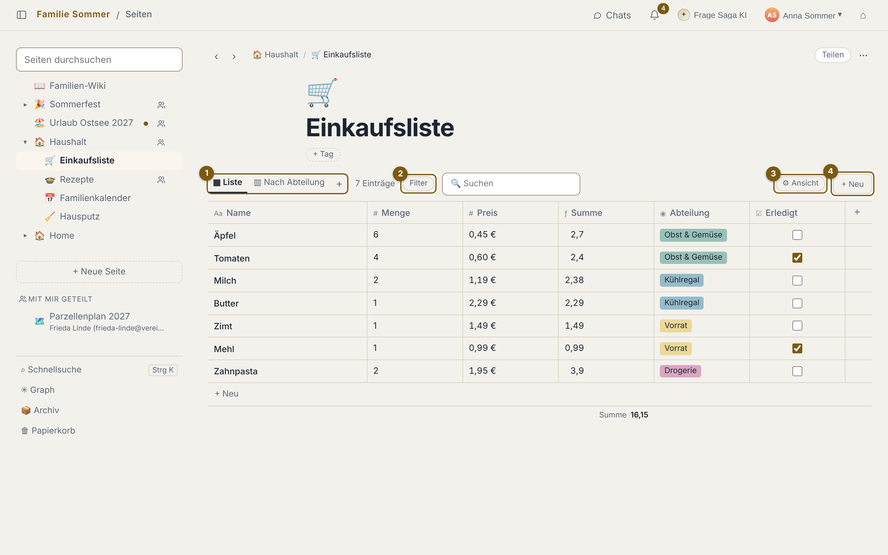

Was die Nummern bedeuten:

- ① **Ansichten** als Reiter – zum Beispiel „Alle“, „Nach Abteilung“
- ② **Filter** – die Zahl zeigt, wie viele gerade aktiv sind
- ③ **Ansicht-Einstellungen** (⚙ Ansicht) – Layout, Eigenschaften, Gruppen, Farben, Import und Export
- ④ **+ Neu** – neuen Eintrag anlegen

### 2. Einträge anlegen und bearbeiten

1. Klick auf ④ **+ Neu** oder in die leere Zeile unter der Tabelle und tipp den Namen ein.
2. `Enter` springt in die nächste Zeile; in der letzten Zeile legt `Enter` gleich den nächsten Eintrag an.
3. Klick in eine Zelle, um einen Wert einzutragen.

**Einen Eintrag als Seite öffnen:** Fahr mit der Maus über den Namen und klick auf **Öffnen**. Der Eintrag öffnet
sich als Seitenansicht rechts („Peek“) – siehe Abschnitt 7. Darin stehen oben alle Eigenschaften, darunter
schreibst du wie in jeder Seite.

**Eintrags-Vorlagen:** Bei **+ Neu ▾** (der kleine Pfeil) legst du mit **+ Neue Vorlage** ein Muster an, zum
Beispiel ein Rezept mit den Abschnitten „Zutaten“ und „Zubereitung“. **Als Standard für „+ Neu“** macht es
zur Vorlage für jeden neuen Eintrag. Unter **Vorlagen verwalten …** änderst du sie.

### 3. Eigenschaften (Spalten)

Klick rechts im Tabellenkopf auf **+** (**Spalte hinzufügen**) und wähl einen Typ. Ein Klick auf den
Spaltenkopf öffnet das Spaltenmenü: umbenennen, Typ ändern, sortieren, ausblenden, löschen.

| Typ | Wofür | Beispiel |
|---|---|---|
| Text | beliebiger Text | Notiz „Bio-Qualität“ |
| Zahl | rechnen, Summen | Preis 2,49 |
| Auswahl | genau eine Option, farbig | Abteilung „Obst“ |
| Mehrfachauswahl | mehrere Optionen | Tags „vegetarisch“, „schnell“ |
| Datum | Tag, mit Uhrzeit oder als Zeitraum | Elternabend 14.11., 19:30 |
| Häkchen | ja/nein | „gekauft“ |
| URL | Link | Rezept-Quelle |
| Person | eine oder mehrere Personen | zuständig: Ben |
| Dateien | Anhänge | Foto der Rechnung |
| Relation | Verbindung zu Einträgen einer anderen Datenbank | Rezept ↔ Zutaten |
| Rollup | rechnet über eine Relation | Anzahl fehlender Zutaten |
| Formel | rechnet aus anderen Eigenschaften | Summe = Menge × Preis |
| Erstellt am / Zuletzt bearbeitet | füllt Saga selbst | |

**Status:** Eine **Auswahl** wird zum Status, wenn du im Spaltenmenü **Als Status (Gruppen)** einschaltest.
Dann gehört jede Option zu einer Gruppe – **Zu erledigen**, **In Arbeit** oder **Erledigt** – und Saga weiß,
was „fertig“ bedeutet. Mit **Gruppen zuordnen** legst du fest, welche Option wohin gehört.

**Datum mit Uhrzeit oder Zeitraum:** Im Datumsfeld schaltest du **Mit Uhrzeit** oder **Zeitraum** (mit
**Enddatum**) ein.

### 4. Ansichten

Ein Klick auf **+** neben den Reitern (**Ansicht hinzufügen**) legt eine neue Ansicht an. Im Menü der Ansicht
wechselst du das **Layout**:

**Tabelle** – Zeilen und Spalten, wie oben. In **⚙ Ansicht** stellst du **Zeilenumbruch in allen Spalten** und
**Spalten fixieren** (Name und bis zu zwei weitere Spalten bleiben beim Scrollen stehen) ein. Unter jeder Spalte
wählst du bei **Berechnen** eine Summe, einen Durchschnitt, die Anzahl und mehr.

**Board** – Karten in Spalten nach einer Auswahl oder einem Status. Zieh eine Karte in eine andere Spalte, um den
Wert zu ändern. Bei einem Status gruppiert das Board auf Wunsch **nach Status-Gruppe (Zu erledigen / In Arbeit /
Erledigt)**.

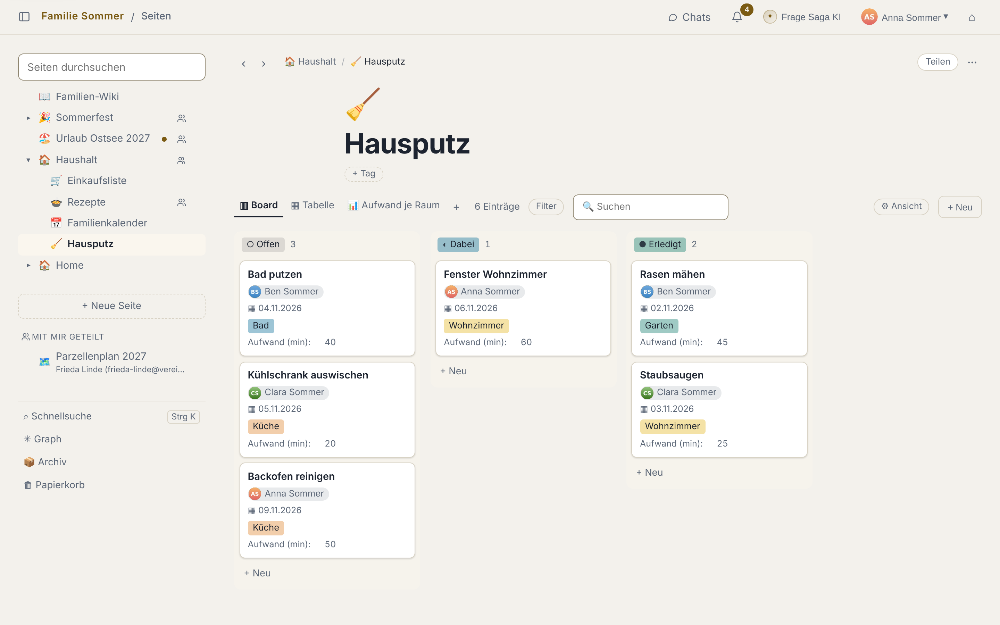

**Liste** – schlicht, eine Zeile je Eintrag.

**Galerie** – Karten mit Bild. Das Bild kommt aus dem Titelbild des Eintrags oder einer Dateien-Eigenschaft.

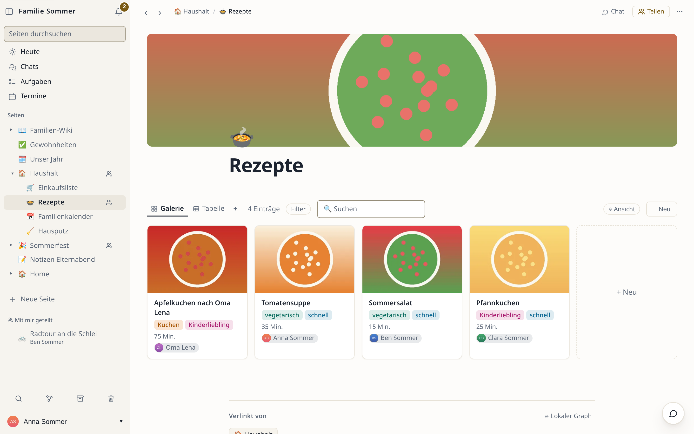

**Kalender** – Einträge an ihrem Datum, als **Monat** oder **Woche**. Zieh einen Eintrag auf einen anderen Tag,
um ihn zu verschieben.

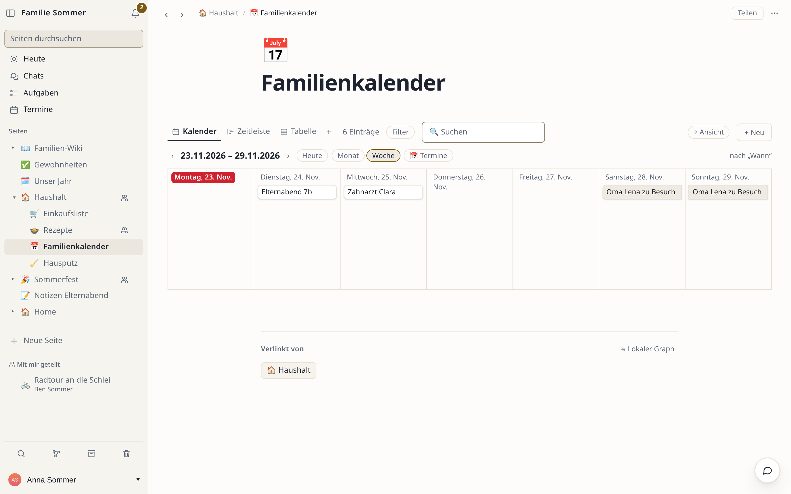

**Zeitleiste** – Balken von Beginn bis Ende, in der Skala **Tag**, **Woche**, **Monat** oder **Quartal**.
Zieh einen Balken, um ihn zu verschieben, oder an seinen Enden, um ihn zu verlängern. Einträge ohne Termin stehen
darunter – zieh sie auf die Zeitleiste, um einen Termin zu setzen.

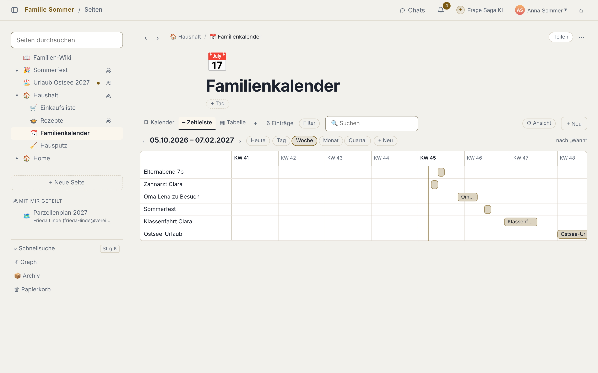

**Diagramm** – Balken, Linie, Fläche, Kreis, Ring oder eine große Zahl. Nach dem Umschalten klickst du auf
**⚙ Diagramm einrichten** und wählst, was gezählt oder summiert wird. Ein Klick auf einen Balken zeigt die
Einträge dahinter.

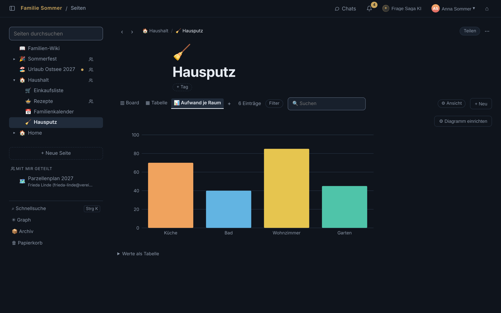

### 5. Filtern, sortieren, gruppieren, einfärben

**Filter:**

1. Klick auf ② **Filter** → **+ Filter hinzufügen …**.
2. Wähl die Eigenschaft und die **Bedingung**, zum Beispiel „Abteilung ist Obst“ oder „Preis > 5“.
3. Für Datumsfelder gibt es **relative** Bedingungen, die jeden Tag neu gelten: ist heute, ist morgen, ist
   gestern, ist diese/letzte/nächste Woche, ist diesen/letzten/nächsten Monat, ist dieses Jahr,
   **ist überfällig**, in den nächsten … Tagen, in den letzten … Tagen.
4. Bei einer Person gibt es **ist mir zugewiesen** – jede Person sieht dann ihre eigenen Einträge.

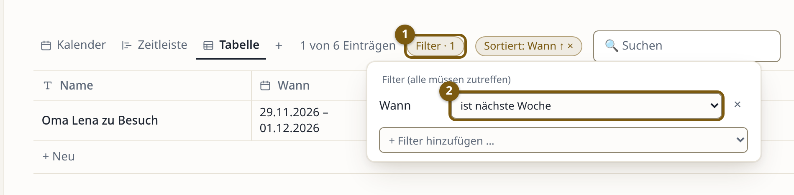

- ① **Filter** mit der Anzahl aktiver Filter
- ② **Bedingung** – auch relativ, wie „ist nächste Woche“

**Sortieren:** In **⚙ Ansicht** → **+ Sortierung hinzufügen …** – bis zu 3 Stufen, zum Beispiel erst nach
Abteilung, dann nach Name. Schneller: Spaltenkopf → **Aufsteigend sortieren**.

**Gruppieren:** **⚙ Ansicht** → **Gruppieren nach** – etwa die Einkaufsliste nach Abteilung. Jede Gruppe lässt
sich auf- und zuklappen.

**Bedingte Farbe:** **⚙ Ansicht** → **Bedingte Farbe** → **+ Farbregel hinzufügen**. Beispiel: Zeilen, deren
Datum „ist überfällig“ ist, werden rot. Es gilt die erste passende Regel.

> **Hinweis:** Filter, Sortierung und Gruppen gehören zur **Ansicht**. Lege für verschiedene Zwecke einfach
> mehrere Ansichten an – „Alle“, „Diese Woche“, „Nur Ben“.

### 6. Formeln, Relationen und Rollups

**Formel:** Eine Formel rechnet aus anderen Eigenschaften desselben Eintrags.

1. Spalte hinzufügen → **Formel**.
2. Klick auf den Spaltenkopf → **Formel bearbeiten …**.
3. Schreib die Formel. Eigenschaften holst du mit `prop("Name")`.

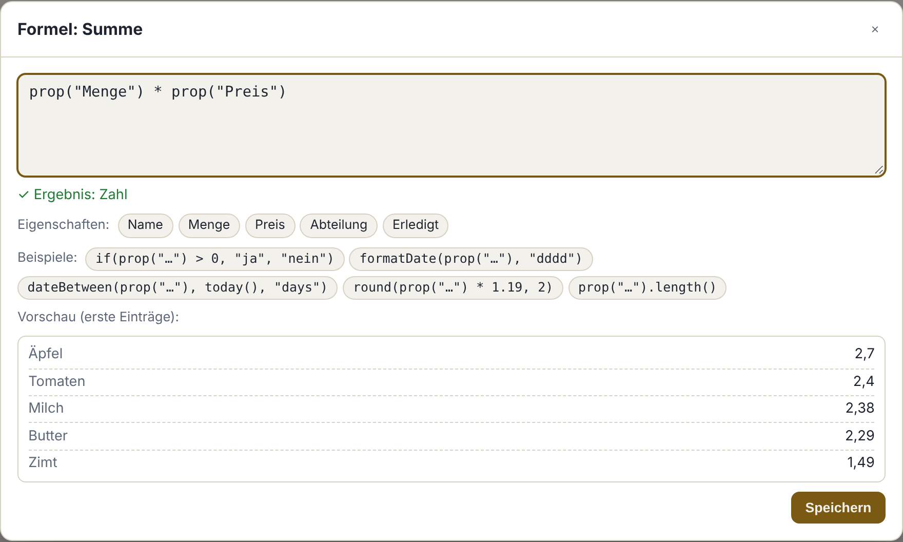

Einige Beispiele:

- `prop("menge") * prop("preis")` – Menge mal Preis
- `if(prop("gekauft"), "✓", "fehlt")` – Text je nach Häkchen
- `dateBetween(prop("Datum"), now(), "days")` – wie viele Tage bis zum Termin
- `round(prop("Minuten") / 60, 1)` – Minuten in Stunden

Saga kennt viele Rechen-, Text- und Datumsfunktionen (etwa `sum`, `round`, `if`, `contains`, `formatDate`,
`dateAdd`). Ist eine Formel falsch, steht in der Zelle „Formel fehlerhaft“.

**Relation:** verbindet Einträge zweier Datenbanken. Beispiel: In „Rezepte“ eine Relation „Zutaten“ zur
Datenbank „Einkaufsliste“. In der Zelle wählst du dann die passenden Einträge aus.

**Rollup:** rechnet über eine Relation. Spalte hinzufügen → **Rollup**, dann im Spaltenkopf die **Relation**,
die **Eigenschaft** und bei **Berechnen** die Rechenart wählen – zum Beispiel Anzahl, Summe, Durchschnitt,
% angehakt, früheste oder späteste Angabe, oder **Original anzeigen**.

**In Formel umwandeln …:** Hast du eine Spalte als Text (etwa nach einem Import aus Notion), ersetzt du sie im
Spaltenmenü durch eine echte Formel.

### 7. Einträge im Peek öffnen

Ein Eintrag öffnet sich ohne die Datenbank zu verlassen in der Seitenansicht („Peek“).

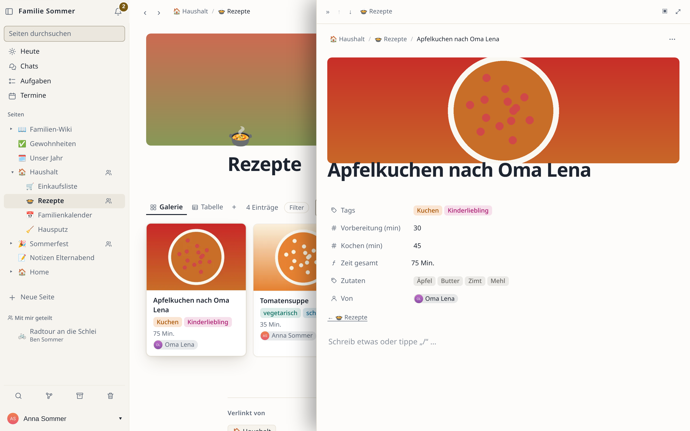

- ① Umschalten zwischen **rechts** und **mittig**
- ② **Als Seite öffnen** – öffnet den Eintrag als ganze Seite
- Mit den Pfeilen oben (oder `Strg` + `⇧` + `J` / `K`) springst du zum nächsten bzw. vorherigen Eintrag.
- `Esc` schließt den Peek.

### 8. Unteraufgaben und Abhängigkeiten

Für Projekte und Aufgabenlisten kannst du Einträge verschachteln und verketten. In **⚙ Ansicht**:

- **Unteraufgaben aktivieren** – jeder Eintrag kann einen übergeordneten Eintrag haben. Die Tabelle zeigt sie
  **verschachtelt**, **flach** oder **nur oberste Ebene**.
- **Abhängigkeiten aktivieren** – ein Eintrag kann „blockiert durch“ einen anderen sein. Ist die Abhängigkeit
  noch nicht erledigt, zeigt Saga „Blockiert“. In der Zeitleiste erscheinen Abhängigkeiten als Pfeile.

### 9. Importieren und exportieren

**Importieren:** **+ Neue Seite** → **Importieren …** (oder im Seitenmenü **⋯** einer Seite – dann landet
alles darunter). Zieh eine Datei oder einen Ordner in das Feld.

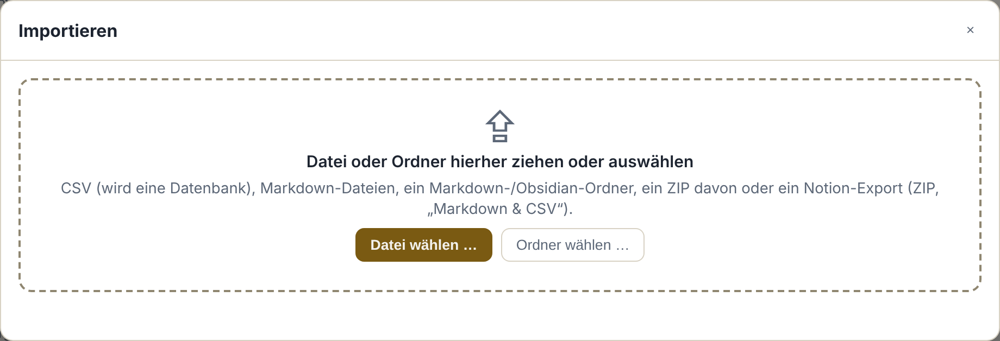

- **CSV → Datenbank:** auch aus Excel. Saga erkennt Trennzeichen, Dezimalkomma und Datumsformate und schlägt
  je Spalte einen Typ vor. In der Vorschau änderst du Typen oder lässt Spalten weg.
- **Markdown / Obsidian:** einzelne `.md`-Dateien, ein Ordner oder ein ZIP davon. Ordner werden Seiten,
  `[[Wikilinks]]` zeigen danach auf die neuen Seiten.
- **Notion:** In Notion **Exportieren** mit dem Format **Markdown & CSV** und **Unterseiten einschließen**
  wählen und die ZIP-Datei unverändert hineinziehen. Saga übernimmt Seitenbaum, Datenbanken mit Einträgen,
  Bilder und Links.

Der Import läuft im Hintergrund. Am Ende siehst du, was angelegt wurde und was nicht übernommen werden konnte –
zusätzlich als Seite „Importbericht“.

**Zeilen an eine bestehende Datenbank anhängen:** **⚙ Ansicht** → **Zeilen aus CSV hinzufügen …** (nur, wenn
dir die Datenbank gehört). Du ordnest jeder CSV-Spalte eine Eigenschaft zu.

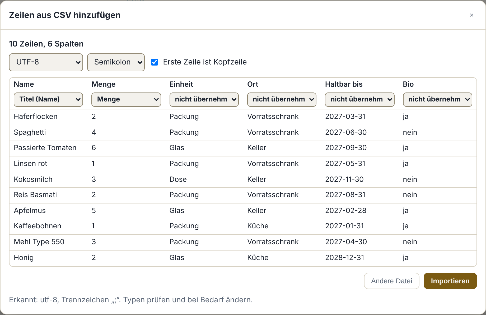

**Als CSV exportieren:** **⚙ Ansicht** → **Als CSV exportieren** → **Diese Ansicht** oder alle Einträge und
Spalten. Für Excel auf Deutsch schaltest du **Excel (Deutsch): Semikolon und Dezimalkomma** ein.

---

## Beispiel aus dem Alltag

**Rezepte und Einkaufsliste hängen zusammen.**

1. Anna legt aus der Galerie **Rezepte & Einkauf** an. Sie bekommt die Datenbanken „Rezepte“ und
   „Einkaufsliste“.
2. In „Rezepte“ wechselt sie zur Ansicht **Galerie** und setzt bei jedem Rezept ein Foto als Titelbild.
3. Sie fügt eine **Mehrfachauswahl** „Tags“ hinzu und gibt dem Apfelkuchen „Kuchen“ und „vegetarisch“.
4. Sie legt eine **Relation** „Zutaten“ zur „Einkaufsliste“ an und verbindet beim Apfelkuchen Äpfel, Mehl und
   Zucker.
5. Dazu kommt ein **Rollup** „fehlt noch“: Relation „Zutaten“, Eigenschaft „gekauft“, Berechnen **nicht
   angehakt**. Jetzt sieht sie an jedem Rezept, wie viele Zutaten noch fehlen.
6. In der Einkaufsliste legt sie eine Ansicht „Im Laden“ an: Filter „gekauft ist nicht angehakt“, gruppiert nach
   Abteilung.

**Ben holt die alte Rezept-Tabelle aus Excel.**

1. Ben speichert seine Excel-Tabelle als **CSV (Trennzeichen-getrennt)**.
2. In Saga öffnet er die Datenbank „Rezepte“ → **⚙ Ansicht** → **Zeilen aus CSV hinzufügen …**.
3. Saga erkennt Semikolon und Dezimalkomma. Ben ordnet „Rezeptname“ dem Titel zu, „Dauer“ der Eigenschaft
   „Gesamtzeit“ und lässt die Spalte „Notizen alt“ weg.
4. Er klickt auf Importieren. Am Ende meldet Saga, wie viele Zeilen angelegt wurden.

---

## Tipps und Tastenkürzel

- `Enter` im Namen springt in die nächste Zeile bzw. legt einen neuen Eintrag an.
- `Strg` + `⇧` + `J` / `K` im Peek: nächster bzw. vorheriger Eintrag. `Esc` schließt.
- **Spalten verschieben:** Spaltenkopf ziehen.
- **Ansichten nur für einen Block:** Eingebettete Datenbanken können eigene Ansichten haben, ohne dass sich die
  Ansichten der eigentlichen Datenbank ändern.
- **Sperren:** Mit **🔒 Datenbank sperren** schützt du Spalten und Ansichten vor versehentlichen Änderungen –
  Einträge lassen sich weiter bearbeiten.

---

## Häufige Fragen

**Was ist der Unterschied zwischen Tabelle (`/tabelle`) und Datenbank?**
Die einfache Tabelle ist nur Text in Zellen. Eine Datenbank hat Typen, Filter, Ansichten, Formeln, und jeder
Eintrag ist eine eigene Seite.

**Ich sehe „Nur lesen – Änderungen an der Ansicht werden nicht gespeichert.“**
Die Datenbank ist mit dir nur zum Lesen geteilt. Filtern und Sortieren geht trotzdem, aber nur für dich und bis
zum nächsten Öffnen.

**Meine Board-Ansicht ist leer.**
Ein Board braucht eine Auswahl-Eigenschaft (zum Beispiel Status). Leg eine an und wähle sie in **⚙ Ansicht**.

**Werden Personen aus Notion übernommen?**
Nein, Notion liefert nur Namen. Personen-Spalten kommen als Text an; Formeln und Rollups als Ergebnis. Die
Formeln baust du mit **In Formel umwandeln …** neu.

**Wie viele Zeilen kann ich importieren?**
Bis zu 5000 Zeilen je Import und 30 Spalten. Was nicht passt, steht im Importbericht.

---

## Auf dem Handy und in den Apps

**Handy-Browser**

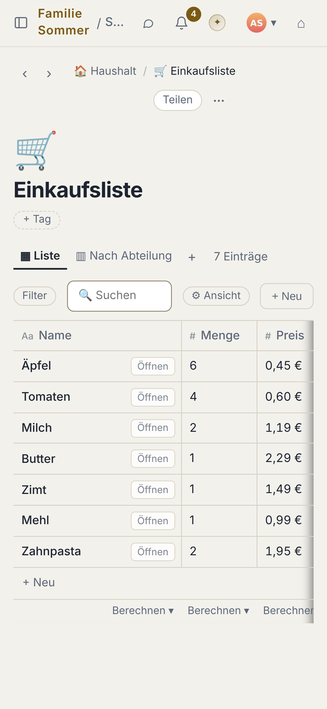

- Tabellen scrollst du seitlich. Mit **Spalten fixieren** bleibt der Name stehen.
- Der Peek öffnet sich über die ganze Breite.
- Importieren und als CSV exportieren gehen nur im Browser am Computer bequem.

**Apps (iOS/iPadOS/Mac, Android, Linux)**

<!-- App-Bild folgt: b07-12-board-ios-dunkel.png -->

- Alle Apps zeigen Datenbanken mit ihren Ansichten und lassen dich Einträge anlegen und bearbeiten.
- **Zeitleiste:** Im Browser, auf dem iPad und auf dem Mac ziehst du Balken; auf iPhone und Android ist sie
  eine lesbare Liste.
- **Import und CSV-Export** gibt es nur im Web.
- Formeln rechnet der Server – die Apps zeigen die Ergebnisse. Ob du Formeln auch in der App bearbeiten kannst,
  hängt von der App ab; im Browser geht es immer.

---

[← B06 Vorlagen-Galerie und Widgets](06-galerie-widgets.md) · [Übersicht](../README.md) · [Weiter: B08 Aufgaben →](08-aufgaben.md)
