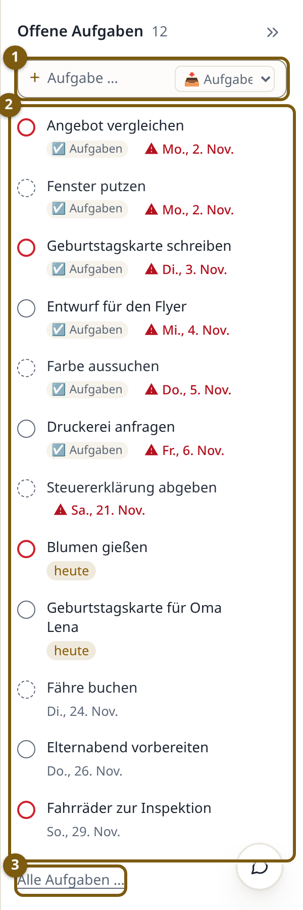
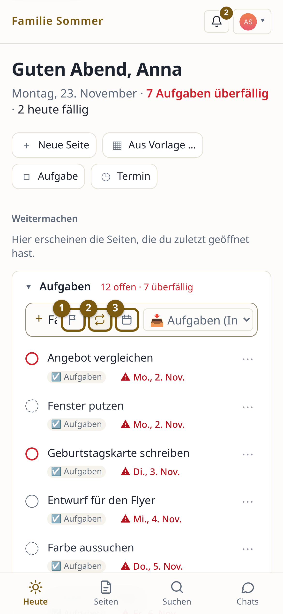
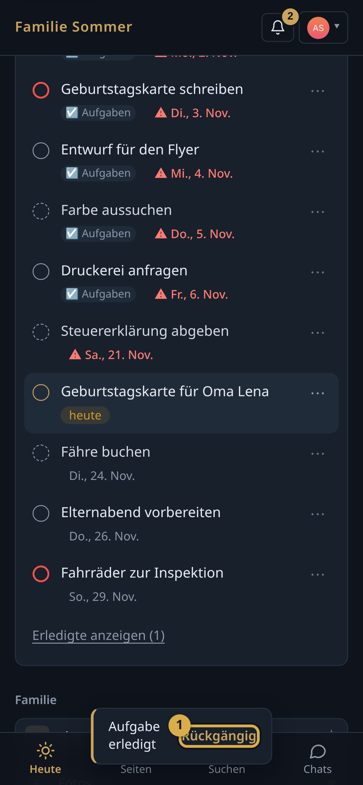
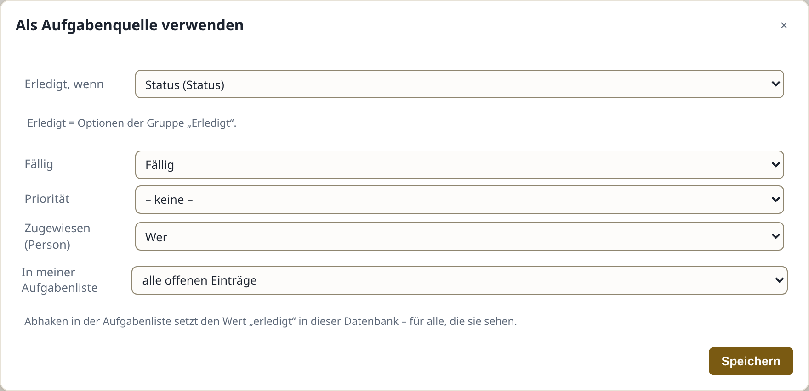

# B08 Aufgaben

**Gilt für:** Web · Handy-Browser · iOS/iPadOS/Mac · Android · Linux

[← B07 Datenbanken](07-datenbanken.md) · [Übersicht](../README.md) · [Weiter: B09 Gleichzeitig bearbeiten →](09-gleichzeitig.md)

---

## Das kannst du damit machen

- **Schnell etwas notieren:** „Milch kaufen“ – `t`, tippen, `Enter`, fertig. Die Aufgabe steht sofort rechts
  auf „Heute“.
- **Wiederkehrendes nicht vergessen:** „Müll rausbringen“ jeden Dienstag, „Pflanzen gießen“ werktags,
  „Kfz-Versicherung prüfen“ jährlich. Nach dem Abhaken steht die nächste schon da.
- **Den Hausputzplan auf „Heute“:** Die Datenbank „Hausputz“ ist Aufgabenquelle. Ben sieht unter seinen
  Aufgaben genau die Räume, die ihm zugewiesen sind.
- **Wichtiges zuerst:** Mit Priorität ⚑ und Fälligkeitsdatum sortiert Saga alles: überfällig, heute, später.
- **Morgens eine Zusammenfassung:** Eine Mitteilung sagt dir, wie viele Aufgaben heute fällig oder überfällig
  sind.

## Wofür ist das?

Saga hat eine einfache **Aufgabenliste** für alles, was du erledigen willst. Du findest sie rechts auf **Heute**,
in der Seitenleiste unter **Aufgaben**, als Block `/aufgaben` in jeder Seite und in den Apps.

Dazu kommen **Datenbanken als Aufgabenquelle**: Offene Einträge aus Datenbanken wie „Hausputz“ oder „Aufgaben
& Projekte“ erscheinen in derselben Liste. So hast du alles, was zu tun ist, an einem Ort – egal, wo es
eigentlich herkommt.

---

## Schritt für Schritt

### 1. Eine Aufgabe schnell anlegen

Was die Nummern bedeuten:

- ① **Aufgabe …** – hier tippst du eine neue Aufgabe ein
- ② deine **Aufgaben** – der Kreis davor hakt ab
- ③ **Alle Aufgaben …** – öffnet die ganze Liste mit allen Möglichkeiten (dasselbe wie **Aufgaben** in der
  Seitenleiste)

1. Klick in ① **Aufgabe …** – oder drück auf „Heute“ die Taste `t`.
2. Tipp die Aufgabe ein, zum Beispiel „Fähre buchen“.
3. Drück `Enter`.

Hast du Datenbanken als Aufgabenquelle eingerichtet (Abschnitt 5), wählst du vorher das **Ziel der neuen
Aufgabe**: deine **Aufgaben (Inbox)** oder eine der Datenbanken. Saga merkt sich das zuletzt gewählte Ziel.

### 2. Priorität, Wiederholung und Datum

Diese Optionen gibt es beim Anlegen im Kasten **Aufgaben** – du öffnest ihn mit ③ **Alle Aufgaben …**, oder er
erscheint von selbst, wenn die Leiste eingeklappt oder das Fenster schmal ist.

Im Eingabefeld stehen drei Symbole:

- ① **Priorität ⚑** – hoch oder niedrig. Wichtige Aufgaben rutschen nach oben.
- ② **Wiederholung** – **täglich**, **werktags**, **wöchentlich**, **monatlich** oder **jährlich**.
- ③ **Datum** – das Fälligkeitsdatum über das Kalender-Symbol.

Später änderst du das Datum über **⋯** an der Aufgabe → **Datum wählen …** bzw. **Datum ändern …** oder
**Datum entfernen**.

So zeigt Saga das Datum an:

- „heute“ – die Aufgabe ist heute fällig,
- **rot** – sie ist überfällig,
- sonst das Datum.

> **Tipp:** Ein Datum, das du einfach in den Text schreibst („bis Freitag“), setzt kein Fälligkeitsdatum. Nimm
> dafür das Kalender-Symbol.

### 3. Abhaken und Rückgängig

1. Klick auf den **Kreis** vor der Aufgabe.
2. Unten erscheint „Aufgabe erledigt“ mit **Rückgängig**. Für etwa 8 Sekunden holst du die Aufgabe damit
   zurück.

① **Rückgängig** nimmt das Abhaken zurück.

**Bei wiederkehrenden Aufgaben** steht dort „Erledigt. Nächstes Mal: …“ mit dem neuen Datum. Saga legt die
nächste Aufgabe sofort an. **Rückgängig** nimmt auch diese wieder zurück.

**Erledigte ansehen:** Unter der Liste zeigt **Erledigte anzeigen** alle abgehakten Aufgaben. Ein Klick auf den
Haken öffnet eine Aufgabe wieder, **×** löscht sie. **Erledigte löschen** räumt alle auf einmal weg.

### 4. Aufgaben in Seiten

Tipp in einer Seite `/aufgaben`. Der Block zeigt dieselbe Aufgabenliste wie „Heute“ – du kannst dort
anlegen, abhaken und Daten setzen.

- Der Block zeigt immer **deine eigenen** Aufgaben. Auf einer geteilten Seite sehen andere statt deiner Liste
  nur „Nur für den Eigentümer sichtbar“.
- Auf einer veröffentlichten Seite erscheint der Block nicht.
- Die Vorlage **Mein Tag** aus der [Galerie](06-galerie-widgets.md) baut eine Tagesübersicht mit Aufgaben,
  Terminen und Notizen.

**Erinnerung im Text:** Tippst du in einer Seite `@` und wählst **Erinnerung**, legt Saga eine Aufgabe mit
diesem Datum an (siehe [B04](04-seiten-editor.md#7-personen-datum-und-andere-seiten-erwähnen)).

### 5. Datenbanken als Aufgabenquelle

Eine Datenbank wird zur Aufgabenquelle, wenn ihre offenen Einträge in deiner Aufgabenliste erscheinen sollen.

1. Öffne die Datenbank, zum Beispiel „Hausputz“.
2. Klick auf **⚙ Ansicht** → **Als Aufgabenquelle verwenden …**.
3. Saga schlägt die Zuordnung vor. Prüf sie:
   - **erledigt** – woran Saga erkennt, dass ein Eintrag fertig ist (Status-Gruppe „Erledigt“, ein Häkchen
     oder eine bestimmte Auswahl-Option)
   - **Datum** – das Fälligkeitsdatum
   - **Priorität** – optional
   - **Person** – wer zuständig ist
4. Bestätige mit **Als Aufgabenquelle verwenden**.

Ab jetzt stehen die offenen Einträge in deiner Aufgabenliste, mit einem kleinen Schild „Hausputz“ dahinter.
Hakst du einen ab, setzt Saga in der Datenbank den Status auf erledigt (bzw. das Häkchen) – mit **Rückgängig**.

**Wer sieht was?**

- Bei **eigenen** Datenbanken siehst du alle offenen Einträge.
- Bei **geteilten** Datenbanken nur die, die **dir zugewiesen** sind. Das stellst du je Quelle um.
- Höchstens 20 Quellen.

**Quellen verwalten:** Im Block `/aufgaben` einer Seite öffnet das kleine **⚙** die **Aufgabenquellen**. Dort
schaltest du je Quelle zwischen „alle offenen Einträge“ und „nur mir zugewiesene“ um oder entfernst sie. Eine
einzelne Quelle beendest du auch in der Datenbank selbst: **⚙ Ansicht** → **Aufgabenquelle …** → **Keine Aufgabenquelle mehr**.

### 6. Tägliche Zusammenfassung

Einmal am Tag schickt dir Saga eine Mitteilung: wie viele Aufgaben heute fällig oder überfällig sind – nur
Zahlen, keine Texte.

1. Öffne **Einstellungen → Mitteilungen**.
2. Schalt bei **Tägliche Zusammenfassung der Aufgaben** **Zusammenfassung schicken** ein.
3. Wähl die **Uhrzeit**, zum Beispiel 7:00.

Wie Mitteilungen aufs Handy kommen, steht in [B14 Benachrichtigungen und Mitteilungen](14-benachrichtigungen.md).

---

## Beispiel aus dem Alltag

**Clara bringt jeden Dienstag den Müll raus.**

1. Anna öffnet in der Seitenleiste **Aufgaben**.
2. Sie tippt „Müll rausbringen (Clara)“, wählt bei ② **Wiederholung** → **wöchentlich** und bei ③ den
   nächsten Dienstag.
3. Sie drückt `Enter`. Die Aufgabe steht in der Liste.
4. Am Dienstagabend hakt Anna sie ab. Saga meldet „Erledigt. Nächstes Mal: …“ mit dem Dienstag der nächsten
   Woche.

> **Tipp:** Saga-Aufgaben gehören immer einer Person. Soll Clara die Aufgabe auf **ihrem** „Heute“ sehen,
> nimm eine gemeinsame Datenbank als Aufgabenquelle – wie im nächsten Beispiel.

**Der Hausputz verteilt sich von selbst.**

1. Anna hat eine Datenbank „Hausputz“ mit den Eigenschaften Raum, **Status** (Offen · Dabei · Erledigt),
   **Datum** und **Person** (zuständig). Sie hat sie mit Ben und Clara zum Bearbeiten geteilt.
2. Ben öffnet die Datenbank → **⚙ Ansicht** → **Als Aufgabenquelle verwenden …** und bestätigt die
   vorgeschlagene Zuordnung.
3. Weil die Datenbank Anna gehört, sieht Ben nur **die ihm zugewiesenen** Einträge – „Bad putzen“ und „Fenster
   Küche“.
4. Am Samstag hakt Ben „Bad putzen“ auf seinem „Heute“ ab. In der Datenbank springt der Status auf
   „Erledigt“, und Anna sieht es auf ihrem Board.

---

## Tipps und Tastenkürzel

- `t` auf „Heute“ springt in **Aufgabe …**.
- `Enter` legt die Aufgabe an.
- **Sortierung:** Saga sortiert von selbst – überfällig, heute, nach Datum, nach Priorität.
- **Zahlen im Widget:** Mit den Widgets **Kennzahl** und **Fortschritt** zeigst du „heute fällig“, „überfällig“
  oder „diese Woche erledigt“ in jeder Seite an (siehe [B06](06-galerie-widgets.md)).
- **Schaltfläche „Neue Aufgabe“:** Mit `/schaltflächen` legst du einen Knopf an, der mit einem Klick eine
  Aufgabe in einer bestimmten Datenbank anlegt.

---

## Häufige Fragen

**Warum sehe ich die Aufgaben einmal rechts und einmal in der Mitte?**
Ist die Leiste rechts eingeklappt (**»**) oder das Fenster schmal, erscheinen die Aufgaben als Kasten im
Hauptbereich – nie beides zugleich.

**Kann ich eine Aufgabe einer anderen Person zuweisen?**
Saga-Aufgaben gehören immer dir. Für gemeinsame Aufgaben nimm eine geteilte Datenbank mit einer
Personen-Eigenschaft und richte sie als Aufgabenquelle ein.

**Ich habe aus Versehen abgehakt und „Rückgängig“ ist weg.**
Öffne **Erledigte anzeigen** und klick auf den Haken der Aufgabe – sie ist wieder offen. Bei einer
Datenbank-Aufgabe setzt du den Status in der Datenbank zurück.

**Eine Aufgabenquelle ist verschwunden.**
Wurde dir die Datenbank nicht mehr geteilt, entfernt Saga die Quelle von selbst.

---

## Auf dem Handy und in den Apps

**Handy-Browser**

- Die Aufgaben stehen als Kasten auf „Heute“, mit Priorität, Wiederholung und Datum gleich im
  Eingabefeld.
- Nach dem Abhaken erscheint „Rückgängig“ unten am Bildschirm.

**Apps (iOS/iPadOS/Mac, Android, Linux)**

<!-- App-Bild folgt: b08-04-heute-android.png -->
<!-- App-Bild folgt: b08-05-kurzbefehl-ios.png -->

- Alle Apps zeigen deine Aufgaben und Aufgabenquellen; die Apps haben dafür eine eigene Ansicht „Heute“.
- **iPhone, iPad und Mac:** Mit dem Kurzbefehl **Aufgabe anlegen** fügst du per Siri oder Kurzbefehle-App eine
  Aufgabe hinzu, auch mit Ziel. Ein Widget für den Home-Bildschirm zeigt die Aufgaben von heute.
- **Android:** Das Widget **Heute** zeigt deine Aufgaben auf dem Home-Bildschirm.
- **Linux:** kein Widget.

---

[← B07 Datenbanken](07-datenbanken.md) · [Übersicht](../README.md) · [Weiter: B09 Gleichzeitig bearbeiten →](09-gleichzeitig.md)
