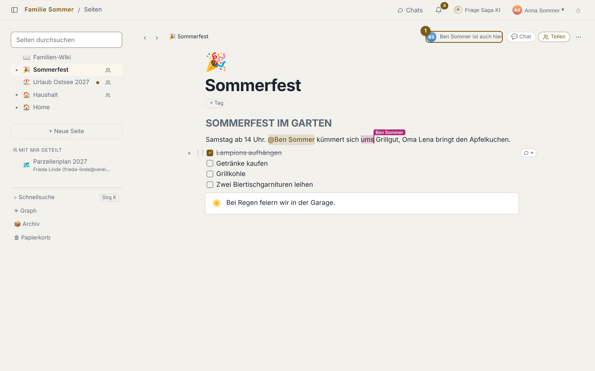
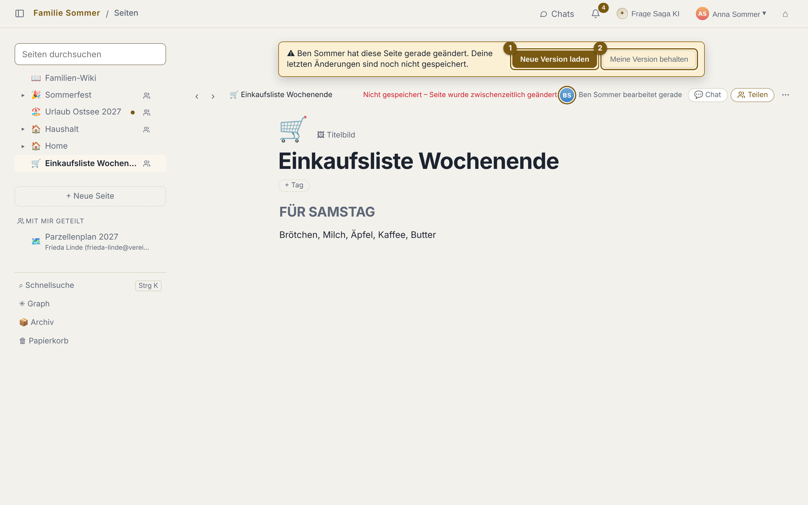
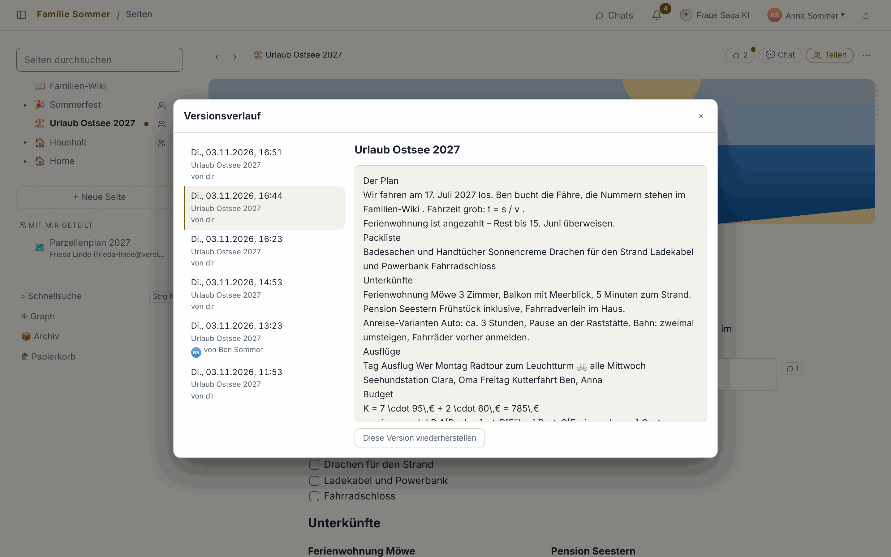

# B09 Gleichzeitig bearbeiten

**Gilt für:** Web · Handy-Browser · iOS/iPadOS/Mac · Android · Linux

[← B08 Aufgaben](08-aufgaben.md) · [Übersicht](../README.md) · [Weiter: B10 Teilen, Rechte, Kommentare, Veröffentlichen →](10-teilen.md)

---

## Das kannst du damit machen

- **Zu zweit die Einkaufsliste ergänzen:** Anna am Laptop, Ben in der Linux-App – beide tippen gleichzeitig,
  und keiner überschreibt den anderen.
- **Das Sommerfest gemeinsam planen:** Anna schreibt das Programm, Ben im selben Moment die Getränkeliste. Jeder
  sieht, wo der andere gerade schreibt.
- **Das Vereinsprotokoll live mitschreiben:** Frieda schreibt mit, Paul ergänzt die Kassenzahlen direkt in
  derselben Seite.
- **Einen Fehler rückgängig machen:** Hat jemand versehentlich einen Absatz gelöscht, holst du im
  Versionsverlauf die Fassung von gestern zurück.

## Wofür ist das?

Wenn mehrere Personen eine Seite bearbeiten dürfen (siehe [B10 Teilen](10-teilen.md)), könnt ihr gleichzeitig
darin arbeiten. Saga zeigt, **wer gerade da ist**, und hält die Seite für alle auf dem neuesten Stand – ohne
Neuladen.

Hat dein Admin **Gleichzeitig bearbeiten live** eingeschaltet, siehst du die Eingaben und die Schreibmarke der
anderen sofort, Buchstabe für Buchstabe. Ohne diesen Schalter führt Saga eure Änderungen beim Speichern
zusammen – meistens merkst du davon nichts. Nur wenn zwei Personen denselben Absatz fast gleichzeitig ändern,
fragt Saga nach.

---

## Schritt für Schritt

### 1. Sehen, wer gerade da ist

Öffnen andere dieselbe Seite, erscheinen oben im Seitenkopf ihre Anfangsbuchstaben bzw. Profilbilder.

① **Wer gerade hier ist** – fahr mit der Maus darüber, um die Namen zu sehen. Ein Ring um das Bild bedeutet:
Diese Person bearbeitet gerade.

**Mit live:** Im Text siehst du die Schreibmarke der anderen in ihrer Farbe, mit Namen daran. Markiert jemand
Text, siehst du auch die Markierung. Was andere tippen, erscheint sofort bei dir.

### 2. Änderungen der anderen

**Mit live** musst du nichts tun – alles kommt sofort an.

**Ohne live** gilt:

- Tippst du gerade nicht, lädt Saga die neue Fassung still nach. Deine Position in der Seite bleibt, so gut es
  geht, erhalten.
- Schreibst du gerade selbst, erscheint zum Beispiel „Ben hat diese Seite geändert“ mit **Neu laden**. Saga führt
  eure Änderungen absatzweise zusammen, wenn ihr an verschiedenen Stellen geschrieben habt.

Unter dem Titel steht außerdem, wer zuletzt geändert hat: „Zuletzt geändert von Ben · vor 5 Min.“.

> **Rückgängig gilt nur für dich:** `Strg` + `Z` nimmt nur deine eigenen Änderungen zurück, nie die der anderen.

### 3. Wenn zwei denselben Absatz ändern

Nur ohne live kann es passieren, dass zwei Personen denselben Absatz fast gleichzeitig ändern. Dann erscheint
oben eine Leiste, etwa „Ben hat diese Seite gerade geändert“.

Du hast zwei Möglichkeiten:

- ① **Neue Version laden** – Saga lädt Bens Fassung. Dein nicht gespeicherter Text erscheint zum Kopieren,
  damit du ihn wieder einfügen kannst.
- ② **Meine Version behalten** – nach einer Rückfrage gilt deine Fassung. Bens Fassung bleibt im
  **Versionsverlauf** erhalten.

Es geht also nie etwas spurlos verloren.

### 4. Versionen ansehen und wiederherstellen

1. Seitenmenü **⋯** → **Versionsverlauf**.
2. Links stehen die gesicherten Fassungen mit Zeit und **wer** sie gespeichert hat.
3. Klick auf eine Version – rechts siehst du ihren Inhalt.
4. **Diese Version wiederherstellen** holt sie zurück. Saga sichert vorher den aktuellen Stand als neue Version.

Saga sichert beim Bearbeiten höchstens alle 5 Minuten, nach einer Pause und beim Verlassen der Seite einen
Stand – bis zu 50 je Seite. Versionen ansehen und wiederherstellen darf, wer die Seite **bearbeiten** darf (bei
gesperrten Seiten nur, wem sie gehört).

### 5. Wenn der Zugriff endet, während du schreibst

Nimmt die Eigentümerin dir das Recht zum Bearbeiten weg, während du schreibst, erscheint ein Fenster mit deinem
letzten Text zum Kopieren. So verlierst du nichts, auch wenn du nicht mehr speichern darfst.

---

## Beispiel aus dem Alltag

**Anna und Ben ergänzen gleichzeitig die Einkaufsliste.**

1. Anna öffnet am Laptop die Datenbank „Einkaufsliste“. Ben öffnet sie in der Linux-App.
2. Oben bei Anna erscheint Bens Kürzel „B“ – er ist auch da.
3. Anna trägt „Kaffee“ ein, Ben gleichzeitig „Spülmittel“. Jeder neue Eintrag ist eine eigene Zeile – keiner
   überschreibt den anderen, und nach einem Augenblick sehen beide beide Einträge.
4. Ben hakt „Milch“ ab, weil er sie auf dem Heimweg schon gekauft hat. Kurz darauf ist der Haken auch bei Anna
   zu sehen.

**Ben hat aus Versehen das Programm gelöscht.**

1. In der Seite „Sommerfest“ fehlt plötzlich der Abschnitt „Programm“.
2. Anna öffnet **⋯** → **Versionsverlauf** und klickt auf die Version von heute Mittag, die von ihr stammt.
3. Rechts sieht sie: Das Programm ist noch da. Sie klickt auf **Diese Version wiederherstellen**.
4. Bens spätere Änderungen sind nicht weg – sie stehen als eigene Version im Verlauf. Anna kopiert sich daraus
   die Getränkeliste, die Ben inzwischen ergänzt hatte.

---

## Tipps und Tastenkürzel

- `Strg` + `Z` (Mac: `⌘` + `Z`) nimmt nur deine eigenen Änderungen zurück.
- **Absprechen über Kommentare:** Statt gleichzeitig am selben Absatz zu schreiben, hinterlass einen Kommentar
  (siehe [B10](10-teilen.md#3-kommentieren)).
- **Seite sperren:** Soll niemand mehr etwas ändern, kann die Eigentümerin die Seite über **⋯** → **Seite
  sperren** schützen.
- **Offline weiterschreiben:** Bricht die Verbindung ab, steht oben „Offline“. Was du schreibst, speichert Saga,
  sobald du wieder online bist.

---

## Häufige Fragen

**Ich sehe die Schreibmarke der anderen nicht.**
Dann ist **Gleichzeitig bearbeiten live** bei euch ausgeschaltet. Saga führt eure Änderungen trotzdem zusammen.
Frag deinen Admin, ob er live einschalten kann.

**Saga zeigt „Diese Seite nutzt eine andere Editor-Version – bitte neu laden.“**
Jemand hat die Seite mit einer neueren Saga-Version bearbeitet. Lade die Seite neu; bis dahin kannst du nur lesen.

**Wie viele können gleichzeitig in einer Seite arbeiten?**
Mehrere Personen sind kein Problem. Hat eine Person aber mehr als fünf Tabs offen, fragt Saga bei den übrigen nur
noch jede Minute nach Änderungen.

**Kann ich sehen, wer was geändert hat?**
Ja: unter dem Titel „Zuletzt geändert von …“, und im Versionsverlauf steht bei jeder Fassung, von wem sie stammt.

---

## Auf dem Handy und in den Apps

**Handy-Browser**

- Anwesenheit und live funktionieren wie am Computer.
- Bei schmalem Bildschirm stehen die Kürzel der anderen gekürzt im Seitenkopf.

**Apps (iOS/iPadOS/Mac, Android, Linux)**

- Live gleichzeitig bearbeiten gibt es im Web, in der Linux-App, auf iPhone, iPad und Mac und auf Android –
  wenn euer Saga-Server Version 2.5 hat und dein Admin den Schalter eingeschaltet hat.
- Sonst führen die Apps eure Änderungen beim Speichern zusammen, genau wie der Browser ohne live.
- Den Versionsverlauf öffnest du am besten im Browser.

---

[← B08 Aufgaben](08-aufgaben.md) · [Übersicht](../README.md) · [Weiter: B10 Teilen, Rechte, Kommentare, Veröffentlichen →](10-teilen.md)
