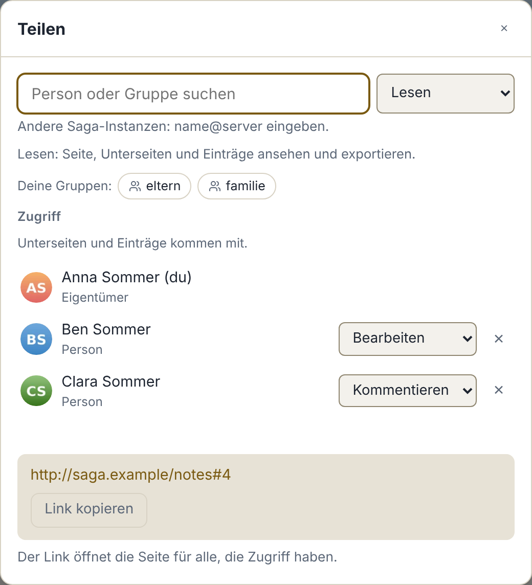
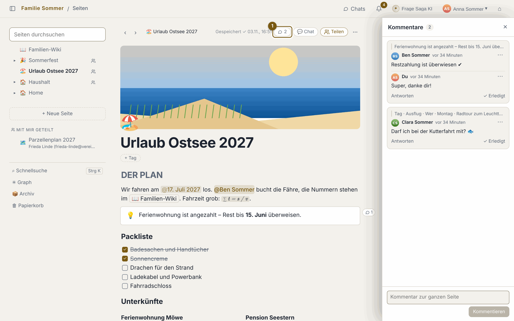
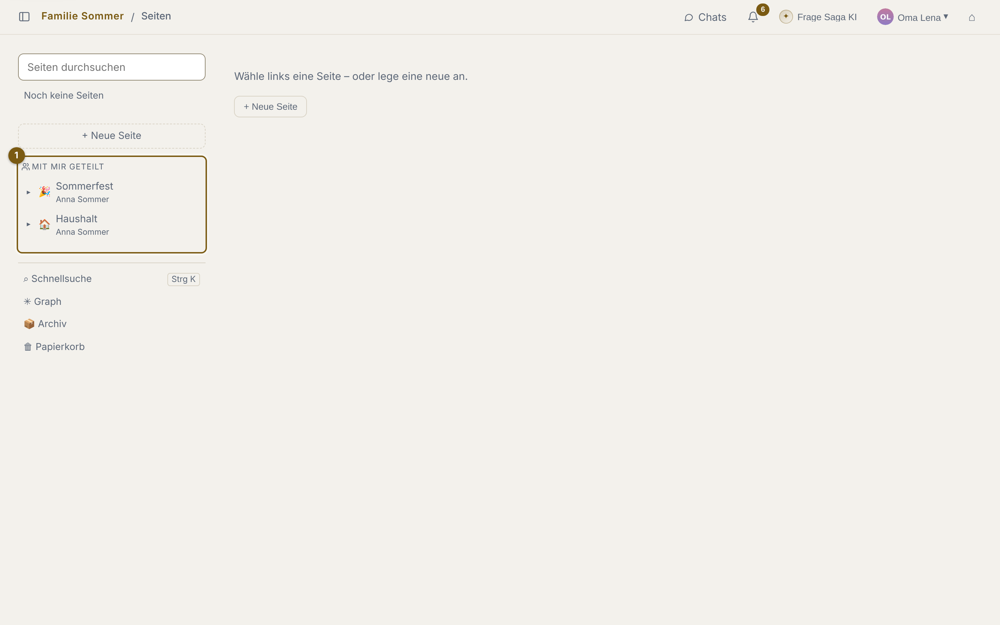
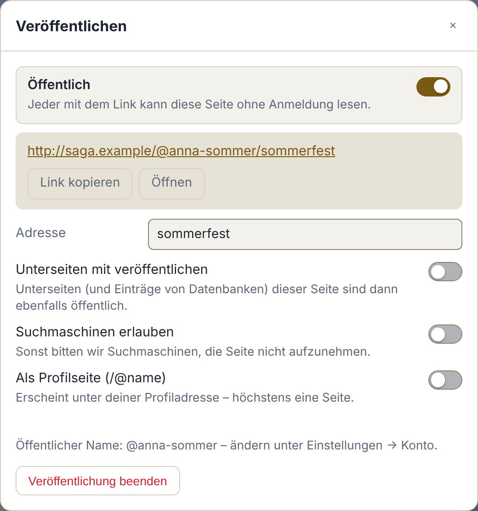
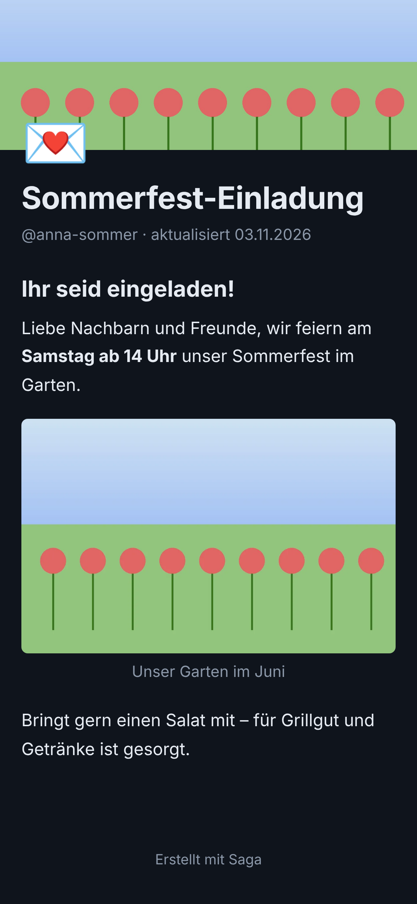

# B10 Teilen, Rechte, Kommentare, Veröffentlichen

**Gilt für:** Web · Handy-Browser · iOS/iPadOS/Mac · Android · Linux

[← B09 Gleichzeitig bearbeiten](09-gleichzeitig.md) · [Übersicht](../README.md) · [Weiter: B11 Föderation →](11-foederation.md)

---

## Das kannst du damit machen

- **Den Urlaub gemeinsam planen:** Anna teilt „Urlaub Ostsee 2027“ mit Ben zum Bearbeiten und mit Clara zum
  Kommentieren. Clara fragt am Rand: „Darf meine Freundin mit?“
- **Omas Rezepte weitergeben:** Oma Lena darf die Rezepte lesen und kommentieren – „Mehr Zimt!“ schreibt sie an
  den Apfelkuchen.
- **Der ganzen Familie auf einmal etwas zeigen:** Statt jede Person einzeln einzutragen, teilst du mit der
  Gruppe „Familie“.
- **Eine Einladung für alle:** Die Seite „Sommerfest-Einladung“ veröffentlicht Anna. Jeder mit dem Link kann sie
  lesen, auch ohne Saga-Konto.
- **Fragen klären, ohne zu chatten:** Kommentare hängen genau am richtigen Absatz und verschwinden mit
  **Erledigt**, wenn alles geklärt ist.

## Wofür ist das?

Deine Seiten gehören dir. Mit **Teilen** gibst du anderen Konten oder Gruppen auf eurem Saga Zugriff: zum
**Lesen**, zum **Kommentieren** oder zum **Bearbeiten**. Mit **Kommentaren** besprecht ihr eine Seite direkt
an der richtigen Stelle. Und mit **Veröffentlichen** machst du eine Seite für alle im Internet lesbar – ohne
Anmeldung.

Teilen mit Personen auf einem **anderen** Saga-Server (etwa dem Verein auf `verein.example`) erklärt
[B11 Föderation](11-foederation.md).

---

## Schritt für Schritt

### 1. Eine Seite teilen

1. Öffne die Seite und klick oben rechts auf **Teilen** (oder Seitenmenü **⋯** → **Teilen …**).
2. Tipp den Namen einer Person oder Gruppe ein. Ab 3 Zeichen findet Saga auch Teile von Namen. Bei leerem Feld
   stehen deine Gruppen als Knöpfe „Deine Gruppen:“ bereit.
3. Wähl die **Rolle**: Lesen, Kommentieren oder Bearbeiten. Unter dem Feld steht, was die Rolle darf.
4. Klick auf den Treffer. Die Person bekommt eine Benachrichtigung.

In der Liste darunter siehst du alle, mit denen die Seite geteilt ist. Dort änderst du die Rolle oder entfernst
eine Freigabe – der Zugriff endet sofort. Ganz unten kopierst du den **Link zur Seite**; er öffnet sie für alle,
die Zugriff haben.

> **Hinweis:** Anstelle von Anmeldenamen zeigt Saga den Anzeigenamen und darunter den öffentlichen Namen oder ein
> Kürzel mit `~`. So unterscheidest du zwei Personen mit gleichem Namen.

### 2. Die Rollen

| Rolle | darf |
|---|---|
| **Lesen** | Seite, Unterseiten und Datenbank-Einträge lesen, exportieren, Kommentare lesen |
| **Kommentieren** | zusätzlich kommentieren, antworten, Unterhaltungen als erledigt markieren |
| **Bearbeiten** | zusätzlich Titel, Inhalt, Symbol, Titelbild und Eigenschaften ändern, Unterseiten und Einträge anlegen, Bilder hochladen, Versionen ansehen und wiederherstellen, innerhalb des geteilten Bereichs verschieben |

**Nur du als Eigentümerin oder Eigentümer** darfst: löschen, archivieren, frei verschieben, sperren, als Vorlage
markieren, veröffentlichen und Freigaben verwalten.

**Gut zu wissen:**

- **Unterseiten kommen mit.** Eine Freigabe gilt auch für alle Unterseiten und Datenbank-Einträge darunter. Es
  zählt die höchste Rolle – ob über die Person, eine Gruppe oder eine Seite weiter oben.
- **Was andere anlegen, gehört dir.** Bilder und Unterseiten, die Ben in deiner Seite anlegt, zählen zu deinem
  Speicherplatz.
- **Persönliche Blöcke bleiben persönlich.** Aufgaben-, Kalender- und Immich-Blöcke zeigen anderen nur „Nur für
  den Eigentümer sichtbar“.
- **Archivierte Seiten, Seiten im Papierkorb und Vorlagen** sieht nur, wem sie gehören.

### 3. Kommentieren

Kommentare hängen an einem **Block** – einem Absatz, einer Überschrift, einem Bild.

1. Fahr mit der Maus über den Block und klick auf den kleinen Knopf **💬+** – oder öffne das Block-Menü **⋮⋮** →
   **Kommentieren** (mit der Tastatur: `Strg` + `/` → „Kommentieren“).
2. Rechts öffnet sich die Unterhaltung. Schreib deinen Kommentar und schick ihn ab.
3. Mit `@Name` erwähnst du jemanden – die Person bekommt eine Benachrichtigung.

- ① **💬 3** im Seitenkopf blendet alle Unterhaltungen der Seite ein und aus. Ein kleiner Punkt zeigt
  Ungelesenes.
- Am Rand eines Blocks steht eine kleine Zahl (💬 2), solange es dort offene Unterhaltungen gibt.
- **✓ Erledigt** schließt eine Unterhaltung. Sie klappt zu und verschwindet. **Erledigte zeigen** holt sie
  zurück, **Wieder öffnen** macht sie wieder aktiv.
- Eigene Kommentare bearbeitest oder löschst du über ihr **⋯**-Menü. Wem die Seite gehört, darf alle löschen.

Auch auf eigenen, nicht geteilten Seiten kannst du kommentieren – als Notiz an dich selbst.

### 4. Mit mir geteilt

Seiten, die andere mit dir geteilt haben, findest du in der Seitenleiste unter **Mit mir geteilt**.

- ① **Mit mir geteilt** – mit dem Namen der Person, der die Seite gehört.
- Neue Kommentare zeigt ein kleiner Punkt an der Seite und eine Zahl am Bereich.
- Unter dem Titel einer fremden Seite steht zum Beispiel „Geteilt von Anna Sommer · Du kannst kommentieren“.
- Mit **Lesen** oder **Kommentieren** kannst du nichts am Inhalt ändern. In Datenbanken kannst du sortieren und
  filtern, das wird aber nicht gespeichert.
- Eigene geteilte Seiten tragen im Seitenbaum ein kleines Personen-Symbol.

### 5. Eine Seite veröffentlichen

Veröffentlichen macht eine Seite für **alle** lesbar – auch ohne Saga-Konto. Sie erscheint schlicht und gut
lesbar, auf dem Handy wie am Computer, hell oder dunkel je nach Gerät.

1. Seitenmenü **⋯** → **Veröffentlichen …**.
2. Beim ersten Mal wählst du deinen **öffentlichen Namen** (2–32 Zeichen, Kleinbuchstaben, Ziffern, `-` und
   `_`). Er steht in jeder Adresse und ist für alle sichtbar – es ist **nie** dein Anmeldename.
3. Schalt **Öffentlich** ein. Ab jetzt ist die Seite unter ihrer Adresse erreichbar, etwa
   `https://saga.example/@anna-sommer/sommerfest`.
4. Mit **Link kopieren** (auf dem Handy **Teilen**) schickst du den Link weiter, **Öffnen** zeigt die
   öffentliche Seite.

**Optionen:**

- **Adresse:** Saga schlägt sie aus dem Titel vor. Ändern geht mit **Adresse ändern** – der alte Link
  funktioniert danach nicht mehr.
- **Unterseiten mit veröffentlichen:** Dann sind auch alle Unterseiten und Datenbank-Einträge darunter lesbar.
  Ohne diesen Schalter bleiben sie privat.
- **Suchmaschinen erlauben:** ab Werk aus – Suchmaschinen werden gebeten, die Seite nicht aufzunehmen.
- **Als Profilseite:** Die Seite erscheint unter `…/@dein-name`. Ohne Profilseite steht dort eine Liste deiner
  öffentlichen Seiten.

**Was öffentlich wird – und was nicht:**

- **Ja:** Titel, Symbol, Titelbild, Text, Listen, Bilder, Tabellen, Spalten, Hinweise, Toggles. Datenbanken
  erscheinen als einfache Tabelle.
- **Nein:** Aufgaben-, Kalender- und Immich-Blöcke, Schaltflächen und Dateianhänge. Verweise auf andere Seiten
  werden nur dann zu Links, wenn das Ziel auch öffentlich ist.

Veröffentlichte Seiten tragen im Seitenkopf **🌐 Öffentlich** – ein Klick öffnet den Dialog.

**Veröffentlichung beenden:** Im Dialog **Veröffentlichung beenden**. Saga merkt sich Adresse und Optionen;
veröffentlichst du später wieder, gilt dieselbe Adresse.

> **Wichtig:** Ist eine Seite mit „Unterseiten mit veröffentlichen“ öffentlich **und** mit jemandem zum
> Bearbeiten geteilt, werden Unterseiten und Bilder, die diese Person anlegt, sofort öffentlich. Der Dialog
> weist dich darauf hin.

---

## Beispiel aus dem Alltag

**Oma Lena bekommt die Rezepte.**

1. Anna öffnet die Datenbank „Rezepte“ und klickt auf **Teilen**.
2. Sie tippt „Lena“, wählt die Rolle **Kommentieren** und klickt auf „Oma Lena“.
3. Lena bekommt auf dem Handy eine Benachrichtigung. Sie tippt auf **Seiten** → **Mit mir geteilt** → „Rezepte“.
4. Beim „Apfelkuchen nach Oma Lena“ tippt sie auf den Absatz mit dem Zimt, dann auf **💬+**, und schreibt:
   „Mehr Zimt! Mindestens zwei Teelöffel.“
5. Anna sieht den Punkt im Seitenbaum, ändert das Rezept, antwortet „Erledigt, danke!“ und klickt auf
   **✓ Erledigt**.

**Die Sommerfest-Einladung geht raus.**

1. Anna schreibt die Seite „Sommerfest-Einladung“ mit Datum, Uhrzeit, Anfahrt und einem Titelbild.
2. Seitenmenü **⋯** → **Veröffentlichen …**. Als öffentlichen Namen nimmt sie den Vorschlag `anna-sommer`.
3. Sie schaltet **Öffentlich** ein, lässt **Suchmaschinen erlauben** aus und klickt auf **Link kopieren**.
4. Den Link schickt sie an Nachbarn und Freunde. Die Einladung öffnet sich ohne Anmeldung – im Dunkelmodus auch
   dunkel.

5. Als sich die Uhrzeit ändert, korrigiert Anna einfach ihre Seite. Wer den Link öffnet, sieht sofort die neue
   Uhrzeit.

---

## Tipps und Tastenkürzel

- **Mit Gruppen teilen** spart Arbeit: Kommt jemand neu in die Gruppe, sieht er automatisch alle Seiten, die mit
  der Gruppe geteilt sind.
- **Link zum Block:** Block-Menü **⋮⋮** → **Link zum Block kopieren** springt direkt zur richtigen Stelle – ideal
  in einem Kommentar oder Chat.
- `Strg` + `L` (Mac: `⌘` + `L`) kopiert den Link zur Seite.
- `Strg` + `/` → **Kommentieren** kommentiert den Block, in dem die Schreibmarke steht.

---

## Häufige Fragen

**Ich finde eine Person beim Teilen nicht.**
Saga zeigt nie eine Liste aller Konten. Tipp mindestens 3 Zeichen des Anzeigenamens. Je nach Einstellung deines
Admins findest du nur Personen, mit denen du eine Gruppe gemeinsam hast.

**Ich kann keine Gruppe auswählen.**
Teilen kannst du nur mit Gruppen, in denen du selbst bist.

**Jemand hat mir den Zugriff entzogen, während ich geschrieben habe.**
Saga zeigt dir deinen letzten Text zum Kopieren. Du verlierst nichts.

**Kann ich eine veröffentlichte Seite wieder privat machen?**
Ja, mit **Veröffentlichung beenden**. Liegt die Seite im Papierkorb oder Archiv, ist sie ebenfalls nicht mehr
erreichbar.

**Mein Admin hat meine Veröffentlichung zurückgezogen.**
Dann steht im Dialog „Vom Admin zurückgezogen am …“, und du bekommst eine Benachrichtigung. Sprich mit deinem
Admin.

---

## Auf dem Handy und in den Apps

**Handy-Browser**

- Teilen, Kommentieren und Veröffentlichen funktionieren wie am Computer.
- Die Kommentar-Leiste öffnet sich von unten. Auf schreibgeschützten Seiten erscheint **💬+**, wenn du einen Block
  antippst.
- Im Veröffentlichen-Dialog gibt es zusätzlich **Teilen**, um den Link über das Handy zu verschicken.

**Apps (iOS/iPadOS/Mac, Android, Linux)**

<!-- App-Bild folgt: b10-06-teilen-ios.png -->

- Teilen und Veröffentlichen gibt es in allen Apps.
- „Mit mir geteilt“ zeigen alle Apps.
- Ob du in jeder App kommentieren kannst, hängt von der App ab. Im Browser geht es immer.

---

[← B09 Gleichzeitig bearbeiten](09-gleichzeitig.md) · [Übersicht](../README.md) · [Weiter: B11 Föderation →](11-foederation.md)
