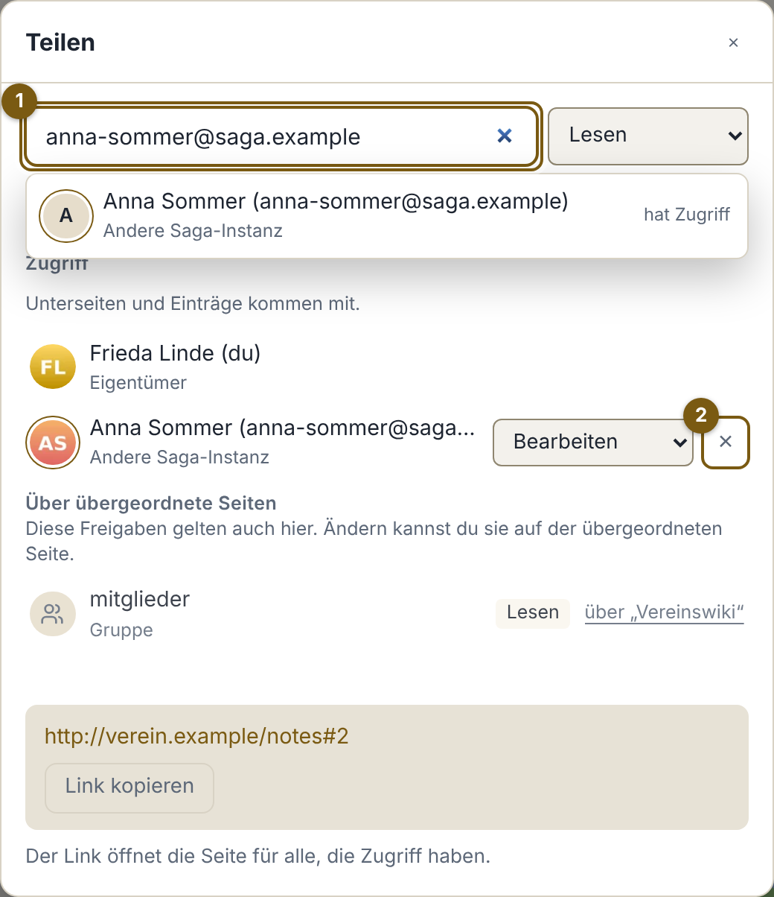
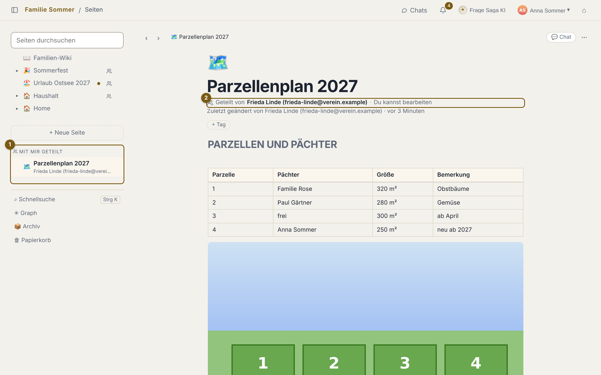

# B11 Föderation – mit anderen Saga-Servern

**Gilt für:** Web · Handy-Browser · iOS/iPadOS/Mac · Android · Linux

[← Übersicht](../README.md) · [Weiter: B12 Chats →](12-chats.md)

---

## Das kannst du damit machen

- **Im Verein mitarbeiten, ohne zweites Konto.** Anna hat ihr Konto bei Familie Sommer. Frieda vom Gartenverein
  teilt ihr trotzdem den „Parzellenplan 2027“ – Anna bearbeitet ihn in ihrem eigenen Saga.
- **Mit Leuten auf anderen Servern schreiben.** Anna fragt Frieda per Direkt-Chat, wann der Arbeitseinsatz ist –
  auch das ist Ende-zu-Ende verschlüsselt, obwohl die beiden auf verschiedenen Servern sind.
- **Über Servergrenzen telefonieren.** Aus dem Chat mit Frieda ruft Anna einfach an, wie bei jemandem aus der Familie.
- **Gemeinsam an einer Liste arbeiten.** Paul, der Kassenwart, pflegt die Datenbank „Mitgliedsbeiträge“; Anna
  trägt dort ihre Zahlung ein – Paul sieht sie sofort.

## Wofür ist das?

Jeder Saga-Server gehört einer Familie, einem Verein oder einer Firma. **Föderation** verbindet solche Server
miteinander. Danach kannst du Seiten mit Menschen auf dem anderen Server teilen, mit ihnen chatten und telefonieren –
als wären sie auf deinem eigenen Saga.

Die Inhalte bleiben dabei immer auf dem Server, dem die Seite gehört. Du arbeitest über dein eigenes Saga daran,
das im Hintergrund beim anderen Server nachfragt. Wer was darf, entscheidet immer der Server der Seite.

> **Hinweis:** Damit das klappt, müssen die **Admins beider Server** ihre Server einmal miteinander verbinden. Das
> beschreibt [A07 Föderation](../admin/07-foederation.md). Wenn du hier nichts davon siehst, frag deinen Admin.

---

## Schritt für Schritt

### 1. Die Adresse einer Person: name@server

Personen auf anderen Servern erkennst du an ihrem **Handle**: einem Namen, einem `@` und dem Server, zum Beispiel
`frieda-linde@verein.example`. So verwechselt niemand Frieda vom Verein mit einer Frieda auf deinem eigenen Saga.

Überall, wo Personen von anderen Servern auftauchen – in „Mit mir geteilt“, bei Kommentaren, in Benachrichtigungen
und im Chat – steht deshalb der Server dabei, zum Beispiel „Frieda Linde (frieda-linde@verein.example)“ oder
„Frieda Linde · verein.example“.

Auch Gruppen auf dem anderen Server lassen sich so ansprechen: `vorstand@verein.example`.

> **Tipp:** Ob andere dich über deinen Anzeigenamen finden dürfen, stellst du unter **Einstellungen → Konto →
> „In Adressbüchern verbundener Server erscheinen“** ein. Ist der Haken aus, findet man dich dort nur noch, wenn man
> dein Handle genau kennt.

### 2. Eine Seite mit jemandem auf einem anderen Server teilen

Das Teilen funktioniert wie immer (siehe [Teilen, Rechte, Kommentare](10-teilen.md)) – nur gibst du statt eines
Namens das Handle ein.

1. Öffne die Seite und klick oben auf **Teilen**.
2. Tipp bei ① das Handle ein, zum Beispiel `anna-sommer@saga.example`. Ist euer Server schon gut verbunden, reicht
   oft auch der Anzeigename („Anna“) – Saga zeigt dann „Anna Sommer · saga.example“ zur Auswahl.
3. Wähl die Rolle: **Lesen**, **Kommentieren** oder **Bearbeiten**.
4. Bestätige. Die Person steht jetzt bei ② in der Liste – mit ihrem Server dahinter.

Was die Nummern bedeuten:

- ① Hier gibst du das Handle `name@server` ein.
- ② Schon geteilt: Anna auf `saga.example` darf bearbeiten.

Freigaben nimmst du genauso wieder zurück wie bei Personen auf deinem eigenen Server. Das wirkt sofort.

### 3. Eine geteilte Seite öffnen

Hat dir jemand von einem anderen Server eine Seite geteilt, bekommst du eine Benachrichtigung in der Glocke
(siehe [Benachrichtigungen](14-benachrichtigungen.md)).

1. Öffne den Seitenbaum.
2. Unter ① **Mit mir geteilt** steht die Seite – auch die von anderen Servern.
3. Klick darauf. Die Seite öffnet sich in deinem normalen Editor.
4. Oben steht bei ②, von wem die Seite kommt und was du darfst.

Was die Nummern bedeuten:

- ① **Mit mir geteilt** – hier landen auch Seiten von anderen Servern.
- ② Wer die Seite geteilt hat und welche Rolle du hast.

Je nach Rolle kannst du die Seite lesen, kommentieren oder bearbeiten. Mit „Bearbeiten“ geht fast alles, was du von
eigenen Seiten kennst:

- Text und Titel ändern, Bilder und Dateien hochladen
- Datenbanken öffnen, filtern, sortieren und **Einträge anlegen**
- Unterseiten anlegen und innerhalb der geteilten Seiten verschieben
- den Versionsverlauf ansehen und die Seite exportieren
- sehen, wer gerade auf der Seite ist, und **live mitschreiben** – wenn beide Server das können

### 4. Chatten und anrufen

1. Öffne die **Chats** und klick auf **+ Neu**.
2. Tipp den Namen oder das Handle ein. Personen anderer Server erscheinen mit ihrem Server dahinter.
3. Klick auf die Person – der Direkt-Chat beginnt.

Bei der anderen Person erscheint dein Chat zuerst als **Nachrichtenanfrage**: ohne Klingeln und ohne Mitteilung, bis
sie annimmt. Erst dann geht es los. Wie Chats und Anrufe funktionieren, steht in [Chats](12-chats.md) und
[Anrufe](13-anrufe.md).

---

## Beispiel aus dem Alltag

**Anna plant mit dem Gartenverein den Parzellenplan.** Anna ist Mitglied im Gartenverein Lindenhof, hat aber nur
ein Konto bei Familie Sommer auf `saga.example`. Die Admins der beiden Server haben ihre Saga-Server verbunden.

1. Frieda öffnet im Vereins-Saga die Seite „Parzellenplan 2027“ und klickt auf **Teilen**.
2. Sie tippt `anna-sommer@saga.example` ein, wählt **Bearbeiten** und bestätigt.
3. Bei Anna klingelt die Glocke: „Frieda Linde hat eine Seite mit dir geteilt“.
4. Anna öffnet **Mit mir geteilt** und klickt auf „Parzellenplan 2027“.
5. Sie trägt in der Tabelle ein, dass Familie Sommer Parzelle 14 übernimmt.
6. Frieda hat die Seite gerade offen und sieht Annas Änderung sofort.
7. Für eine Rückfrage schreibt Anna Frieda im Chat: „Gehört der Schuppen zu Parzelle 14 dazu?“

**Ben fragt beim Kassenwart nach.** Ben will wissen, ob der Jahresbeitrag schon abgebucht wurde.

1. Ben öffnet die Chats, klickt auf **+ Neu** und tippt „Paul“.
2. Saga zeigt „Paul … · verein.example“. Ben klickt darauf und schreibt seine Frage.
3. Paul sieht oben in seiner Chatliste eine **Nachrichtenanfrage** von Ben und nimmt sie an.
4. Ab jetzt schreiben die beiden wie in jedem anderen Chat.

---

## Tipps und Tastenkürzel

- Dein eigenes Handle besteht aus deinem **öffentlichen Namen** (Einstellungen → Konto) und der Adresse deines
  Saga – bei Anna also `anna-sommer@saga.example`. So kannst du es anderen weitergeben.
- Seiten anderer Server erkennst du im Seitenbaum immer am Server-Namen dahinter.
- Es gibt keine eigenen Tastenkürzel für Föderation – alles geht wie bei deinen eigenen Seiten.

---

## Häufige Fragen

**Ich finde die Person nicht.**
Prüf das Handle auf Tippfehler. Vielleicht sind eure Server noch nicht verbunden, oder die Person möchte nicht im
Adressbuch erscheinen – dann brauchst du ihr genaues Handle. Im Zweifel frag deinen Admin.

**Was kann ich auf einer fremden Seite nicht?**
Löschen, archivieren, veröffentlichen und Freigaben verwalten macht nur, wem die Seite gehört. Die
[Vorlagen-Galerie](06-galerie-widgets.md) unter fremden Seiten und Aufgabenquellen auf fremden Servern gehen noch
nicht. Auch der [KI-Assistent](15-ki-assistent.md) liest keine Seiten anderer Server.

**Sagt Saga „Der Server … kann das noch nicht“?**
Dann läuft auf dem anderen Server eine ältere Saga-Version. Lesen, Kommentieren und Bearbeiten gehen trotzdem. Den
Rest kann der Admin dort mit einem Update freischalten.

**Was passiert, wenn die Server getrennt werden?**
Dann enden alle Freigaben sofort, und Seiten von dort verschwinden aus „Mit mir geteilt“. Chats bleiben lesbar,
aber du kannst nichts Neues mehr schreiben.

**Sieht der andere Server meinen Anmeldenamen oder meine E-Mail?**
Nein. Er sieht deinen Anzeigenamen, dein Profilbild und eine feste, zufällige Kennung – nie Anmeldename, E-Mail
oder Passwort.

---

## Auf dem Handy und in den Apps

**Handy-Browser**

Alles geht wie am Computer. Den Seitenbaum mit **Mit mir geteilt** öffnest du über den Knopf oben links.

**iPhone, iPad und Mac**

<!-- App-Bild folgt: b11-03-foederation-ios.png -->

- Seiten anderer Server stehen unter **Mit mir geteilt**, mit `name@server`.
- Teilen mit `name@server` geht im Teilen-Dialog der App.

**Android und Linux**

- Auch hier stehen fremde Seiten unter **Mit mir geteilt**, und du teilst mit `name@server`.

**In allen Apps** gibt es einzelne Funktionen nur, wenn beide Server sie können. Fehlt etwas, liegt es meist an
einer älteren Version auf einem der Server oder in der App – ein Update hilft.

---

[← Übersicht](../README.md) · [Weiter: B12 Chats →](12-chats.md)
