# B12 Chats – sicher schreiben

**Gilt für:** Web · Handy-Browser · iOS/iPadOS/Mac · Android · Linux

[← Übersicht](../README.md) · [Weiter: B13 Anrufe →](13-anrufe.md)

---

## Das kannst du damit machen

- **Familienchat.** Im Chat „Sommers 🏡“ fragt Anna „Wer holt Oma ab?“, Clara antwortet mit 🙋 – alle wissen
  Bescheid, ohne dass ein fremder Messenger mitliest.
- **Wichtiges oben festhalten.** Ben heftet die WLAN-Daten des Ferienhauses an. Jeder findet sie mit einem Klick,
  statt im Verlauf zu suchen.
- **Fotos und Sprachnachrichten schicken.** Oma Lena nimmt lieber eine Sprachnachricht auf, als zu tippen; Ben
  schickt das Foto vom Strand.
- **Über eine Seite reden.** Auf der Seite „Urlaub Ostsee 2027“ öffnet Anna den **Seiten-Chat** – darin sind
  automatisch alle, die die Seite sehen dürfen.
- **Ruhe, wenn du sie brauchst.** Clara schaltet den Klassenchat bis morgen stumm und bekommt trotzdem jede
  Erwähnung mit.

## Wofür ist das?

Saga hat einen eingebauten Messenger. Das Besondere: Alle Nachrichten, Bilder und Dateien sind **Ende-zu-Ende
verschlüsselt**. Das heißt: Sie werden auf deinem Gerät verschlüsselt und erst auf dem Gerät der anderen Person
wieder lesbar. Der Server bewahrt nur verschlüsselten Datensalat auf – auch dein Admin kann nichts lesen.

Damit das funktioniert, hat jedes deiner Geräte einen eigenen Schlüssel. Deshalb gibt es zwei Dinge, die du von
anderen Diensten vielleicht nicht kennst: den **Wiederherstellungsschlüssel** und das **Koppeln neuer Geräte**.
Beides ist schnell erklärt und schnell erledigt.

---

## Schritt für Schritt

### 1. Chats zum ersten Mal einrichten

**Chats** findest du links in der Seitenleiste – auf „Heute“ und auf jeder Seite. Die Zahl daneben zeigt ungelesene
Nachrichten. In den Chats stehen deine Unterhaltungen ebenfalls in der Seitenleiste (unter „Chats“, mit Suche und
**+ Neu**), rechts daneben die geöffnete Unterhaltung. Die Sprechblase unten rechts auf „Heute“ und in den Seiten
öffnet die Chats in einem kleinen Fenster, ohne die Seite zu verlassen.

Beim allerersten Öffnen richtet Saga deine Schlüssel ein und zeigt dir deinen **Wiederherstellungsschlüssel**.
Das ist eine Reihe aus 32 Buchstaben und Ziffern, zum Beispiel `ABCD-EFGH-…`.

1. Heb den Schlüssel gut auf: **Kopieren** (zum Beispiel in deinen Passwort-Manager) oder **Als Datei speichern**.
   Du kannst ihn auch abschreiben und zu deinen wichtigen Unterlagen legen.
2. Tipp zur Bestätigung die **letzten vier Zeichen** ein.
3. Fertig – deine Chats sind bereit.

> **Wofür brauche ich den Schlüssel?** Stell ihn dir vor wie den Ersatzschlüssel für deine Haustür, den du bei den
> Nachbarn hinterlegst. Im Alltag brauchst du ihn nie. Erst wenn du **alle** deine Geräte verlierst (oder ein neues
> Gerät hast und kein altes mehr zur Hand), holst du damit deine Chats zurück.

> **Wichtig:** Den Wiederherstellungsschlüssel kennt nur du. Dein Admin kann ihn dir nicht neu geben – genau das
> macht die Verschlüsselung sicher. Leg ihn deshalb an einen Ort, an dem du ihn wiederfindest.

### 2. Ein neues Gerät oder einen neuen Browser verbinden

Meldest du dich auf einem neuen Laptop, in einem anderen Browser oder in einer App an, fehlt dort zunächst dein
Chat-Schlüssel. Saga fragt dann, wie du das neue Gerät verbinden willst. Du hast zwei Wege:

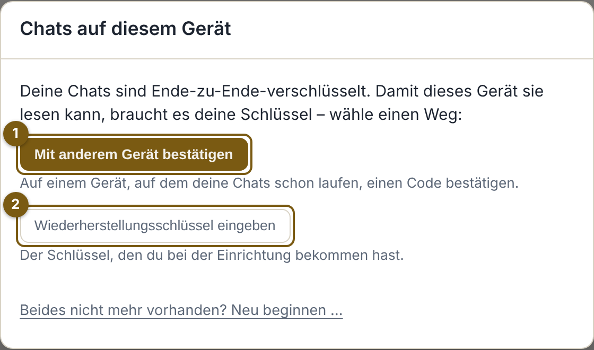

Was die Nummern bedeuten:

- ① **Mit anderem Gerät bestätigen** – der bequeme Weg, wenn du ein Gerät zur Hand hast, auf dem deine Chats schon
  laufen (zum Beispiel dein Handy).
- ② **Wiederherstellungsschlüssel eingeben** – wenn du gerade kein anderes Gerät hast.

**Weg ①: Mit anderem Gerät bestätigen**

1. Klick auf dem neuen Gerät auf ① **Mit anderem Gerät bestätigen**. Es zeigt einen Code aus vier
   Fünfergruppen (20 Zeichen).
2. Auf deinem alten Gerät erscheint eine Anfrage mit einem Code.
3. Vergleiche beide Codes Zeichen für Zeichen. Nur wenn sie **genau gleich** sind, klick auf
   **Code stimmt – bestätigen**.
4. Das neue Gerät ist verbunden und zeigt auch deine bisherigen Nachrichten.

> **Tipp:** Der Vergleich schützt dich davor, dass sich ein fremdes Gerät einschleicht. Siehst du eine Anfrage, die
> du nicht selbst ausgelöst hast, bestätige sie nicht.

**Weg ②: Wiederherstellungsschlüssel eingeben**

1. Klick auf ② **Wiederherstellungsschlüssel eingeben**.
2. Tipp den Schlüssel bei ① ein. Leerzeichen und Bindestriche sind egal.
3. Klick auf **Entsperren**.

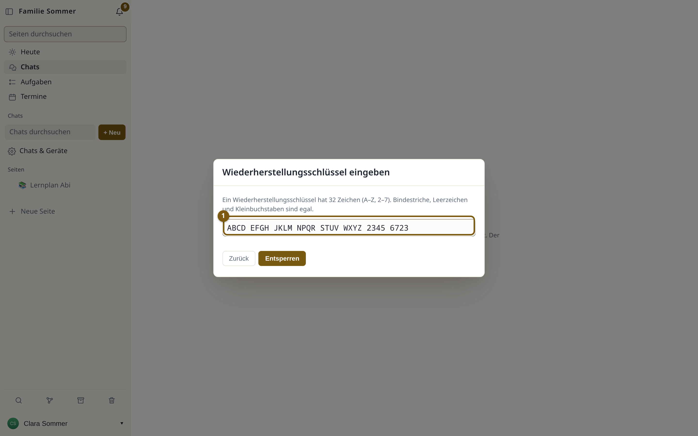

Was die Nummern bedeuten:

- ① Hier gehört dein Schlüssel hin – 32 Zeichen, nur Buchstaben A–Z und Ziffern 2–7.

**Beides verloren?** Unten steht „Beides nicht mehr vorhanden? **Neu beginnen …**“. Dann bekommst du neue
Schlüssel und kannst sofort weiterschreiben. Deine **alten** Nachrichten lassen sich danach aber nicht mehr lesen.
Zur Sicherheit fragt Saga vorher noch einmal nach deinem Passwort.

> **Hinweis:** In einem privaten Browser-Fenster gehen Chats nicht, weil der Browser dort keine Schlüssel behalten
> darf.

### 3. Eine Unterhaltung beginnen

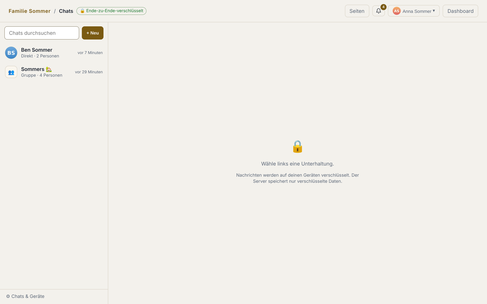

1. Klick in der Chatliste auf **+ Neu**.
2. Ohne Eingabe siehst du deine ① **Kontakte** – alle, mit denen du schon geschrieben hast, die neuesten zuerst.
3. Tipp einen Namen ein, um jemand anderen zu finden.

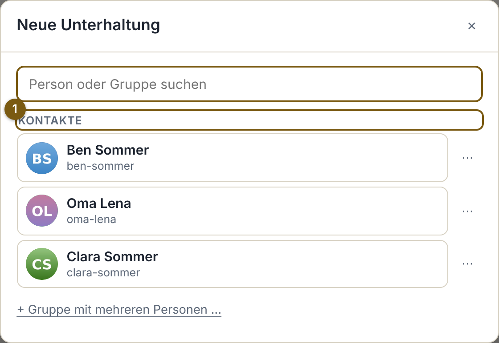

Was die Nummern bedeuten:

- ① Kontakte – Personen, mit denen du schon einmal geschrieben hast.

  Über **⋯** neben einer Person kommst du ab Saga 2.6 mit **Kontakt bearbeiten …** in dein Adressbuch – mit
  Nummern, E-Mail-Adressen und Anrede, nur für dich sichtbar ([B20 Kontakte](20-kontakte.md)).

Es gibt vier Arten von Unterhaltungen:

- **Direkt-Chat** – du und eine andere Person. Klick einfach auf den Namen.
- **Freie Gruppe** – „**+ Gruppe mit mehreren Personen …**“. Du wählst die Mitglieder selbst, gibst der Gruppe einen
  Namen und bist ihr Admin.
- **Gruppen-Chat** – für alle in einer Gruppe, die dein Admin angelegt hat (zum Beispiel „familie“). Wer in die
  Gruppe kommt, ist automatisch im Chat.
- **Seiten-Chat** – auf einer geteilten Seite über **💬 Chat** im Seitenkopf. Dabei sind alle, die die Seite
  sehen dürfen.

Wer neu in einen Chat kommt, sieht die Nachrichten ab seinem Beitritt. Wer geht, bekommt nichts Neues mehr.

**Nachrichtenanfragen:** Schreibt dich jemand zum ersten Mal an, den du noch nicht kennst (zum Beispiel von einem
anderen Server, siehe [Föderation](11-foederation.md)), landet das oben unter **Nachrichtenanfragen**. Du kannst
annehmen, ablehnen oder sperren. Bis du annimmst, klingelt und piept nichts.

### 4. Schreiben, antworten, reagieren

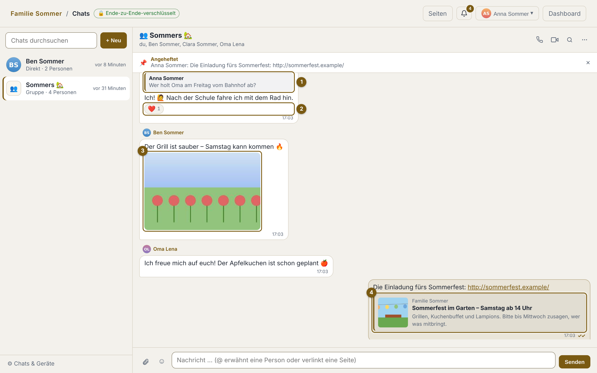

Was die Nummern bedeuten:

- ① Antwort mit Zitat – so sieht man, worauf sich die Nachricht bezieht.
- ② Reaktion mit einem Emoji.
- ③ Ein Bild im Verlauf.

So geht's:

1. Schreib unten ins Eingabefeld. **Enter** schickt die Nachricht ab, **Umschalt + Enter** macht eine neue Zeile.
2. **Antworten:** Fahr über eine Nachricht und wähl im Menü **⋯** → **Antworten**. Die Antwort zeigt das Zitat ①.
3. **Reagieren:** Wähl ein Emoji – es erscheint unter der Nachricht ②.
4. **Bilder, Videos, Dateien:** Klick auf 📎. Bilder erscheinen erst als kleines Vorschaubild ③; das Original lädt
   beim Antippen.
5. **Sprachnachricht:** Klick auf das Mikrofon 🎤 und sprich. Danach wählst du **Senden** oder **Verwerfen**. Eine
   Sprachnachricht darf bis zu 15 Minuten lang sein.
6. **Bearbeiten:** Eigene Nachrichten kannst du nachträglich ändern. Sie zeigen dann „bearbeitet“.
7. **Löschen:** **Für mich löschen** blendet die Nachricht nur bei dir aus (auf allen deinen Geräten). **Für alle
   löschen** entfernt deine eigene Nachricht bei allen.

Ein paar Extras:

- **@-Erwähnung:** Tipp `@` und wähl eine Person aus dem Chat. Sie bekommt eine eigene Mitteilung. Du kannst mit
  `@` auch auf eine Seite verweisen – andere sehen den Titel nur, wenn sie die Seite selbst sehen dürfen.
- **Formatierung:** `*fett*`, `_kursiv_`, `~durchgestrichen~` und `` `Code` ``.
- **Emoji:** über den Smiley im Eingabefeld.
- **Linkvorschau:** Schreibst du eine Webadresse, zeigt Saga vor dem Senden eine kleine Vorschau mit Titel und Bild.
  Willst du sie nicht, entferne sie vor dem Abschicken.
- **Entwürfe:** Was du angefangen, aber nicht abgeschickt hast, bleibt im Eingabefeld stehen – in diesem Browser.

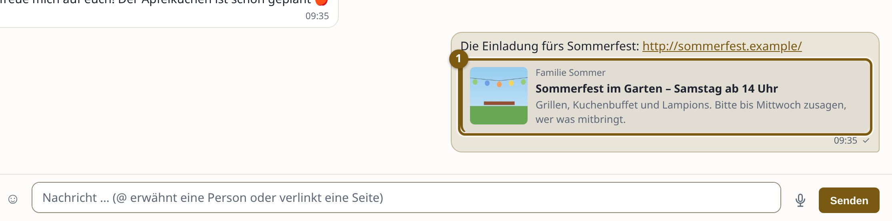

Was die Nummern bedeuten:

- ① Die Vorschau holt der Saga-Server, wenn dein Admin das erlaubt. Sie wird verschlüsselt mitgeschickt.

**Gelesen und online:** Ein Haken ✓ heißt „beim Server angekommen“, zwei Haken ✓✓ heißen „gelesen“. Im Direkt-Chat
steht oben „online“ oder „zuletzt online vor …“. Beides kannst du unter **⚙ Chats & Geräte → Datenschutz**
abschalten – dann siehst du es bei anderen aber auch nicht.

**Status der anderen: Beschäftigt, Nicht stören, Im Anruf.** Hat jemand einen eigenen Status gesetzt (siehe
[Benachrichtigungen und Mitteilungen](14-benachrichtigungen.md), Schritt 5), siehst du ihn in der Chatliste als
kleinen Punkt am Profilbild und im Direkt-Chat oben als ① Hinweis – zum Beispiel „Nicht stören bis 15:00 · Im
Kundentermin“, „Beschäftigt“ oder „Im Anruf“. Ein Klick darauf zeigt den ganzen Text.

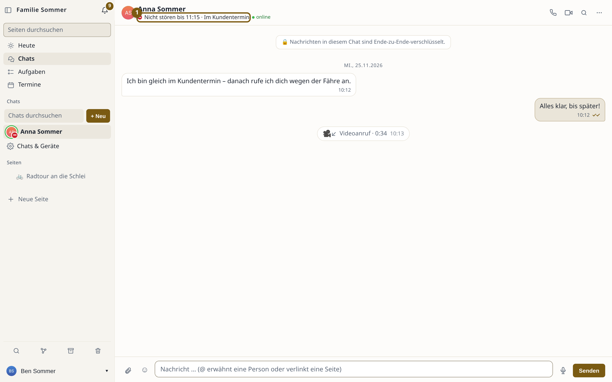

- Den Status siehst du nur bei Personen, mit denen du einen Chat hast – auch dann, wenn ihr den Online-Status
  abgeschaltet habt.
- Den eigenen Text sehen nur Personen auf demselben Saga-Server. Von Personen auf anderen Servern siehst du nur den
  Status und bis wann er gilt.
- „Im Anruf“ steht nur da, wenn die Person das erlaubt und ihr beide den Online-Status zeigt.
- Ruhezeiten anderer siehst du nie.

**Vor dem Anruf fragt Saga nach.** Steht die Person auf **Nicht stören** und du klickst auf **📞** oder **🎥**, fragt
Saga: „Anna möchte gerade nicht gestört werden. Trotzdem anrufen?“ Mit **Anrufen** geht es weiter – bei ihr klingelt
es dann aber nicht, sie sieht deinen Anruf nur still (siehe [Anrufe](13-anrufe.md), Schritt 8). Rufst du innerhalb
von 3 Minuten noch einmal an, klingelt es bei ihr (so ist es ab Werk eingestellt). Telefoniert sie gerade, sagt Saga
„Anna telefoniert gerade – dein Anruf klopft an.“

### 5. Nachrichten anheften

In jedem Chat kannst du bis zu **3 Nachrichten** oben anheften – zum Beispiel Adresse, WLAN-Passwort oder Termin.

1. Öffne an der Nachricht das Menü **⋯** und wähl **Anheften**.
2. Die Nachricht steht jetzt oben im Chat ①. Ein Klick darauf springt an die Stelle im Verlauf.

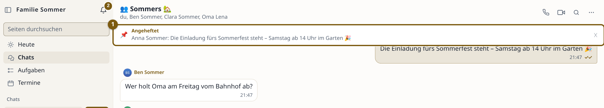

Was die Nummern bedeuten:

- ① Die angeheftete Nachricht.

In Gruppen können die Admins festlegen, dass nur sie anheften dürfen.

### 6. Gruppeninfo: Name, Bild, Mitglieder

Klick oben auf den Namen des Chats (oder **⋯** → **Gruppeninfo …**). Es öffnet sich ein Blatt mit allem, was die
Gruppe betrifft.

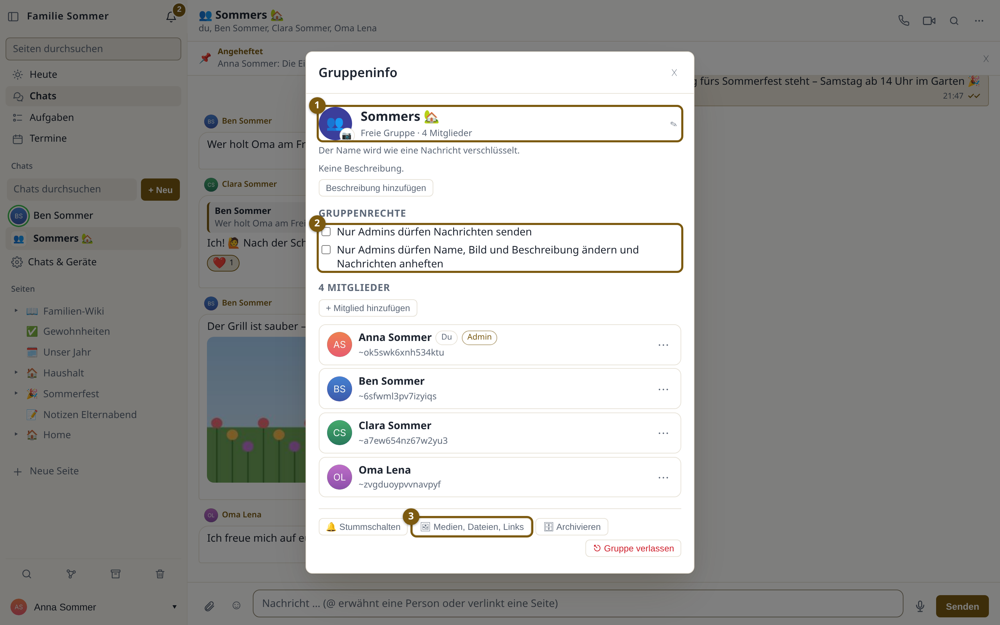

Was die Nummern bedeuten:

- ① Name und Bild – mit dem Stift ✎ änderst du sie.
- ② **Gruppenrechte** – zum Beispiel „Nur Admins dürfen schreiben“ oder „Nur Admins ändern Name, Bild und
  Beschreibung“.
- ③ **Medien, Dateien, Links** – alles, was im Chat geteilt wurde, übersichtlich an einem Ort.

Darunter steht die Mitgliederliste. Als Admin einer freien Gruppe kannst du:

- **Mitglied hinzufügen**,
- jemanden **zum Admin machen** oder den Admin wieder entziehen,
- jemanden **aus der Gruppe entfernen**,
- fremde Nachrichten löschen – im Chat steht dann „Von einem Admin gelöscht“.

Bei Gruppen-Chats (Gruppe vom Admin) und Seiten-Chats ist die Gruppeninfo nur zum Ansehen. Im Seiten-Chat kann, wem
die Seite gehört, Personen hinzufügen – das teilt die Seite gleich mit ihnen.

Ganz unten findest du **Stummschalten**, **Archivieren** und **Gruppe verlassen**.

### 7. Die Chatliste aufräumen

Klick mit der rechten Maustaste auf einen Chat in der Liste (am Handy: lange antippen).

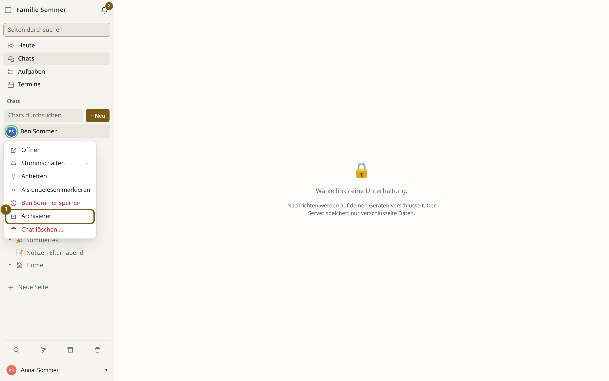

Was die Nummern bedeuten:

- ① **Archivieren** schiebt den Chat in den Bereich „Archiviert“ unten in der Liste.

Was du hier machen kannst:

- **Anheften** – bis zu 5 Chats stehen dann immer oben.
- **Als ungelesen markieren** – als Erinnerung für später.
- **Stummschalten** – für 1 Stunde, 8 Stunden, bis morgen, 1 Woche oder für immer.
- **Mitteilungen** – alle, nur Erwähnungen und Antworten, oder keine.
- **Für mich ausblenden** (bei Gruppen- und Seiten-Chats) – der Chat kommt zurück, wenn dich jemand erwähnt.
- **Archivieren** – der Chat zählt nicht mehr als ungelesen und kommt mit der nächsten Nachricht von selbst zurück.
- **Chat löschen …** – **Nur für mich** entfernt den Verlauf bei dir. **Für alle** löscht einen Direkt-Chat oder eine
  freie Gruppe (als Admin) bei allen. Das lässt sich nicht rückgängig machen.

### 8. Sicherheit: Sicherheitsnummer, sperren, melden

- **Sicherheitsnummer:** Im Chat-Menü **⋯** → **Sicherheitsnummer** siehst du 60 Ziffern. Sie sind bei dir und deinem
  Gegenüber gleich. Vergleicht sie, wenn ihr euch seht oder telefoniert, und klickt auf **Als überprüft markieren**.
  Ändert sich die Nummer später (zum Beispiel weil jemand „Neu beginnen“ gewählt hat), warnt dich der Chat.
- **Sperren …:** Gesperrte Personen können dir nicht mehr schreiben und dich nicht anrufen. In Gruppen werden ihre
  Nachrichten eingeklappt. Entsperren geht über das Chat-Menü.
- **Melden …:** Störende Nachrichten meldest du über das Menü der Nachricht an die Saga-Admins. Du kannst einen Text
  dazuschreiben. Der Admin sieht nur das, was du mitschickst – den Chat selbst kann er nicht lesen.
- **Nachrichten automatisch löschen nach …:** Im Chat-Menü stellst du ein, dass neue Nachrichten nach 1 Stunde bis
  1 Jahr verschwinden.
- **⚙ Chats & Geräte:** Hier siehst du alle Geräte, die deine Chats lesen können. Ein verlorenes Gerät entfernst du
  hier – es bekommt sofort nichts mehr. Außerdem kannst du einen **neuen Wiederherstellungsschlüssel** erzeugen; der
  alte gilt dann nicht mehr.

---

## Beispiel aus dem Alltag

**Familie Sommer richtet ihren Familienchat ein.** Anna möchte einen Chat für die ganze Familie, in dem auch Oma Lena
dabei ist.

1. Anna öffnet **Chats**, klickt auf **+ Neu** und dann auf **+ Gruppe mit mehreren Personen …**.
2. Sie wählt Ben, Clara und Lena aus und nennt die Gruppe „Sommers 🏡“.
3. In der **Gruppeninfo** lädt sie ein Familienfoto als Gruppenbild hoch und macht Ben über **Zum Admin machen**
   ebenfalls zum Admin.
4. Anna schreibt: „Wer holt Oma am Samstag vom Bahnhof ab?“
5. Clara wählt **⋯** → **Antworten** und schreibt „Ich!“ – dazu reagiert sie mit 🙋.
6. Ben heftet die Nachricht mit den WLAN-Daten des Ferienhauses an. Alle sehen sie oben im Chat.

**Clara bekommt ein neues Handy.** Ihr altes Handy liegt noch auf dem Schreibtisch.

1. Clara installiert die Saga-App auf dem neuen Handy und meldet sich an (siehe [Apps](17-apps.md)).
2. Beim Öffnen der Chats wählt sie **Mit anderem Gerät bestätigen**.
3. Am Laptop erscheint eine Anfrage mit einem Code. Clara vergleicht ihn mit dem Code auf dem neuen Handy – er
   stimmt genau.
4. Sie klickt auf **Code stimmt – bestätigen**. Das neue Handy zeigt alle Familien-Nachrichten.
5. Unter **⚙ Chats & Geräte** entfernt sie das alte Handy, bevor sie es verkauft.

---

## Tipps und Tastenkürzel

- `Enter` – Nachricht senden
- `Umschalt` + `Enter` – neue Zeile
- `@` – Person oder Seite erwähnen
- Die **Lupe** im Chat sucht in den geladenen Nachrichten – nur auf diesem Gerät, weil der Server ja nichts lesen
  kann.
- Leg deinen Wiederherstellungsschlüssel gleich beim ersten Mal in deinen Passwort-Manager. Dann ist das Thema erledigt.

---

## Häufige Fragen

**Kann mein Admin meine Nachrichten lesen?**
Nein. Der Server speichert nur verschlüsselte Daten. Der Admin sieht nur, wie viele Chats und Geräte du hast.

**Ich habe meinen Wiederherstellungsschlüssel verloren. Was nun?**
Solange noch ein Gerät deine Chats öffnen kann, ist nichts verloren: Erzeuge dort unter **⚙ Chats & Geräte** einen
neuen Schlüssel und heb ihn gut auf.

**Ich habe alle Geräte und den Schlüssel verloren.**
Dann wählst du **Neu beginnen**. Du kannst sofort wieder chatten, nur die alten Nachrichten bleiben unlesbar.

**Warum sehe ich in einer Gruppe ältere Nachrichten nicht?**
Wer neu dazukommt, sieht nur Nachrichten ab seinem Beitritt. Das ist Absicht.

**Bekommt die andere Person mit, dass ich sie gesperrt habe?**
Nein.

---

## Auf dem Handy und in den Apps

**Handy-Browser**

Die Chats passen sich dem kleinen Bildschirm an. Die Chatliste und ein offener Chat wechseln sich ab; das Menü
eines Chats öffnest du durch langes Antippen. Die Gruppeninfo erscheint als Blatt von unten.

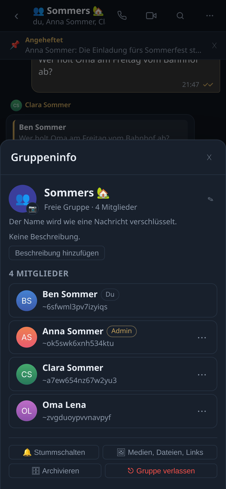

**iPhone, iPad und Mac**

<!-- App-Bild folgt: b12-11-chat-ios.png -->

- Die App bietet dieselben Chats: Antworten, Reaktionen, Bearbeiten, Sprachnachrichten, Gruppeninfo, Anheften.
- Ein neues Gerät verbindest du genauso – mit einem anderen Gerät oder dem Wiederherstellungsschlüssel.
- Entwürfe und die Übersicht „Medien, Dateien, Links“ gibt es zuerst im Web.

**Android**

<!-- App-Bild folgt: b12-12-chat-android-dunkel.png -->

- Wie auf dem iPhone. Archivieren, Stummschalten und Löschen erreichst du durch langes Drücken in der Chatliste.

**Linux**

- Auch die Linux-App zeigt deine Chats mit denselben Funktionen.

**Status der anderen in den Apps:** Alle Apps ab Saga 2.6 zeigen den Status deiner Chat-Partner wie der Browser – als
Punkt in der Chatliste und als Hinweis oben im Chat – und fragen vor einem Anruf bei „Nicht stören“ nach.

**In allen Apps** hängen manche Funktionen davon ab, was dein Saga-Server kann. Zeigt die App „Bitte die App
aktualisieren“, hilft ein Update der App.

---

[← Übersicht](../README.md) · [Weiter: B13 Anrufe →](13-anrufe.md)
