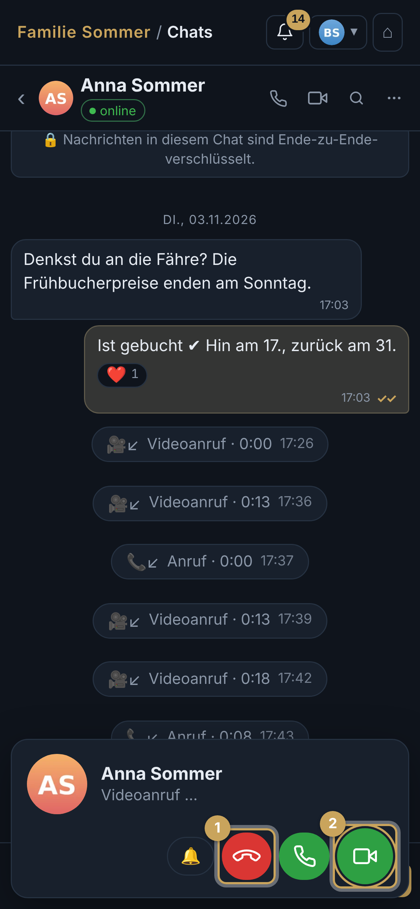
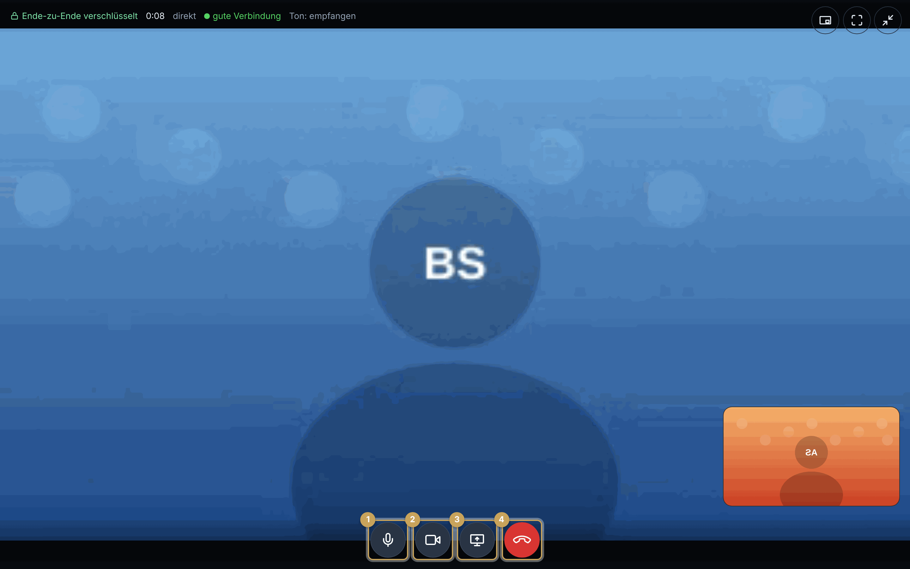
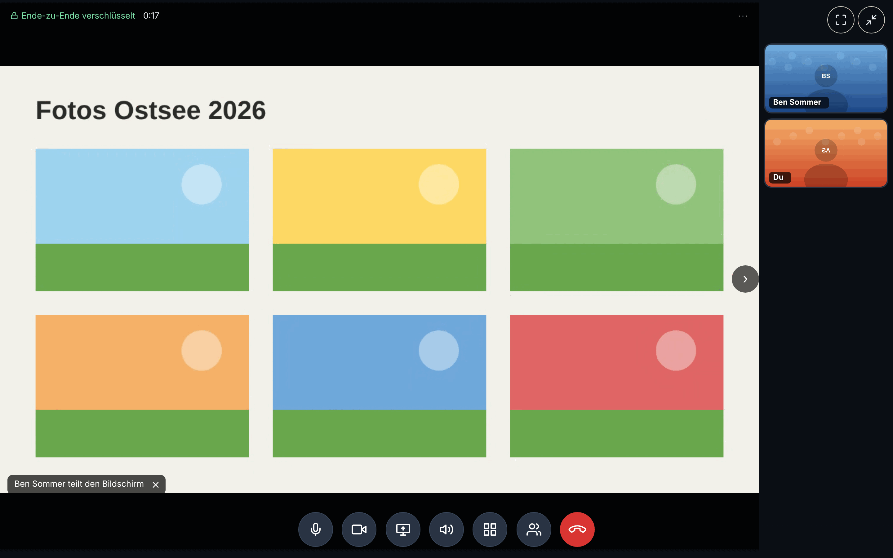

# B13 Anrufe – Audio, Video und Bildschirm teilen

**Gilt für:** Web · Handy-Browser · iOS/iPadOS/Mac · Android · Linux (klingelt in der App, Gespräch im Browser)

[← Übersicht](../README.md) · [Weiter: B14 Benachrichtigungen und Mitteilungen →](14-benachrichtigungen.md)

---

## Das kannst du damit machen

- **Sonntags mit Oma telefonieren.** Ben ruft Oma Lena per Video an – direkt aus dem Chat, ohne fremde App und
  ohne Konto bei einem großen Anbieter.
- **Fotos zeigen, statt sie zu beschreiben.** Mitten im Gespräch teilt Ben seinen Bildschirm, und Lena sieht die
  Urlaubsfotos groß.
- **Familienrunde.** Im Familienchat „Sommers 🏡“ startet Anna einen Gruppenanruf – alle klingeln, und wer Zeit
  hat, kommt dazu.
- **Vom Handy an den Laptop wechseln.** Ben hat auf dem Handy angenommen und holt das Gespräch mit einem Klick an
  den Laptop, ohne aufzulegen.

## Wofür ist das?

Mit Saga kannst du aus jedem Chat heraus anrufen: nur mit Ton, mit Video und mit geteiltem Bildschirm – auch in
Gruppen. Die Geräte verbinden sich möglichst direkt miteinander. Bild und Ton sind **Ende-zu-Ende verschlüsselt**;
der Saga-Server vermittelt nur und kann nicht mithören.

Anrufen kannst du alle, mit denen du einen Chat hast (siehe [Chats](12-chats.md)) – auch Personen auf anderen
Saga-Servern (siehe [Föderation](11-foederation.md)).

---

## Schritt für Schritt

### 1. Jemanden anrufen

1. Öffne den Chat mit der Person.
2. Klick oben auf **📞 Anrufen** (nur Ton) oder **🎥 Videoanruf**.
3. Beim ersten Anruf fragt der Browser, ob Saga Kamera und Mikrofon benutzen darf. Erlaube es.
4. Es klingelt bei der anderen Person. Sobald sie annimmt, seid ihr verbunden.

> **Hinweis:** Hast du Kamera oder Mikrofon aus Versehen verboten, erklärt Saga, wo du es wieder erlaubst: meist
> über das Schloss-Symbol neben der Adresse im Browser.

### 2. Angerufen werden

Ruft dich jemand an, erscheint auf **jeder** Saga-Seite „Name ruft an“ – egal ob du gerade im Dashboard, auf einer
Seite oder in den Chats bist. Dazu klingelt es, und auf dem Handy oder Computer kommt eine Mitteilung.

Was die Nummern bedeuten:

- ① **Ablehnen**
- ② **Mit Video annehmen** – daneben gibt es auch **Nur mit Ton annehmen**, wenn du gerade nicht gesehen werden
  möchtest.

Alle deine Geräte klingeln gleichzeitig. Nimmst du auf einem an, hören die anderen auf. Mit 🔔/🔕 schaltest du den
Klingelton in diesem Browser ab.

### 3. Im Anruf

Was die Nummern bedeuten:

- ① **Stummschalten** – dein Mikrofon ist aus.
- ② **Kamera aus** – du kannst sie jederzeit wieder einschalten, auch in einem Anruf, der nur mit Ton begann.
- ③ **Bildschirm teilen** (am Computer).
- ④ **Auflegen**.

Außerdem:

- **▭** verkleinert das Anruffenster in eine Ecke. So kannst du nebenbei im Chat schreiben.
- **Bild-im-Bild** holt das Gespräch in ein kleines Fenster, das über anderen Programmen liegt. Kann dein Browser
  das nicht, fehlt der Knopf.
- Oben siehst du die Dauer, die Verbindungsqualität und „🔒 Ende-zu-Ende verschlüsselt“.

Bricht die Verbindung kurz ab – zum Beispiel beim Wechsel vom WLAN ins Mobilfunknetz –, legt Saga nicht auf, sondern
verbindet von selbst neu.

### 4. Den Bildschirm teilen

1. Klick im Anruf auf ③ **Bildschirm teilen**.
2. Beim ersten Mal erinnert Saga dich: Alles, was du teilst, ist sichtbar – auch Mitteilungen und andere Fenster.
3. Wähl im Browser, was du teilen willst: am besten **nur ein Fenster oder einen Tab**.
4. Oben steht jetzt eine rote Leiste „Du teilst deinen Bildschirm“. Mit **Teilen beenden** hörst du auf.

Dein Gegenüber sieht den Bildschirm groß und deine Kamera klein. Antippen tauscht die beiden. Nichts davon wird
aufgezeichnet oder auf dem Server gespeichert.

### 5. Gruppenanrufe

In einem Gruppen-Chat, einer freien Gruppe oder einem Seiten-Chat starten **📞** und **🎥** einen **Gruppenanruf**.

1. Klick im Gruppenchat auf **📞** oder **🎥**.
2. Alle Mitglieder klingeln. In großen Chats (mehr als 8 Mitglieder) klingelt es nicht – dort steht nur still
   „Gruppenanruf läuft – Beitreten“.
3. Jede Person erscheint als Kachel. Wer gerade spricht, ist grün umrandet.
4. Jeder kann jederzeit dazukommen und wieder gehen. Der Anruf läuft, solange mindestens zwei dabei sind.

Ohne weitere Einrichtung passen **4 Personen mit Video** oder **6 nur mit Ton** in einen Gruppenanruf.

> **Große Gruppenanrufe:** Dein Admin kann einen Anruf-Knoten einrichten, damit große Gruppenanrufe flüssig laufen.

### 6. Den Anruf auf ein anderes Gerät holen

Läuft ein Anruf auf deinem Handy, zeigen deine anderen Geräte oben eine Leiste „Anruf läuft auf …“ mit dem Namen
des Geräts.

1. Klick am Laptop in dieser Leiste auf ① **Hierher übernehmen**.
2. Der Laptop verbindet sich und übernimmt Ton, Mikrofon und Kamera.
3. Das Handy legt sich still. Das Gespräch läuft ohne Unterbrechung weiter.

Was die Nummern bedeuten:

- ① **Hierher übernehmen** – holt das Gespräch auf dieses Gerät.

Das geht auch wieder zurück: Auf dem Handy erscheint jetzt dieselbe Leiste.

### 7. Verpasst, besetzt, abgelehnt

- **Verpasst:** Nimmt niemand ab, steht im Chat „Verpasster Anruf“ mit dem Knopf **Zurückrufen**. Dazu kommt eine
  Benachrichtigung.
- **Besetzt:** Telefoniert die Person gerade, siehst du „Besetzt“.
- Auch beendete und abgelehnte Anrufe stehen als Eintrag im Chat – mit Dauer, aber natürlich ohne Inhalt.

**Wer darf mich anrufen?** Im Direkt-Chat nur die andere Person, im Gruppenanruf die Mitglieder des Chats. Personen,
die du gesperrt hast, können dich nicht anrufen. Ist ein Chat stummgeschaltet, klingelt er nicht auf dem Handy.

---

## Beispiel aus dem Alltag

**Der Sonntagsanruf bei Oma Lena.** Jeden Sonntag ruft Ben seine Mutter an. Heute will er ihr die Urlaubsfotos zeigen.

1. Ben sitzt im Garten und öffnet auf dem Handy den Chat mit Lena.
2. Er tippt auf **🎥 Videoanruf**. Bei Lena klingelt das Handy, sie tippt auf **Mit Video annehmen**.
3. Die beiden plaudern. Dann will Ben die Fotos zeigen – die liegen auf dem Laptop.
4. Ben geht ins Haus und klappt den Laptop auf. Oben steht „Anruf läuft auf …“.
5. Er klickt auf **Hierher übernehmen**. Der Laptop übernimmt das Gespräch, das Handy wird still.
6. Ben klickt auf **Bildschirm teilen**, wählt das Fenster mit den Fotos und klickt sich durch.
7. Lena sieht die Fotos groß und Ben klein daneben. Zum Schluss klickt Ben auf **Teilen beenden** und dann auf
   **Auflegen**.

**Kurze Familienrunde am Abend.** Anna will klären, wer am Wochenende das Auto braucht.

1. Anna öffnet den Familienchat „Sommers 🏡“ und klickt auf **📞**.
2. Ben, Clara und Lena klingeln. Clara ist noch beim Training – sie kommt zehn Minuten später einfach dazu.
3. Nach der Absprache legen alle auf. Im Chat steht ein Eintrag mit der Dauer des Anrufs.

---

## Tipps und Tastenkürzel

- Teile möglichst **nur ein Fenster oder einen Tab**, nicht den ganzen Bildschirm. Dann sieht niemand versehentlich
  deine Mitteilungen.
- Mit **Kopfhörern** gibt es kein Echo, besonders in Gruppenanrufen.
- Hat dein Gegenüber ein schlechtes Netz, hilft es oft, die Kamera auszuschalten.
- In Chrome und Edge kannst du beim Teilen eines Tabs auch dessen Ton mitschicken – praktisch für ein Video.

---

## Häufige Fragen

**Es steht „Direktverbindung nicht möglich“.**
Manche Firmennetze oder Mobilfunknetze lassen direkte Verbindungen nicht zu. Dein Admin kann dafür einen
Vermittlungsserver (TURN) eintragen. Sag ihm Bescheid.

**Kann der Server mithören?**
Nein. Bild und Ton sind Ende-zu-Ende verschlüsselt. Der Server sieht nur, dass ein Anruf stattfindet, und wie lange.

**Warum klingelt es bei mir nicht?**
Prüf, ob der Chat stummgeschaltet ist und ob Mitteilungen eingeschaltet sind (siehe
[Benachrichtigungen und Mitteilungen](14-benachrichtigungen.md)). Anrufe brauchen außerdem eine sichere
Verbindung (`https`).

**Wie viele können an einem Gruppenanruf teilnehmen?**
Ohne Anruf-Knoten 4 mit Video oder 6 nur mit Ton. Mit einem Anruf-Knoten deines Admins deutlich mehr.

**Wird der Anruf aufgezeichnet?**
Nein. Saga zeichnet weder Gespräche noch geteilte Bildschirme auf.

---

## Auf dem Handy und in den Apps

**Handy-Browser**

Anrufe gehen auch im Handy-Browser. Bildschirm teilen gibt es dort nicht – das geht nur am Computer.

**iPhone, iPad und Mac**

<!-- App-Bild folgt: b13-06-anruf-ios.png -->

- Auf iPhone und iPad klingelt Saga wie ein normaler Telefonanruf – auch bei gesperrtem Bildschirm. Dafür muss dein
  Admin Mitteilungen für die Apple-Apps eingerichtet haben.
- Auf dem Mac öffnet sich ein eigenes Anruffenster.

**Android**

- Ein Anruf erscheint im Vollbild, auch wenn das Handy gesperrt ist. Damit das im Hintergrund klappt, braucht die
  App Mitteilungen (siehe [Benachrichtigungen und Mitteilungen](14-benachrichtigungen.md)).

**Linux**

- Die Linux-App klingelt. Das Gespräch selbst läuft dann in deinem Browser.

---

[← Übersicht](../README.md) · [Weiter: B14 Benachrichtigungen und Mitteilungen →](14-benachrichtigungen.md)
