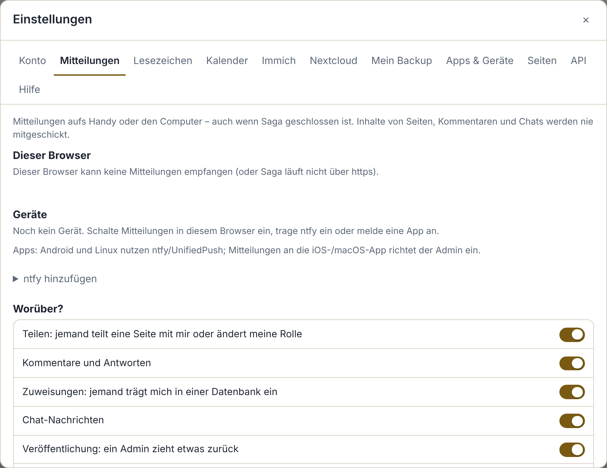
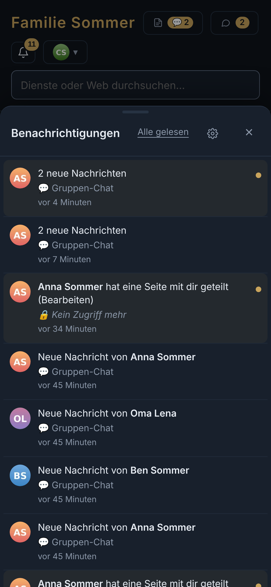

# B14 Benachrichtigungen und Mitteilungen

**Gilt für:** Web · Handy-Browser · iOS/iPadOS/Mac · Android · Linux

[← Übersicht](../README.md) · [Weiter: B15 KI-Assistent →](15-ki-assistent.md)

---

## Das kannst du damit machen

- **Nichts verpassen.** Ben erwähnt Clara auf der Seite „Urlaub Ostsee 2027“ – Claras Glocke zeigt eine 1, und ein
  Klick bringt sie genau an die Stelle.
- **Unterwegs Bescheid bekommen.** Oma Lena hat Saga nicht offen, aber ihr Handy piept, wenn Anna im Familienchat
  schreibt.
- **Nachts Ruhe haben.** Clara stellt Ruhezeiten von 22 bis 7 Uhr ein. Morgens steht alles in der Glocke.
- **Diskret bleiben.** Anna schaltet „Namen zeigen“ aus. Auf dem Sperrbildschirm steht dann nur „Neuer Kommentar“,
  nicht, wer kommentiert hat.

## Wofür ist das?

Saga sagt dir auf zwei Arten Bescheid:

- **Benachrichtigungen** siehst du in der **Glocke** oben rechts, solange Saga offen ist. Dort steht alles, was dich
  betrifft: geteilte Seiten, Kommentare, Erwähnungen, Aufgaben und mehr.
- **Mitteilungen** kommen aufs Handy oder den Computer – auch wenn Saga geschlossen ist. Das ist wie bei einer
  Nachricht im Messenger.

Du entscheidest für beides selbst, worüber du informiert werden willst. Mitteilungen enthalten nie Inhalte – nur
einen kurzen Satz wie „Neue Nachricht von Anna“ und einen Link.

---

## Schritt für Schritt

### 1. Die Glocke

Oben rechts im Dashboard und auf jeder Seite steht die Glocke ①. Die Zahl darauf nennt, wie viele Benachrichtigungen
ungelesen sind.

Was die Nummern bedeuten:

- ① Die Glocke mit der Zahl der ungelesenen Benachrichtigungen.
- ② **Alle gelesen** – markiert alles auf einmal als gelesen.

So gehst du damit um:

1. Klick auf die Glocke ①. Die Liste öffnet sich.
2. Klick auf einen Eintrag. Saga öffnet die Seite – bei Kommentaren gleich die passende Unterhaltung – und markiert
   den Eintrag als gelesen.
3. Hast du alles gesehen, klick auf ② **Alle gelesen**.

Gut zu wissen:

- Mehrere Kommentare in kurzer Zeit fasst Saga zusammen, zum Beispiel „3 neue Antworten in einer Unterhaltung“.
- Für deine eigenen Aktionen bekommst du nie eine Benachrichtigung.
- Hat dir jemand den Zugriff auf eine Seite wieder entzogen, steht beim Eintrag „Kein Zugriff mehr“.
- Benachrichtigungen bleiben 90 Tage gespeichert.

### 2. Worüber die Glocke Bescheid sagt

Unter **Einstellungen → Konto → Benachrichtigungen** schaltest du jede Art einzeln an oder ab:

- Jemand teilt eine Seite mit mir / meine Rolle ändert sich
- Neue Kommentare auf meinen Seiten und Antworten in Unterhaltungen, an denen ich beteiligt bin
- Jemand erwähnt mich in einer Seite, einem Kommentar oder einem Chat
- Neue Chat-Nachrichten (ohne Inhalt; stummgeschaltete Chats nie)
- Verpasste Anrufe
- Jemand trägt mich in einer Datenbank ein
- Ein Admin zieht eine Veröffentlichung von mir zurück

Den Weg dorthin findest du auch direkt in der Glocke: **Benachrichtigungen einstellen**.

### 3. Mitteilungen aufs Handy oder den Computer

Mitteilungen richtest du unter **Einstellungen → Mitteilungen** ein.

Es gibt drei Wege. Du kannst auch mehrere gleichzeitig nutzen.

**In diesem Browser** (am Computer oder Android-Handy)

1. Klick bei **Dieser Browser** auf **In diesem Browser einschalten**.
2. Der Browser fragt, ob Saga Mitteilungen schicken darf. Klick auf **Erlauben**.
3. Fertig: „✓ Eingeschaltet – dieser Browser bekommt Mitteilungen.“

> **Hinweis:** Auf **iPhone und iPad** geht das nur, wenn Saga als App auf dem Home-Bildschirm liegt: in Safari
> auf **Teilen → Zum Home-Bildschirm**, dann Saga von dort öffnen und hier einschalten. Noch bequemer ist die
> Saga-App (siehe [Apps](17-apps.md)).

**Mit der App ntfy** (Android, iPhone, Linux)

[ntfy](https://ntfy.sh) ist eine kleine App, die nur Mitteilungen empfängt.

1. Installiere ntfy und abonniere dort ein Topic mit einem schwer zu erratenden Namen, zum Beispiel
   `sommer-clara-x7k2q`.
2. Trag in Saga bei **ntfy hinzufügen** die Adresse des Topics ein, zum Beispiel `https://ntfy.sh/sommer-clara-x7k2q`,
   und gib dem Gerät einen Namen („Handy“).
3. Klick auf **Hinzufügen**.

Über ntfy schickt Saga nie Namen – nur „Neue Nachricht“, „Neuer Kommentar“ und so weiter.

**Mit den Saga-Apps**

Die Apps melden sich von selbst für Mitteilungen an und erscheinen dann in der Liste **Geräte**.

**Die Geräteliste**

Unter **Geräte** stehen alle Browser, ntfy-Topics und Apps, die Mitteilungen bekommen.

- **Test** schickt eine Probe-Mitteilung an dieses Gerät.
- **Entfernen** beendet die Mitteilungen dorthin.
- Kommt nichts an, steht dort „Letzter Fehler: …“ – das hilft dir oder deinem Admin bei der Suche.

### 4. Worüber? Namen? Ruhezeiten?

Weiter unten auf derselben Seite:

- **Worüber?** – Teilen, Kommentare, Chat-Nachrichten, Anrufe, Zuweisungen in Datenbanken, eine tägliche
  Aufgaben-Zusammenfassung und Veröffentlichungen einzeln an- oder abschalten.
- **Namen zeigen** – an: „Ben hat deine Seite kommentiert“. Aus: nur „Neuer Kommentar auf deiner Seite“. Praktisch,
  wenn andere auf deinen Bildschirm schauen.
- **Ruhezeiten** – in dieser Zeit kommen keine Mitteilungen. Die Glocke in Saga hat trotzdem alles.

---

## Beispiel aus dem Alltag

**Clara will nachts schlafen, aber nichts Wichtiges verpassen.** Clara bekommt viele Nachrichten aus dem Familienchat
und von ihrer Lerngruppe. Abends möchte sie Ruhe haben.

1. Clara öffnet **Einstellungen → Mitteilungen**.
2. Sie stellt bei **Ruhezeiten** „22:00“ bis „07:00“ ein und speichert.
3. Im Klassenchat wählt sie per Rechtsklick **Mitteilungen → nur Erwähnungen und Antworten** (siehe
   [Chats](12-chats.md)).
4. Den Familienchat lässt sie auf „alle“.
5. Am nächsten Morgen zeigt ihre Glocke, was nachts los war: zwei neue Kommentare und eine Erwähnung von Ben.

**Oma Lena bekommt Mitteilungen aufs Handy.** Lena hat ein Android-Handy und nutzt Saga im Browser.

1. Anna hilft ihr: In Lenas Browser öffnet sie **Einstellungen → Mitteilungen**.
2. Sie tippt auf **In diesem Browser einschalten** und dann auf **Erlauben**.
3. Mit **Test** probiert sie es aus – Lenas Handy piept.
4. Ab jetzt sieht Lena „Neue Nachricht von Anna“ auch, wenn Saga zu ist.

---

## Tipps und Tastenkürzel

- Kommt keine Mitteilung an, probier zuerst **Test** in der Geräteliste und schau, ob dort ein Fehler steht.
- Chats, die dich nerven, schaltest du lieber einzeln stumm, statt alle Chat-Mitteilungen abzuschalten.
- Mitteilungen enthalten nie Seitentitel, Kommentare oder Chat-Inhalte – du kannst sie also auch auf dem
  Sperrbildschirm ruhig sehen lassen.

---

## Häufige Fragen

**Es steht „Dieser Browser kann keine Mitteilungen empfangen (oder Saga läuft nicht über https)“.**
Browser-Mitteilungen brauchen eine sichere Verbindung (`https`). Läuft euer Saga ohne, frag deinen Admin. Bis dahin
helfen ntfy oder die Saga-Apps.

**„Mitteilungen sind für Saga im Browser blockiert“ – was nun?**
Du hast die Nachfrage des Browsers einmal abgelehnt. Erlaube Mitteilungen in den Website-Einstellungen des Browsers
(meist über das Schloss-Symbol neben der Adresse).

**Warum steht in der Mitteilung nicht, was jemand geschrieben hat?**
Absichtlich. Mitteilungen laufen über fremde Dienste (zum Beispiel von Google oder Apple). Deshalb schickt Saga nur
einen kurzen Satz und den Link.

**Ich habe mich abgemeldet – bekomme ich noch Mitteilungen?**
In diesem Browser nicht mehr. Apps und ntfy-Topics bleiben, bis du sie unter **Geräte** entfernst.

---

## Auf dem Handy und in den Apps

**Handy-Browser**

Die Glocke öffnet sich auf dem Handy als Liste von unten.

**iPhone, iPad und Mac**

- Die App bekommt Mitteilungen über Apple. Dafür muss dein Admin das einmal einrichten. Fehlt das, steht in
  Saga „Mitteilungen an die Apple-App sind auf diesem Server noch nicht eingerichtet“.
- Die Glocke gibt es auch in der App.

**Android**

- Die App braucht kein Google. Sie hält entweder eine eigene, stromsparende Verbindung, oder sie nutzt eine App wie
  ntfy als „Verteiler“.
- Kommen Mitteilungen bei dir verspätet, kannst du Saga in der App von der **Akku-Optimierung** ausnehmen. Bei den
  meisten Handys ist das nicht nötig.

**Linux**

- Solange die App läuft, kommen Mitteilungen als normale GNOME-Mitteilungen. Sonst über einen Verteiler wie ntfy.

---

[← Übersicht](../README.md) · [Weiter: B15 KI-Assistent →](15-ki-assistent.md)
