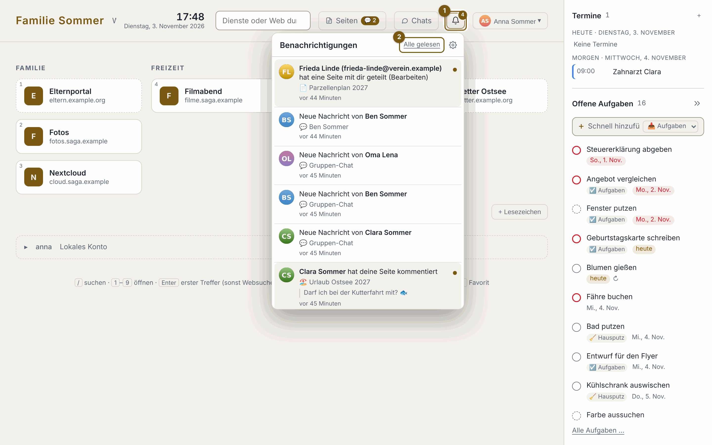
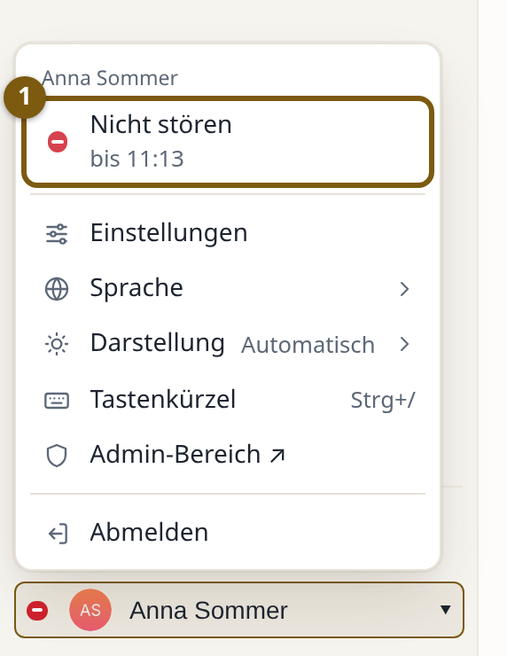
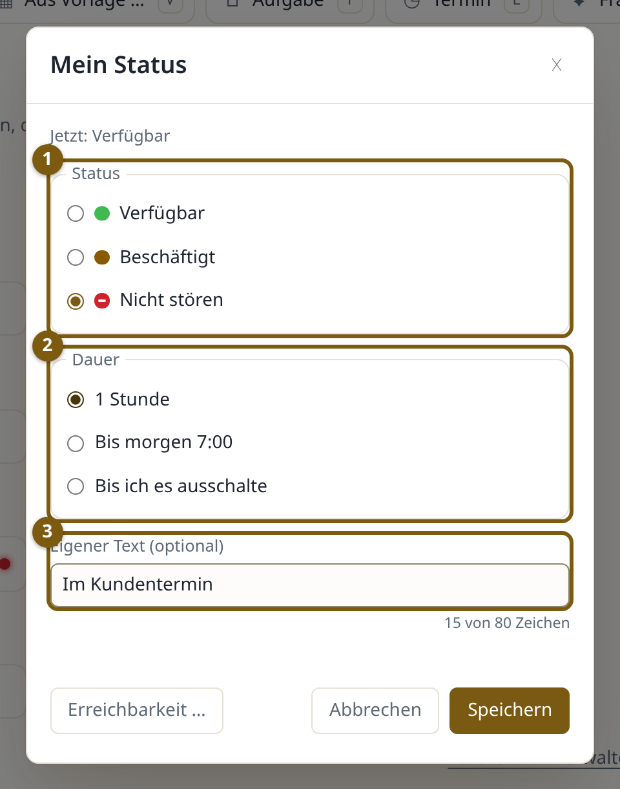
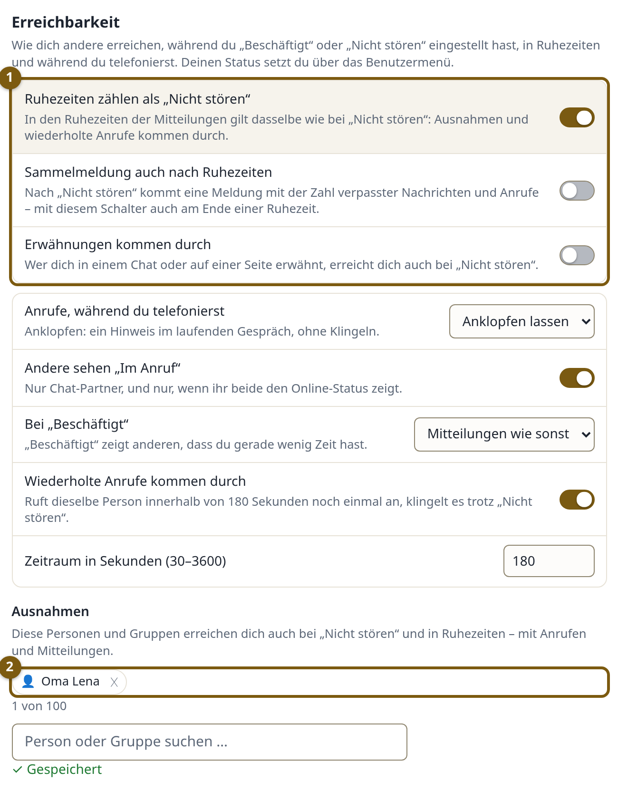
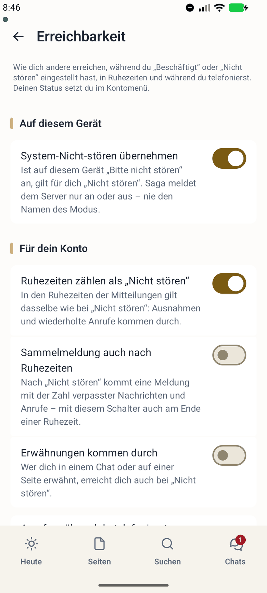
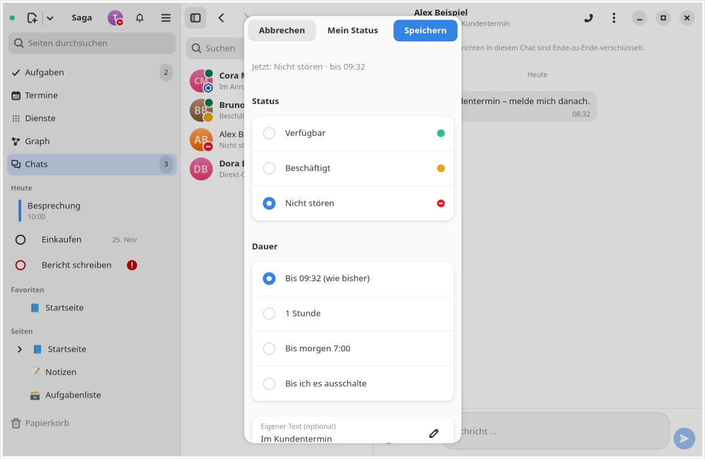

# B14 Benachrichtigungen und Mitteilungen

**Gilt für:** Web · Handy-Browser · iOS/iPadOS/Mac · Android · Linux

[← Übersicht](../README.md) · [Weiter: B15 KI-Assistent →](15-ki-assistent.md)

---

## Das kannst du damit machen

- **Nichts verpassen.** Ben erwähnt Clara auf der Seite „Urlaub Ostsee 2027“ – Claras Glocke zeigt eine 1, und ein
  Klick bringt sie genau an die Stelle.
- **Unterwegs Bescheid bekommen.** Oma Lena hat Saga nicht offen, aber ihr Handy piept, wenn Anna im Familienchat
  schreibt.
- **Nachts Ruhe haben.** Clara stellt Ruhezeiten von 22 bis 7 Uhr ein. Morgens steht alles in der Glocke.
- **Diskret bleiben.** Anna schaltet „Namen zeigen“ aus. Auf dem Sperrbildschirm steht dann nur „Neuer Kommentar“,
  nicht, wer kommentiert hat.
- **Eine Stunde konzentriert arbeiten.** Ben stellt seinen Status auf „Nicht stören – 1 Stunde · Im Kundentermin“.
  Nichts klingelt, nichts piept – nur Oma Lena kommt als Ausnahme immer durch. Danach sagt ihm eine einzige Meldung,
  was er verpasst hat.

## Wofür ist das?

Saga sagt dir auf zwei Arten Bescheid:

- **Benachrichtigungen** siehst du in der **Glocke** oben in der Seitenleiste, solange Saga offen ist. Dort steht alles, was dich
  betrifft: geteilte Seiten, Kommentare, Erwähnungen, Aufgaben und mehr.
- **Mitteilungen** kommen aufs Handy oder den Computer – auch wenn Saga geschlossen ist. Das ist wie bei einer
  Nachricht im Messenger.

Du entscheidest für beides selbst, worüber du informiert werden willst. Mitteilungen enthalten nie Inhalte – nur
einen kurzen Satz wie „Neue Nachricht von Anna“ und einen Link.

---

## Schritt für Schritt

### 1. Die Glocke

Oben in der Seitenleiste – neben dem Namen eures Saga, auf „Heute“ und auf jeder Seite – steht die Glocke ①. Die Zahl darauf nennt, wie viele Benachrichtigungen
ungelesen sind.

Was die Nummern bedeuten:

- ① Die Glocke mit der Zahl der ungelesenen Benachrichtigungen.
- ② **Alle gelesen** – markiert alles auf einmal als gelesen.

So gehst du damit um:

1. Klick auf die Glocke ①. Die Liste öffnet sich.
2. Klick auf einen Eintrag. Saga öffnet die Seite – bei Kommentaren gleich die passende Unterhaltung – und markiert
   den Eintrag als gelesen.
3. Hast du alles gesehen, klick auf ② **Alle gelesen**.

Gut zu wissen:

- Mehrere Kommentare in kurzer Zeit fasst Saga zusammen, zum Beispiel „3 neue Antworten in einer Unterhaltung“.
- Für deine eigenen Aktionen bekommst du nie eine Benachrichtigung.
- Hat dir jemand den Zugriff auf eine Seite wieder entzogen, steht beim Eintrag „Kein Zugriff mehr“.
- Benachrichtigungen bleiben 90 Tage gespeichert.

### 2. Worüber die Glocke Bescheid sagt

Unter **Einstellungen → Mitteilungen → Worüber?** schaltest du jede Art einzeln an oder ab:

- Jemand teilt eine Seite mit mir / meine Rolle ändert sich
- Neue Kommentare auf meinen Seiten und Antworten in Unterhaltungen, an denen ich beteiligt bin
- Jemand erwähnt mich in einer Seite, einem Kommentar oder einem Chat
- Neue Chat-Nachrichten (ohne Inhalt; stummgeschaltete Chats nie)
- Verpasste Anrufe
- Jemand trägt mich in einer Datenbank ein
- Ein Admin zieht eine Veröffentlichung von mir zurück

Den Weg dorthin findest du auch direkt in der Glocke: **Benachrichtigungen einstellen**.

### 3. Mitteilungen aufs Handy oder den Computer

Mitteilungen richtest du unter **Einstellungen → Mitteilungen** ein.

Es gibt drei Wege. Du kannst auch mehrere gleichzeitig nutzen.

**In diesem Browser** (am Computer oder Android-Handy)

1. Klick bei **Dieser Browser** auf **In diesem Browser einschalten**.
2. Der Browser fragt, ob Saga Mitteilungen schicken darf. Klick auf **Erlauben**.
3. Fertig: „✓ Eingeschaltet – dieser Browser bekommt Mitteilungen.“

> **Hinweis:** Auf **iPhone und iPad** geht das nur, wenn Saga als App auf dem Home-Bildschirm liegt: in Safari
> auf **Teilen → Zum Home-Bildschirm**, dann Saga von dort öffnen und hier einschalten. Noch bequemer ist die
> Saga-App (siehe [Apps](17-apps.md)).

**Mit der App ntfy** (Android, iPhone, Linux)

[ntfy](https://ntfy.sh) ist eine kleine App, die nur Mitteilungen empfängt.

1. Installiere ntfy und abonniere dort ein Topic mit einem schwer zu erratenden Namen, zum Beispiel
   `sommer-clara-x7k2q`.
2. Trag in Saga bei **ntfy hinzufügen** die Adresse des Topics ein, zum Beispiel `https://ntfy.sh/sommer-clara-x7k2q`,
   und gib dem Gerät einen Namen („Handy“).
3. Klick auf **Hinzufügen**.

Über ntfy schickt Saga nie Namen – nur „Neue Nachricht“, „Neuer Kommentar“ und so weiter.

**Mit den Saga-Apps**

Die Apps melden sich von selbst für Mitteilungen an und erscheinen dann in der Liste **Geräte**.

**Die Geräteliste**

Unter **Geräte** stehen alle Browser, ntfy-Topics und Apps, die Mitteilungen bekommen.

- **Test** schickt eine Probe-Mitteilung an dieses Gerät.
- **Entfernen** beendet die Mitteilungen dorthin.
- Kommt nichts an, steht dort „Letzter Fehler: …“ – das hilft dir oder deinem Admin bei der Suche.

### 4. Worüber? Namen? Ruhezeiten?

Weiter unten auf derselben Seite:

- **Worüber?** – Teilen, Kommentare, Chat-Nachrichten, Anrufe, Zuweisungen in Datenbanken, eine tägliche
  Aufgaben-Zusammenfassung und Veröffentlichungen einzeln an- oder abschalten.
- **Namen zeigen** – an: „Ben hat deine Seite kommentiert“. Aus: nur „Neuer Kommentar auf deiner Seite“. Praktisch,
  wenn andere auf deinen Bildschirm schauen.
- **Ruhezeiten** – in dieser Zeit kommen keine Mitteilungen. Die Glocke in Saga hat trotzdem alles. Ab Saga 2.6
  zählen Ruhezeiten von selbst als **geplantes „Nicht stören“**: Auch Anrufe klingeln dann nicht, deine Ausnahmen
  und wiederholte Anrufe kommen aber durch (siehe Schritt 5).

### 5. Eigener Status: Verfügbar, Beschäftigt, Nicht stören

Mit deinem Status sagst du anderen, ob du gerade Zeit hast – und Saga richtet sich danach.

| Status | Was andere sehen | Was bei dir passiert |
|---|---|---|
| **Verfügbar** | nichts Besonderes | alles wie gewohnt |
| **Beschäftigt** | „Beschäftigt“ | Anrufe und Mitteilungen kommen wie sonst – auf Wunsch ohne Ton |
| **Nicht stören** | „Nicht stören“, auf Wunsch bis wann und dein Text | keine Mitteilungen, Anrufe klingeln nicht; die Glocke sammelt alles |

**Status setzen**

1. Klick unten links auf deinen Namen (das Benutzermenü). Ganz oben steht dein Status ① mit einem farbigen Punkt.

   

2. Klick darauf. Das Fenster **Mein Status** öffnet sich.

   

   Was die Nummern bedeuten:

   - ① **Status** – Verfügbar, Beschäftigt oder Nicht stören.
   - ② **Dauer** – **1 Stunde**, **Bis morgen 7:00** (vor 7 Uhr morgens: **Bis 7:00**) oder **Bis ich es ausschalte**. Läuft
     schon ein Status mit Ende, steht oben zusätzlich „Bis … (wie bisher)“.
   - ③ **Eigener Text (optional)** – zum Beispiel „Im Kundentermin“, höchstens 80 Zeichen.

3. Klick auf **Speichern**. Solange du nicht verfügbar bist, zeigt dein Profilbild unten links einen kleinen Punkt.

Ist die Zeit um, steht dein Status von selbst wieder auf **Verfügbar**. Deine anderen Geräte und Browser-Tabs
übernehmen jede Änderung sofort.

Im Benutzermenü steht immer, was **gerade wirkt** – auch wenn du nichts eingestellt hast. Zum Beispiel:

- „Ruhezeit bis 7:00 – zählt als Nicht stören“ während deiner Ruhezeit,
- **Im Anruf**, solange du telefonierst,
- „vom Gerät (Fokus)“, wenn dein Handy den Status gesetzt hat (siehe „Auf dem Handy und in den Apps“).

**Was „Nicht stören“ bewirkt**

- **Mitteilungen** aufs Handy oder den Computer kommen nicht. In der Glocke steht trotzdem alles.
- **Anrufe** klingeln nicht. Du siehst nur eine stille Leiste „Anruf von Ben – stumm (Nicht stören)“ und kannst
  trotzdem **Annehmen**. Im Chat steht danach „Verpasster Anruf (Nicht stören)“ – das siehst nur du (siehe
  [Anrufe](13-anrufe.md)).
- **Ruft dieselbe Person innerhalb von 3 Minuten noch einmal an**, klingelt es – vielleicht ist es dringend.
- **Ausnahmen** kommen immer durch (siehe unten).
- Im Browser erscheinen keine Chat-Einblendungen.

**Die Sammelmeldung danach.** Endet „Nicht stören“ – weil du es ausschaltest oder weil die Zeit um ist –, bekommst
du **eine einzige** Meldung, zum Beispiel „Während „Nicht stören“: 4 Nachrichten, 1 verpasster Anruf“. Sie nennt nur
Zahlen, nie Namen. Nach einer Ruhezeit kommt sie nur, wenn du das einschaltest (siehe Erreichbarkeit).

**Wer deinen Status sieht.** Nur Personen, mit denen du einen Chat hast (siehe [Chats](12-chats.md)). Sie sehen
den Status und, wenn du eine Dauer gewählt hast, ungefähr bis wann (auf 5 Minuten gerundet). Deinen eigenen Text
sehen nur Personen auf eurem Saga-Server, nicht Personen auf anderen Servern. Deine Ruhezeiten und deine Ausnahmen
sieht **niemand** sonst.

### 6. Erreichbarkeit: Ausnahmen, Ruhezeiten, Anrufe

Unter **Einstellungen → Mitteilungen → Erreichbarkeit** (oder im Fenster **Mein Status** über **Erreichbarkeit …**)
legst du fest, wie dich andere erreichen.

Was die Nummern bedeuten:

- ① die Einstellungen (unten erklärt)
- ② **Ausnahmen** – Personen und Gruppen, die immer durchkommen

| Einstellung | ab Werk | was sie bewirkt |
|---|---|---|
| **Ruhezeiten zählen als „Nicht stören“** | an | In den Ruhezeiten gilt dasselbe wie bei „Nicht stören“: keine Mitteilungen, kein Klingeln, aber Ausnahmen und wiederholte Anrufe kommen durch. Aus: wie vor Saga 2.6 – nur keine Mitteilungen, Anrufe klingeln. |
| **Sammelmeldung auch nach Ruhezeiten** | aus | Auch am Ende einer Ruhezeit kommt die Meldung mit den Zahlen. |
| **Erwähnungen kommen durch** | aus | Wer dich in einem Chat oder auf einer Seite erwähnt, erreicht dich auch bei „Nicht stören“. |
| **Anrufe, während du telefonierst** | Anklopfen lassen | **Anklopfen lassen**: ein Hinweis im laufenden Gespräch, ohne Klingeln. **Besetzt melden**: wie früher besetzt. |
| **Andere sehen „Im Anruf“** | an | Nur Chat-Partner, und nur, wenn ihr beide den Online-Status zeigt. |
| **Bei „Beschäftigt“** | Mitteilungen wie sonst | Oder **Mitteilungen ohne Ton**. |
| **Wiederholte Anrufe kommen durch** | an, 180 Sekunden | Ruft dieselbe Person in dieser Zeit noch einmal an, klingelt es trotz „Nicht stören“. Den Zeitraum stellst du zwischen 30 und 3600 Sekunden ein. |

**Ausnahmen hinzufügen**

1. Tipp im Feld **Person oder Gruppe suchen …** einen Namen ein, zum Beispiel „Lena“.
2. Klick auf den Treffer. Die Person steht jetzt in der Liste und ist sofort gespeichert.
3. Mit **✕** neben dem Namen nimmst du sie wieder heraus.

Ausnahmen können Personen sein – auch auf anderen Saga-Servern – und Gruppen, in denen du selbst bist. Insgesamt
gehen bis zu 100. Wer Ausnahme ist, erreicht dich bei „Nicht stören“ und in Ruhezeiten mit Anrufen und Mitteilungen.
Die Person erfährt davon nichts.

---

## Beispiel aus dem Alltag

**Clara will nachts schlafen, aber nichts Wichtiges verpassen.** Clara bekommt viele Nachrichten aus dem Familienchat
und von ihrer Lerngruppe. Abends möchte sie Ruhe haben.

1. Clara öffnet **Einstellungen → Mitteilungen**.
2. Sie stellt bei **Ruhezeiten** „22:00“ bis „07:00“ ein und speichert.
3. Im Klassenchat wählt sie per Rechtsklick **Mitteilungen → nur Erwähnungen und Antworten** (siehe
   [Chats](12-chats.md)).
4. Den Familienchat lässt sie auf „alle“.
5. Am nächsten Morgen zeigt ihre Glocke, was nachts los war: zwei neue Kommentare und eine Erwähnung von Ben.

**Oma Lena bekommt Mitteilungen aufs Handy.** Lena hat ein Android-Handy und nutzt Saga im Browser.

1. Anna hilft ihr: In Lenas Browser öffnet sie **Einstellungen → Mitteilungen**.
2. Sie tippt auf **In diesem Browser einschalten** und dann auf **Erlauben**.
3. Mit **Test** probiert sie es aus – Lenas Handy piept.
4. Ab jetzt sieht Lena „Neue Nachricht von Anna“ auch, wenn Saga zu ist.

---

## Tipps und Tastenkürzel

- Kommt keine Mitteilung an, probier zuerst **Test** in der Geräteliste und schau, ob dort ein Fehler steht.
- Chats, die dich nerven, schaltest du lieber einzeln stumm, statt alle Chat-Mitteilungen abzuschalten.
- Mitteilungen enthalten nie Seitentitel, Kommentare oder Chat-Inhalte – du kannst sie also auch auf dem
  Sperrbildschirm ruhig sehen lassen.

---

## Häufige Fragen

**Es steht „Dieser Browser kann keine Mitteilungen empfangen (oder Saga läuft nicht über https)“.**
Browser-Mitteilungen brauchen eine sichere Verbindung (`https`). Läuft euer Saga ohne, frag deinen Admin. Bis dahin
helfen ntfy oder die Saga-Apps.

**„Mitteilungen sind für Saga im Browser blockiert“ – was nun?**
Du hast die Nachfrage des Browsers einmal abgelehnt. Erlaube Mitteilungen in den Website-Einstellungen des Browsers
(meist über das Schloss-Symbol neben der Adresse).

**Warum steht in der Mitteilung nicht, was jemand geschrieben hat?**
Absichtlich. Mitteilungen laufen über fremde Dienste (zum Beispiel von Google oder Apple). Deshalb schickt Saga nur
einen kurzen Satz und den Link.

**Ich habe mich abgemeldet – bekomme ich noch Mitteilungen?**
In diesem Browser nicht mehr. Apps und ntfy-Topics bleiben, bis du sie unter **Geräte** entfernst.

**Sieht jemand meine Ruhezeiten?**
Nein. Andere sehen nur einen Status, den du selbst setzt (oder dein Gerät per Fokus). Dass gerade deine Ruhezeit
läuft, sieht niemand – auch nicht im Chat-Eintrag eines verpassten Anrufs. Deine Ausnahmen sieht ebenfalls niemand.

**Was sieht jemand, der mich bei „Nicht stören“ anruft?**
Bei ihm klingelt es ganz normal, bis die Klingelzeit um ist. Dann steht dort „nicht angenommen“ – wie bei jedem
Anruf, den du nicht annimmst. Vorher sieht er deinen Status im Chat-Kopf, und Saga fragt ihn „Trotzdem anrufen?“
(mit einer älteren App oder von einem älteren Saga-Server aus fehlt beides).

**Ich hatte „Nicht stören“ an – wo sehe ich, was ich verpasst habe?**
In der Glocke. Dazu kommt beim Ausschalten eine Sammelmeldung mit den Zahlen.

**Mein Status ist plötzlich wieder „Verfügbar“.**
Die gewählte Dauer ist abgelaufen – oder der Status kam von deinem Handy (Fokus), und dort ist der Fokus zu Ende.
Einen Status, den du selbst gesetzt hast, lässt das Ende eines Fokus stehen.

---

## Auf dem Handy und in den Apps

**Handy-Browser**

Die Glocke öffnet sich auf dem Handy als Liste von unten.

**iPhone, iPad und Mac**

- Die App bekommt Mitteilungen über Apple. Dafür muss dein Admin das einmal einrichten. Fehlt das, steht in
  Saga „Mitteilungen an die Apple-App sind auf diesem Server noch nicht eingerichtet“.
- Die Glocke gibt es auch in der App.
- **Eigener Status:** in der App unter **Einstellungen → Mein Status**, mit denselben Möglichkeiten wie im Browser;
  am Kontoknopf zeigt ein Punkt, wenn du nicht verfügbar bist. Darunter liegt **Erreichbarkeit**.
- **Fokus koppeln:** Saga bringt einen Fokusfilter **„Saga-Status“** mit. Richte ihn in den iPhone-Einstellungen
  unter **Fokus** → dein Fokus (zum Beispiel „Arbeit“) → **Fokusfilter hinzufügen** → **Saga** ein und wähl
  **Beschäftigt** oder **Nicht stören**. Solange der Fokus an ist, gilt dieser Status in Saga. Saga meldet dem Server
  nur den Zustand – **nie den Namen des Fokus**. Im Benutzermenü steht dann „vom Gerät (Fokus)“.

<!-- App-Bild folgt: b14-07-status-ios.png -->

**Android**

- Die App braucht kein Google. Sie hält entweder eine eigene, stromsparende Verbindung, oder sie nutzt eine App wie
  ntfy als „Verteiler“.
- Kommen Mitteilungen bei dir verspätet, kannst du Saga in der App von der **Akku-Optimierung** ausnehmen. Bei den
  meisten Handys ist das nicht nötig.
- **Eigener Status:** im Kontomenü (dein Profilbild) – dort steht dein Status mit Punkt, ein Tippen öffnet
  **Mein Status**. Die Einstellungen findest du unter **Einstellungen → Benachrichtigungen → Erreichbarkeit**.
- **System-„Bitte nicht stören“ übernehmen:** Unter **Erreichbarkeit → Auf diesem Gerät** gibt es den Schalter
  **System-Nicht-stören übernehmen** (ab Werk aus). Ist er an und du schaltest am Handy „Bitte nicht stören“ ein, gilt
  in Saga „Nicht stören“. Saga meldet nur „an“ oder „aus“, nie den Namen des Modus. Das wirkt sofort, wenn die App
  läuft; sonst gleicht sie es beim nächsten Öffnen ab.

**Linux**

- Solange die App läuft, kommen Mitteilungen als normale GNOME-Mitteilungen. Sonst über einen Verteiler wie ntfy.
- **Eigener Status:** Klick auf dein Profilbild – dort steht dein Status, **Mein Status** setzt ihn wie im Browser.
  **Erreichbarkeit** findest du in den Einstellungen der App.
- Eine Kopplung an „Nicht stören“ des GNOME-Desktops gibt es noch nicht; sie folgt später.

**Ältere Apps und Server:** Den eigenen Status gibt es ab Saga 2.6 – auf dem Server und in den Apps. Mit einer
älteren App siehst du ihn nicht; dein Status wirkt trotzdem, weil der Server entscheidet.

---

[← Übersicht](../README.md) · [Weiter: B15 KI-Assistent →](15-ki-assistent.md)
