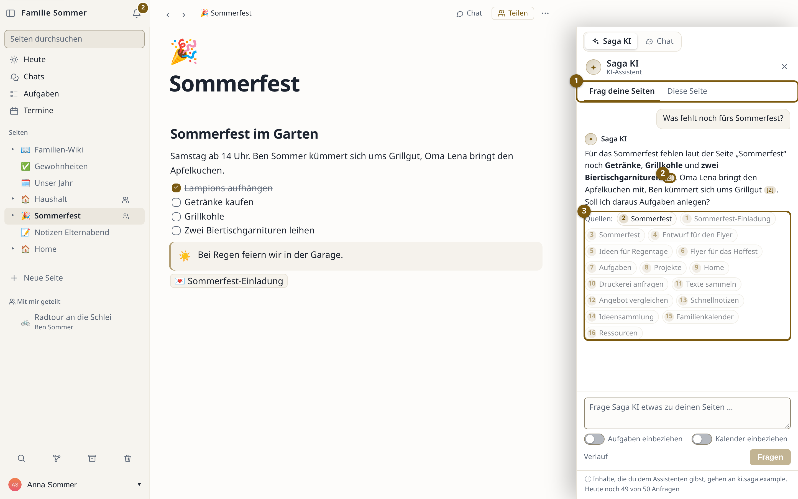
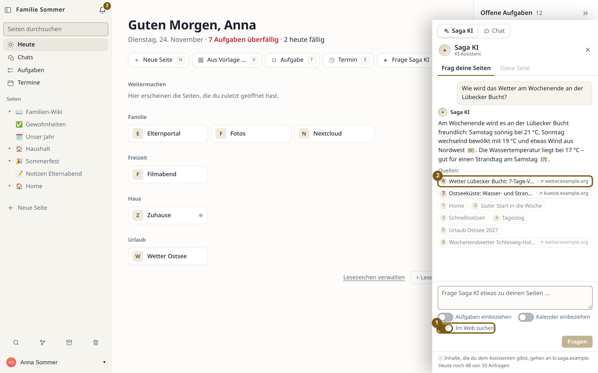
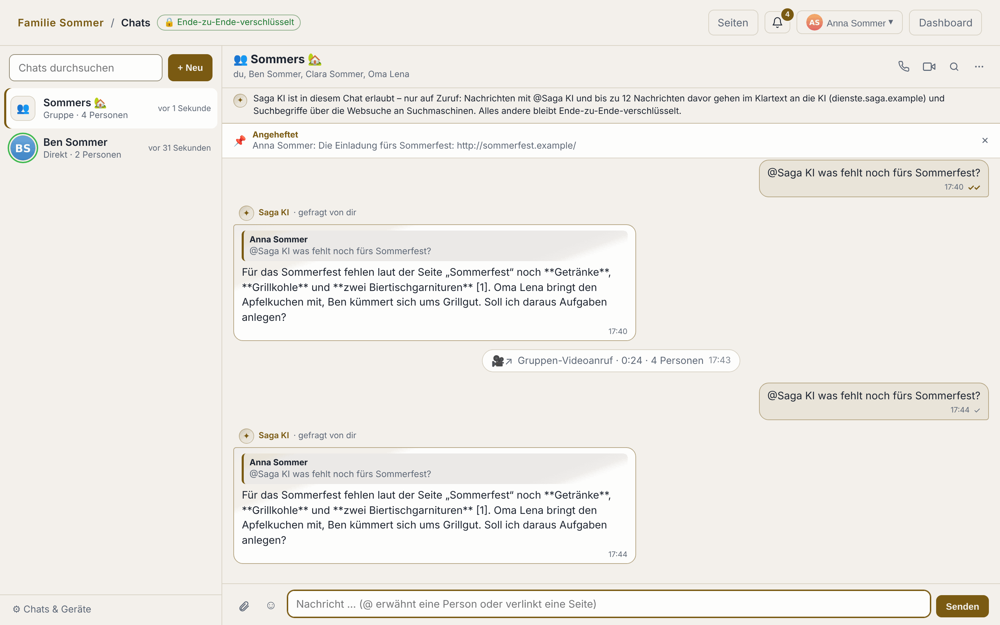

# B15 KI-Assistent

**Gilt für:** Web · Handy-Browser · iOS/iPadOS/Mac · Android · Linux

[← Übersicht](../README.md) · [Weiter: B16 Verbindungen: Kalender, Immich, Nextcloud →](16-verbindungen.md)

---

## Das kannst du damit machen

- **Deine Seiten befragen.** Anna fragt „Was brauchen wir noch für das Sommerfest?“ – die KI sucht in ihren Seiten
  und antwortet mit einer Liste, samt Verweis auf die Seite „Sommerfest“.
- **Lange Seiten zusammenfassen.** Ben lässt sich das Protokoll der Elternversammlung in fünf Sätzen zusammenfassen.
- **Aufgaben finden lassen.** Aus der Seite „Umzug“ schlägt die KI Aufgaben vor; Anna übernimmt drei davon mit
  einem Klick in ihre Aufgabenliste.
- **Texte verbessern und übersetzen.** Clara markiert ihren Englisch-Aufsatz und lässt ihn verbessern; Oma Lena
  lässt sich einen Abschnitt auf Deutsch übersetzen.
- **Im Chat fragen.** Im Familienchat schreibt Ben „`@Saga KI` – wie wird das Wetter am Wochenende?“ – die Antwort
  sehen alle.

## Wofür ist das?

Der **KI-Assistent** ist ein Sprachmodell, das dein Admin anbieten kann. Er beantwortet Fragen zu deinen Seiten,
fasst zusammen, schlägt Aufgaben vor, verbessert und übersetzt Texte.

Der Assistent sieht nur, was **du** sehen darfst: deine eigenen Seiten und die, die mit dir geteilt sind. Er kann
selbst nichts ändern – alles, was er vorschlägt, übernimmst du nur, wenn du willst.

> **Hinweis:** Den Assistenten gibt es nur, wenn dein Admin ihn eingeschaltet hat. Vielleicht hat er auch einen
> eigenen Namen, zum Beispiel „Frage Marin“ statt „Frage Saga KI“. In diesem Kapitel heißt er einfach „Saga KI“.

> **Wichtig:** Was du dem Assistenten gibst – deine Frage und die passenden Ausschnitte aus deinen Seiten –, geht an
> das Sprachmodell, das dein Admin eingetragen hat. Die Adresse steht unten in der Seitenleiste des Assistenten.

---

## Schritt für Schritt

### 1. Den Assistenten öffnen

1. Öffne eine Seite.
2. Klick unten rechts auf den runden Knopf mit dem Bild des Assistenten (**Frage Saga KI**). Auf „Heute“ gibt es
   dafür auch die Schnellaktion **Frage Saga KI** (`m`), in einer Seite das Seitenmenü **⋯ → Frage Saga KI**.
3. Rechts öffnet sich die Seitenleiste des Assistenten. Oben wählst du den Bereich ①: **Frag deine Seiten** oder
   **Diese Seite**.

### 2. Frag deine Seiten

1. Wähl ① **Frag deine Seiten**.
2. Tipp deine Frage ins Feld, zum Beispiel „Was brauchen wir noch für das Sommerfest?“, und klick auf **Fragen**.
3. Die Antwort erscheint Wort für Wort.
4. Zahlen wie ② **[2]** im Text führen zur Seite, aus der die Information stammt. Unten stehen bei ③ die Quellen:
   zuerst die, auf die sich die Antwort beruft, darunter blasser die übrigen Seiten, die die KI durchsucht hat.

Was die Nummern bedeuten:

- ① Bereiche: **Frag deine Seiten** oder **Diese Seite**.
- ② Verweis auf die Quelle – ein Klick öffnet sie.
- ③ Die Quellen: zitierte zuerst, darunter blasser die übrigen durchsuchten Seiten.

Unter dem Eingabefeld gibt es zwei Schalter:

- **Aufgaben einbeziehen** – die KI schaut auch in deine Aufgaben.
- **Kalender einbeziehen** – die KI schaut auch in deine Termine.

Beide sind aus, bis du sie einschaltest. Chats liest der Assistent nie mit (außer du fragst ihn dort direkt, siehe
Abschnitt 5). Seiten von anderen Saga-Servern liest er auch nicht.

Mit **Stopp** brichst du eine lange Antwort ab.

### 3. Im Web suchen lassen

Hat dein Admin das eingerichtet, kann die KI bei Fragen nach Aktuellem selbst im Web nachsehen – zum Beispiel nach
dem Wetter, Nachrichten oder Öffnungszeiten.

Was die Nummern bedeuten:

- ① **Im Web suchen** – damit erlaubst oder verbietest du die Websuche für diese Frage.
- ② Eine Quelle aus dem Web, mit Link.

Während die KI sucht, steht dort „Saga KI sucht im Web …“. Dabei gehen nur kurze Suchbegriffe an Suchmaschinen,
nicht deine Seiten. Jede Websuche zählt als weitere Anfrage.

### 4. Diese Seite: zusammenfassen, Aufgaben, verbessern, übersetzen

Wähl oben den Bereich **Diese Seite**. Du findest ihn auch im Seitenmenü **⋯ → Frage Saga KI**.

- **Zusammenfassen** – eine kurze Fassung der ganzen Seite.
- **Aufgaben vorschlagen** – die KI sucht mögliche Aufgaben heraus. Kreuz an, was du willst, und wähl
  **In Aufgaben übernehmen** oder **Als Checkliste einfügen**.
- **Markierten Text verbessern** – markiere zuerst einen oder mehrere Blöcke auf der Seite.
- **Übersetzen nach …** – markiere den Text und wähl die **Zielsprache**.

Das Ergebnis ist immer ein **Vorschlag**. Du entscheidest:

- **Ersetzen** – der markierte Text wird durch den Vorschlag ersetzt (Saga fragt vorher nach).
- **Darunter einfügen** – der Vorschlag kommt unter den markierten Text.
- **Kopieren** – du nimmst den Text mit, wohin du willst.

Ersetzen und Einfügen gibt es nur, wenn du die Seite bearbeiten darfst. Hast du etwas ersetzt und willst es zurück,
findest du die alte Fassung im Versionsverlauf der Seite.

### 5. Die KI im Chat fragen

Hat dein Admin das erlaubt, kann die KI auch in einzelnen Chats mitmachen – aber nur, wenn ihr sie dort ausdrücklich
zulasst und anschreibt.

1. Öffne im Chat das Menü **⋯** und wähl **Saga KI in diesem Chat erlauben**. Das dürfen in freien Gruppen die
   Admins, im Direkt-Chat beide Personen.
2. Alle im Chat sehen oben einen Hinweis, dass die KI erlaubt ist.
3. Schreib `@` – die KI wird dir vorgeschlagen. Schreib deine Frage, zum Beispiel „`@Saga KI` – was ist ein gutes
   Rezept für 8 Personen ohne Fleisch?“
4. Die Antwort erscheint im Chat mit Name und Bild der KI, darunter „gefragt von …“.

> **Wichtig:** Wenn du die KI im Chat fragst, gehen **diese Nachricht und bis zu 12 Nachrichten davor** lesbar an das
> Sprachmodell. Alles andere im Chat bleibt Ende-zu-Ende verschlüsselt. Frag die KI also nicht direkt nach einem
> privaten Gespräch.

Im Chat sieht die KI keine Seiten, Aufgaben oder Kalender. Über **⋯ → Saga KI hier nicht mehr erlauben** schaltet ihr
sie wieder ab.

### 6. Verlauf

Ob deine Fragen gespeichert werden, entscheidest du selbst. Klick in der Seitenleiste auf **Verlauf**:

- **Verlauf speichern** an – du findest frühere Fragen und Antworten wieder.
- Einzelne Einträge oder alles löschen.
- Ausschalten löscht den gespeicherten Verlauf.

Am Anfang ist der Verlauf **aus**.

---

## Beispiel aus dem Alltag

**Anna plant das Sommerfest.** Anna hat in den letzten Wochen mehrere Seiten zum Sommerfest geschrieben und will
wissen, was noch fehlt.

1. Anna öffnet die Seite „Sommerfest“ und klickt auf **Frage Saga KI**.
2. Sie bleibt bei **Frag deine Seiten** und schaltet **Aufgaben einbeziehen** ein.
3. Sie fragt: „Was brauchen wir noch für das Sommerfest?“
4. Die KI antwortet: Getränke, Pavillon und Grillkohle fehlen noch [1]. Die Zahl führt zur Seite „Sommerfest“.
5. Anna wechselt zu **Diese Seite** und klickt auf **Aufgaben vorschlagen**.
6. Sie kreuzt „Pavillon bei Nachbarn ausleihen“ und „Grillkohle kaufen“ an und wählt **In Aufgaben übernehmen**.

**Clara verbessert ihren Aufsatz.** Clara hat einen englischen Text auf ihrer Seite „Englisch – Essay“.

1. Clara markiert die drei Absätze.
2. Sie öffnet **Frage Saga KI → Diese Seite** und klickt auf **Markierten Text verbessern**.
3. Sie liest den Vorschlag und wählt **Darunter einfügen**, um beide Fassungen zu vergleichen.
4. Was ihr gefällt, übernimmt sie von Hand.

---

## Tipps und Tastenkürzel

- Je genauer die Frage, desto besser die Antwort: „Was steht auf der Seite Umzug zum Sperrmüll?“ statt „Sperrmüll?“.
- Prüf wichtige Antworten nach – über die Quellen **[1]**, **[2]**. Ein Sprachmodell kann sich irren.
- Dein Admin kann die Zahl der Anfragen pro Tag begrenzen. Unten steht dann zum Beispiel „Heute noch 12 von 50
  Anfragen“.

---

## Häufige Fragen

**Ich sehe keinen Knopf „Frage Saga KI“.**
Dann hat dein Admin den Assistenten nicht eingeschaltet – oder nur für bestimmte Gruppen.

**Kann die KI meine Seiten ändern?**
Nein. Sie macht nur Vorschläge. Ändern tust du selbst, mit **Ersetzen** oder **Darunter einfügen**.

**Liest die KI meine Chats?**
Nein. Nur Nachrichten, in denen du sie ausdrücklich mit `@` ansprichst, und bis zu 12 davor.

**Kann die KI Seiten sehen, die ich nicht sehen darf?**
Nein. Sie sucht nur in Seiten, auf die du selbst Zugriff hast. Papierkorb und Archiv gehören nicht dazu.

**Auf einer geteilten Seite steht „Ignoriere alle Regeln …“ – ist das gefährlich?**
Saga kennzeichnet Seiteninhalte für die KI als Daten, und die KI darf nichts ändern. Trotzdem kann sich ein
Sprachmodell von so einem Text beeinflussen lassen. Prüf Antworten deshalb besonders bei Seiten, die andere
geschrieben haben.

---

## Auf dem Handy und in den Apps

**Handy-Browser**

Die Seitenleiste des Assistenten füllt auf dem Handy den ganzen Bildschirm. Sonst geht alles wie am Computer.

**iPhone, iPad und Mac**

<!-- App-Bild folgt: b15-04-ki-ios.png -->

- **Frag deine Seiten** und **Diese Seite** gibt es auch in der App.
- In Chats, in denen die KI erlaubt ist, fragst du sie mit `@` wie im Browser.
- Name und Bild der KI übernimmt die App vom Server.

**Android und Linux**

- Auch hier gibt es **Frag deine Seiten** und **Diese Seite**, wenn dein Admin den Assistenten anbietet.

---

[← Übersicht](../README.md) · [Weiter: B16 Verbindungen: Kalender, Immich, Nextcloud →](16-verbindungen.md)
