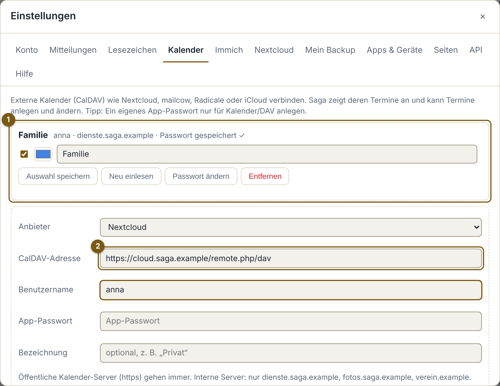
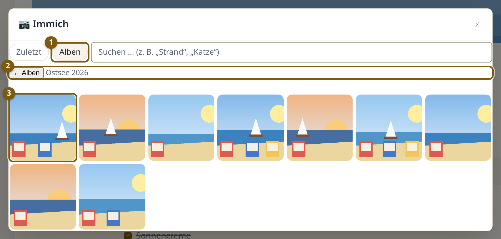
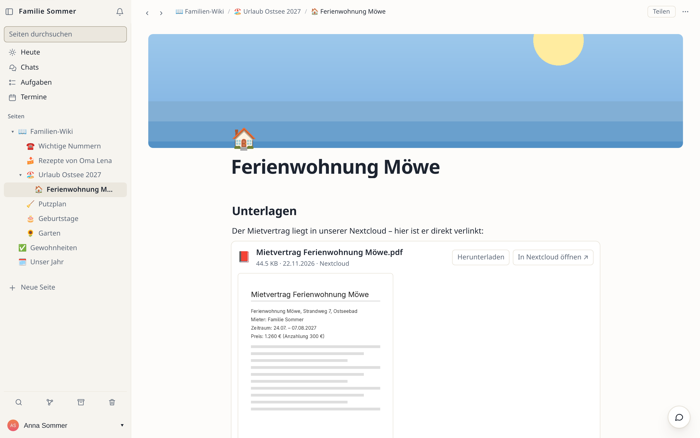
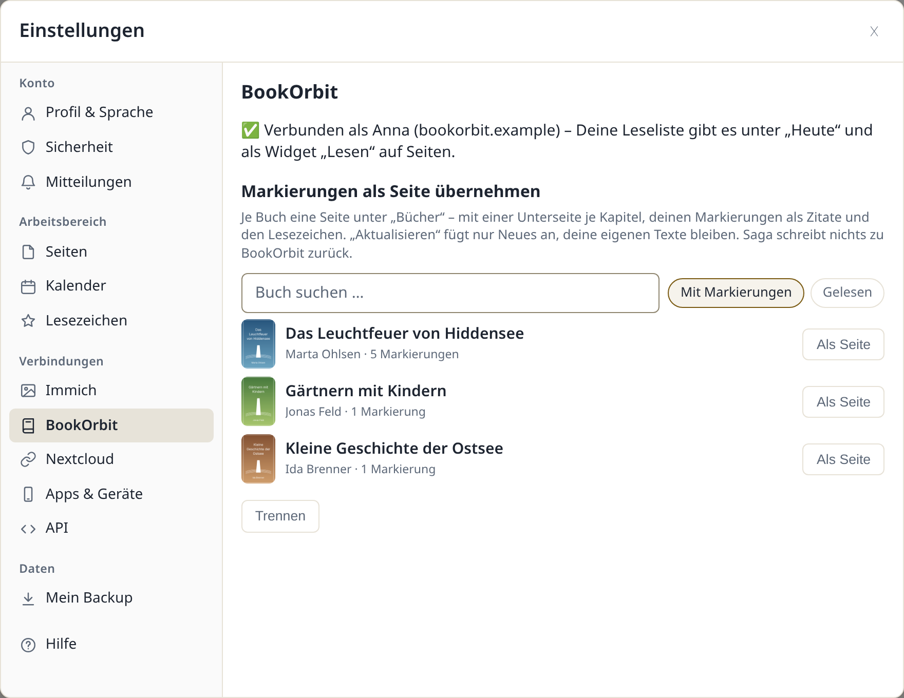
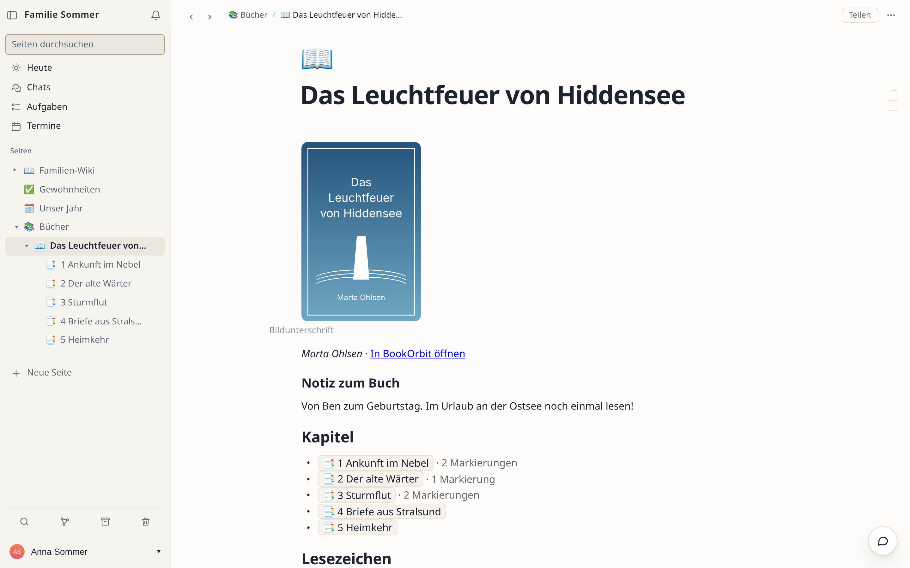
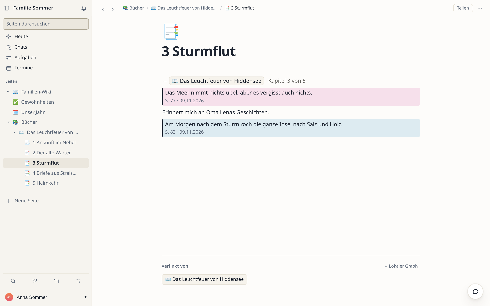

# B16 Verbindungen: Kalender, Immich, Nextcloud, BookOrbit

**Gilt für:** Web (verbinden) · Handy-Browser · iOS/iPadOS/Mac · Android · Linux (anzeigen)

[← Übersicht](../README.md) · [Weiter: B17 Apps →](17-apps.md)

---

## Das kannst du damit machen

- **Familientermine im Blick.** Anna verbindet den Familienkalender aus ihrer Nextcloud. Auf dem Dashboard steht
  jetzt „Zahnarzt Clara“ direkt neben ihren Aufgaben.
- **Urlaubsfotos in die Reiseseite.** Ben holt das schönste Strandfoto aus dem Immich-Album „Ostsee 2026“ als
  Titelbild auf die Seite „Urlaub Ostsee 2027“.
- **Dokumente verlinken statt kopieren.** Anna fügt den Mietvertrag der Ferienwohnung aus ihrer Nextcloud in die
  Reiseseite ein. Die Datei bleibt in der Nextcloud, alle auf der Seite können sie öffnen.
- **Wochenplan mit echten Terminen.** Clara setzt einen Kalender-Block in ihren „Lernplan Abi“ und sieht dort ihre
  Klausurtermine aus dem Schulkalender.
- **Lesen mit Notizen.** Ben liest E-Books mit BookOrbit. Seine Markierungen holt er als Seite nach Saga – je Kapitel
  eine Unterseite mit den Zitaten und seinen Notizen.

## Wofür ist das?

Viele Familien und Vereine haben ihre Termine, Fotos und Dateien schon woanders: Termine in einem Kalender (zum
Beispiel Nextcloud oder mailcow), Fotos in [Immich](https://immich.app), Dateien in Nextcloud, Bücher und
Markierungen in BookOrbit. Saga holt diese Dinge
auf deine Seiten und ins Dashboard – ohne dass du sie doppelt pflegen musst.

Jede Verbindung gehört nur zu **deinem** Konto. Du verbindest deine eigenen Dienste; andere sehen davon nur, was du
bewusst auf einer Seite einfügst.

> **Hinweis:** Liegen eure Dienste im Heimnetz (zum Beispiel `nextcloud.lan`), muss dein Admin sie einmal
> freigeben. Öffentliche Adressen mit `https` gehen immer.

---

## Schritt für Schritt

### 1. Einen Kalender verbinden

Saga liest Kalender über **CalDAV** – das können Nextcloud, mailcow und viele andere.

1. Öffne **Einstellungen → Kalender**.
2. Klick auf **+ Kalender verbinden**.
3. Wähl deinen Anbieter: **Nextcloud**, **mailcow (SOGo)** oder **Andere CalDAV-Adresse**.
4. Trag bei ② die **CalDAV-Adresse** ein. Bei Nextcloud sieht sie so aus:
   `https://cloud.example.org/remote.php/dav/`
5. Trag deinen Benutzernamen und ein **App-Passwort** ein.
6. Saga meldet „✓ Verbunden – 3 Kalender gefunden“. Kreuz an, welche Kalender du sehen willst, und **speichere die
   Auswahl**.

Was die Nummern bedeuten:

- ① Der schon verbundene Kalender „Familie“.
- ② Adresse des CalDAV-Servers. Das Passwortfeld bleibt im Bild leer – dort gehört dein App-Passwort hin.

> **Tipp:** Leg in deiner Nextcloud (bzw. bei deinem Kalender-Anbieter) ein **eigenes App-Passwort** nur für Saga an.
> So musst du dein echtes Passwort nirgends eintragen und kannst Saga den Zugang jederzeit wieder entziehen.

**Wo erscheinen die Termine?**

- Auf dem **Dashboard** rechts neben den Aufgaben.
- Im **Kalender-Block**: Tipp auf einer Seite `/Kalender`. Jede Person sieht dort ihre **eigenen** Termine – auch
  auf geteilten Seiten.
- In Datenbanken mit Kalender-Ansicht kannst du **Termine aus verbundenen Kalendern einblenden**.

Serientermine änderst du am besten direkt im Kalender, damit die Serie erhalten bleibt. Eine Verbindung löschst du
wieder in **Einstellungen → Kalender** – die Termine im Kalender selbst bleiben dabei erhalten.

### 2. Immich verbinden und Fotos einfügen

1. Öffne in Immich dein Konto und leg einen **API-Schlüssel** an. Er braucht diese Rechte: `album.read`,
   `asset.read`, `asset.view`, `asset.download` und `user.read`.
2. Öffne in Saga **Einstellungen → Immich**.
3. Trag die **Immich-Adresse** und den **API-Schlüssel** ein und speichere.

Jetzt gibt es Bilder aus Immich an drei Stellen: im `/`-Menü (**Bild aus Immich**), beim **Titelbild** und beim
**Symbol** einer Seite.

1. Tipp auf einer Seite `/Immich` und wähl **Bild aus Immich**.
2. Klick auf ① **Alben** – oder such oben nach einem Stichwort („Strand“).
3. Wähl das Album ②, zum Beispiel „Ostsee 2026“.
4. Klick das gewünschte Foto an ③.

Was die Nummern bedeuten:

- ① **Alben** – alle Alben aus deinem Immich.
- ② Das gewählte Album.
- ③ Ein Klick auf ein Foto übernimmt es.

Das Foto wird in die Seite **kopiert**. Es bleibt also auch dann sichtbar, wenn du es später in Immich löschst, und
alle, die die Seite sehen, sehen auch das Bild.

### 3. Nextcloud verknüpfen und Dateien einfügen

1. Öffne **Einstellungen → Nextcloud**.
2. Trag die **Nextcloud-Adresse** ein.
3. Saga meldet „Nextcloud gefunden“. Klick auf **In Nextcloud anmelden**.
4. In einem neuen Tab meldest du dich bei Nextcloud an und erlaubst den Zugriff. Saga bekommt dabei ein eigenes
   App-Passwort – dein echtes Passwort sieht Saga nie.

Danach gibt es im `/`-Menü den Block **Nextcloud-Datei**:

1. Tipp `/Nextcloud` und wähl **Nextcloud-Datei**.
2. Wähl eine Datei: aus den zuletzt geänderten Dateien, durch Blättern in Ordnern oder über die Suche.
3. Entscheide, wie die Datei auf die Seite kommt:
   - **Als Verweis einfügen** – die Datei bleibt in der Nextcloud. Bilder erscheinen groß, andere Dateien als Karte
     mit Vorschau, **Herunterladen** und **In Nextcloud öffnen**.
   - **Als Kopie übernehmen** – die Datei wird zu einer normalen Saga-Datei. Sie folgt dann den Rechten der Seite
     und ist auch im Backup und Export.

> **Wichtig:** Bei **Als Verweis einfügen** sehen **alle, die die Seite sehen, auch diese Datei** – auch Personen
> ohne eigene Nextcloud. Saga holt die Datei dafür über dein Konto. Füg also nur Dateien ein, die alle auf der Seite
> sehen dürfen.

Fügst du einen Link auf eine Datei deiner Nextcloud einfach in die Seite ein, macht Saga daraus automatisch einen
Nextcloud-Block.

Unter einem Nextcloud-Block, den du eingefügt hast, stehen zwei Schalter (am Anfang aus):

- **Auf veröffentlichter Seite zeigen** – Besucher einer veröffentlichten Seite sehen dann Vorschau und Download.
  Die Adresse deiner Nextcloud erfahren sie nicht.
- **Über verbundene Server zeigen** – Personen auf anderen Saga-Servern, mit denen die Seite geteilt ist, sehen die
  Datei ebenfalls.

**Trennen** in **Einstellungen → Nextcloud** widerruft Sagas App-Passwort. Eingefügte Verweise zeigen danach keinen
Inhalt mehr; Kopien bleiben.

### 4. BookOrbit verbinden: Leseliste und Markierungen

**BookOrbit** ist eine Leseplattform für E-Books, die man selbst betreiben kann. Saga **liest
nur** – es schreibt nie etwas zu BookOrbit zurück.

1. Öffne **Einstellungen → Verbindungen → BookOrbit**.
2. Trag die **BookOrbit-Adresse** (zum Beispiel `https://bookorbit.example`), deinen **Benutzernamen** und dein
   **Passwort** ein und klick auf **Anmelden**. Saga meldet sich einmal an und merkt sich nur ein Sitzungs-Token
   (verschlüsselt) – dein Passwort speichert es nicht.
3. Saga zeigt „✅ Verbunden“.

Danach gibt es:

- **Unter „Heute“** die Karte **Lesen**: was du gerade liest (mit Cover und Fortschritt) und deine Lesesträhne.
- **Das Widget „Lesen“** für Seiten: **Gerade am Lesen**, **Leseziel** oder **Lesesträhne** (siehe
  [B06](06-galerie-widgets.md)). Es zeigt immer die Daten der Person, die die Seite ansieht – auf einer geteilten
  Seite sieht also jede Person ihre eigenen Bücher, auf veröffentlichten Seiten erscheint nichts.
- **Markierungen als Seite übernehmen:** In den BookOrbit-Einstellungen, unter „Heute“ oder im Widget „Lesen“ ein Buch
  antippen. Saga legt unter der Seite **„Bücher“** (📚) eine Seite für das Buch an – mit Cover, Autor:in, deiner
  Notiz zum Buch, den Lesezeichen und **je Kapitel einer Unterseite** (📑) mit deinen Markierungen als Zitate und
  deinen Notizen darunter.
- **Aus BookOrbit aktualisieren** (Seitenmenü **⋯** der Buchseite) holt neue Markierungen dazu. Was du selbst
  ergänzt oder geändert hast, bleibt; was du in Saga gelöscht hast, kommt nicht wieder.

**Trennen** in **Einstellungen → Verbindungen → BookOrbit** meldet Saga auch bei BookOrbit ab. Übernommene
Buchseiten bleiben als normale Seiten stehen.

---

## Beispiel aus dem Alltag

**Anna bringt Familienkalender und Urlaubsfotos zusammen.** Familie Sommer pflegt ihre Termine in einem gemeinsamen
Nextcloud-Kalender „Familie“ und ihre Fotos in Immich.

1. Anna legt in ihrer Nextcloud ein App-Passwort „Saga“ an.
2. In Saga öffnet sie **Einstellungen → Kalender → + Kalender verbinden**, wählt **Nextcloud** und trägt Adresse,
   Benutzernamen und das App-Passwort ein.
3. Saga findet drei Kalender. Anna kreuzt „Familie“ an und speichert die Auswahl.
4. Auf dem Dashboard steht jetzt rechts „Zahnarzt Clara“.
5. Danach öffnet sie die Seite „Urlaub Ostsee 2027“, tippt `/Immich` und wählt aus dem Album „Ostsee 2026“ das Foto
   vom Leuchtturm.
6. Darunter fügt sie mit **Nextcloud-Datei** die Buchungsbestätigung der Ferienwohnung **als Verweis** ein. Ben,
   mit dem die Seite geteilt ist, kann sie jetzt herunterladen.

---

## Tipps und Tastenkürzel

- `/Kalender`, `/Immich` und `/Nextcloud` im Editor bringen dich direkt zum passenden Block.
- Für jeden Dienst ein eigenes App-Passwort bzw. einen eigenen API-Schlüssel – so kannst du Saga den Zugang gezielt
  entziehen, ohne woanders etwas zu ändern.
- Willst du eine Datei unabhängig von deiner Nextcloud machen (zum Beispiel für ein Backup), nimm **Als Kopie
  übernehmen**.

---

## Häufige Fragen

**Saga sagt, die Adresse ist nicht erlaubt.**
Dein Dienst läuft im Heimnetz. Dein Admin muss ihn einmal freigeben.

**Sehen andere meine Termine, wenn ich einen Kalender-Block auf eine geteilte Seite setze?**
Nein. Jede Person sieht im Kalender-Block nur ihre **eigenen** Termine.

**Ich habe ein Immich-Foto gelöscht – ist es jetzt auch in Saga weg?**
Nein. Fotos aus Immich werden in die Seite kopiert.

**Die Nextcloud-Datei zeigt nur noch eine leere Karte.**
Die Verknüpfung wurde getrennt, die Datei ist in der Nextcloud weg, oder die Person, die sie eingefügt hat, darf die
Seite nicht mehr bearbeiten.

**Gibt es Nextcloud-Dateien bei mir gar nicht?**
Dann hat dein Admin die Funktion abgeschaltet.

**Bei BookOrbit steht „Anmeldung abgelaufen – bitte neu anmelden“.**
Die Anmeldung bei BookOrbit ist abgelaufen. Melde dich unter **Einstellungen → Verbindungen → BookOrbit** einfach
neu an.

---

## Auf dem Handy und in den Apps

**Handy-Browser**

Verbinden und Einfügen geht im Handy-Browser genauso wie am Computer.

**iPhone, iPad, Mac, Android und Linux**

- Die Verbindungen richtest du am besten **im Browser** ein. Die Apps übernehmen sie automatisch. Einen Kalender
  kannst du in der App für iPhone, iPad und Mac auch direkt verbinden.
- Termine aus deinen Kalendern erscheinen in den Apps zum Beispiel in der Ansicht **Heute** (siehe [Apps](17-apps.md)).
- Bilder und Nextcloud-Dateien auf Seiten zeigen die Apps wie im Browser an.

---

[← Übersicht](../README.md) · [Weiter: B17 Apps →](17-apps.md)
