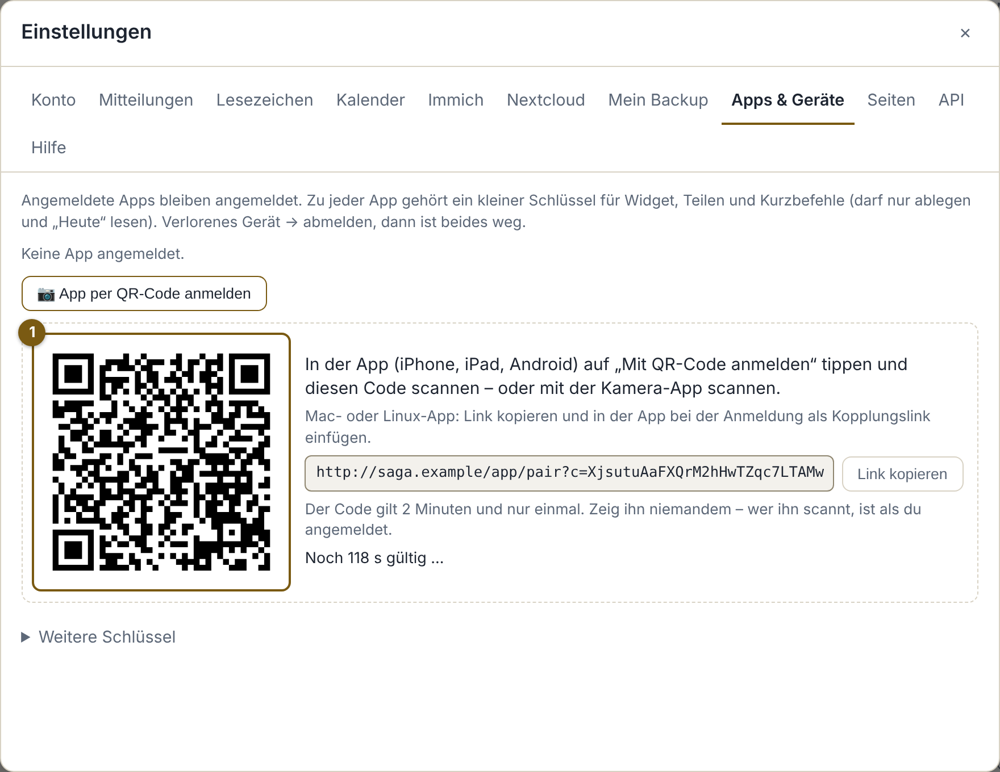

# B17 Apps – Saga auf iPhone, iPad, Mac, Android und Linux

**Gilt für:** iOS/iPadOS/Mac · Android · Linux (eingerichtet wird im Web)

[← Übersicht](../README.md) · [Weiter: B18 Für Fortgeschrittene: API-Tokens, Webhooks, MCP →](18-api-webhooks-mcp.md)

---

## Das kannst du damit machen

- **Oma Lena ist in einer Minute drin.** Anna zeigt am Laptop einen QR-Code, Lena scannt ihn mit dem Android-Handy –
  fertig angemeldet, ohne ein Passwort einzutippen.
- **Den Tag auf dem Startbildschirm.** Ben hat das Widget „Heute“ auf dem Handy: Termine und fällige Aufgaben, die
  er direkt im Widget abhakt.
- **Schnell etwas ablegen.** Clara findet in Safari ein Rezept und **teilt** es an Saga – es landet als Seite in
  ihrem Eingang.
- **Mit Siri.** Anna sagt beim Autofahren „Aufgabe in Saga anlegen“ und diktiert „Grillkohle kaufen“.
- **Am Schreibtisch unter Linux.** Ben nutzt die Saga-App auf seinem Fedora-Rechner und findet Seiten direkt über die
  GNOME-Suche.

## Wofür ist das?

Saga gibt es nicht nur im Browser, sondern auch als **echte Apps** für iPhone, iPad, Mac, Android und Linux. Die Apps
zeigen Seiten, Datenbanken, Aufgaben, Termine, Chats und Anrufe direkt an – angepasst an das jeweilige Gerät. Dazu
kommen Dinge, die nur eine App kann: Widgets, Teilen aus anderen Apps, Siri-Kurzbefehle und Klingeln wie ein echtes
Telefon.

Einmal angemeldet, bleibt eine App dauerhaft angemeldet. Abmelden kannst du jedes Gerät jederzeit im Browser.

---

## Schritt für Schritt

### 1. Die App herunterladen

Die fertigen Pakete findest du bei den [Saga-Apps auf GitHub](https://github.com/yggdrasil-sh/saga-apps/releases/latest):

- **Mac** (macOS 26 oder neuer): die Datei `Saga-…-macOS.dmg` öffnen und Saga in den Programme-Ordner ziehen.
- **Android** (Android 8 oder neuer): die Datei `Saga-….apk` aufs Handy laden und öffnen. Android fragt, ob du
  Apps aus dieser Quelle erlauben willst – erlaube es für die Installation.
- **Linux:** für Fedora und AlmaLinux/RHEL das Paket `saga-…noarch.rpm`, für alle anderen Systeme das Flatpak
  `saga-…x86_64.flatpak`.
- **iPhone und iPad:** Eine Version im App Store gibt es noch nicht. Frag deinen Admin – oft verteilt er die App
  selbst.

**Passt die App zum Server?** Für Saga 2.5 nimm die Apps ab 2.5 – vor allem für Anrufe über den Anruf-Knoten und die
modernen Chats. Ältere Apps melden sich weiter an und zeigen Seiten und Chats, manche neuen Funktionen fehlen dort
aber (zum Beispiel sagt ein Anruf dann „braucht Saga 2.5“). Bis zum offiziellen Release stehen die Apps 2.5 als
**Vorabversion** (Pre-release) bei den [Saga-Apps auf GitHub](https://github.com/yggdrasil-sh/saga-apps/releases).

> **Tipp:** Wenn dir das zu technisch ist: Lass es deinen Admin einmal mit dir zusammen machen. Danach musst du nie
> wieder etwas einrichten – Updates kommen über denselben Weg.

### 2. Anmelden über den Browser

1. Öffne die App und trag die Adresse deines Saga ein, zum Beispiel `https://saga.example`.
2. Tipp auf **Anmelden**. Die App öffnet die Anmeldeseite von Saga in einem Browserfenster.
3. Melde dich dort an wie gewohnt – mit Passwort, Passkey oder über euren Anmeldedienst.
4. Bist du im Browser schon angemeldet, fragt Saga „App anmelden?“. Bestätige nur, wenn du die Anmeldung gerade
   **selbst** in der App gestartet hast.
5. Die App übernimmt die Anmeldung – fertig.

### 3. Bequemer: Koppeln per QR-Code oder Link

Bist du am Computer schon in Saga angemeldet, geht es noch einfacher:

1. Öffne im Browser **Einstellungen → Apps & Geräte**.
2. Klick auf **📷 App per QR-Code anmelden**. Ein QR-Code erscheint ①.
3. **iPhone, iPad, Android:** Tipp in der App auf **Mit QR-Code anmelden** und scanne den Code. Die Kamera-App des
   Handys geht auch.
4. **Mac und Linux:** Klick unter dem Code auf **Link kopieren** und füg den Link in der App bei der Anmeldung als
   **Kopplungslink** ein.
5. Saga meldet „✓ … ist angemeldet“.

Was die Nummern bedeuten:

- ① Den QR-Code scannst du mit der App.

> **Wichtig:** Der Code gilt **2 Minuten** und nur **einmal**. Zeig ihn niemandem – wer ihn scannt, ist als du
> angemeldet. Läuft er ab, erzeugst du einfach einen neuen.

### 4. Geräte verwalten und abmelden

Unter **Einstellungen → Apps & Geräte** stehen alle angemeldeten Apps – mit Name, „angemeldet am“ und „zuletzt
aktiv“.

- **Abmelden** meldet die App ab. Auch Widgets, Teilen und Kurzbefehle auf diesem Gerät verlieren den Zugang.
- Hast du ein Gerät **verloren**, meld es hier sofort ab.
- Unter **Weitere Schlüssel** kannst du von Hand Schlüssel für Kurzbefehle oder kleine Skripte erzeugen. Für
  größere Vorhaben gibt es [API-Tokens](18-api-webhooks-mcp.md).

> **Hinweis:** Zu jeder App gehört ein kleiner Schlüssel für Widgets, Teilen und Kurzbefehle. Er darf nur Dinge
> ablegen und „Heute“ lesen – mehr nicht. Die App richtet ihn bei der Anmeldung selbst ein.

### 5. iPhone, iPad und Mac: Widgets, Teilen, Siri

<!-- App-Bild folgt: b17-02-ios-start.png -->

<!-- App-Bild folgt: b17-03-ipad-board.png -->

<!-- App-Bild folgt: b17-04-mac.png -->

**Widgets**

1. Halte auf dem Home-Bildschirm eine freie Stelle gedrückt und tipp auf **+** (bzw. am Mac: Widgets bearbeiten).
2. Such nach **Saga**.
3. Wähl ein Widget:
   - **Heute** – Termine und Aufgaben von heute; Aufgaben hakst du direkt im Widget ab.
   - **Seite** – zeigt eine Seite deiner Wahl.
   - **Seite oder Datenbank** – zeigt eine Seite oder eine Datenbank.

<!-- App-Bild folgt: b17-09-ios-widget.png -->

**Teilen aus anderen Apps**

1. Tipp in Safari (oder einer anderen App) auf **Teilen**.
2. Wähl **Saga**.
3. Leg den Link oder Text **als Seite im Eingang** oder **als Aufgabe** ab.

<!-- App-Bild folgt: b17-08-ios-teilen.png -->

**Kurzbefehle und Siri**

In der Kurzbefehle-App findest du Saga-Aktionen: **Aufgabe anlegen**, **Notiz ablegen**, **Seite öffnen** und
**Aufgabe abhaken**. Du kannst sie auch per Siri aufrufen.

**Anrufe** klingeln auf iPhone und iPad wie normale Telefonanrufe – auch bei gesperrtem Bildschirm (siehe
[Anrufe](13-anrufe.md)).

### 6. Android: Widgets „Heute“ und „Seite“

<!-- App-Bild folgt: b17-05-android-heute.png -->

1. Halte auf dem Startbildschirm eine freie Stelle gedrückt und tipp auf **Widgets**.
2. Such nach **Saga**.
3. Zieh ein Widget auf den Startbildschirm:
   - **Saga: Heute** – Termine von heute und Aufgaben, die heute fällig, überfällig oder ohne Datum sind. Abhaken
     geht direkt im Widget, mit **Neue Aufgabe** legst du schnell eine an.
   - **Saga: Seite** – zeigt eine Seite deiner Wahl mit Symbol, Titel und dem Anfang des Inhalts.

<!-- App-Bild folgt: b17-06-android-widgets.png -->

Weitere Besonderheiten auf Android:

- **Mitteilungen ohne Google:** Die App hält eine eigene, stromsparende Verbindung oder nutzt eine App wie ntfy
  (siehe [Benachrichtigungen und Mitteilungen](14-benachrichtigungen.md)).
- **Akku:** Kommen Mitteilungen verspätet, kannst du Saga von der Akku-Optimierung ausnehmen. Bei den meisten Handys
  ist das nicht nötig.
- **Anrufe** erscheinen im Vollbild, auch auf dem Sperrbildschirm.

### 7. Linux (GNOME)

<!-- App-Bild folgt: b17-07-linux.png -->

- Die Linux-App ist für den GNOME-Desktop gemacht.
- Seiten findest du auch über die **GNOME-Suche** in der Aktivitäten-Übersicht.
- Im Dock gibt es die Aktionen **Neue Seite** und **Neue Aufgabe**.
- Mitteilungen kommen als GNOME-Mitteilungen, solange die App läuft.
- **Anrufe:** Die App klingelt, das Gespräch selbst läuft im Browser.

---

## Beispiel aus dem Alltag

**Oma Lena bekommt Saga aufs Handy.** Lena hat ein Android-Handy und möchte keine langen Passwörter tippen.

1. Anna lädt auf Lenas Handy die Datei `Saga-….apk` herunter und installiert sie (dabei erlaubt sie einmal die
   Installation aus dieser Quelle).
2. Anna meldet sich am Laptop mit Lenas Konto an – oder Lena selbst tut es, Anna hilft.
3. Im Browser öffnet sie **Einstellungen → Apps & Geräte → 📷 App per QR-Code anmelden**.
4. Lena öffnet die App, tippt auf **Mit QR-Code anmelden** und hält das Handy vor den Bildschirm.
5. Nach einer Sekunde steht im Browser „✓ … ist angemeldet“. Lena sieht ihre Dienste und Chats.
6. Zum Schluss zieht Anna noch das Widget **Saga: Heute** auf Lenas Startbildschirm. So sieht Lena jeden Morgen ihre
   Termine.

**Clara sammelt Rezepte mit dem iPhone.** Clara findet in Safari ein Rezept für Ofengemüse.

1. Sie tippt auf **Teilen** und wählt **Saga**.
2. Sie wählt **als Seite im Eingang** und tippt auf **Sichern**.
3. Abends am Laptop verschiebt sie die neue Seite in ihre Rezepte-Sammlung.

---

## Tipps und Tastenkürzel

- Den QR-Code kannst du auch mit der normalen Kamera-App des Handys scannen.
- Auf dem Mac und unter Linux geht die Anmeldung am schnellsten mit **Link kopieren** → einfügen.
- Die Sprache der App stellst du in der App unter **Einstellungen → Sprache** ein – sogar schon vor der Anmeldung.
- In den Einstellungen der App siehst du ihre Version und die des Servers. Ist die App zu alt für den Server, sagt
  sie es dir.

---

## Häufige Fragen

**Muss ich mich in der App jedes Mal neu anmelden?**
Nein. Die App bleibt angemeldet, bis du sie abmeldest – oder bis dein Passwort geändert wird. Dann meldest du sie
einmal neu an.

**Ich sehe keinen QR-Code-Knopf.**
Verlangt dein Admin einen zweiten Faktor und hast du noch keinen, richte ihn zuerst ein (siehe
[Erste Schritte](01-erste-schritte.md)). Danach erscheint der Knopf.

**Mein Handy ist weg. Was tun?**
Öffne im Browser **Einstellungen → Apps & Geräte** und tipp beim Handy auf **Abmelden**. Entferne es außerdem unter
**Chats → ⚙ Chats & Geräte** (siehe [Chats](12-chats.md)).

**Warum fehlt in der App eine Funktion, die es im Browser gibt?**
Manche Funktionen kommen zuerst ins Web. Aktualisiere die App – oft ist sie dann schon dabei.

---

## Was geht wo?

Ein grober Überblick. Einzelheiten stehen jeweils im letzten Abschnitt der Kapitel.

| Funktion | Web | iOS/iPadOS/Mac | Android | Linux |
|---|---|---|---|---|
| Seiten, Datenbanken, Aufgaben | ✓ | ✓ | ✓ | ✓ |
| Chats (Ende-zu-Ende) | ✓ | ✓ | ✓ | ✓ |
| Anrufe | ✓ | ✓ (iPhone klingelt wie ein Telefon) | ✓ (Vollbild) | klingelt, Gespräch im Browser |
| Mitteilungen | ✓ (Browser) | ✓ (Apple) | ✓ (ohne Google) | ✓ |
| KI-Assistent | ✓ | ✓ | ✓ | ✓ |
| Widgets | – | Heute, Seite, Seite oder Datenbank | Heute, Seite | – |
| Teilen aus anderen Apps | – | ✓ | – | – |
| Siri / Kurzbefehle | – | ✓ | – | – |
| Kalender, Immich, Nextcloud verbinden | ✓ | anzeigen (Kalender auch verbinden) | anzeigen | anzeigen |
| API-Tokens, Webhooks | ✓ | – | – | – |

---

[← Übersicht](../README.md) · [Weiter: B18 Für Fortgeschrittene: API-Tokens, Webhooks, MCP →](18-api-webhooks-mcp.md)
