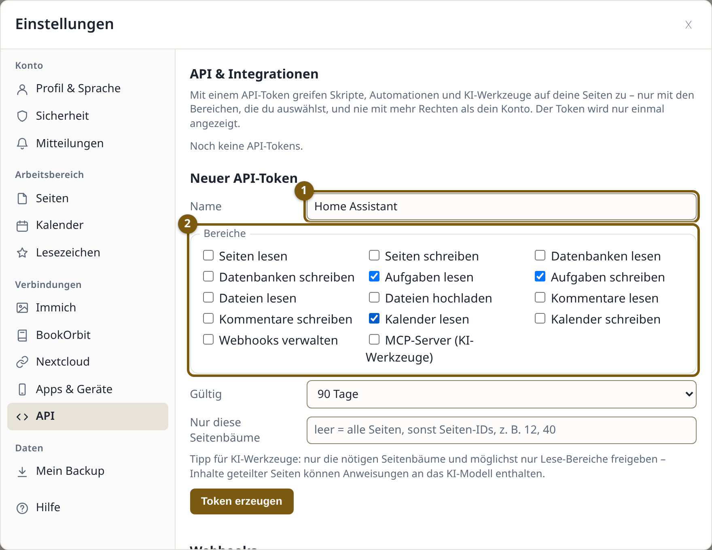
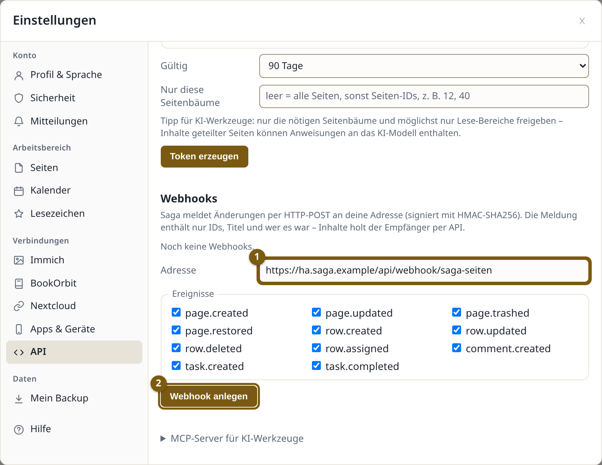

# B18 Für Fortgeschrittene: API-Tokens, Webhooks, MCP

**Gilt für:** Web

[← Übersicht](../README.md) · [Weiter: B19 Hilfe: Diagnose senden, Mein Backup →](19-hilfe.md)

---

## Das kannst du damit machen

- **Home Assistant Bescheid sagen.** Ben lässt Home Assistant per Webhook wissen, wenn in der Datenbank
  „Einkaufsliste“ ein neuer Eintrag landet – und das Wohnzimmerlicht blinkt kurz.
- **Eigene Skripte.** Anna liest mit einem kleinen Skript jeden Abend die Seite „Essensplan“ als Markdown und
  druckt sie aus.
- **Automationen mit n8n.** Paul vom Gartenverein legt aus einem Online-Formular automatisch neue Einträge in der
  Datenbank „Mitgliedsanträge“ an.
- **KI-Werkzeuge anbinden.** Clara verbindet Claude mit ihrem Saga, damit es in ihrem „Lernplan Abi“ nachschlagen
  kann – aber nur dort und nur lesend.

## Wofür ist das?

Dieses Kapitel ist für alle, die Saga mit anderen Programmen verbinden möchten. Dafür gibt es drei Werkzeuge:

- **API-Tokens** – ein Schlüssel, mit dem ein Programm in deinem Namen auf Saga zugreift. Du legst genau fest, was
  es darf.
- **Webhooks** – Saga meldet sich von selbst bei einem anderen Programm, wenn sich etwas ändert.
- **MCP-Server** – eine Schnittstelle, über die KI-Werkzeuge wie Claude deine Seiten lesen und bearbeiten können.

Ein Token kann **nie mehr als dein Konto**. Und du kannst ihn jederzeit widerrufen.

> **Hinweis:** Ob du API, Webhooks und MCP nutzen darfst, entscheidet dein Admin. Steht unter **Einstellungen →
> API** „Die API ist auf diesem Server für dein Konto nicht freigegeben“, frag ihn.

Alle Einzelheiten zu Endpunkten, Ereignissen und Fehlermeldungen stehen in der
[API-Beschreibung](../../API.md).

---

## Schritt für Schritt

### 1. Einen API-Token anlegen

1. Öffne **Einstellungen → API**.
2. Klick auf **Neuer API-Token**. Saga fragt zur Sicherheit noch einmal nach deinem Passwort (oder einem Code aus der
   Authenticator-App).
3. Gib bei ① einen **Namen** ein, an dem du den Token später erkennst – zum Beispiel „Home Assistant“, „n8n“ oder
   „Claude“.
4. Kreuz bei ② die **Bereiche** an, die das Programm braucht. Nimm so wenige wie möglich.
5. Wähl, wie lange der Token **gültig** ist: 30 Tage, 90 Tage, 180 Tage oder 1 Jahr.
6. Optional: **Nur diese Seitenbäume** – trag die Nummern (IDs) der Seiten ein, auf die der Token zugreifen darf.
   Unterseiten gehören dazu. Leer heißt: alle deine Seiten.
7. Klick auf **Token erzeugen**.



Was die Nummern bedeuten:

- ① Name des Tokens.
- ② Bereiche – der Token bekommt nie mehr Rechte als dein Konto.

Die Bereiche im Überblick:

- **Seiten lesen** / **Seiten schreiben**
- **Datenbanken lesen** / **Datenbanken schreiben**
- **Aufgaben lesen** / **Aufgaben schreiben**
- **Dateien lesen** / **Dateien hochladen**
- **Kommentare lesen** / **Kommentare schreiben**
- **Kalender lesen** / **Kalender schreiben** – deine verbundenen Kalender (siehe [B16](16-verbindungen.md))
- **Webhooks verwalten**
- **MCP-Server (KI-Werkzeuge)**

> **Wichtig:** Saga zeigt den Token **nur ein einziges Mal** an („nur jetzt sichtbar!“). Kopier ihn sofort und leg
> ihn sicher ab, zum Beispiel im Passwort-Manager. Geht er verloren, widerrufst du ihn und legst einen neuen an.

**Wo finde ich die ID einer Seite?** Öffne die Seite. In der Adresszeile des Browsers steht die Nummer hinter dem `#`.

### 2. Den Token benutzen

Programme schicken den Token in der Kopfzeile `Authorization` mit. Die Schnittstelle liegt unter `/api/v1/`.
Beispiel: Die Seite mit der Nummer 12 als Markdown lesen:

```sh
curl -H "Authorization: Bearer sga_…" "https://saga.example/api/v1/pages/12?format=markdown"
```

`sga_…` ersetzt du durch deinen Token. Weitere Beispiele stehen in der [API-Beschreibung](../../API.md).

**Tokens verwalten:** Unter **Einstellungen → API** siehst du alle Tokens mit Bereichen, Ablaufdatum und „zuletzt
benutzt“. **Widerrufen** sperrt einen Token sofort – alle Programme, die ihn nutzen, verlieren den Zugriff.

### 3. Einen Webhook anlegen

Ein Webhook ist eine Adresse, an die Saga eine kurze Nachricht schickt, sobald etwas passiert – zum Beispiel ein neuer
Datenbank-Eintrag oder ein neuer Kommentar.

1. Öffne **Einstellungen → API** und scroll zu **Webhooks**.
2. Trag bei ① die **Adresse** des Empfängers ein, zum Beispiel die Webhook-Adresse aus Home Assistant.
3. Wähl die **Ereignisse**, die gemeldet werden sollen.
4. Klick auf ② **Webhook anlegen**.
5. Saga zeigt einmalig das **Geheimnis für die Signatur** („nur jetzt sichtbar!“). Kopier es in dein empfangendes
   Programm.



Was die Nummern bedeuten:

- ① Adresse des Empfängers.
- ② **Webhook anlegen**.

Mögliche Ereignisse sind zum Beispiel: Seite angelegt, geändert, in den Papierkorb gelegt oder wiederhergestellt;
Datenbank-Eintrag angelegt, geändert, gelöscht oder jemandem zugewiesen; neuer Kommentar; Aufgabe angelegt oder
erledigt.

**Was steht in der Nachricht?** Absichtlich wenig: welche Seite oder welcher Eintrag, der Titel, was sich geändert
hat und wer es war – aber **keine Inhalte**. Die holt sich das Programm bei Bedarf mit einem API-Token.

**Ist die Nachricht echt?** Jede Nachricht trägt eine Signatur (Kopfzeile `Saga-Signature`, HMAC-SHA256 mit deinem
Geheimnis). So kann der Empfänger prüfen, dass sie wirklich von deinem Saga kommt. Ein Prüf-Beispiel steht in der
[API-Beschreibung](../../API.md).

Weitere Knöpfe in der Liste:

- **Testen** schickt eine Probe-Nachricht.
- **Ausschalten** / **Einschalten** pausiert den Webhook.
- **Löschen** entfernt ihn.

Klappt die Zustellung nicht, versucht Saga es über einen Tag hinweg immer wieder. Nach 20 Fehlschlägen in Folge
schaltet Saga den Webhook ab und sagt dir Bescheid.

> **Hinweis:** Empfänger brauchen eine öffentliche `https`-Adresse. Adressen im Heimnetz (zum Beispiel Home
> Assistant unter `homeassistant.lan`) muss dein Admin einmal freigeben.

### 4. Ein KI-Werkzeug über MCP verbinden

MCP (Model Context Protocol) ist ein Standard, über den KI-Werkzeuge mit anderen Programmen sprechen. Saga hat einen
MCP-Server eingebaut. Seine Adresse ist die Adresse deines Saga mit `/mcp` dahinter, zum Beispiel
`https://saga.example/mcp`.

1. Leg einen API-Token an (Abschnitt 1) und kreuz dabei **MCP-Server (KI-Werkzeuge)** an – dazu die Bereiche, die
   die KI nutzen soll, zum Beispiel **Seiten lesen**.
2. Beschränke den Token mit **Nur diese Seitenbäume** auf die Seiten, die die KI wirklich braucht.
3. Trag Adresse und Token in deinem KI-Werkzeug ein.

Beispiel für Claude Code:

```sh
claude mcp add --transport http saga https://saga.example/mcp --header "Authorization: Bearer sga_…"
```

Beispiel für eine Konfigurationsdatei (zum Beispiel `.mcp.json`):

```json
{
  "mcpServers": {
    "saga": {
      "type": "http",
      "url": "https://saga.example/mcp",
      "headers": {"Authorization": "Bearer sga_…"}
    }
  }
}
```

Die KI bekommt dann nur die Werkzeuge, die der Token erlaubt – zum Beispiel Seiten suchen und lesen, Einträge in
Datenbanken anlegen, Aufgaben anlegen oder abhaken, Kommentare schreiben.

**Was eine KI mit Schreib-Bereichen in Saga 2.5 kann:**

- **Seiten gezielt ändern** – einen einzelnen Abschnitt oder Block ersetzen, etwas darunter einfügen oder
  entfernen, ein Kästchen einer Checkliste abhaken; alle anderen Blöcke und ihre Kommentare bleiben, wie sie sind.
  Hat jemand die Seite inzwischen geändert, bekommt die KI einen verständlichen Fehler statt still zu überschreiben.
  Seiten archivieren oder in den Papierkorb legen geht ebenfalls.
- **Datenbanken anlegen** – mit Eigenschaften und Ansichten (Tabelle, Board, Kalender, Zeitleiste …), auch mit Filter
  und Sortierung, und gleich in eine Seite eingebettet. Eigenschaften und Ansichten ergänzen und umbenennen geht;
  **gelöscht wird nie**. Formeln und Rollups richtest du weiter im Browser ein.
- **Widgets** – Fortschritt, Kennzahl, Countdown, Diagramm und andere in Seiten anlegen, ändern und ihre Werte lesen.
- **Neue Seiten und Einträge** – mit Symbol, Einträge auch aus einer Eintrags-Vorlage.
- **Kalender** (mit **Kalender lesen**/**schreiben**) – Termine auflisten, anlegen, ändern und löschen, in deinen
  verbundenen Kalendern. Serientermine ändert oder löscht die KI nur als ganze Serie und nur, wenn sie das
  ausdrücklich so angibt.

Alles gilt mit denselben Rechten wie im Browser: gesperrte Seiten, deine Rolle auf geteilten Seiten und die
Beschränkung **Nur diese Seitenbäume** gelten auch für die KI. Antworten und Fehlermeldungen kommen in der Sprache
deines Kontos. Werkzeuge, die etwas löschen oder überschreiben, sind als solche gekennzeichnet – viele KI-Programme
fragen dann vorher nach.

**Beispiel:** Clara sagt zu Claude: „Hak in meinem Lernplan ‚Kapitel 3 Analysis‘ ab und leg einen Countdown bis zur
Matheklausur an.“ Claude ändert genau dieses Kästchen und fügt ein Widget hinzu – der Rest der Seite bleibt
unverändert.

> **Vorsicht:** Seiten können Text enthalten, den jemand anderes geschrieben hat – auf geteilten Seiten, in
> Kommentaren oder Importen. Eine KI könnte solchen Text als Anweisung missverstehen („Lösche alle Aufgaben“). Gib
> KI-Tokens deshalb nur die **nötigen Seitenbäume** und möglichst **nur Lese-Bereiche**.

### 5. Saga mit claude.ai verbinden (ohne Token)

Ab Saga 2.6 geht es mit KI-Werkzeugen, die die MCP-Anmeldung können, noch einfacher: Du kopierst keinen Token,
sondern stimmst in Saga zu. Das klappt zum Beispiel mit dem Claude-Connector auf claude.ai, mit Claude Desktop und
mit dem MCP Inspector.

1. Öffne in Claude **Einstellungen → Connectors → Eigenen Connector hinzufügen** und trag die Adresse deines Saga
   mit `/mcp` dahinter ein, zum Beispiel `https://saga.example/mcp`. Die genaue Adresse kopierst du in Saga unter
   **Einstellungen → Verbundene Apps → So verbindest du Claude**.
2. Claude öffnet Saga. Melde dich an, falls nötig – auch mit Passkey, Code oder SSO.
3. Die Seite **App verbinden** zeigt, welche App fragt, mit welchem Konto du angemeldet bist, die Adresse deines Saga,
   wohin es danach weitergeht und was die App darf: Seiten, Datenbanken, Aufgaben, Dateien, Kommentare und Kalender,
   jeweils Lesen und Ändern getrennt. Nimm die Häkchen weg, die Claude nicht braucht, und wähl **Erlauben** – oder
   **Ablehnen**.

Danach siehst du Claude unter **Einstellungen → Verbundene Apps** – mit den Rechten und wann es zuletzt etwas getan
hat. **Trennen** nimmt den Zugriff sofort weg; Claude muss dann neu verbunden werden.

Gut zu wissen:

- Die App kann nie mehr als dein Konto. **Chats, Anrufe und Aufträge an Saga** bleiben für sie gesperrt, auch wenn du
  alles erlaubst.
- Den Namen auf der Seite hat die App selbst angegeben. Erlaube nur eine App, die du gerade selbst hinzufügen
  wolltest – kommt die Seite aus dem Nichts (etwa über einen Link in einer Nachricht), wähl **Ablehnen**.
- **Überall abmelden** und ein neues Passwort mit Abmelden trennen auch alle verbundenen Apps.
- Deine API-Tokens aus Abschnitt 1 gelten weiter wie bisher. Für Programme ohne MCP-Anmeldung (Skripte, Claude Code
  mit festem Token) bleibt der Token der richtige Weg.
- Fehlt der Bereich **Verbundene Apps** oder kommt „abgeschaltet“, hat dein Admin die Anmeldung per OAuth nicht
  freigegeben.

<details><summary>ⓘ Was steckt dahinter?</summary>

Saga nutzt dafür OAuth 2.1, ein offenes Verfahren für Zugriffsfreigaben, so wie es die MCP-Spezifikation vorsieht.
Die App bekommt einen eigenen, kurzlebigen Schlüssel nur für den MCP-Server (`/mcp`) – nie dein Passwort. Technische
Einzelheiten stehen in der [API-Beschreibung](../../API.md#mcp-mit-oauth-verbundene-apps-26).

</details>

---

## Beispiel aus dem Alltag

**Ben lässt Home Assistant auf die Einkaufsliste hören.** Ben möchte, dass Home Assistant eine Mitteilung schickt,
sobald jemand etwas auf die Einkaufsliste setzt.

1. In Home Assistant legt Ben eine Automation mit dem Auslöser **Webhook** an. Home Assistant zeigt ihm die
   Webhook-Adresse.
2. In Saga öffnet er **Einstellungen → API → Webhooks**.
3. Er trägt die Adresse aus Home Assistant ein und wählt das Ereignis **Datenbank-Eintrag angelegt**.
4. Er klickt auf **Webhook anlegen** und kopiert das Geheimnis in seine Automation.
5. Mit **Testen** prüft er die Verbindung – Home Assistant meldet die Probe-Nachricht.
6. Clara setzt „Hafermilch“ auf die Einkaufsliste. Sekunden später zeigt Bens Handy: „Neu auf der Einkaufsliste“.

**Clara lässt Claude in ihrem Lernplan nachschlagen.** Clara will, dass Claude ihre Lernnotizen kennt – aber nichts
anderes.

1. Clara öffnet ihre Seite „Lernplan Abi“ und notiert sich die Nummer hinter dem `#` in der Adresse.
2. Unter **Einstellungen → API** legt sie einen Token „Claude“ an, mit **Seiten lesen** und **MCP-Server
   (KI-Werkzeuge)**.
3. Bei **Nur diese Seitenbäume** trägt sie die Nummer ihres Lernplans ein und wählt **90 Tage**.
4. Sie kopiert den Token und trägt ihn mit der Adresse `https://saga.example/mcp` in Claude ein.
5. Claude kann jetzt im Lernplan und seinen Unterseiten lesen – aber weder Familienseiten sehen noch etwas ändern.

---

## Tipps und Tastenkürzel

- **Ein Token je Programm.** Dann kannst du einem Programm den Zugang entziehen, ohne die anderen zu stören.
- **So wenig wie nötig.** Nur die Bereiche und Seitenbäume, die das Programm wirklich braucht.
- **Mit Ablaufdatum.** Ein Token, der nach 90 Tagen ausläuft, ist sicherer als einer, der ewig gilt.
- Unter „zuletzt benutzt“ siehst du, ob ein Token überhaupt noch gebraucht wird. Alte Tokens: widerrufen.

---

## Häufige Fragen

**Ich habe meinen Token nicht kopiert. Kann ich ihn noch einmal sehen?**
Nein. Widerruf ihn und leg einen neuen an.

**Kann ein Token mehr als ich?**
Nein. Ein Token kann nie mehr als dein Konto. Verlierst du den Zugriff auf eine Seite, verliert ihn auch der Token.

**Mein Webhook kommt nicht an.**
Prüf in der Liste die letzte Zustellung. Häufige Gründe: Die Adresse ist im Heimnetz und nicht freigegeben, sie
nutzt kein `https`, oder sie leitet auf eine andere Adresse weiter – Weiterleitungen verfolgt Saga nicht.

**Kann mein Admin meine Tokens sehen?**
Er sieht, wie viele Tokens, Webhooks und verbundene Apps du hast, und kann im Notfall alle widerrufen bzw. trennen.
Die Tokens selbst sieht er nicht.

**Wo ist die vollständige Beschreibung?**
In der [API-Beschreibung](../../API.md).

---

## Auf dem Handy und in den Apps

**Handy-Browser**

Tokens und Webhooks kannst du auch im Handy-Browser anlegen. Den Token aus der Zwischenablage zu kopieren ist am
Computer aber meist bequemer.

**iPhone, iPad, Mac, Android und Linux**

- In den Apps gibt es keine Verwaltung für API-Tokens und Webhooks. Das machst du im Browser.
- Für kleine Kurzbefehle auf iPhone und Mac reicht oft schon ein Schlüssel unter **Einstellungen → Apps & Geräte →
  Weitere Schlüssel** (siehe [Apps](17-apps.md)).

---

[← Übersicht](../README.md) · [Weiter: B19 Hilfe: Diagnose senden, Mein Backup →](19-hilfe.md)
