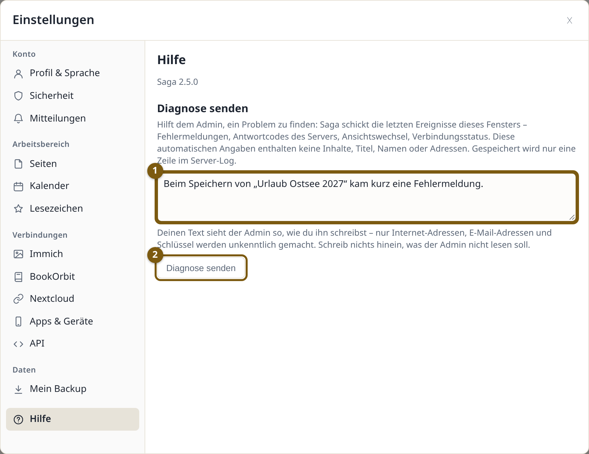
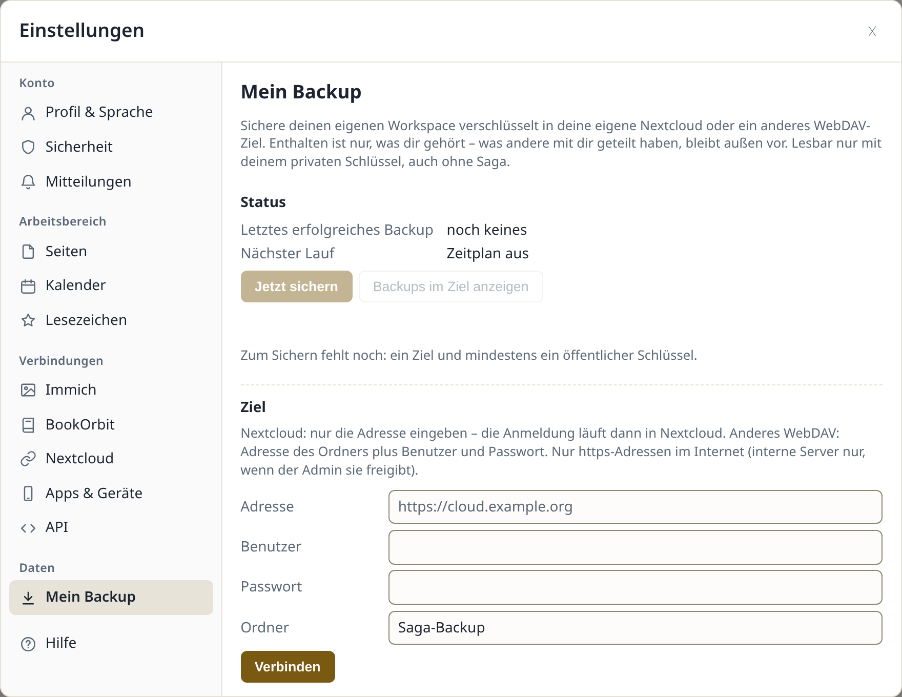

# B19 Hilfe: Diagnose senden, Mein Backup

**Gilt für:** Web · Handy-Browser · iOS/iPadOS/Mac · Android · Linux (Mein Backup nur Web)

[← Übersicht](../README.md) · [Weiter: B20 Kontakte →](20-kontakte.md)

---

## Das kannst du damit machen

- **Dem Admin ein Problem zeigen, statt es zu beschreiben.** Bei Ben lässt sich ein Bild nicht einfügen. Er klickt
  auf **Diagnose senden** und schickt Anna nur eine kurze Kennung wie `D-7K3FM`. Anna findet damit genau, was schief
  ging.
- **Deine Seiten selbst sichern.** Anna sichert ihren eigenen Saga-Bereich jede Nacht verschlüsselt in ihre eigene
  Nextcloud – unabhängig davon, was der Admin sichert.
- **Etwas Verlorenes zurückholen.** Clara hat aus Versehen ihre Rezeptsammlung gelöscht und den Papierkorb geleert.
  Aus ihrem Backup von letzter Woche spielt sie sie wieder ein.
- **Umziehen.** Paul nimmt seine Seiten aus dem Saga seines alten Vereins mit auf einen neuen Server.

## Wofür ist das?

Dieses Kapitel hat zwei Teile:

- **Diagnose senden** hilft, wenn etwas nicht funktioniert. Saga schickt deinem Admin eine kurze technische
  Aufzeichnung der letzten Schritte. Darin stehen **keine Inhalte** – keine Seiten, Titel, Namen oder Chats.
- **Mein Backup** ist deine eigene Sicherung. Saga packt alles, was dir gehört, verschlüsselt in ein Ziel, das du
  selbst wählst. Nur du hast den Schlüssel.

---

## Schritt für Schritt

### 1. Diagnose senden

Am besten sendest du die Diagnose gleich, nachdem der Fehler passiert ist – im selben Fenster.

1. Öffne **Einstellungen → Hilfe**. Oben steht, welche Saga-Version läuft.
2. Schreib bei ① kurz, was passiert ist, zum Beispiel „Bild lässt sich nicht einfügen“. Das ist freiwillig.
3. Klick auf ② **Diagnose senden**.
4. Saga antwortet: „Gesendet. Nenne dem Admin diese Kennung:“ – zum Beispiel `D-7K3FM`.
5. Schick die Kennung deinem Admin, etwa per Chat.

Was die Nummern bedeuten:

- ① Kurze Beschreibung – nur für den Admin, freiwillig.
- ② **Diagnose senden** – danach bekommst du die Kennung `D-…` für den Admin.

**Was wird übertragen?** Die letzten Ereignisse dieses Fensters: Fehlermeldungen, Antworten des Servers,
Ansichtswechsel und der Verbindungsstatus. Diese automatischen Angaben enthalten keine Inhalte, Titel, Namen oder
Adressen. Gespeichert wird nur eine Zeile im Protokoll des Servers.

> **Wichtig:** Deinen eigenen Text sieht der Admin so, wie du ihn schreibst. Nur Internet-Adressen, E-Mail-Adressen
> und Schlüssel macht Saga unkenntlich. Schreib nichts hinein, was der Admin nicht lesen soll – vor allem keine
> Passwörter.

Außerdem melden Browser und Apps echte Programmfehler von selbst an den Server – ebenfalls ohne Inhalte. Darum musst du
dich nicht kümmern.

> **Hinweis:** Steht dort „Diagnose ist auf diesem Server abgeschaltet“, hat dein Admin die Funktion ausgeschaltet.
> Beschreib ihm das Problem dann einfach so.

### 2. Mein Backup: das Ziel festlegen

Unter **Einstellungen → Mein Backup** richtest du deine eigene Sicherung ein.

Zuerst brauchst du ein **Ziel**, wohin die Backups gespeichert werden:

- **Eigene Nextcloud:** Adresse eintragen, auf **In Nextcloud anmelden** klicken, dort anmelden und den Zugriff
  erlauben. Saga bekommt ein eigenes App-Passwort – dein Passwort sieht Saga nie.
- **Anderer WebDAV-Speicher:** Adresse des Ordners, Benutzer und Passwort eintragen und **Verbinden**.

Mit **Verbindung prüfen** siehst du, ob alles klappt und wie viel Platz frei ist.

> **Hinweis:** Erlaubt sind nur `https`-Adressen im Internet. Liegt dein Speicher im Heimnetz, muss dein Admin ihn
> freigeben.

### 3. Mein Backup: den Schlüssel anlegen

Deine Backups werden verschlüsselt. Ohne Schlüssel sichert Saga nicht.

1. Klick bei **Verschlüsselung** auf **Schlüsselpaar erzeugen**.
2. Saga zeigt einen **privaten Schlüssel** – nur dieses eine Mal. Saga speichert ihn nicht.
3. Leg ihn sicher ab: **Als Datei herunterladen**, in deinen Passwort-Manager kopieren oder ausdrucken. Nicht auf dem
   Saga-Server!
4. Tipp zur Bestätigung die **letzten 6 Zeichen** ein und klick auf **Schlüssel ist sicher abgelegt – eintragen**.

> **Wichtig:** Ohne diesen privaten Schlüssel lassen sich deine Backups **nicht** wiederherstellen – auch nicht von
> deinem Admin. Behandle ihn wie den Wiederherstellungsschlüssel deiner Chats.

Kennst du dich aus, kannst du stattdessen einen **eigenen öffentlichen Schlüssel eintragen** (age oder SSH).

### 4. Mein Backup: was und wann

Unter **Was gesichert wird** stehen alle Bereiche, die dir gehören: Seiten und Unterseiten samt Datenbanken,
Vorlagen, Archiv, Papierkorb, Versionen, eigene Dateien und Bilder, Kommentare, Aufgaben, Lesezeichen sowie Profil
und Einstellungen. Du kannst jeden Bereich abschalten und einzelne Seiten mit **Ausschließen** weglassen.

**Nie** im Backup: Seiten anderer Personen (auch nicht „Mit mir geteilt“) und Chats. Chats gehören allen
Beteiligten und lassen sich nur mit den Geräteschlüsseln lesen.

Unter **Zeitplan und Aufbewahrung**:

1. Wähl bei **Automatisch sichern**: aus, wöchentlich oder täglich.
2. Stell **Uhrzeit** (und bei „wöchentlich“ den **Wochentag**) ein.
3. Leg fest, wie viele **Backups behalten** werden. Ältere löscht Saga im Ziel.
4. Klick auf **Speichern**.

Mit **Jetzt sichern** startest du sofort ein Backup. Oben unter **Status** siehst du das letzte erfolgreiche Backup
und den nächsten Lauf. Schlägt ein Backup fehl, sagt dir die Glocke Bescheid.

### 5. Ein Backup einspielen

1. Öffne **Einstellungen → Mein Backup → Backup einspielen**.
2. Wähl eine **Backup-Datei** von deinem Rechner – oder hol eines **aus dem Ziel**.
3. Füg deinen **privaten Schlüssel** ein. Er geht nur für diesen Vorgang an den Server und wird nicht gespeichert.
4. Wähl, was dazukommt: Papierkorb, Aufgaben, Lesezeichen, Chat-Kontakte.
5. Klick auf **Einspielen**.

Saga legt alles **als neue Seiten** in einer Seite „Wiederhergestellt <Datum>“ an. Deine bestehenden Seiten bleiben
unverändert. Verweise zwischen den Seiten, Datenbanken und Bilder zeigen danach auf die neuen Seiten.

> **Hinweis:** Ein normaler Export einer Seite (Seite → Exportieren) ist kein Backup und lässt sich nicht einspielen.

---

## Beispiel aus dem Alltag

**Ben meldet ein Problem.** Ben will in der Seite „Urlaub Ostsee 2027“ ein Foto einfügen, aber es passiert nichts.

1. Ben lässt das Fenster offen und öffnet über das Benutzermenü unten links **Einstellungen → Hilfe**.
2. Er schreibt: „Bild lässt sich nicht einfügen, Urlaubsseite“.
3. Er klickt auf **Diagnose senden** und bekommt die Kennung `D-7K3FM`.
4. Im Familienchat schreibt er Anna: „Bild geht nicht, Diagnose D-7K3FM“.
5. Anna sucht die Kennung in ihrem Server-Protokoll und sieht, woran es lag (siehe Admin-Handbuch).

**Anna richtet ihr eigenes Backup ein.** Anna möchte ihre Seiten zusätzlich in ihrer eigenen Nextcloud sichern.

1. Sie öffnet **Einstellungen → Mein Backup**.
2. Bei **Ziel** trägt sie die Adresse ihrer Nextcloud ein, meldet sich an und erlaubt den Zugriff.
3. Bei **Verschlüsselung** klickt sie auf **Schlüsselpaar erzeugen**, lädt den privaten Schlüssel als Datei herunter
   und speichert ihn in ihrem Passwort-Manager.
4. Sie bestätigt mit den letzten 6 Zeichen.
5. Bei **Zeitplan** wählt sie **täglich, 02:00 Uhr** und **7 Backups behalten**.
6. Mit **Jetzt sichern** macht sie gleich das erste Backup. Unter **Status** steht kurz darauf das Datum.

---

## Tipps und Tastenkürzel

- Sende die Diagnose direkt **nach** dem Fehler und **im selben Fenster** – dann sind die passenden Ereignisse dabei.
- Schreib in die Beschreibung, **was du tun wolltest** und **was stattdessen passiert ist**. Das hilft dem Admin am
  meisten.
- Probier dein Backup einmal aus: Spiel es ein und schau dir die Seite „Wiederhergestellt …“ an. Danach kannst du sie
  wieder löschen.
- Die Backup-Dateien sind ein offenes Format. Wer sich auskennt, kann sie auch ohne Saga mit dem Programm `age`
  entschlüsseln.

---

## Häufige Fragen

**Kann der Admin mit der Diagnose meine Seiten lesen?**
Nein. Die automatischen Angaben enthalten keine Inhalte, Titel oder Namen. Nur deinen eigenen Text sieht der Admin.

**Es steht „Zu viele Anfragen – bitte kurz warten“.**
Du kannst nur ein paar Diagnosen pro Stunde senden. Warte einen Moment.

**Brauche ich Mein Backup, wenn mein Admin schon sichert?**
Nicht unbedingt. Mit deinem eigenen Backup hast du aber eine Kopie in **deiner** Hand – praktisch, wenn du Saga
verlässt, umziehst oder einzelne Seiten zurückholen willst.

**Ich habe den privaten Schlüssel verloren.**
Dann lassen sich die bisherigen Backups nicht mehr öffnen. Erzeuge ein neues Schlüsselpaar und entferne den alten
Schlüssel – ab dann sind neue Backups wieder lesbar.

**Steht „Persönliche Backups sind auf diesem Server abgeschaltet“?**
Dann hat dein Admin die Funktion ausgeschaltet.

---

## Auf dem Handy und in den Apps

**Handy-Browser**

Diagnose senden und Mein Backup gehen auch im Handy-Browser. Das Einrichten des Backups ist am Computer aber
bequemer.

**iPhone, iPad, Mac, Android und Linux**

<!-- App-Bild folgt: b19-03-diagnose-android.png -->

- **Diagnose senden** gibt es auch in den Apps, in den Einstellungen unter **Hilfe**. Die Kennung `D-…` gibst du genauso
  an deinen Admin weiter.
- **Mein Backup** richtest du im Browser ein. Es sichert auch alles, was du in den Apps anlegst.

---

[← Übersicht](../README.md) · [Weiter: B20 Kontakte →](20-kontakte.md)
