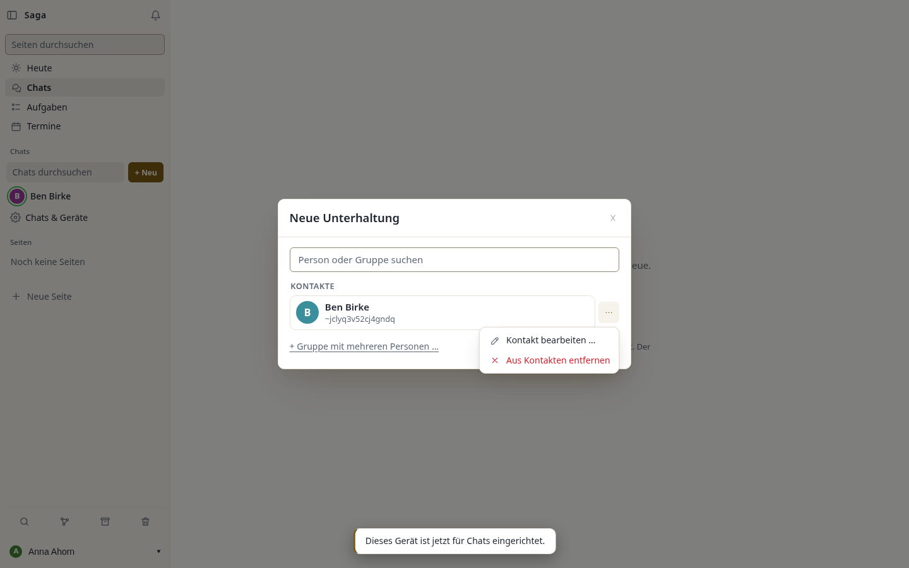
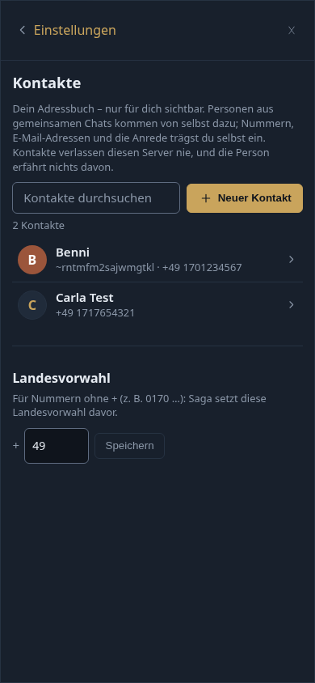
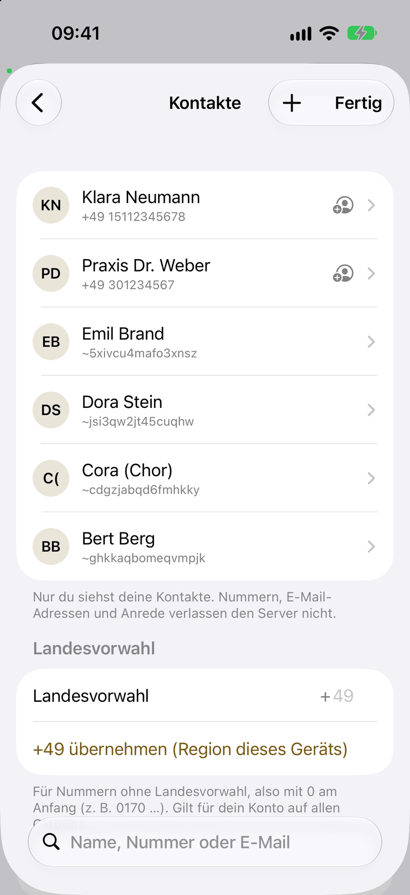
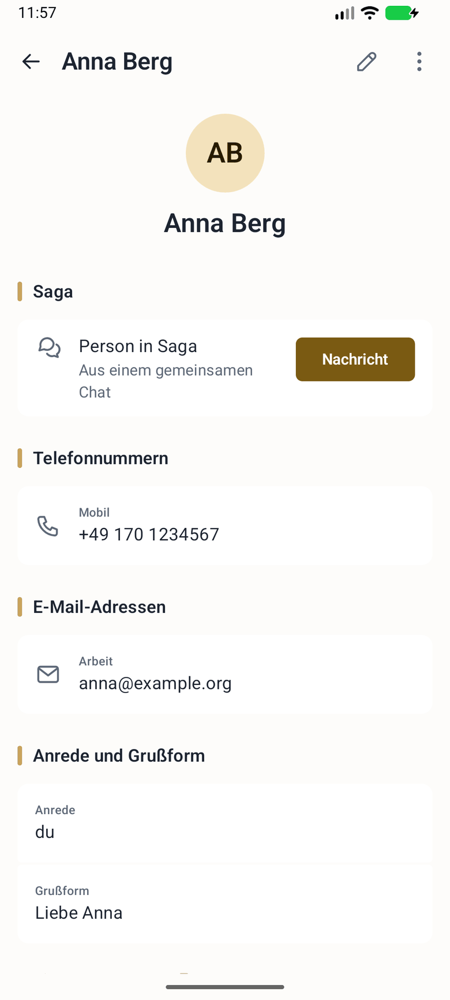
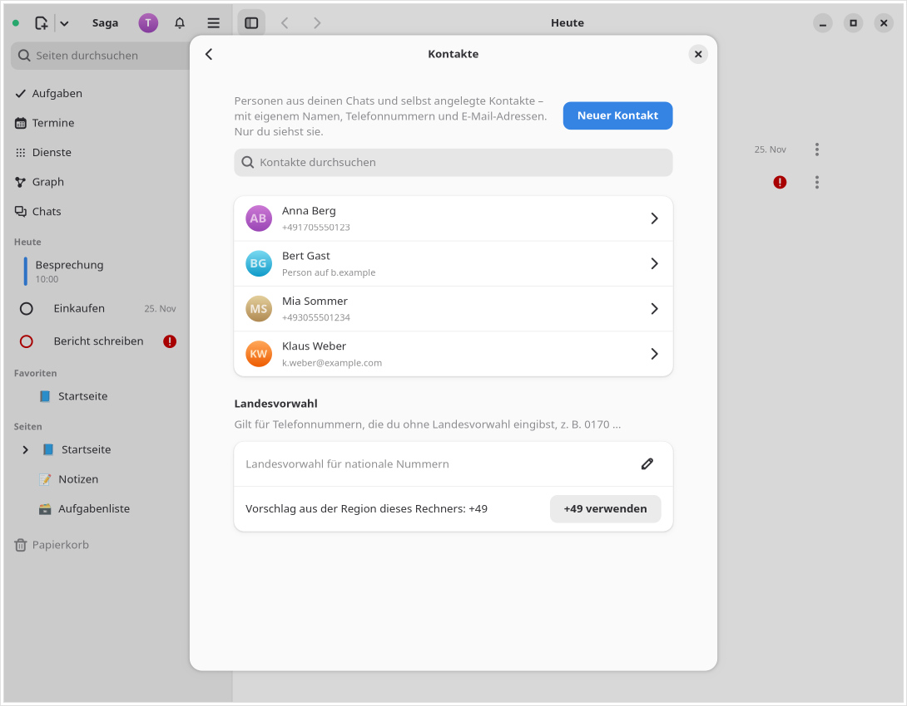

# B20 Kontakte – dein Adressbuch

**Gilt für:** Web · Handy-Browser · iOS/iPadOS/Mac · Android · Linux (ab Saga 2.6)

[← B19 Hilfe](19-hilfe.md) · [Übersicht](../README.md)

---

## Das kannst du damit machen

- **Omas Festnetznummer griffbereit:** Ben trägt bei Oma Lena, mit der er ohnehin chattet, ihre Festnetznummer ein.
  Ein Klick darauf, und das Telefon wählt.
- **Die Hausarztpraxis ohne Saga:** Anna legt „Praxis Dr. Weber“ mit Telefonnummer und E-Mail-Adresse an – auch
  Menschen und Firmen ohne Saga-Konto gehören ins Adressbuch.
- **Eigene Spitznamen:** Clara nennt ihren Vater in ihrem Adressbuch „Papa“. In den Chats steht weiter „Ben Sommer“.
- **Du oder Sie?** Frieda vom Gartenverein merkt sich bei Paul „du“ und „Lieber Paul“, beim Bürgermeister „Sie“ und
  „Sehr geehrter Herr Krause“.

## Wofür ist das?

Das **Adressbuch** ist deine persönliche Liste der Menschen, mit denen du zu tun hast. Zu jedem Kontakt kannst du
Telefonnummern, E-Mail-Adressen, einen eigenen Namen und die Anrede festhalten.

Wichtig vorab:

- **Nur für dich.** Niemand sonst sieht dein Adressbuch – nicht die anderen in der Familie und nicht der Admin im
  Admin-Bereich. Es bleibt auf deinem eigenen Saga-Server und geht **nie** an andere Server. Die Person erfährt nicht,
  dass oder was du über sie eingetragen hast.
- **Füllt sich von selbst.** Jede Person, mit der du einen gemeinsamen Chat hast, steht automatisch darin – auch
  Personen auf anderen Saga-Servern.
- **Gibt keine Rechte.** Wer dir schreiben darf, entscheiden weiter die Chats und deine Chat-Einstellungen. Ein
  Eintrag im Adressbuch ändert daran nichts.

> **Nicht verwechseln:** Bei der [Föderation](11-foederation.md) gibt es den Schalter „Adressbuch mit dieser Instanz
> teilen“. Der regelt nur, ob Personen anderer Server euch über den Namen **finden**. Mit deinem persönlichen
> Adressbuch hat er nichts zu tun.

---

## Schritt für Schritt

### 1. Das Adressbuch öffnen

1. Klick unten links auf deinen Namen (das Benutzermenü) und dann auf **⚙ Einstellungen**.
2. Wähl links unter **Arbeitsbereich** den Eintrag **Kontakte**.

Was du hier siehst:

- die **Suche** – sie findet Namen, E-Mail-Adressen und ab drei Ziffern auch Telefonnummern (`0170 123` findet
  `+49 170 123…`),
- **Neuer Kontakt** – für Menschen ohne Saga (Abschnitt 4),
- die **Liste**, die zuletzt genutzten zuerst. Unter dem Namen steht die Saga-Adresse (bei Personen aus Chats) bzw.
  die erste Nummer oder E-Mail-Adresse,
- die **Landesvorwahl** (Abschnitt 5).

### 2. Was von selbst ins Adressbuch kommt

Sobald du mit jemandem einen gemeinsamen Chat hast – einen Direkt-Chat oder eine freie Gruppe –, legt Saga für diese
Person einen Kontakt an. Bei einer **Nachrichtenanfrage** geschieht das erst, wenn sie angenommen ist.

Ein solcher Kontakt hat eine **Saga-Adresse**: die feste Kennung der Person im Chat, zum Beispiel `~jclyq3v52cj4gndq`.
Sie stammt aus dem gemeinsamen Chat und lässt sich weder ändern noch einzeln löschen. Selbst eintragen kannst du eine
Saga-Adresse nicht – so kann niemand über das Adressbuch herausfinden, wer auf dem Server ein Konto hat.

Klick auf einen Kontakt, um ihn zu öffnen:

- **Nachricht** öffnet den Chat mit der Person (auch wenn sie auf einem anderen Server ist).
- Ein Klick auf die **Nummer** öffnet die Telefon-App deines Geräts, ein Klick auf die **E-Mail-Adresse** dein
  Mailprogramm.

### 3. Einen Kontakt bearbeiten

1. Öffne den Kontakt und klick auf **Bearbeiten**.
2. Ändere, was du möchtest, und klick auf **Speichern**.

Die Felder:

- **Name für mich** – dein eigener Name für den Kontakt, zum Beispiel „Oma“ oder „Benni“. Er steht **nur in deinem
  Adressbuch**. In Chats siehst du (wie alle anderen) weiter den Namen, den die Person selbst gewählt hat.
- **Anrede** – „du“, „Sie“ oder nichts (—).
- **Grußform** – zum Beispiel „Liebe Anna“ oder „Sehr geehrter Herr Krause“.

  Anrede und Grußform sind eine Merkhilfe für dich. Saga trägt sie nie selbst ein und rät sie auch nicht aus Chats.
- **Telefonnummern** und **E-Mail-Adressen** – mit **+ Nummer** bzw. **+ E-Mail-Adresse** kommt eine Zeile dazu, mit
  **×** fällt eine weg. Rechts wählst du die Art: **Mobil**, **Privat**, **Arbeit** oder **Sonstige**. Je Kontakt gehen
  bis zu 10 Nummern und 10 Adressen.

Steht eine Nummer oder Adresse schon bei einem anderen deiner Kontakte, sagt Saga Bescheid und bietet **Zum Kontakt**
an. Hat jemand den Kontakt inzwischen auf einem anderen Gerät geändert, lädt Saga den neuen Stand; deine Eingaben
bleiben stehen, damit du sie prüfen und erneut speichern kannst.

### 4. Einen neuen Kontakt anlegen

Für Menschen und Firmen ohne Saga – die Hausarztpraxis, den Handwerker, die Schule:

1. Klick in der Liste auf **Neuer Kontakt**.
2. Gib einen **Namen** ein (Pflicht).
3. Trag mindestens eine **Telefonnummer** oder **E-Mail-Adresse** ein.
4. Wenn du magst: Anrede und Grußform.
5. Klick auf **Anlegen**.

In der Liste steht unter selbst angelegten Kontakten die erste Nummer oder Adresse, in der Ansicht des Kontakts
„Selbst angelegt“. Je Konto gehen bis zu 2000 selbst angelegte Kontakte.

### 5. Telefonnummern und die Landesvorwahl

Saga speichert jede Nummer im internationalen Format, kurz **E.164**: ein Pluszeichen, die **Landesvorwahl** (49 für
Deutschland, 43 für Österreich, 41 für die Schweiz) und dann die Nummer ohne die Null vorn. Aus `0170 1234567` wird so
`+49 1701234567`.

- Leerzeichen, Striche, Schrägstriche und Klammern darfst du mittippen – Saga lässt sie weg.
- Tippst du eine Nummer **mit einer Null vorn**, setzt Saga die Landesvorwahl davor, die unten in der Liste unter
  **Landesvorwahl** steht. Trag sie dort einmal ein und klick auf **Speichern** – sie gilt für dein Konto auf allen
  Geräten. Ist noch keine eingetragen, schlägt Saga eine aus der Region deines Geräts vor („Vorschlag: +49
  übernehmen“).
- Ohne Landesvorwahl – und bei Nummern ohne Null vorn, etwa aus Spanien oder Nordamerika – gibst du die Nummer
  einfach mit `+` ein, zum Beispiel `+34 612 345 678`.

### 6. Aus den Chats heraus

Auch im Chat kommst du zum Adressbuch: Klick in der Chatliste auf **+ Neu** (oder in einer Gruppe auf **Mitglied
hinzufügen**) und dann neben einer Person auf **⋯**.

- **Kontakt bearbeiten …** öffnet den Kontakt direkt im Adressbuch.
- **Aus Kontakten entfernen** – siehe nächster Abschnitt.

### 7. „Aus Kontakten entfernen“ oder „Kontakt löschen“?

Die beiden klingen ähnlich, machen aber Verschiedenes:

| | **Aus Kontakten entfernen** (Menü ⋯ im Chat) | **Kontakt löschen** (im Adressbuch) |
|---|---|---|
| Chat-Vorschläge | Person verschwindet daraus | Person verschwindet daraus |
| Adressbuch | Ein leerer Kontakt verschwindet; einer mit Nummern, Adressen, Anrede oder „Name für mich“ **bleibt** | Der ganze Kontakt samt Nummern und Adressen ist weg |
| Bestehende Chats | bleiben | bleiben |

**Kontakt löschen** fragt vorher nach. Schreibt ihr euch später wieder in einem neuen gemeinsamen Chat, legt Saga
wieder einen **leeren** Kontakt an – deine früheren Angaben kommen dabei nicht zurück.

---

## Beispiel aus dem Alltag

**Anna legt die Hausarztpraxis an und merkt sich Omas Festnetz.**

1. Anna öffnet **⚙ Einstellungen → Kontakte**. Ganz unten steht bei **Landesvorwahl** noch nichts; sie klickt auf
   „Vorschlag: +49 übernehmen“.
2. Sie klickt auf **Neuer Kontakt**, schreibt „Praxis Dr. Weber“ als Namen und bei Telefonnummer `030 1234567` mit der
   Art **Arbeit**. Dazu die E-Mail-Adresse der Praxis. **Anlegen** – Saga speichert die Nummer als `+49 301234567`.
3. Oma Lena steht schon im Adressbuch, weil Anna mit ihr chattet. Anna öffnet sie, klickt auf **Bearbeiten**, trägt
   bei **Name für mich** „Oma“ ein und bei Telefonnummer Omas Festnetznummer mit der Art **Privat**. **Speichern**.
4. In der Liste steht jetzt „Oma“. Im Familienchat heißt Oma weiter „Lena Sommer“ – so, wie sie sich selbst genannt hat.
5. Will Anna Oma anrufen, öffnet sie den Kontakt und klickt auf die Nummer. Für einen Saga-Anruf oder eine Nachricht
   nimmt sie **Nachricht**.

Weder Oma noch Ben noch der Admin sehen, was Anna eingetragen hat.

---

## Tipps

- **Suchen statt blättern:** Die Suche findet auch Teile der Nummer – praktisch, wenn du nur die letzten Ziffern
  weißt (ab drei Ziffern).
- **Einmal Landesvorwahl, immer richtig:** Mit eingestellter Landesvorwahl kannst du Nummern so eintippen, wie du sie
  gewohnt bist (`0170 …`).
- **Live auf allen Geräten:** Änderst du einen Kontakt am Laptop, sehen deine anderen offenen Geräte das sofort.
- **Im Backup:** Dein Adressbuch ist Teil von **Mein Backup** ([B19](19-hilfe.md)). Beim Einspielen holst du es mit
  **Chat-Kontakte übernehmen** zurück – zweimal einspielen legt nichts doppelt an.

---

## Häufige Fragen

**Sieht die Person, dass ich sie eingetragen habe?**
Nein. Das Adressbuch verlässt deinen Server nie, und die Person bekommt keine Nachricht davon.

**Kann der Admin mein Adressbuch sehen?**
Nicht im Admin-Bereich. Ende-zu-Ende-verschlüsselt wie die Chats ist das Adressbuch aber nicht: Wer den Server
betreibt, könnte es – wie deine Seiten – direkt in der Datenbank lesen.

**Warum kann ich bei einem Kontakt die Saga-Adresse nicht ändern?**
Sie gehört zu einem gemeinsamen Chat und ist die feste Kennung der Person. So stimmt sie immer.

**Ich habe „Name für mich“ eingetragen, aber im Chat steht der alte Name.**
Das ist so gewollt: „Name für mich“ gilt nur im Adressbuch. In Chats steht der Name, den die Person selbst gewählt hat.

**Saga sagt „Für nationale Nummern bitte die Landesvorwahl einstellen oder die Nummer mit + beginnen.“**
Die Nummer beginnt mit einer Null, aber es ist noch keine Landesvorwahl eingestellt. Trag sie unten in der Liste ein
(Abschnitt 5) oder gib die Nummer mit `+` ein.

**Was passiert, wenn jemand sein Konto löscht?**
Ein leerer Kontakt verschwindet mit. Hast du Nummern, Adressen oder eine Anrede eingetragen, bleibt der Kontakt als
selbst angelegter Kontakt erhalten – nur ohne Saga-Adresse. Dasselbe gilt, wenn der Admin einen verbundenen Server
entfernt.

**Kann ich meine Kontakte ins Adressbuch meines Handys übernehmen?**
Noch nicht – das kommt in einem späteren Schritt. Anrufe ins Telefonnetz über Saga sind für Saga 3.0 geplant.

---

## Auf dem Handy und in den Apps

**Handy-Browser**

Im Handy-Browser öffnen die Einstellungen als ganze Seite; die Kontakte sehen aus wie am Computer, nur schmaler.

**iPhone, iPad und Mac**

- Einstellungen (Zahnrad oben links) → **Kontakte**. Mit **+** legst du einen neuen Kontakt an, die Suche steht unten.
- Im Kontakt: **Nachricht** für den Chat, ein Tipp auf die Nummer ruft an, ein Tipp auf die Adresse öffnet Mail.
- Unter der Liste steht die **Landesvorwahl** mit dem Vorschlag aus der Region des Geräts.
- In „Neue Unterhaltung“ und in der Gruppeninfo: lange auf eine Person drücken → **Kontakt bearbeiten …**.
- Die Mac-App zeigt die Web-Oberfläche deines Servers – dort ist alles wie im Web oben.

**Android**

- Einstellungen → **Daten & Dienste** → **Kontakte**. Oben steht die Landesvorwahl, darunter die Liste und **Neuer
  Kontakt**.
- Im Kontakt: **Nachricht**, Stift zum **Bearbeiten**, im Menü **⋮** auch **Kontakt löschen**. Ein Tipp auf die Nummer
  öffnet die Telefon-App mit der Nummer – gewählt wird erst, wenn du es dort bestätigst.
- In „Neue Unterhaltung“ und in der Gruppeninfo: Menü **⋮** bei einer Person → **Kontakt bearbeiten …**.

**Linux**

- Einstellungen → **Kontakte**. Rechts oben **Neuer Kontakt**, darunter Suche, Liste und
  Landesvorwahl.
- Im Kontakt: **Nachricht**, Knöpfe zum Anrufen bzw. Mailen und zum Kopieren; **Bearbeiten** oben rechts.
- In „Neue Unterhaltung“ und in der Gruppeninfo: Knopf **⋯** oder Rechtsklick bei einer Person → **Kontakt bearbeiten …**.

**Ältere Apps und Server:** Das Adressbuch gibt es ab Saga 2.6 – auf dem Server und in den Apps. Ältere Apps zeigen
weiter nur die Kontakte im Chat („Aus Kontakten entfernen“); deine Einträge bleiben trotzdem erhalten.

---

[← B19 Hilfe](19-hilfe.md) · [Übersicht](../README.md)
